# 风向标拆解第3期：一个Notion模板如何做到年入百万美金？拆解Thomas Frank的资料整理变现全案
作者：龙哥

今天拆的这个案例，是目前全球最会赚钱的Notion博主 Thomas Frank。他的玩法堪称出海知识变现的教科书，一鱼多吃，把资料整理生意做成了完整的商业生态。模板销售只是入口，后面还串联了YouTube、课程、分销、广告和工具站。如果你想学海外的知识付费，这套路子非常值得抄作业。

注：下面拆解主要基于创作者本人的创业自述，信息更第一手，也能更清楚看到他是如何把一个文档工具做到年入七位数。

# 1. 他的变现版图有多大

Thomas Frank 在2022年的收入结构已经非常多元化了：

团队整体收入：
• Notion模板：100万美元
• Youtube收入：15.3万美元
• Skillshare课程：10.2万美元
• Notion分销：8.8万美元
• 广告赞助：6.7万美元
• Notion Coach服务：4k美元
• 电子书：2k美元

总营收：141.6万美元

团队支出：
• 员工：45.2万美元
• 交易费用：6.8万美元
• 办公室租金：4.8万美元
• SaaS费用：3.3万美元
• 团建：1.9 万美元
• 其他支出：18.1 万美元

总支出：80.1万美元

总利润：61.5万美元

2022年一年，他个人从这套体系里拿到的净利润就是61.5万美元。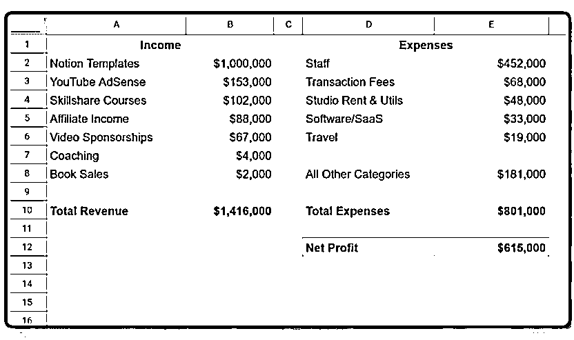

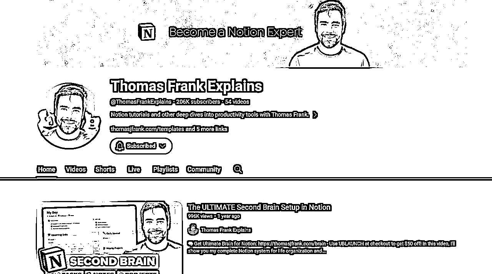

更夸张的是，他靠卖两款Notion模板，仅仅两年时间就拿到了210万美元的销售额。现在模板的月均稳定在12万美元左右，其他副业收入每月还有约1.5万美元，来自联盟营销和YouTube AdSense。

# 2. 产品线和人设定位

人设很清晰：运营一家公司，教人用Notion，同时卖Notion模板。还运营着一个290万订阅的个人品牌YouTube频道，核心是生产力和学习方法。

代表作：
* 旗舰产品 Ultimate Brain，把Notion打造成一套完整的个人生产力系统，涵盖任务、笔记、项目和目标追踪。
* 初代产品 Creator’s Companion，面向内容创作者，在Notion里一站式规划和制作所有社媒内容。
* 在研工具：Flylighter，一个网页剪藏工具，让Notion用户能一键抓取网页高亮、注释、语音笔记等。

# 3. 从学生博主到模板商人的成长线

起点可以追溯到2008年金融危机的余波。Thomas在2010年上大学时就开始创业，大一就沉迷生产力博客。因为申请给HackCollege写稿被拒，他索性自己建站 College Info Geek。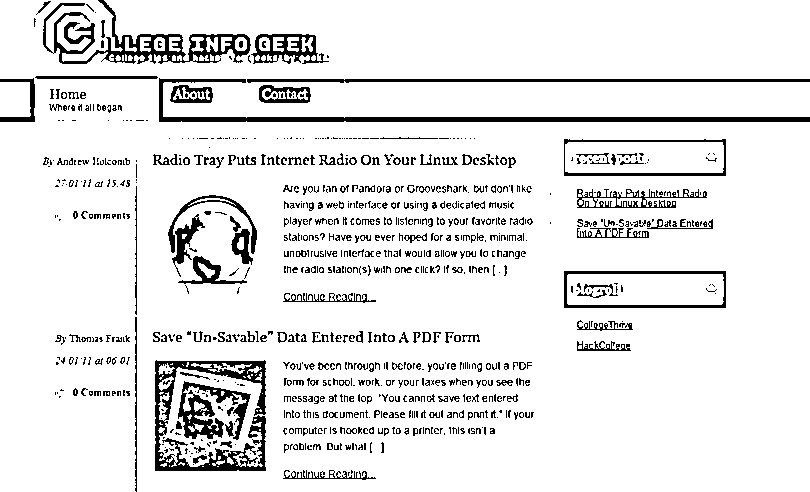

2012年博客开始赚钱，他all in做播客。2014年底进军YouTube，做学生向的高质量学习和生产力内容。2015年破10万粉，2018年初破100万粉。早期主要靠在Reddit的r/getstudy板块发视频摘要引流。

这波媒体势能直接为后来的模板销售提供了巨大流量池。

从2017年到2022年，他几乎每周都在主频道更新，几乎每条都接赞助，月收入曾稳定在5万美元左右，主要靠品牌视频合作。

转折点是团队自己需要更强的工作系统。他开始用Notion做Wiki，后来用来管理视频制作，还自建了一套内容规划系统，用来捕捉点子、写脚本、排拍摄和编辑日历。

为了寻找第二曲线，他本想做Notion课程，后来发现自己手上已经有一个现成的产品：那套内部规划系统。于是直接把它打磨成付费模板 Creator’s Companion，并在2021年底上线。2022年又推出了爆款 Ultimate Brain。

他几乎没做市场调研，就上线了。只是在免费模板页面放了个购买链接，没有任何额外营销。首月卖出112份，收入12,858美元。到2021年底累计卖出367份，收入49,019美元。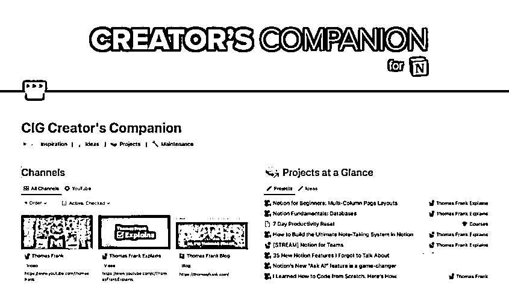

Ultimate Brain的思路是把笔记、任务、项目、目标整合进一个模板，让用户能在Notion里规划生活。它面向的是更广泛的大众用户，而非只做创作者。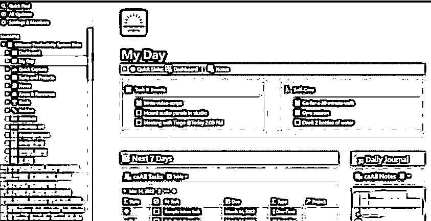

# 4. 发行打法：简单粗暴但极有效率

### Creator’s Companion 上线

2021年8月前，他纠结了很久支付、网站、营销工具，最后决定用最简单的 Gumroad。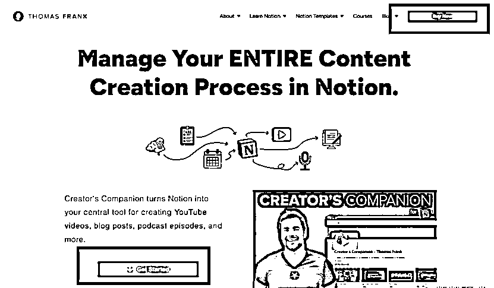

分发体系是：
* 模板本身是公开的 Notion 页面，可复制
* 客户链接通过 Circle 发放，同时在 Circle 里做教程和社群支持
* 买家同步加入 ConvertKit 邮件自动化
* 网站用 WordPress + Elementor 做销售页，按钮直接跳 Gumroad 支付

因为担心200万订阅的粉丝一波涌入导致产品出 bug，他先偷偷建了一个等待名单，只放了434人内测。结果第一个月就卖了12,858美元。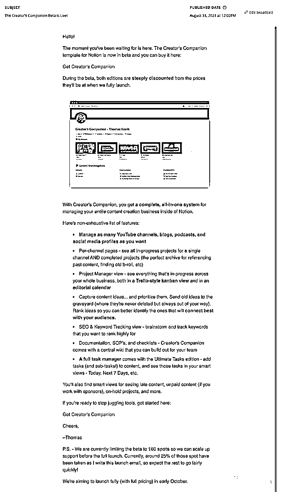

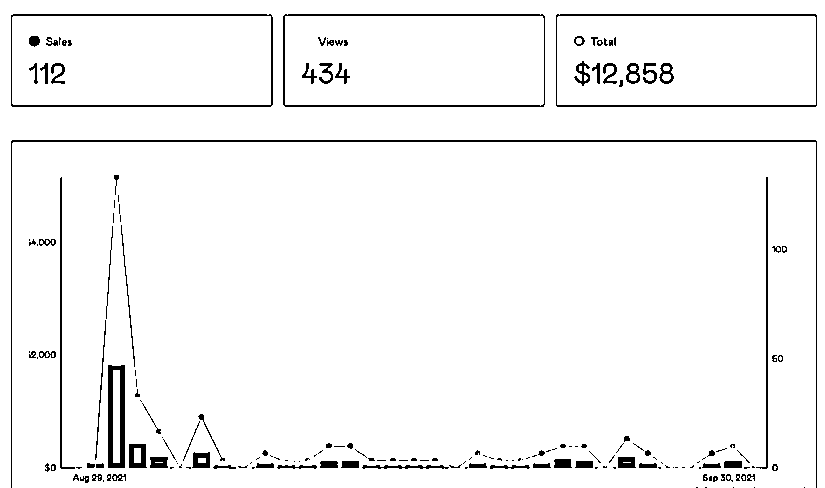

### Ultimate Brain 上线

有了前车之鉴，这次更快更猛。2022年4月5日，直接向3,201人发售，邮件打开率81%，点击率60%。首月销售额88,241美元。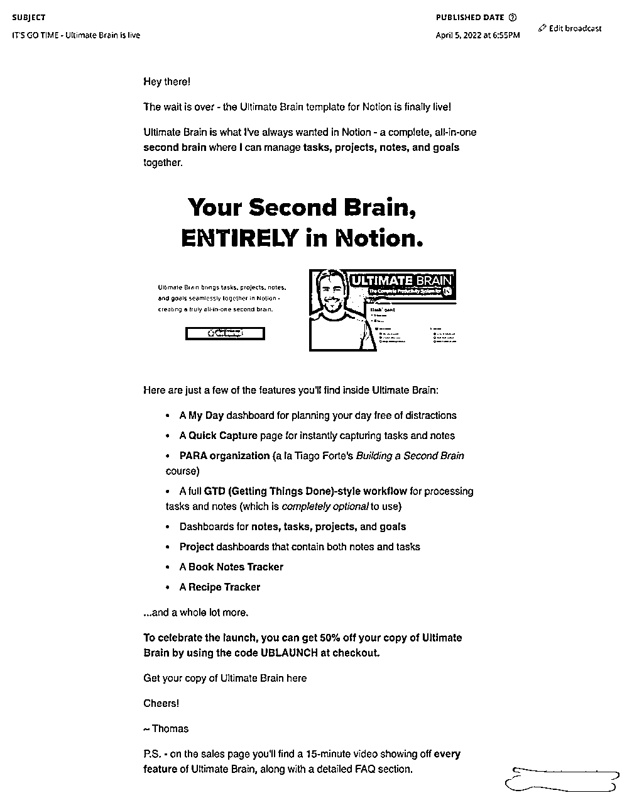

一个月后，他把邮件推给完整的 Notion Tips 列表，35,000人。这波又贡献了66,830美元的销售额。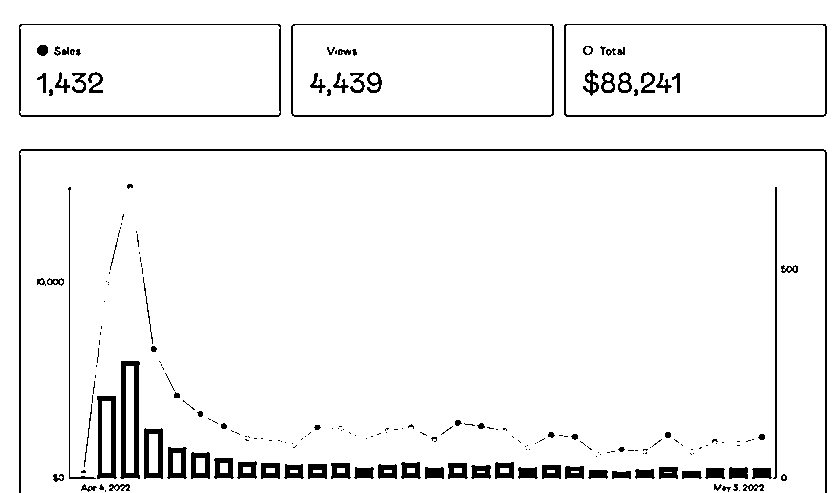

# 5. 客户为什么买单又能留存

核心增长引擎始终是YouTube。他开了第二个频道 Thomas Frank Explains，100%专注教 Notion，使用场景从基础页面到API高级功能全覆盖，甚至有一个2小时免费的API课程。

频道主要靠YouTube算法自然推流增长，主站几乎没怎么宣传。这个细分定位非常准，让他成了搜索学习Notion的首选入口。

在推出 Ultimate Brain 两月后，他做了个45分钟的深度产品演示视频，每个功能逐一讲解。灵感来自 More Plates More Dates 的80分钟产品广告。视频最终成了频道播放冠军，近100万观看，带来1.2万新增订阅，AdSense收入6.6万美元。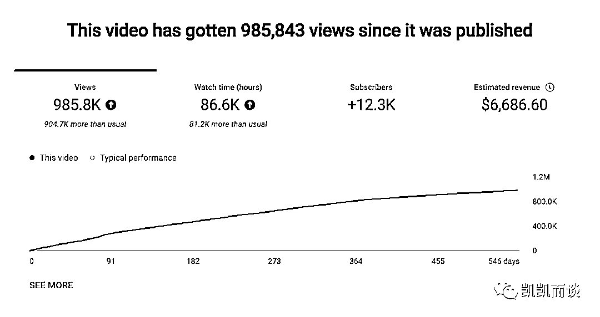

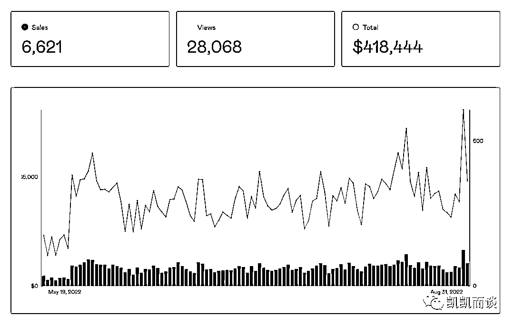

视频上线后，日销售额从2,500美元直接涨到5,000美元并稳定维持。

除了硬广，他用两条软引导做持续获客：
1. Notion基础课：免费视频+文章合集，注册时送小抄
2. 免费模板：每个建站教程都配免费模板，领取后进邮件池，第二天就推付费模板

内容矩阵还包括：从零构建指南、Notion新功能解读、初学者概念课、清单类视频、偶尔的无代码教程。

他也在做SEO，团队写长文指南，比如一篇4.5万字的Notion公式技术文档。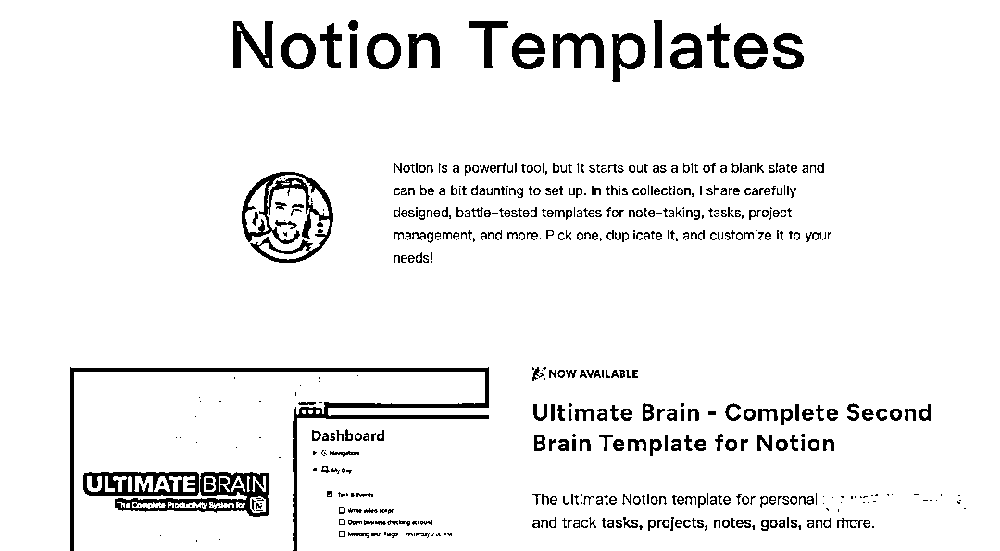

# 结论

从Thomas Frank的案例能看出，海外资料整理的变现远不止卖模板这一件事。模板、视频、课程、分销、广告、工具站，环环相扣，构建出非常健康的现金流。

核心逻辑是：先用免费内容建立信任和流量池，再用高完成度的资料产品实现变现，最后用工具和服务做复购和溢价。

如果你手上有专业知识，这套一鱼多吃的打法完全可以复刻。尤其是出海市场，付费意愿更强，资料整理类产品的天花板远比想象中高。国内也可以参考这套方法论做改良。