# 巴西TikTok半闭环内测开启，是机会还是深坑？这份调研报告讲透了
作者：龙哥

最近，TikTok巴西市场的半闭环招商已经悄悄启动，目前采取邀请制内测，已经有一些玩家拿到邀请码并开始测试。

所谓半闭环，就是商家通过Shopify等第三方建站工具的插件，把独立站与TikTok绑定起来。用户刷到视频后，点击购物车或主页橱窗，就能跳转到独立站下单。

先看市场大盘。巴西是拉丁美洲规模最大的经济体，电商近年的增长几乎可以用“爆炸式”来形容。移动互联网的普及加上社交媒体影响力上升，让TikTok这类平台变成了品牌与消费者之间的重要桥梁。巴西超过70%的网民都靠手机上网，年轻人占比又高，天然愿意尝鲜，这就给电商发展提供了非常合适的土壤。

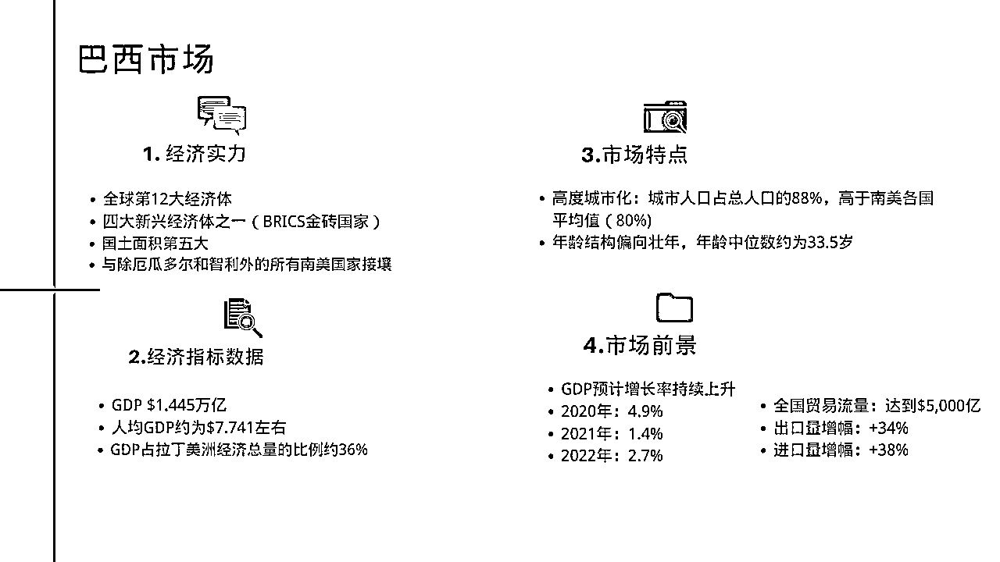

再看用户盘子。Statista的数据显示，TikTok在巴西社交媒体用户中的份额已达到50%，用户量在巴西能排进前五。

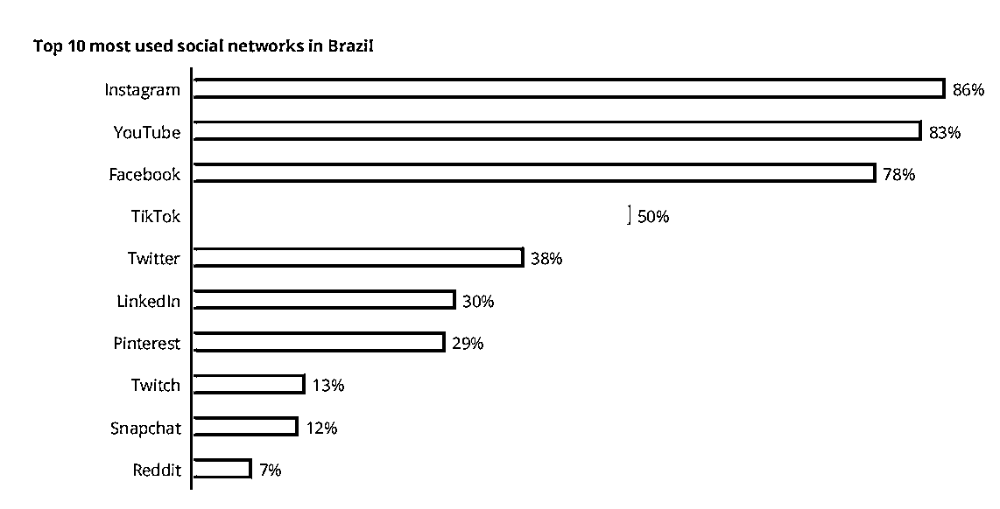

pipiads的观察也显示，截至2024年2月，全球TikTok广告受众排名中，美国以1.58亿列第一，印尼以1.4亿排第二，巴西以1亿受众位列第三；而且巴西环比1月新增了180万广告受众。

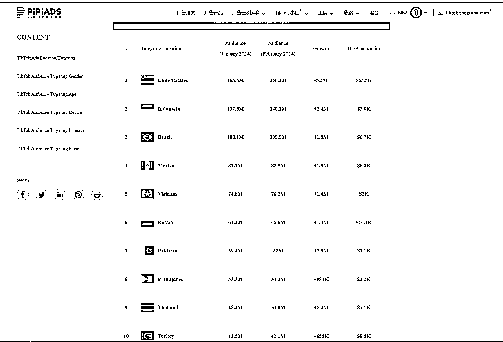

用户行为层面，巴西TikTok用户活跃度和参与度都很高，他们喜欢探索新产品、看品牌故事、接触创意营销内容。最吸引他们的类目集中在时尚与美容、健康与健身、家居与园艺。商家如果能顺着这些偏好调整产品与推广策略，定位会精准很多。

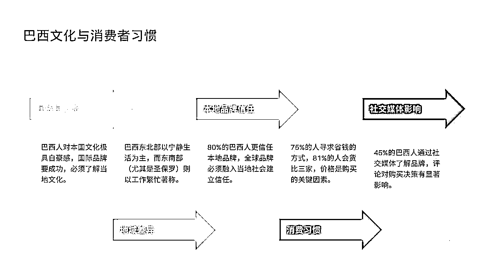

选品方向上，巴西市场有三大类需求尤其旺盛：第一是时尚与美容，当地人对个人形象很看重，服装、饰品、化妆品都好卖；第二是健康与健身，健康意识抬头之后，营养补剂、有机食品、健身器材持续走热；第三是家居与园艺，居家时间变长，让家居软装、局部改造、园艺用品都迎来增长。

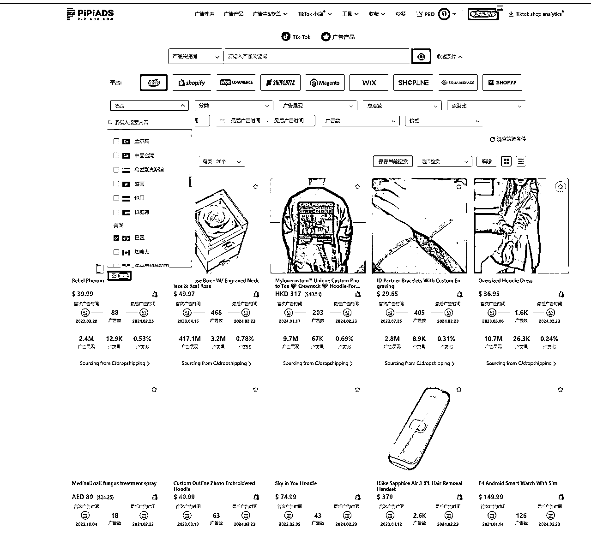

想摸清巴西市场，调研工具得用好。Google Trends既能追踪搜索趋势，也能反映消费者兴趣变化。

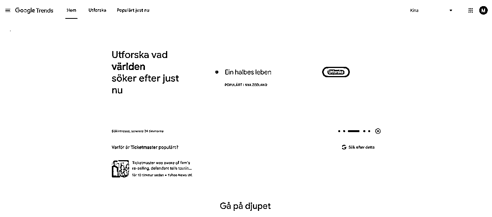

pipiads可以帮助观察广告投放、流量来源和用户行为。

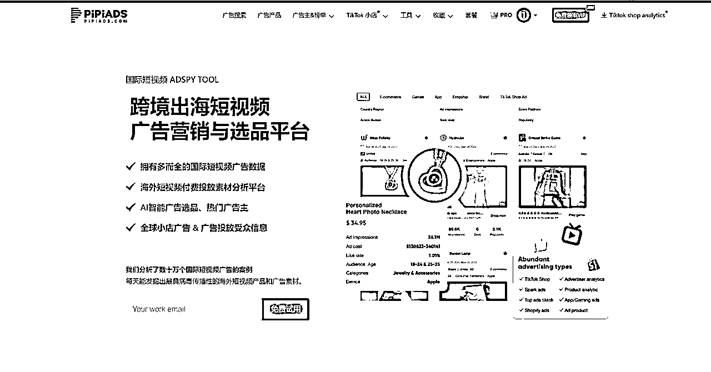

另外，多逛巴西本地的电商平台，也能挖到一些信息差。

再说说主流电商平台。除TikTok这种社交电商外，巴西还有几个重要平台值得关注。Mercado Livre是拉美最大的在线市场，类目覆盖非常广。

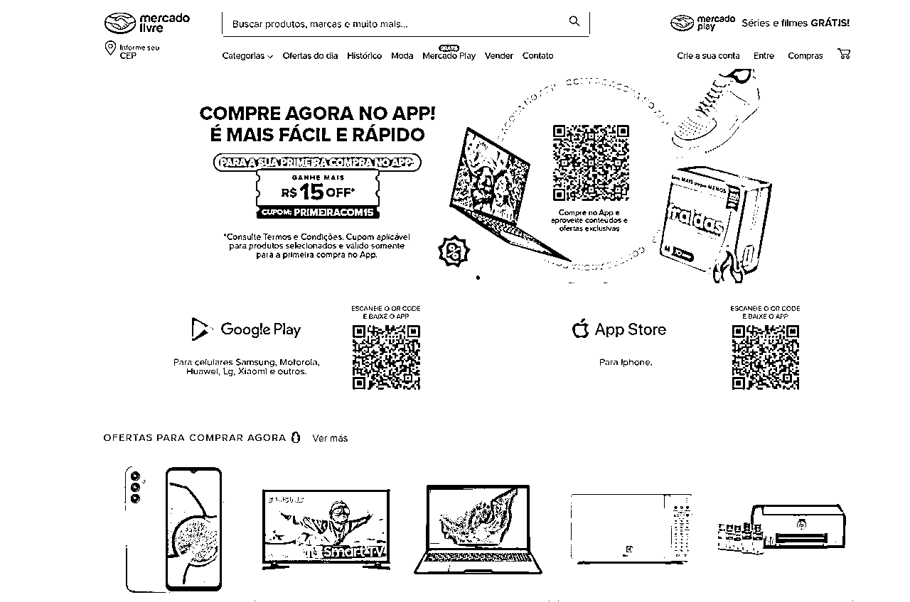

Americanas和Magazine Luiza主打电子产品、家居用品。

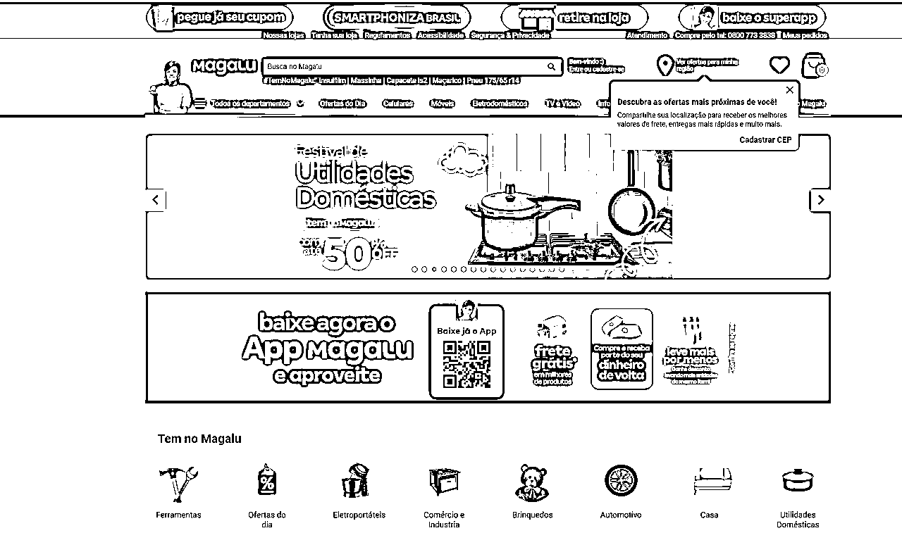

OLX则覆盖多个类目的二手交易。

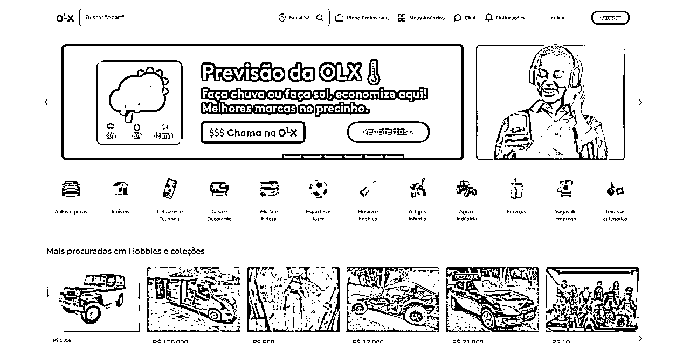

营销节点上，要重点留意当地节日、体育赛事、文化活动，以及重要的经济日期。

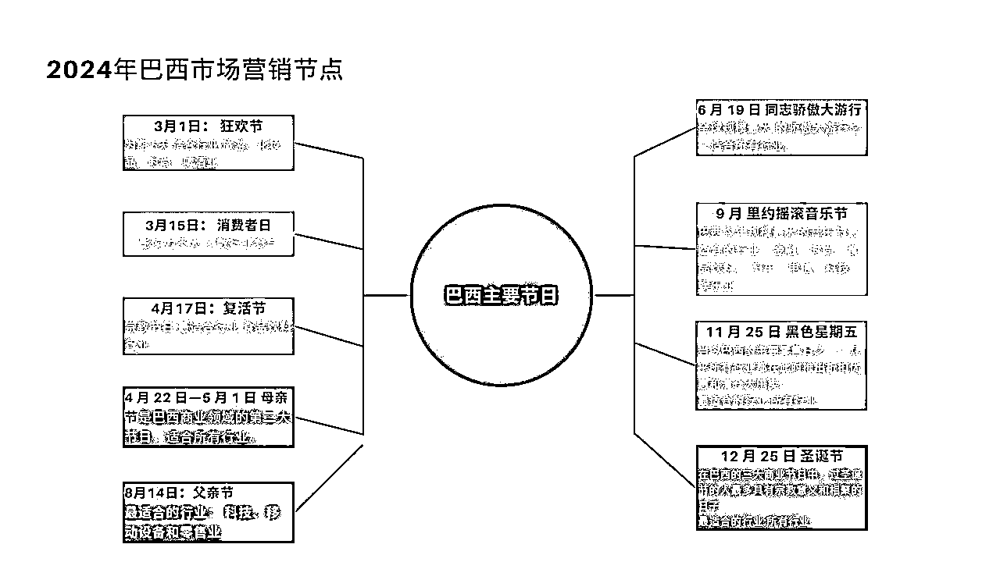

挑战和解决方案也不少。

物流清关是绕不开的痛点。巴西物流成本高、配送周期长，清关难度大，退货率高、丢件率高也让卖家头疼。破局思路可以是自建仓或与本地仓合作，优化物流网络。有调研显示，安骏物流早在几年前就建好了巴西跨境小包直邮专线，专门承接国内电商轻小件。在此之前，中国发货到巴西要等30到90天；专线上线后，巴西主要城市80%的货量能压到9到14天，中西部地区大约14到25天。

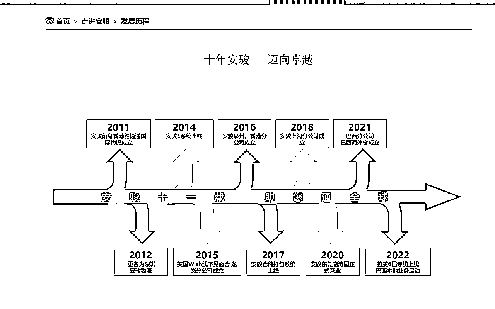

支付方面，巴西消费者习惯多元化支付，尤其喜欢按月分期，所以很多本地网站都会同时标出全价和分期价。除了信用卡和银行转账，当地还有BoletoBancário——通过打印付款单进行线下支付，以及DébitoOnline——直接从银行账户在线扣款。Pix也特别火，这是巴西央行推出的即时支付工具，用动态二维码或代码就能完成付款，操作简单、0手续费、即时到账，已经有70%的成年巴西人用过，体验和国内的支付宝/🛰️支付很像。

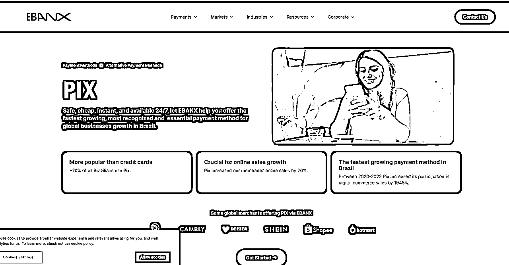

解决方案就是尽可能接全本地主流支付方式，给消费者灵活的选择。

文化差异怎么处理？参考美国小店爆发的过程，巴西电商后续的带货主力大概率还是本地达人内容。找当地达人合作，正是迈出第一步的关键突破口。

法律税务这块也要重视起来。巴西进口税收政策复杂，联邦国税局从2022年起密集发文：2022年12月21日发布RFB 2124/2022号规范性文件，要求跨境包裹规范申报，给了6个月过渡期，2023年7月1日正式生效；2023年6月29日又发布RFB 2146/2023号文件，规定从2023年8月1日起对入境包裹统一征收17%的ICMS进口流转税；同年7月25日再发布DOU 130/2023号操作文件，把PRC合规缴税计划的申报与缴税方式讲清楚。由于操作性文件距离新政生效时间太近，实际执行时口岸给出了缓冲期，同时鼓励各电商平台尽早完成PRC备案注册、拿到编号。

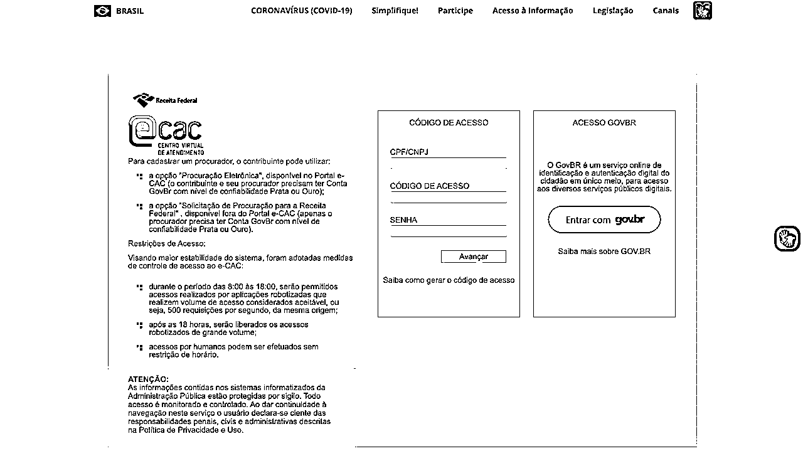

合规的办法是聘请当地法律顾问，确保经营动作不出格。

再看潜在机会。巴西网购人群覆盖各个年龄层，平均年龄在36到50岁之间，女性买家占比达58.9%。

具体案例也很直观。

护发素这个品，投放广告做到了2.4亿展现，售价12美元，预估拿货成本不到5美元。

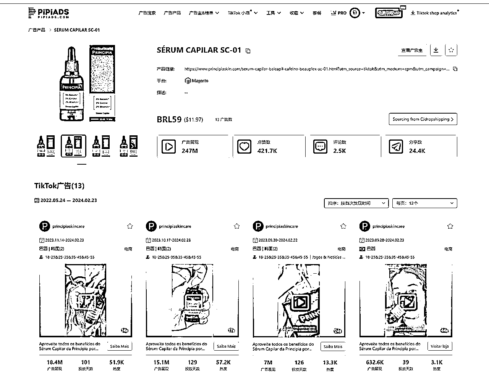

产品链接：https://www.pipiads.com/zh/product-search/63983bac5602e34654467b24/

1800万播放的广告素材，核心是达人真人露脸讲解+场景化刺激；网站设计极简，用产品图+描述+YouTube红人背书。

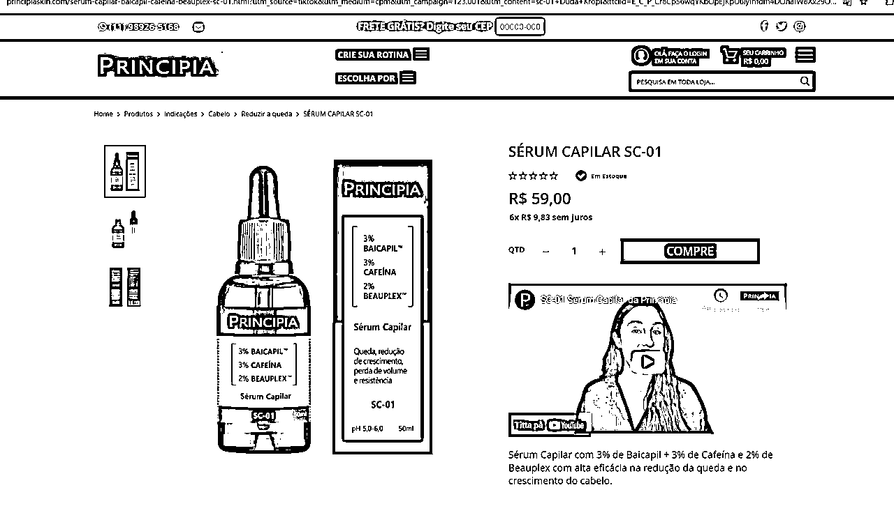

纯色男士短袖，从2022年投放至今，广告展现1.1亿，累计126条广告。

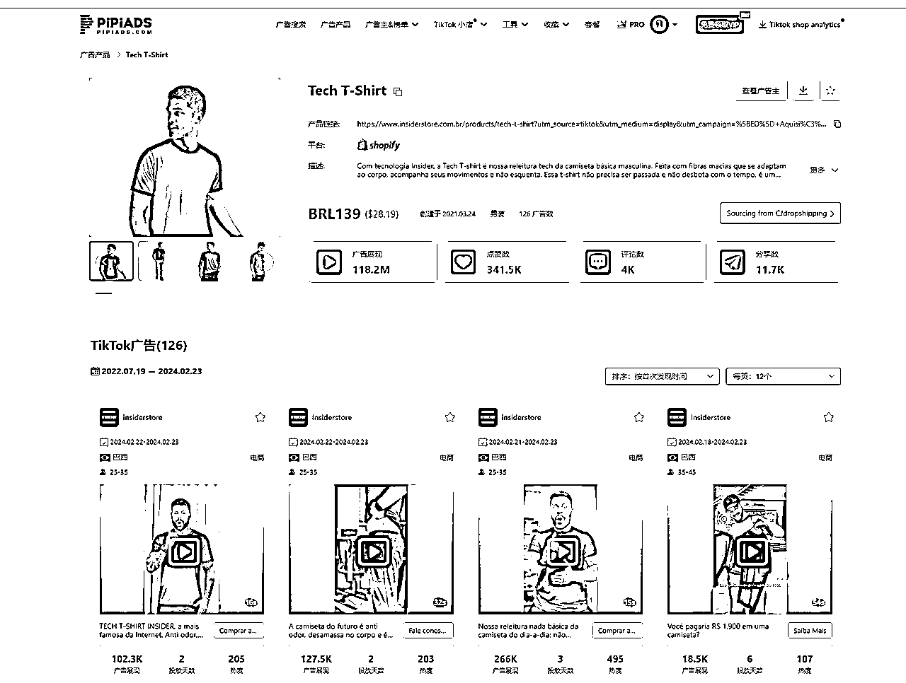

产品链接：https://www.pipiads.com/zh/product-search/63078d3eaccc4615a5247375/

1100万播放的素材走的是本土达人真人出镜讲解+场景代入，一共138个SKU，卖了三年。

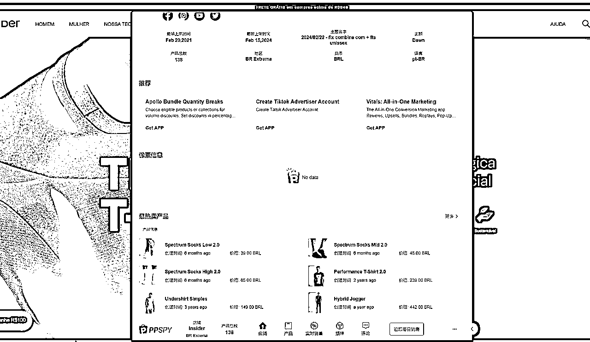

蓝牙耳机，1688拿货价9.6元，当地售价BRL168（约34美元），广告展现4100万。

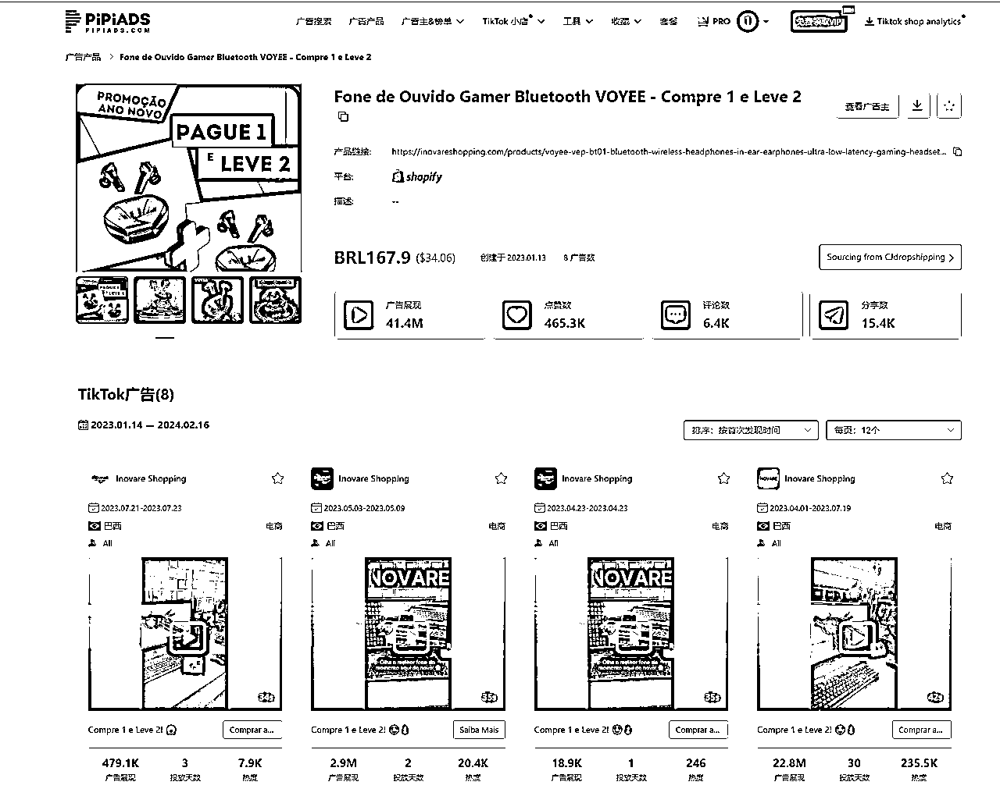

560万播放量的素材打法，是展示痛点、种草、给方案、做实物演示。

狗便盆，广告展现4800万，广告数21条。

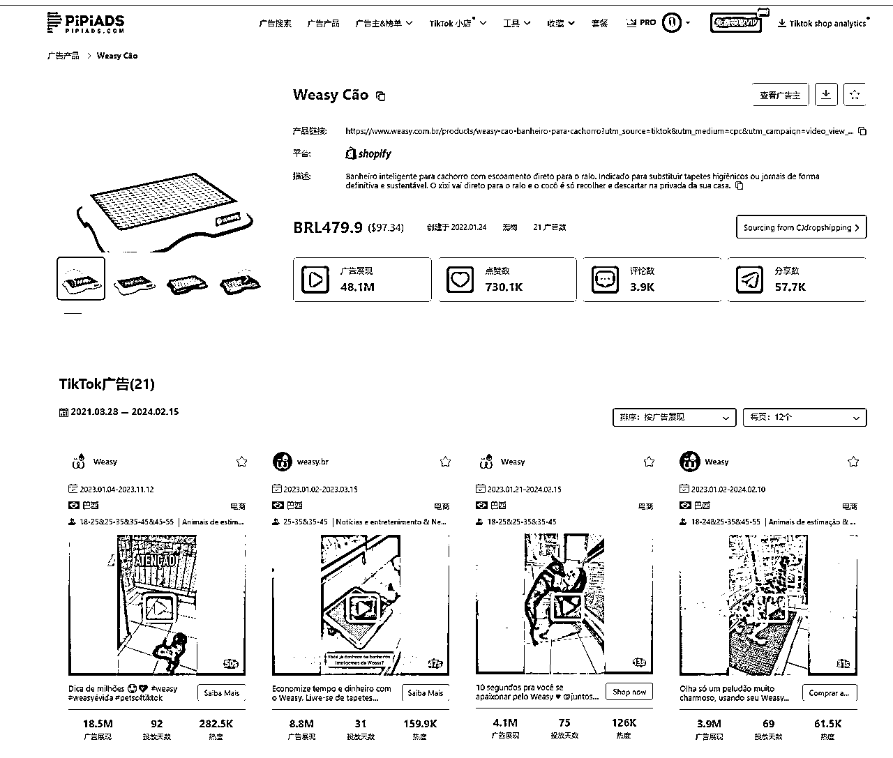

1850万播放的素材，核心是痛点场景切入+给出解决方案。

卷发器，广告展现2600万，广告数131条，利润空间大但竞争也激烈。

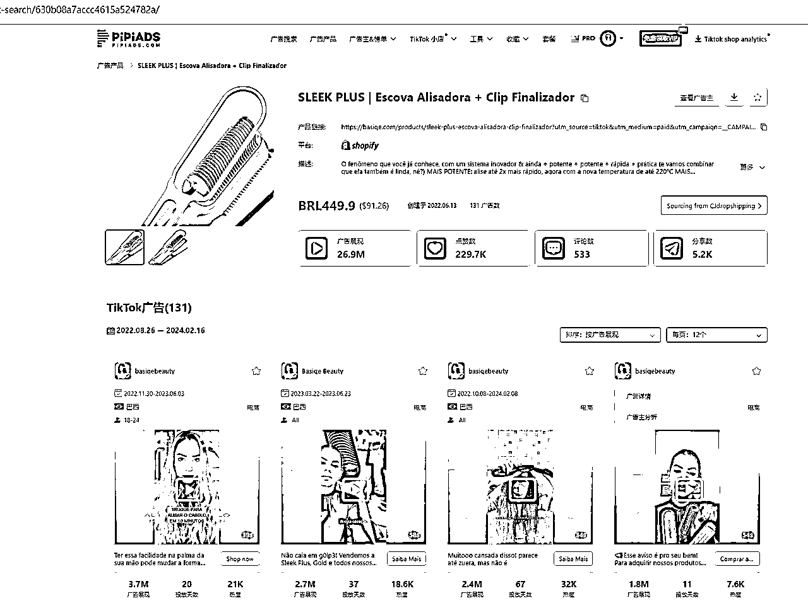

370万播放的素材，突出利他、达人露脸、前后对比。

总结来看，巴西市场的电商潜力确实很大，所有人都在盯着这个机会。但皮皮也提醒，TikTok这次半闭环内测，未必是一进场就能捡钱的生意。独立站不是巴西市场的主流，也很难成为平台未来的重点方向。卖家要面对本土化布局难题，支付、税、语言、消费习惯都要重新适应。巴西市场不妨让子弹飞一会儿，全闭环真正上线还需要时间。2024年的重心，依然可以放在美国市场。更多行业趋势，可以持续关注PiPiADS平台。