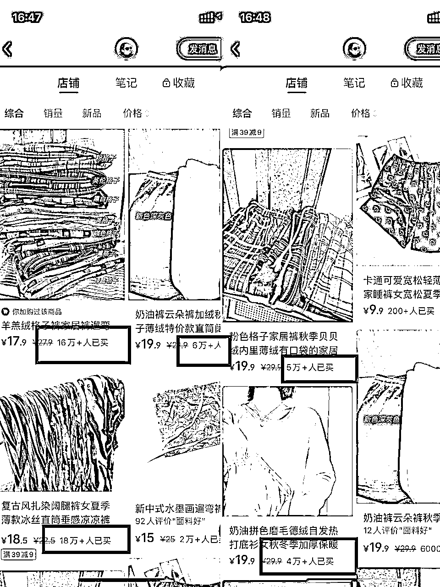
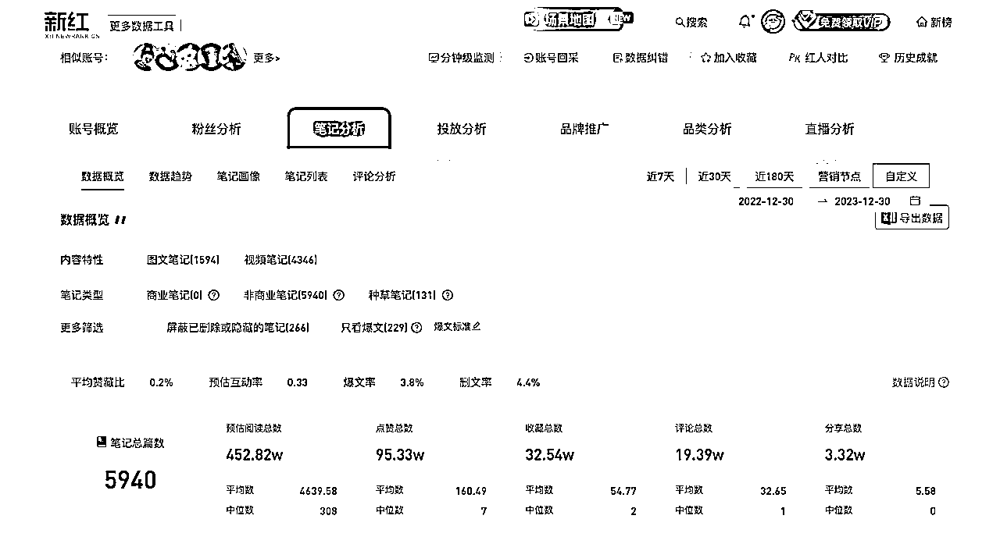
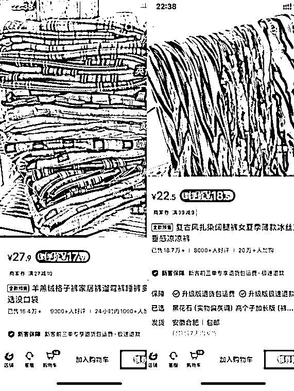
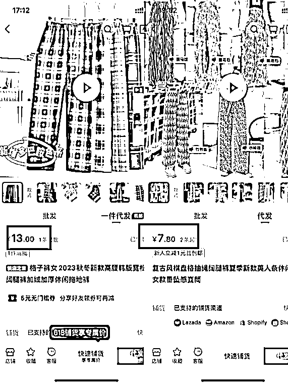

# 风向标拆解第 3 期--📕爆款，售卖件数50W+的店铺到底是怎么赚钱的--走れ！小鱼ちゃん

一个只有7.7万粉的📕店，凭什么卖出84.8万件？

最近拆到一家叫“一树的店”的店铺，数据有点意思：粉丝量不算高，只有7.7万；赞藏却有180多万；累计笔记6956条；店铺总销量直接冲到84.8万。更特别的是，店内上架50多款商品，其中40多款是家居裤。 这么垂直的选品，反而更容易打出爆款。

流量方面靠的是“视频轰炸”。这家店从2022年12月4日注册，到2024年2月3日，每天至少更新20多条笔记，视频内容占了差不多八成五。一年下来，爆款笔记出了229条，算下来每1.6天就有一条。 笔记铺得够密，“睡裤”加各种推荐词，搜索前20名基本都能碰到它。关键词覆盖得七七八八，SEO自然就做上去了。

赚钱的账也很好算。拿店内两款热销裤举例， 羊羔绒格子裤到手价17.9元，1688进价13元，单条利润4.9元；扎染阔腿裤到手价18.5元，进价7.8元，单条利润10.7元。两条一平均，单件毛利7.8元。拿货价对比了1688和拼多多，1688的价格更香。 按无货源模式跑，总共84.8万件销量，总利润算下来接近660万；哪怕有30%退货，净利仍能守住462万。

做这件事的门槛其实不高。前期主要精力放在做视频上，脚本简单，熟练工一个人就能扛住。等爆单了，再配专门的客服。先用无货源模式，等单量稳定后直接找厂家做系统对接，成本还能再砍一刀。

想放大也很容易：
视频可以同步发到抖音、快手、视频号，一鱼多吃；
用同一套打法多开产品线，做矩阵账号；
用RPA把重复性环节自动化，省下时间多管号；
把流程整理成SOP，再扩团队，边跑边调整，靠组织力冲规模。

说到底，这家店卖的不是高利润，而是极致垂直+海量铺量+搜索卡位的组合拳。单品赚几块钱，看似不起眼，但乘以84.8万，就是另一回事了。