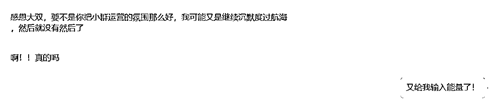
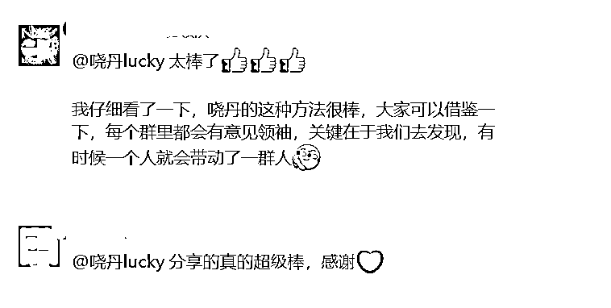
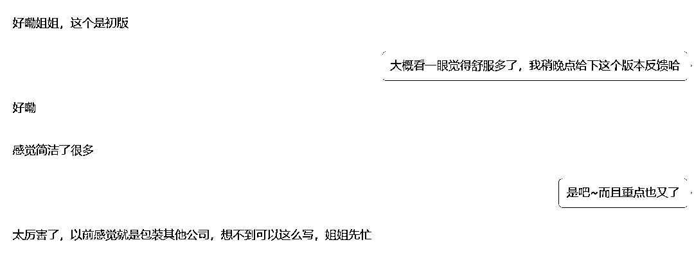
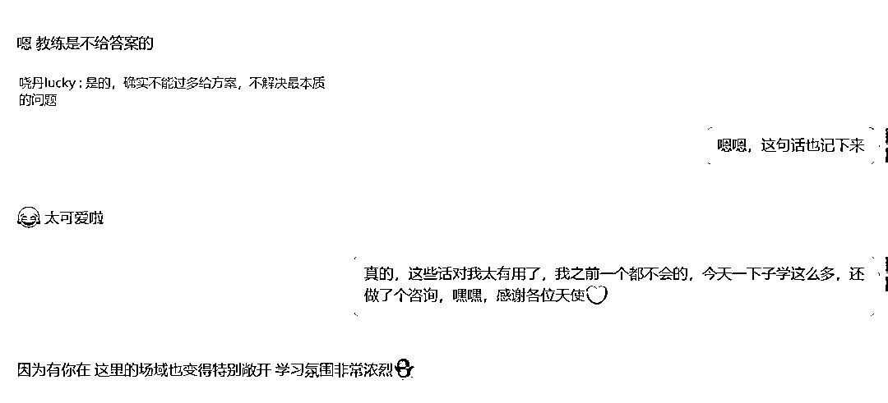
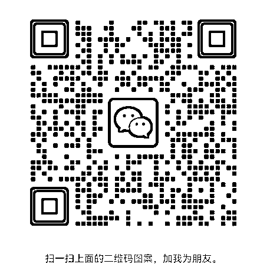

# 从运营经理到双线生长，我用21天航海把副业跑通了
作者：龙哥

00 先说前提

真正的跃迁没有捷径，把过往积累全盘否定就谈成长是自欺。我的特质本身就是价值。

自律其实是伪命题，清楚自己才能管好自己。过去到现在，我做的事都落在擅长区，这才有了一击即中的感觉。

# 01 互联网运营的老本行，被迫换个场子

我在某互联网公司做运营负责人，算下来干了四年半。

起初是写商业转化类文案，后来写顺了就带组带项目。撞上好时机，陆续接手社群、公号等项目，成为私域端的小负责人。

业务推进中，我亲手从零搭建过不少业务流程和体系，让团队运转更顺。

人多了之后，演讲能力被动打开，内部培训和业务分享多次拿到满分和最高分。

带出来几位靠谱的项目负责人和业务骨干，也沉淀了不少可复用的方法论。弯路、付出、心酸就不展开了。

按理说工作还能应付，为什么还要搞副业？

行业整体下行，业务方向频繁调整，招聘环境鱼龙混杂，越干越发现只靠埋头实干的天花板很低。

职场软实力对我来说是硬伤。业务内部卷却没产出，太较真容易让领导不快；直属上级对业务基本放养，反而被点赞。心里堵得慌。团队里成员想法各异，对业务敬畏心不足，我满怀期待他们的成长，反而招来误会。

存量够了，也有表达欲，就想换个地方试试。

# 02 先交结果：航海很值，副业也起来了

一开始想做个人号，觉得沟通表达还不错，和合伙人聊过一次后因距离成本太高放弃。

第二次尝试和赚钱圈的好友深聊，做了一版规划却没跟进。

4月加入赚钱，开启两次航海实操，顺带付费报了📕方向的规划。

第一次航海主题是朋友圈IP文案，21天全勤，个人排名冲进全场前十。

收获→把简历精修做成了第一个变现入口。

第二次航海是9月，这次我报名做志愿者。小队排名进前五，在领队名下所有志愿者里排第一，个人仍在前十。

收获→完成自我锚定：咨询师方向。正式上单2笔，合计360+，十一假期前已预约6笔。

这两件事让我在公司之外被看见，成就感和底气都回来了。

# 03 两个航海，半年拉扯的复盘

我的玩法很简单：每次最多报两个活动，死磕到底，每次作业都要有可见产出。

## 个人层面

航海日志被精选4次，成果日志被标好事4次，精选+好事合计5次。在400+人的大群里，我的日志被推荐6次。积分规则是打卡+10，被精选/好事再+10，同时达成+20，累计多拿180分。

航海前做了盖洛普优势测评，结果很惊喜，我的前排才干基本都在用了。

一个小尴尬是Top1是“洞察型”，当时觉得这有啥用，执行力在整体里还倒数，像个懒人。

后来我反而很爱这个才干，沟通、个体、关联、战略、伯乐这些靠前的特质在航海里都被激活了。写日志正好唤醒我的写作老本行，写着写着思维才干也跟上了。

目标清晰就不想混交差，每次动笔都逼自己复盘一次定位。副业到底要做成什么样，写着写着就清楚了。路不会白走。

## 志愿者层面

虽然带过社群运营项目，但做志愿者实操是第一次，我把个别、沟通、关联的特质用满了。社群起步期通过高频沟通识别出可能的意见领袖，并提炼群友技能标签，用关联促成互联。于是顺势开了优势觉察小群、影响力小群，甚至有两位群友已经开始合作变现。

节奏我会控。初期群里提醒大家打卡，后期出现倦怠就私聊跟进，避免大家把责任全丢给我。

我保持真诚点赞的习惯，被精选被推荐的日志，主动答疑的热心人，都会被我逐条引用。发言我尽量逐一回应，照顾感受、保持尊重。

社群活跃的本质是定位与价值感。我运营的通知群本身价值有限，关联度低更像个松散联盟。

但群里每个人都是资源，聊起来价值就有了。群内问答变活跃，大家互相鼓励，温暖的氛围自然留人。后来收到不少好评，也被领队邀请在小群里分享了两句，很开心。

具体打法底层就是用户运营，感兴趣可以私聊聊。

## 团队层面

好风水会让做事的人变多。这次航海最深的体感是，遇到一个好领队有多重要。全程跟进，大到方向小到细节都清晰明确，志愿者都很负责，船员士气也高。实名感谢领队闯天下。

# 04 从试水到明路，变现逐渐清晰

谈变现必须先说我的人设：利他倾向很强，选业要选善业，产品要有意义才愿意推。想赚钱还挑剔，大概就是我本人。

## 第一次试水

4月左右两个下属离职，去做了499的简历精修服务，发给我看的时候质量说实话一般。我顺手改了一版。

缘分就这么来了，两人很满意，还给我推荐了海报设计。

一周内海报就出来了，花200块买的一比一参考，形式不重要，简历我熟，这几年面过的没300也有200人。

变现很快发生，对方反馈不错，但我自己觉得不饱满，无非是帮对方梳理优势+换个包装。对方拿着简历面试不慌了，我的热情却耗尽了。

## 找到长线

我想做长期项目，不想靠流量买卖拼获客。此前一年半我在素食店熏陶心性成长，一直在找一份助人利己又能从心灵层面切实的事业，可能老天听见了。

航海让我明白认识自己有多关键。再看自己的优势才干，这不就是天生的咨询师。

公司里唠叨没人听，换个场子别人付费来听，是不是很爽。一周我试听了3-4个产品，刘津老师的课程和我学的心性成长理念高度契合，正好打在心坎。

我是营销型人格，目标一旦锁定，拖延感就消失，会一直冲下去。

0912下单课程，每天3-5节课，作业2-6份，开始焦虑。

0916觉察到焦虑情绪后主动沟通，节奏放缓。听懂比冲进度重要。温暖的小瞬间是，我在自我洞察过程中让好友给我反馈，反馈很暖，说我有能量、爱进步……信心回来了，更坚定要成长自己、照亮他人。

0918开始给身边人做测评和解读，被好友打赏88。隔天天赋咨询全课学完。

0920开始学财富关系课程，当天接了一个圈友咨询单，被打赏288，激动到不行。服务被认可，评价也很温暖。为了交付我准备了10页内容，还请教老师，决心把交付做到位。

过程中卡点是：不敢做朋友圈营销。教练对话后发现，困难被我想得太可怕而已，冲就完了。感谢教练闯天下，声音也好听。

0923开启朋友圈日更，至今十一的优势咨询已约满。财富关系课程在学中。幸福指UP咨询师像一种自我疗愈的职业，帮别人解决问题的同时常会解开自己的结。

所以前两天通勤时我随性有感【有幸择善业，照亮别人，照见自己】

怎么平衡主业？就8-9小时在岗，下班及周末学习拉满。

如果你也有兴趣，欢迎聊聊。

希望大家都能找到心流方向～

优秀新学员连麦分享实录

1、自我介绍

大家好，我是哓丹，太激动了。

几个标签：

北漂四年的农村女孩

会写商业文案的私域运营负责人

企业业务、管理分享培训师，多次拿到最高分、满分评价

面试过200+人的业务面试官

斜杠探索五个月孵化两个产品，盈利四位数的个体创业者

2、与刘津老师链接的经历

职场经历是关键。

前两年：风口期，冲起来。机会多，有晋升。没日没夜从骨干到小组长，成长是养料，涨薪不争，晋升也让给了伙伴。

第三年：风口下。机会多变动多内耗大。人员流失，负责人出走，上司团队架构频繁变，带15+人团队，挑战后成长不少。后来直属上级又离职，陷入困局。

第四年：乱。几年里优质人才流失，企业文化稀释。新来的直属上级堵住我上升通道，能力差、不作为、撒谎、敷衍、媚上、人品差，三观震动。不是努力认真踏实就能混得好，持续内耗一年。对上管理情绪尽量配合沟通，对下管理预期为伙伴成长负责，即便如此仍大批流失。职场并不公平，我一片热血白费。

外部机会看了几家，面试没问题，但问自己还想卷吗？还想勾心斗角、媚上竞争吗？答案是否定的。

转机是上级之上又来新上级，我主动沟通讲述卡点，要求我的直属上级少插手我的工作。此后状态稳定下来。

副业初探：时机对，人也对

副业探索衍生出第一个产品，我对副业也有点挑剔。

心灵成长一年半，坚定利他、认真。

昕酱引荐，一周对比学习，岑岑咨询，津姐对话。

听课感受很爽，7-8天看完两大节课程并完成记录打卡，治好了我的赚钱挑剔症。

3、学习过程的收获

第一阶段：猛冲不分昼夜

9天学完天赋课程。

第二阶段：放缓回归初心

有一天发现自己开始以看完课程为目标，疯狂听课记录打卡，学习乐趣全无，写作业也没感情了。赶紧和老师岑岑沟通，决定放缓脚步。

第三阶段：开始接单

第四阶段：调整平衡

短跑选手决定做长期主义。

4、咨询师个人IP的思考

单点突破，多点开花。

5、最后想说

执行要狠，心态要佛。