# ('风向标拆解第三期-小红书爆款，售卖件数59w+的店铺到底是怎么赚钱的-真z', (2, 39))

今天想扒一个特别有意思的生意：有人靠一款“裸感连裤袜”，在种草社区里卖出近八十万件，粗略一算利润接近两千万。听起来像吹牛，但数据就摆在那儿。

先看大盘。大多数商家在这个平台上的累计销量，基本停留在1万到20万件之间。能做到50万件以上的，已经是另一个量级的存在。而首饰、鞋包、美甲、家居、零食这些看起来很适合内容电商的类目，反而很难有店铺冲破30万件。

我盘了几家跑得特别凶的店：

云南格棠鲜切花的店，卖花，28.4万粉，卖出了51.6万件，粉丝转化率55%，靠直播和短视频两条线走量，内容发了一万七千多条；ehd旗舰店，做身体护理，22.9万粉拿下182.1万件，纯靠内容驱动，只有三千多条笔记；福东海旗舰店，做养生食品，13万粉卖出69.5万件，四百多条内容就撑起来了；XIAO詹原创工作室，主攻原创休闲服，32.1万粉做到71万件，粉丝转化率45.2%；还有卖裤装的一周无休的店，17.9万粉卖出94.1万件；运动服饰品牌MOLYVIVI，11.8万粉卖出64.5万件，也是直播加内容两手抓。

这几家里最值得研究的，是那家只卖“仿腿肤色袜”的店。它的粉丝量不算多，内容数量也少得惊人，但成交数据却把同行远远甩开。典型的小账号、大爆款，天生适合拿来当案例拆。

这家店的选品非常克制，只有“裸感连裤袜”这一个品类。账号在2023年10月21日前后开始运营，靠短视频冷启动，每天保持三条图文的更新频率，把商品挂载到页面左下角，全程没有开过直播。整个模式听起来就很轻：不用囤货、不用出镜直播、内容制作门槛也低。

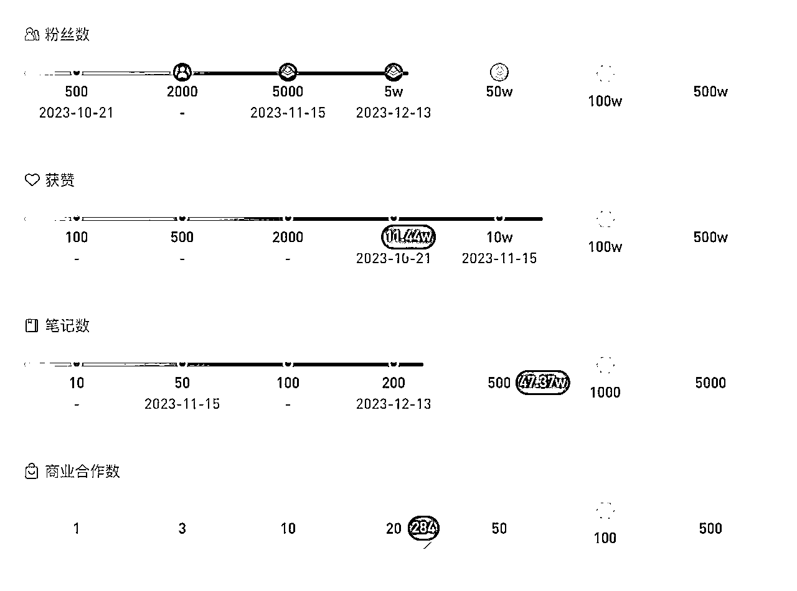

我之所以盯上它，原因有三：第一，它足够垂直，只做一个品类，不靠海量SKU堆成交；第二，它用短视频完成了从0到1的启动，连直播都没碰；第三，这个单品在平台上的成交记录已经超过75万件，相当恐怖。

流量是怎么来的？基本是自然流量。它那条起量的视频，标题大意是“三十多块就到手，效果也太绝了”，封面直接放无褶皱的实拍上腿图，特别抓人。单条视频攒下1500多个赞、750多个收藏、300多条评论。热度一起来，账号立刻换不同模特拍同款上身视频，把流量一波接一波接住，账号就这样被带起来了。

人设方面，它给自己贴的标签是“厂家直供”“接近批发价”“赠送退运险”，让用户感觉绕过了所有中间商。

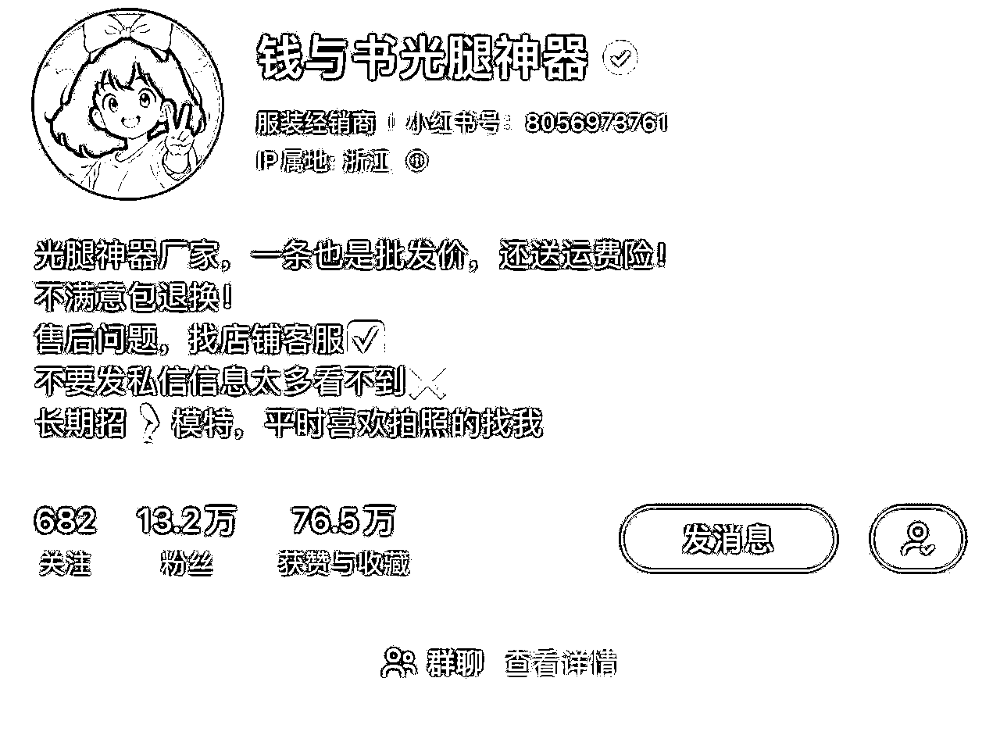

再看看同赛道选手。在站内搜同类产品，按成交量排序，前排几家的情况大概是：那家“书”字号店铺，粉丝13.2万，成交79.8万件，内容只有56条，累计赞藏76.5万，价格从39.9元到69.9元分四档；怀山叙集，6.3万粉，35.3万件成交，发了62条内容，赞藏72.2万，晚于前者约两周起步，价格39.9元起；黄小姐旗舰店，7.8万粉，30.7万件成交，内容多达1568条，赞藏却只有40.8万，2019年就入局了，客单价69元往上走；小晴学姐穿搭，粉丝七千出头，成交16.9万件，内容677条，赞藏19.7万，卖的是“尤然”这个牌子，价格在41.65元到67.15元之间。

一对比就看出门道了：那家“书”字号店铺内容最少，赞藏却最高，说明每一条内容的平均质量都相当能打。更妙的是，它起步一个月就有了好反响，怀山叙集随即开始照着它的路子做，也跟着吃到了红利。黄小姐是品牌店，定价偏高，能跑出来的图文爆款稀少；小晴学姐入局更早，但早期的短视频一直没水花，后期靠复刻成熟玩法才慢慢有起色。

那它到底怎么做内容？

封面是第一步。拉一个腿模，把薄绒、厚绒不同厚度直接上腿对比，再配一句扎心的痛点文案，比如“不皱、不假白、不勒裆”。整体风格完全不像广告，更像真实买家到手后的随手分享。一旦某条内容测出来了，就拿着同款标题反复拍，只是场景和模特不断换，每天稳定更新三条，持续吃流量。

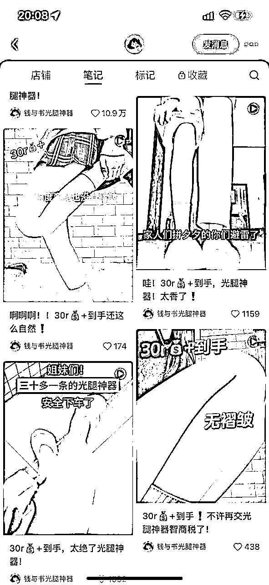

标题撰写也有自己的套路。

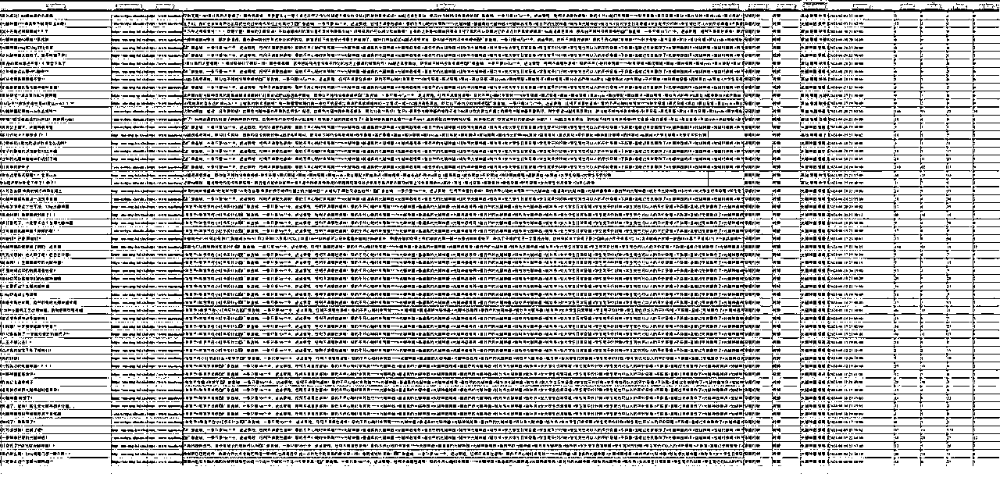

核心卖点词基本围绕用户最焦虑的几个点展开：价格便宜、表面无痕、颜色像真腿、一杯奶茶钱就能拿下、紧贴皮肤、送退运险、可退换、回弹力足、不勒裆、没有螺旋纹、不容易勾丝。

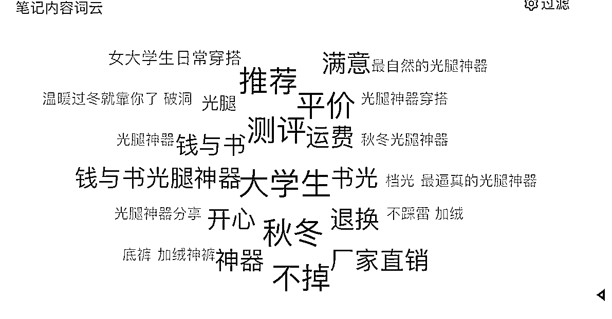

这些词被反复组合成标题，比如“无痕效果”“三十几块到手”“自然得像真腿”“pxx避雷”“中肤色与深肤色怎么选”“无痕背后的秘密”“不同厚度对比”等等，全是冲着点击率去的。

视频时长控制在30秒内。剧本方面，至少安排三组场景，在不同光线和环境下展示上身效果，再加近景特写，镜头里要有站立、下蹲、转圈、行走、屈膝这些动作。最狠的一点是模特不重样，每一条都换人，让用户觉得内容又多又真实。

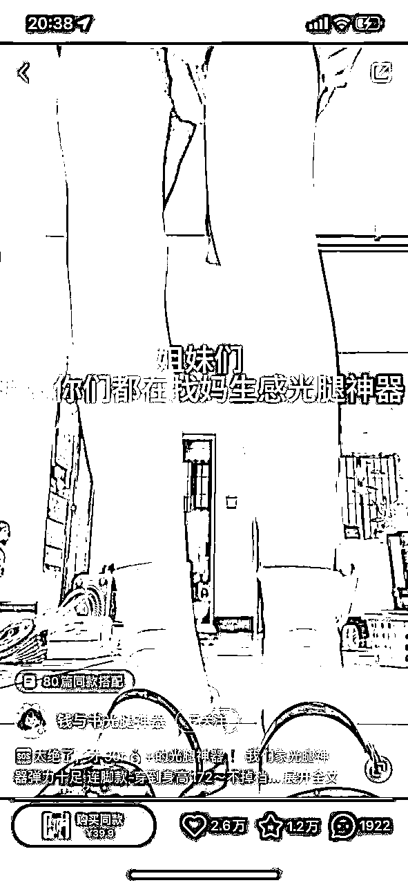

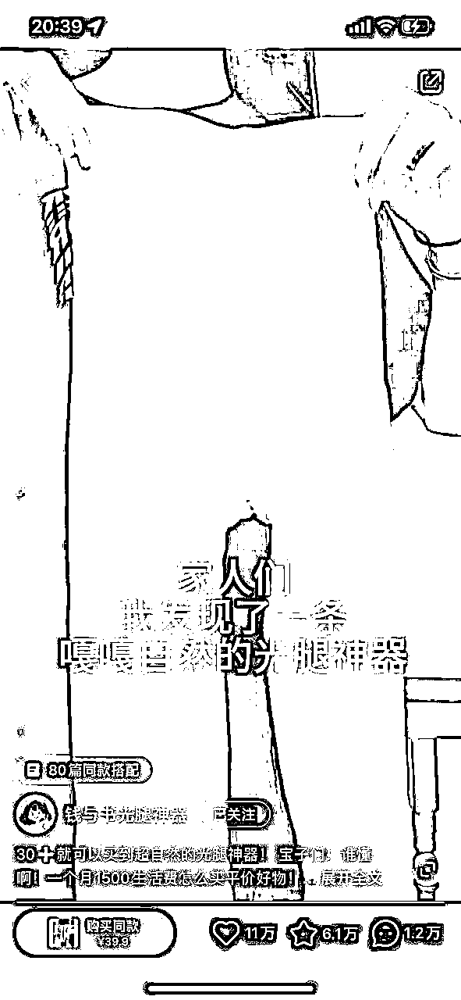

内容主题始终围绕“划算”展开：便宜、能退换、三十多块入手。本质上是在给用户提供两种价值——钱包上的满足感和决策上的安全感：你不用花大价钱，就能买到一条不假白、不褶皱、仿若真腿的连裤袜。

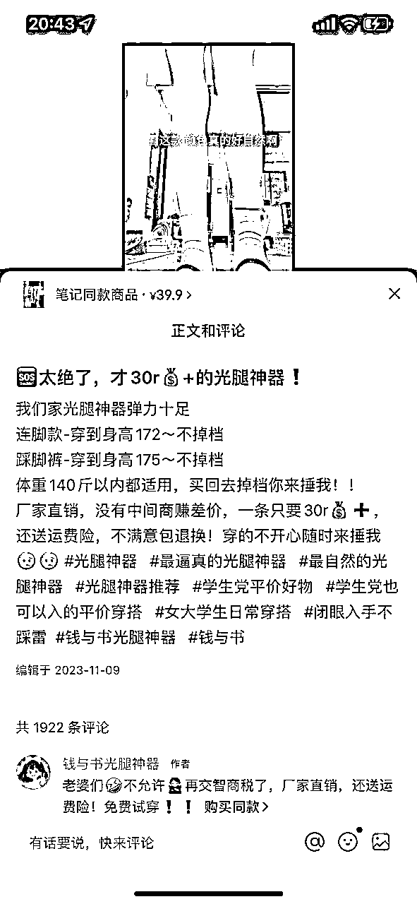

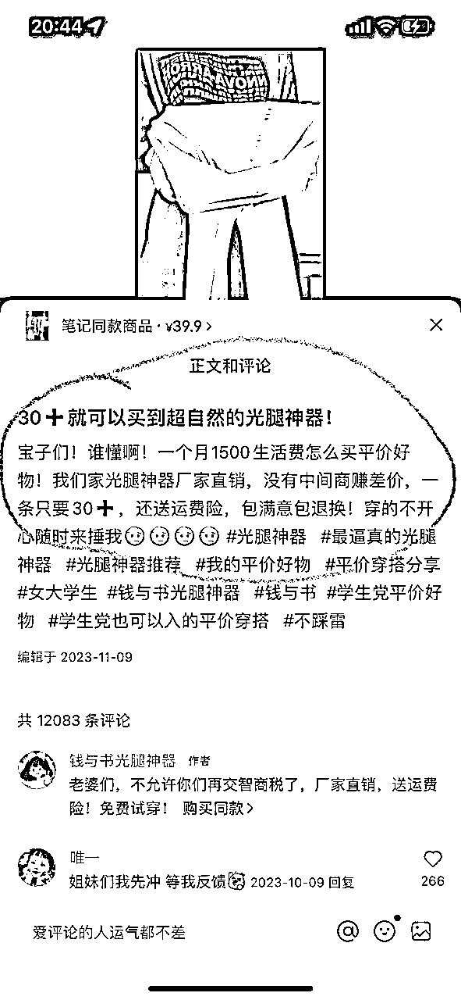

再对比同行的内容，就能更清楚它的优势。怀山叙集的拍摄手法和文案风格，已经高度接近那家“书”字号店铺，其中一条内容甚至拿到了13.9万赞。小晴学姐起初一直在模仿，后来才慢慢找到自己的方向。

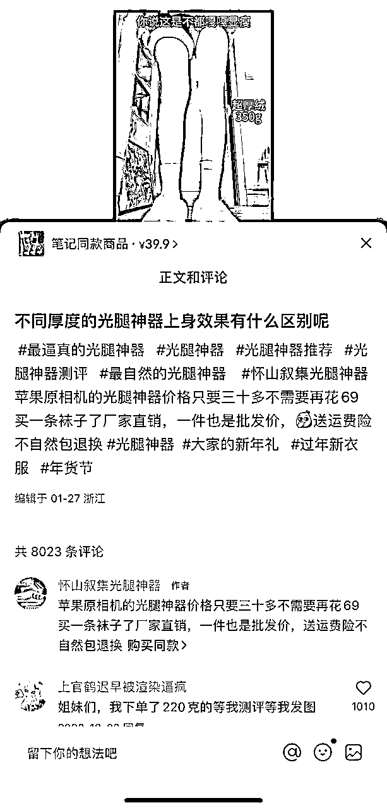

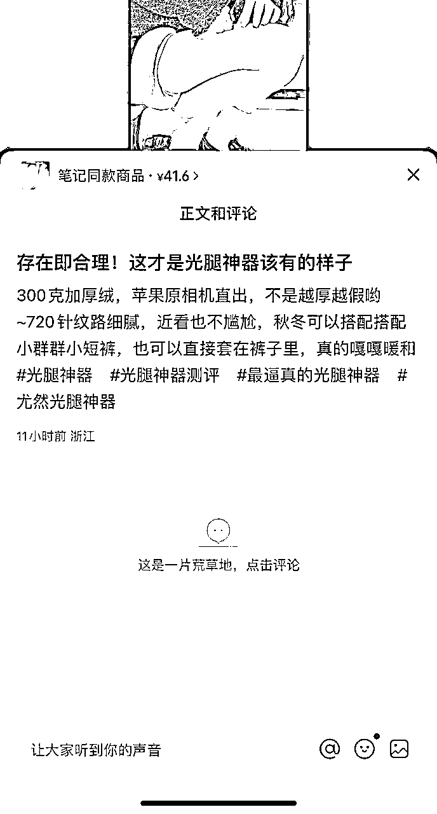

现在平台用户的消费观越来越务实，对“真实感”和“性价比”的敏感度极高。这家店很懂评论区运营：视频发出去后先在评论区自导自演把话题带起来，客服式的回复速度极快，还会给出专业的厚度和肤色选择建议。互动率上去了，系统自然会把内容推到更大的流量池里。

社群的日常运维也值得一提。

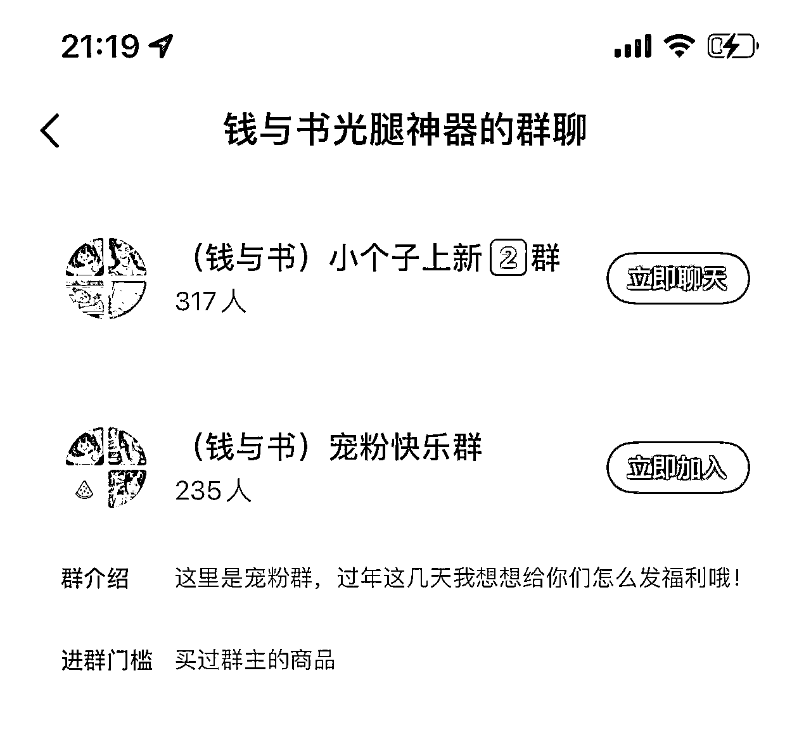

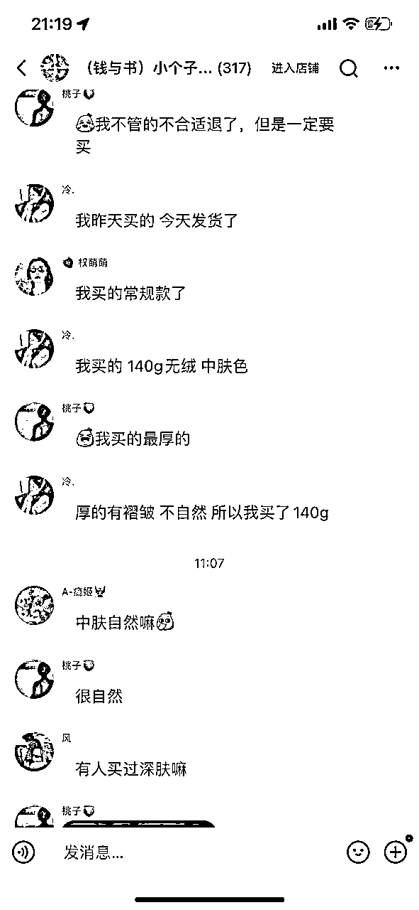

它在群里把用户粘性经营得很强，粉丝可以随时提需求，晒真实的反馈和试穿体验。令我意外的是，客服居然也是外包的，用的是金牌团队，按接待量计费。这家店每天的接待量超过1000人，24小时内就有4000人加购。外包客服的具体报价参考如下。

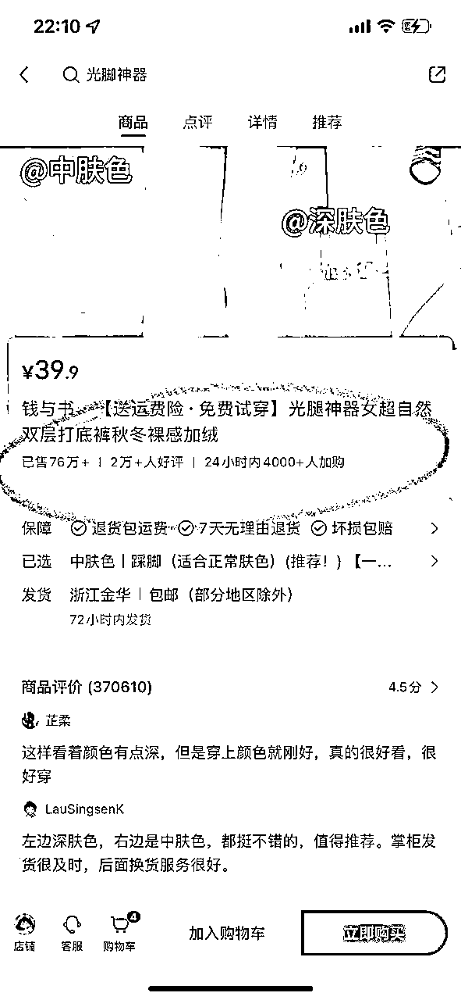

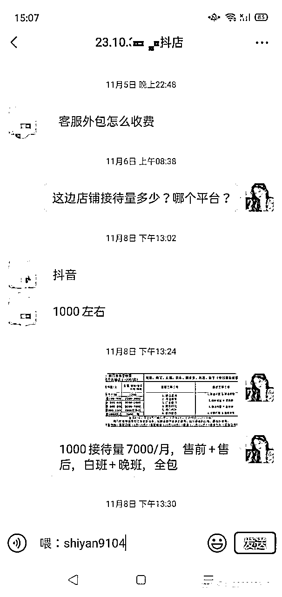

另外，它还对发布过的内容进行了分类整理，让不同需求的用户都能快速找到自己关心的信息，减少决策成本。

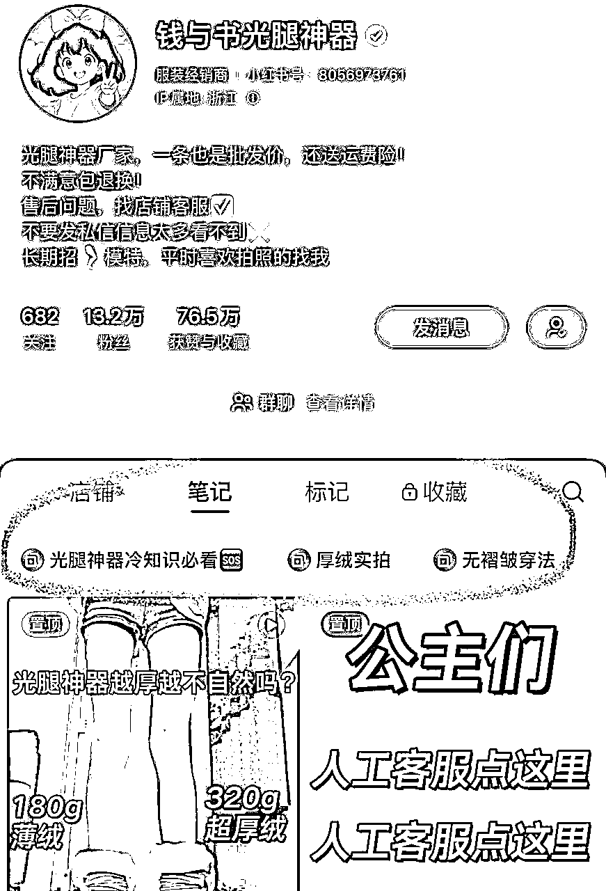

最后算算账。

1688上的采购成本截图贴在下面。

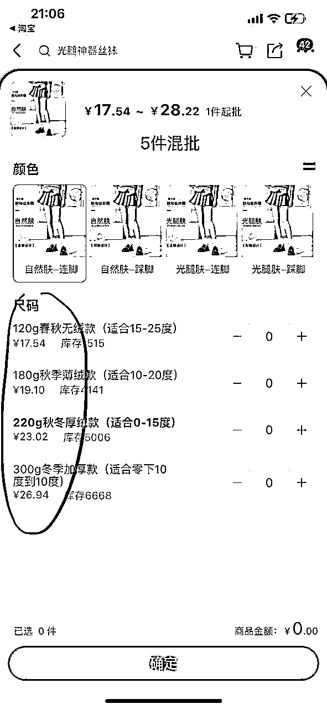

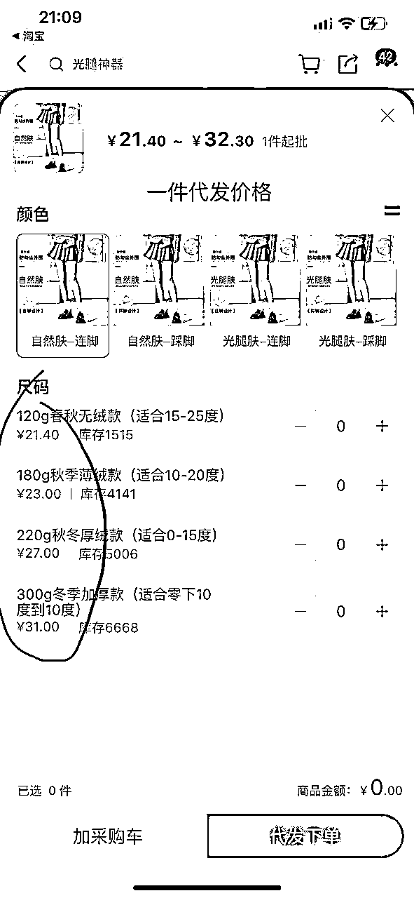

如果采用一件代发的模式，每单运费要增加4元，按这个口径估算，单件商品大约能留下26元的差价。

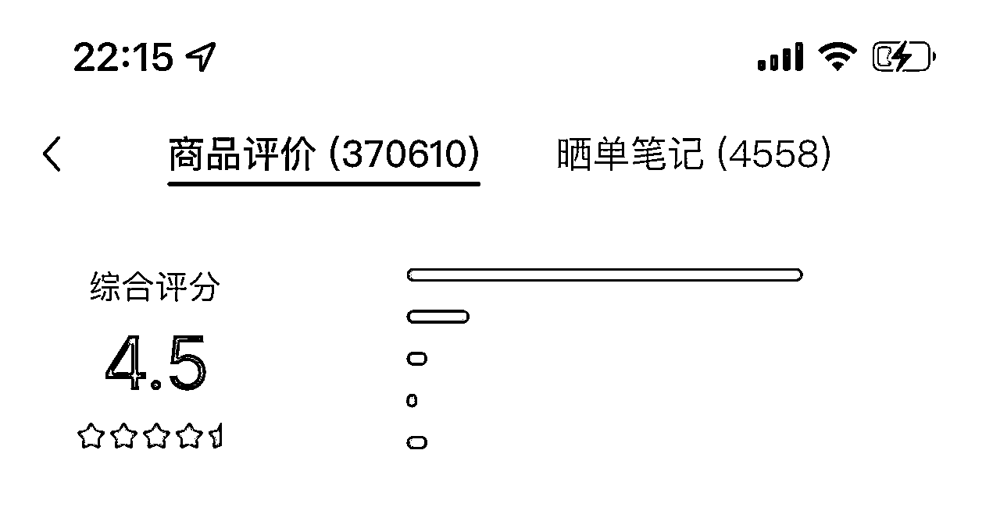

售后的处理也很聪明：店铺差评率不高，遇到售后问题直接对接1688上的工厂，退货就转给供应商处理，最坏的情况不过是少赚一笔运费。粗算一下：客服成本按每月7000元、持续3个月，一共2.1万元；日成交差额按50单乘26元，日入1300元；起号至今76万件成交乘以单件26元，销售额差额约1976万元；拍摄成本按每条1200元、284条内容计算，支出约34万元。各项加总，在不把内部运营费用计入的前提下，净利润大约1939万元。

坦白讲，算完这笔账我愣了很久，反复确认有没有遗漏。翻遍投放后台，也没查到它买过曝光。它就是靠一条爆款内容起家，然后借着热度持续输出，把流量滚雪球一样滚起来。所谓的“厂家直销”更像是刻意营造的认知人设，但视频内容拍得足够真实，定价又确实比同行低，性价比一目了然。这才是它真正跑出来的原因。

回到最初那个问题：为什么市面上那么多产品，偏偏是这条连裤袜能破圈？

总结下来有四条。第一，它精准怼上了用户最具体的痛点；第二，价格低到让人不需要犹豫；第三，实拍内容把痛点可视化，一下子抓住用户注意力；第四，选品眼光在线，还特别擅长放大产品优点——早在2023年10月，拼多多上就有同类产品卖出高销量，这个平台上也出现过类似的图文内容，但都反响平平。它只是用短视频把同样的产品重新演了一遍，结果完全不同。

不管做哪个类目，短视频的转化力大概率都强于图文。用户偏爱那种真实的、带有测评感的内容；评论区的回复速度和专业性，也会直接影响内容的曝光量。做店初期，一个人包揽客服、拍摄、对接供应商完全可行；但一旦体量起来，就需要专业分工。客服可以外包，一个月大概7000元；视频素材可以找网拍团队，或者直接剪辑真实买家的返图；再用社群福利把老客养起来。这套组合拳，放进其他品类里同样成立。

当然，这次的拆解远谈不上完整，我只是挑了一个表现最强的单品去摸它背后的赚钱逻辑，思路也未必严谨。欢迎懂行的朋友在评论区指正，大家一起探讨。