# 风向标拆解第 3 期--靠Notion模板年收入100万美元，通过资料整理变现的路径如何实现--占占
作者：龙哥

靠Notion模板做到年入百万美元？资料整理变现路径全拆解

在信息爆炸的时代，你手边那些看似普通的资料，可能正藏着一条意想不到的赚钱路径。今天我们就来拆解一个热门风向标——有人靠卖Notion模板做到了年收入100万美元。这听起来很夸张，但背后的逻辑其实很简单：找到有需求的人，把资料整理成产品，然后卖给他们。

我自己看完这个案例，总结了三个核心认知：

第一，资料无处不在，关键在于能不能找到需要它们的人。一旦找到，这些资料就能变成流量或收入。

第二，当用户明确之后，真正考验你的是资料整理能力。你怎么把自己对用户需求的理解，系统地放进一套资料里？对需求理解越深，整理出来的东西就越受欢迎。

第三，产品打磨完成后，引流和变现的路径可以很开阔。卖资料、卖课程、卖其他能满足用户需求的产品都可以。重点是锁定属于你的那批人，围绕他们持续迭代。

接下来，我们把资料整理分成两类来看：一类是模板类，比如Notion模板、PPT模板、多维表格模板；另一类是考试类，比如雅思、考研、考公。下面分别拆解。

## Notion模板：从0到1的产品化

很多人好奇，那些卖得不错的Notion模板到底是从哪来的？是自己做的，还是去拼多多买的？如何二次整理做出特色？

其实Notion的上手门槛不低，官方也只提供一些基础模板，所以真正的商品化模板基本都要靠自己创造。做出特色的关键，在于把你的专业知识和对某个场景的理解，体系化地嵌入模板。

举个例子，在📕搜“Notion模板”，卖得最好的那个（忽略第一个1元引流款）是一个记账模板，它精准戳中了很多人的日常记账需求。

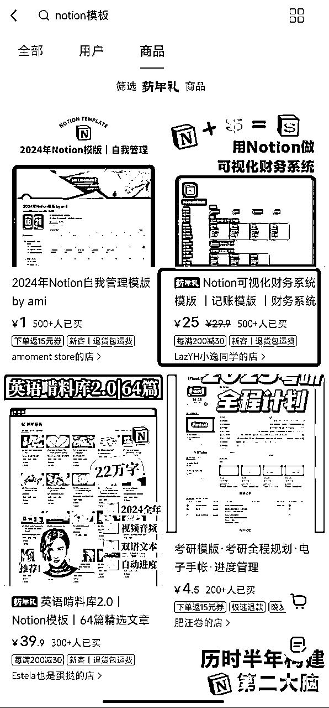

所以，如何把资料整理出自己的特色？与其纠结这个问题，不如换个角度：先研究你的用户（或粉丝）到底需要什么，然后针对这个需求，设计一套对应的Notion模板。

比如销量第一的博主，本身就在卖各种手账周边；而销量第三、第四的模板，目标也极其明确——学英语、考研规划。抓住具体需求，你的模板自然就有了与众不同的定位。

## 引流：靠内容还是靠人设？

有了产品，怎么把人吸引过来？是靠模板本身足够优质，还是靠账号人设？

以📕搜索“notion 模版”排在最前面的笔记为例，我们能看到一套清晰的引流链路。

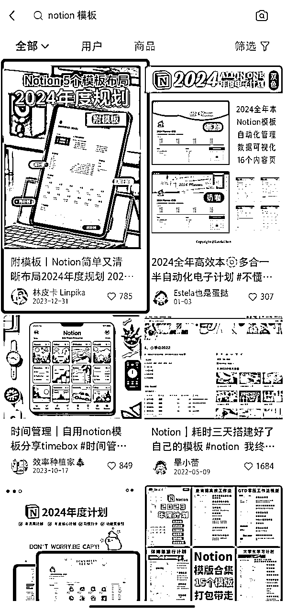

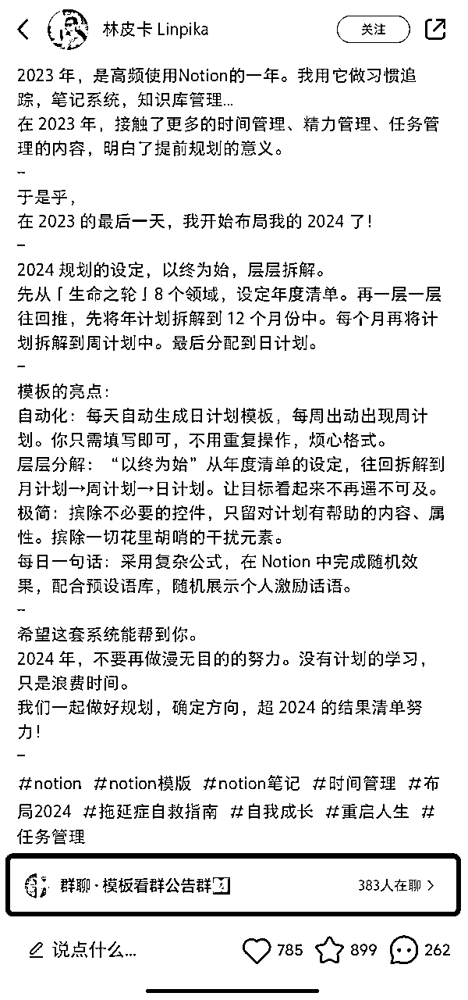

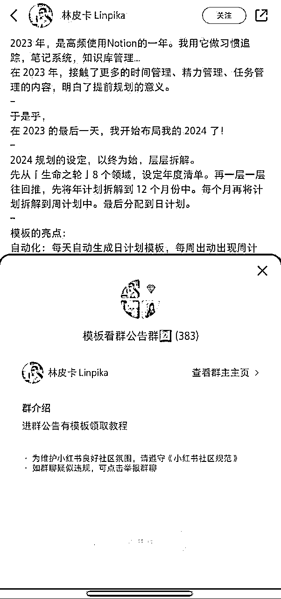

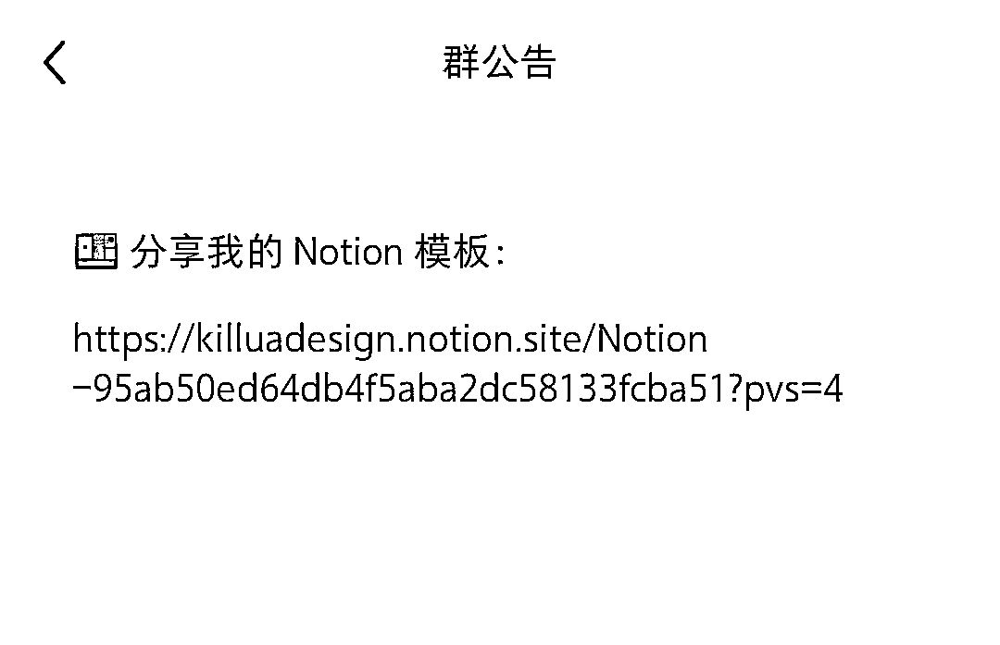

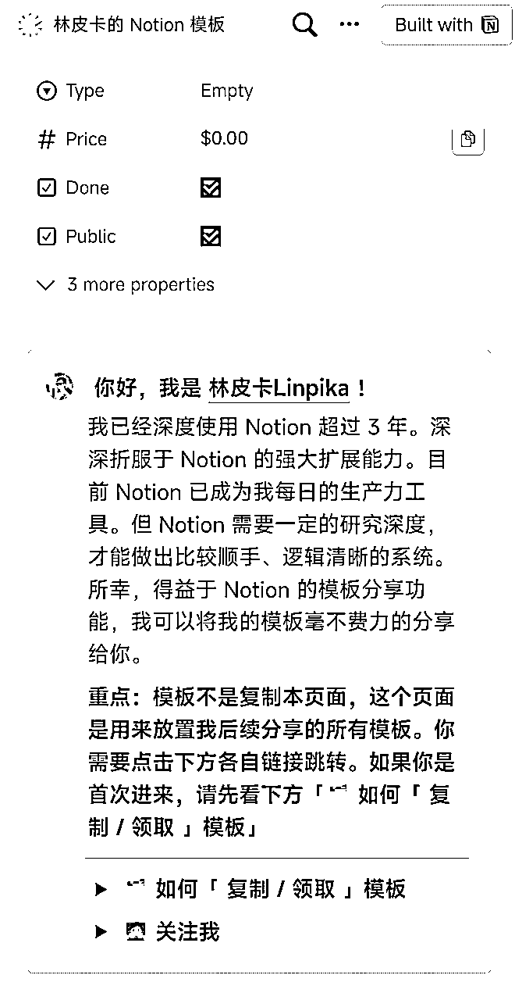

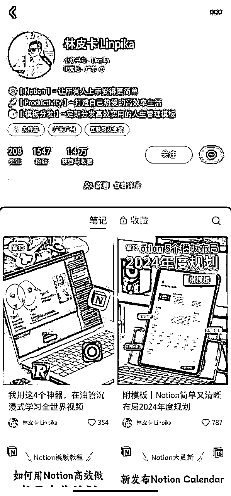

📕笔记会直接关联一个群聊，群名就写着加群领模板。进群后，群公告再把用户引导到博主的Notion个人网页，网页上强调“使用Notion 3年”，强化专业人设。这位博主的账号，整体也主打Notion专家形象。

目前观察下来，Notion模板的引流主要还是靠产品本身的质量。优质模板塑造了账号的专业形象，而这类账号的人设通常是“热爱高效人生”“人均规划大师”“人生管理达人”。

## 变现：不止卖模板一条路

目前Notion模板这门生意，大概有三种玩法：

第一种，纯卖模板。前面提到的记账模板，定价25元，显示500+人购买，这一个模板就带来了一万多元收益。由于模板属于DIY型产品，成本很难核算，姑且把这笔钱看作纯利润。虽然这位博主店里总共只有4个模板，整体赚钱效率不算高，但不到4000粉丝却能有500+人购买，笔记到下单的转化率相当惊人。

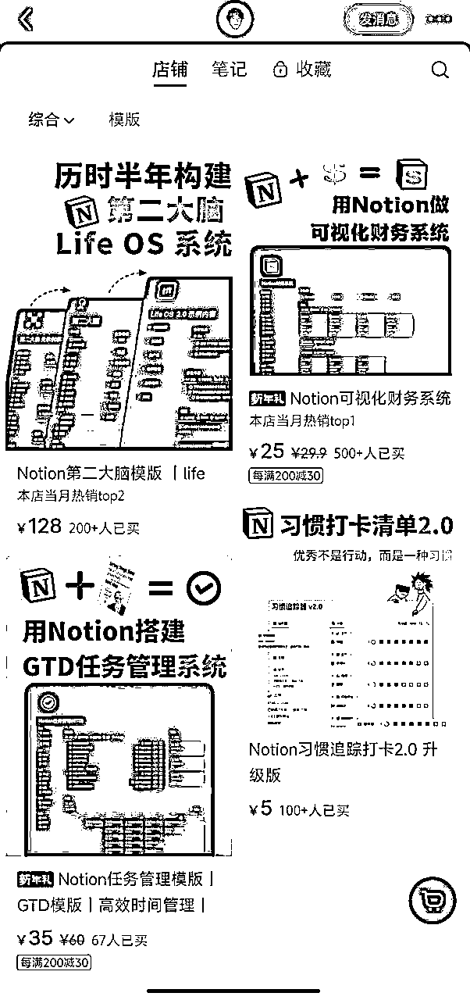

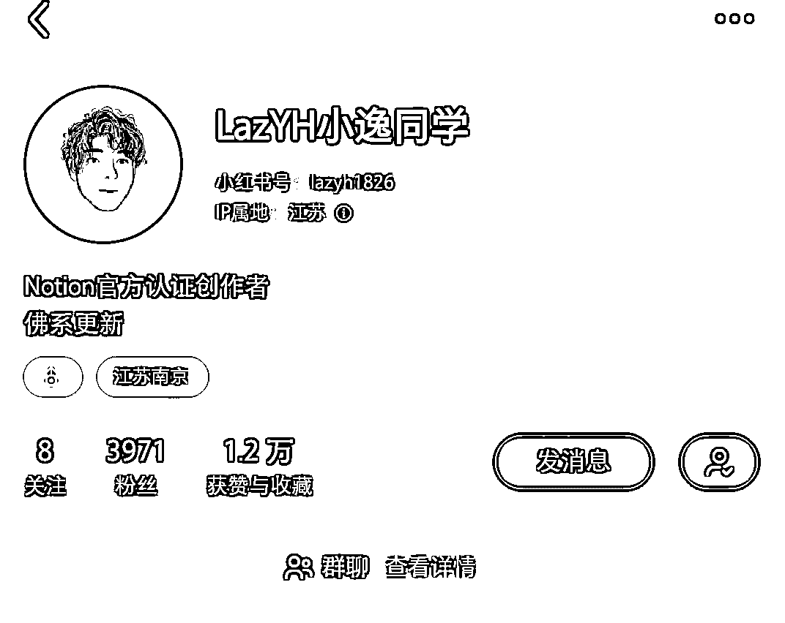

第二种，卖Notion使用教程。课程的客单价通常比模板高，而且可以分不同价位、不同等级来卖。比如下面这个入门训练营，定价不到70元，显示购买超过1000次，收入就是7万多元。

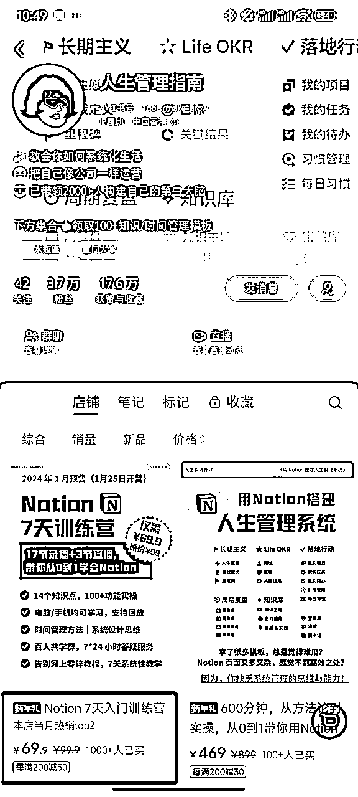

第三种，用1元低价模板引流。先把喜欢规划、记录和人生管理的用户吸引过来，再引导他们购买博主更贵的手账类主营产品。

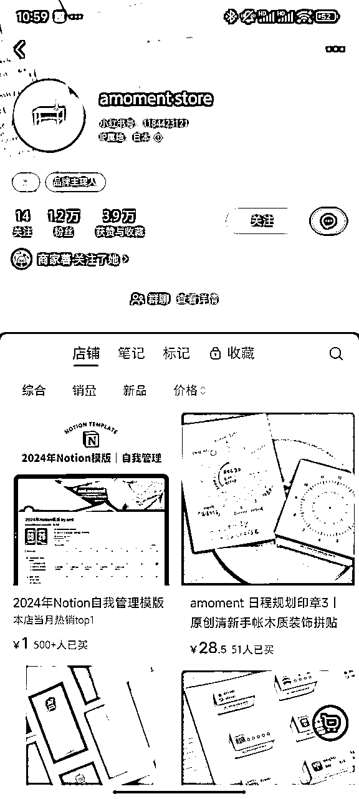

总结一下以上三种方式：卖模板、卖教程、引流卖人设相关产品。

## 雅思资料：流量玩法与信息差

雅思类的资料其实非常成熟，只要加几个送资料的号，基本就能把资料收全。那真正的难点在哪里？是引流和后续变现。

在📕上，常见操作是这样的：先发帖子，暗示“我手上有资料”，但不明说怎么领。这就会吸引很多人在评论区留言“求资料”。评论一多，📕的算法会认为这是优质内容，从而给笔记更多曝光。

然后，博主会私聊那些留言的人，告诉他们加🛰️领资料，借此把流量导到自己的🛰️上。

更有意思的是，还有人会“截胡”同行的流量。比如A账号已经用上述方式积累了评论，B账号直接跑到A的评论区“捞人”，在自己的笔记底下@那些求资料的人。对于用户而言，领资料嘛，加A还是加B都一样，只要能拿到资料就行，所以用户反感度很低。而B账号甚至可能还有另外一层收益——帮培训机构拉新，赚取佣金。

至于变现，目前雅思资料本身很难直接收费，毕竟网上到处都是。大家基本都是拿资料做引流，最终引导用户报课，靠课程分成或服务费赚钱。

但如果你的资料有独特壁垒，那就可以直接卖资料。比如考研专业课，每个学校基本自主命题，本校学生如果能收集到历年真题或内部课程资源，就能利用信息差赚到不错的收益。

## 关于作者

最后给作者打个广告，欢迎连接。

他是“占占”，龙哥盟昵称，目前在北京。自称“INFP-A｜体验派、实践派”，相信人生是旷野，生命在于感知，喜欢可能性和多样性，还调侃自己是“非著名喝水人”。

主业是云计算/音视频行业的B端产品经理，副业做音频后期，有零散收入。他希望拓展更多副业，一起搞钱。

他提供的资源包括：音频后期技术，音频后期、音乐混音、歌手/配音、视频剪辑等相关专业团队资源，云计算产品咨询（企业或个人网站上云），以及家里的生意货源（家电、烟酒饮料、橱柜行业）。

他需要的是：还在探索期，希望通过龙哥盟拓宽视野，找到喜欢并愿意深耕的副业；想放大副业收入，逐步超过主业甚至支撑自由职业；同时他是景德镇人，一直想帮景德镇的个人作坊、景漂学生做品牌，带货并推广瓷文化，只是还没找到切入点。

📕账号是 @混吃的爱学习，主页链接：https://www.xiaohongshu.com/user/profile/56dd8de984edcd58d42ef524

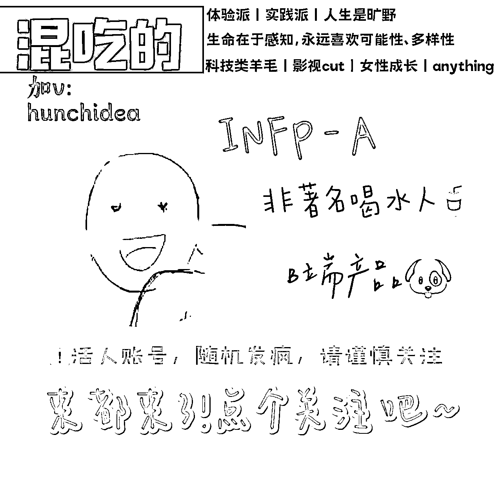

以上就是这期风向标拆解的全部内容。如果你也对资料整理变现感兴趣，不妨从自己手边的素材开始，找到那群需要的人。