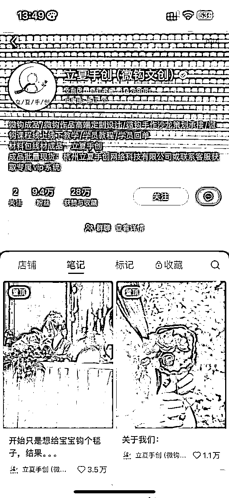
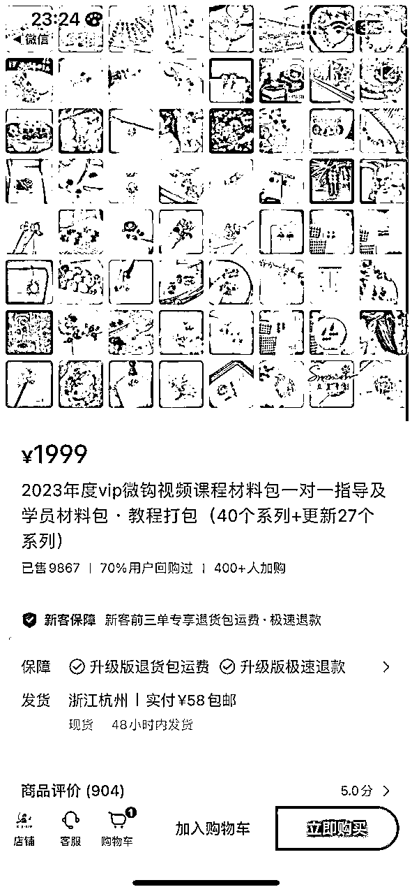
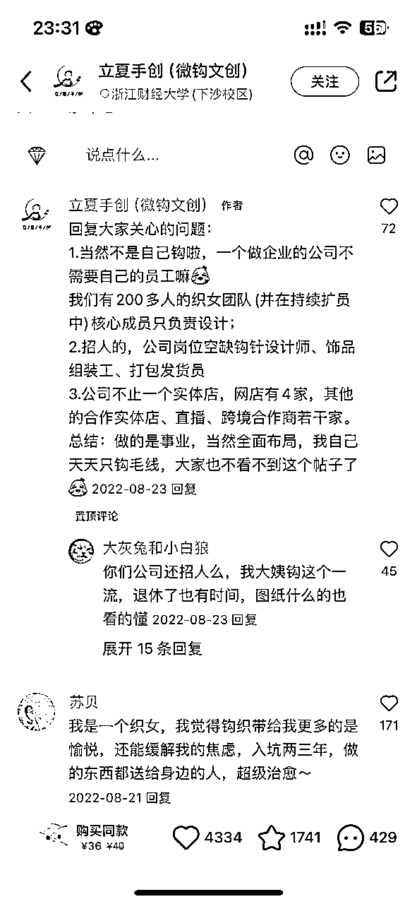
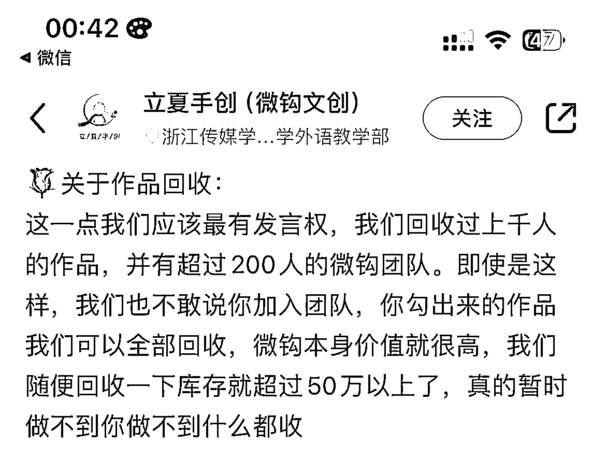
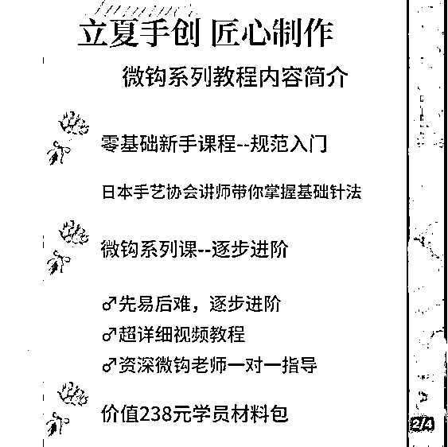
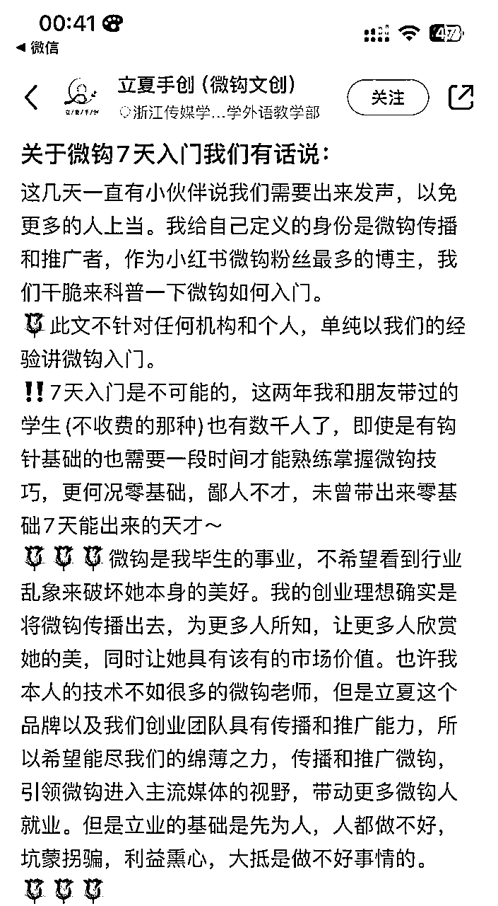
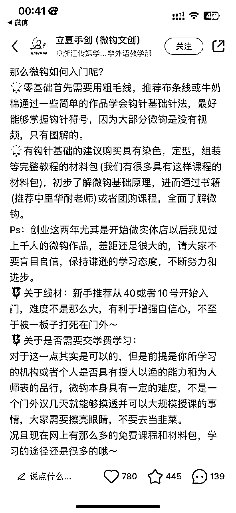
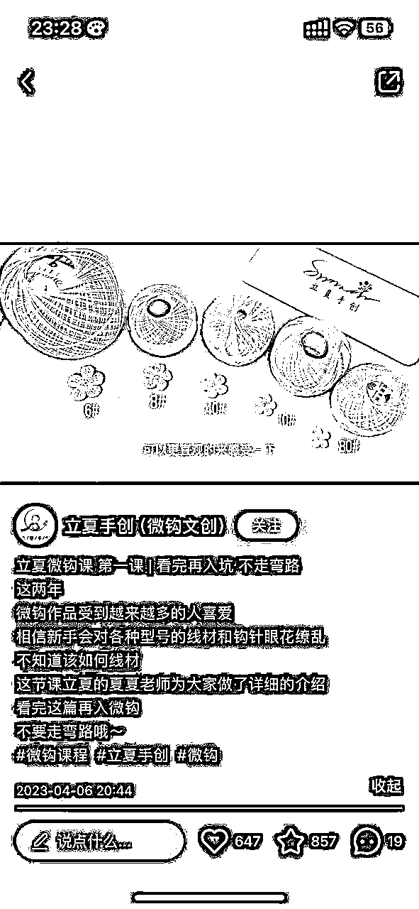
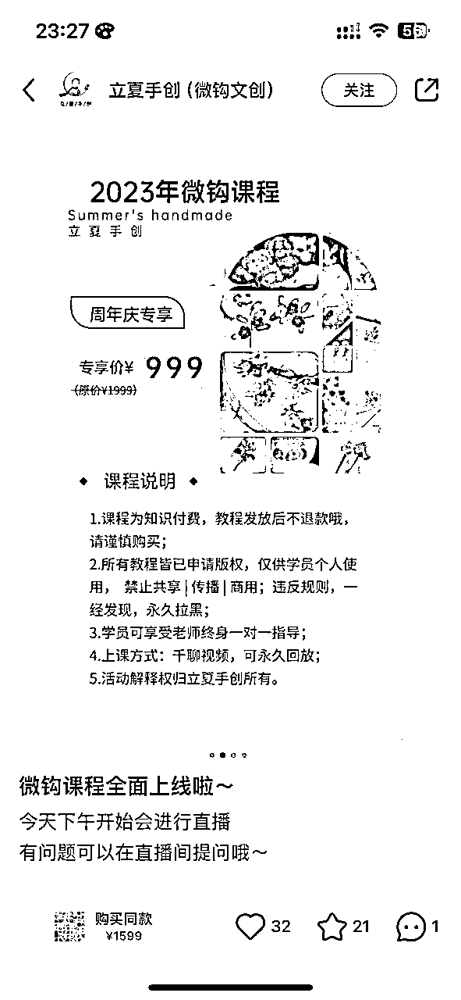

很多人觉得，知识付费赛道已经被挤爆了，但小红书上的一门毛线钩针课，定价1984元，却卖出了将近一万单。这门课有多“冷门”？就是那种你听了都会愣一下的小众手艺。但恰恰是这种小众到极致的知识付费，一旦找准了自己的受众，照样能闪闪发光。

其实像这样“小而美”的付费课程，在市面上一直不缺案例：体外检测教学、照明体系设计……说白了就是死死咬住一个垂直人群，用不同的产品组合去满足他们，哪怕上千元的课程，也能让学员反复掏钱。

那么，这种垂类知识付费到底该怎么玩？换个更直白的说法——如果你自己有一门手艺或技能，该怎么把它变成钱？怎么用账号把流量做起来？怎么设计一套从入门到进阶的课程体系，让学员自然地升单、复购？这次我们拆解一个真实案例，希望能从中提炼出可复用的方法论。

拆解内容主要分三块：选题背景、案例深扒、最终结论。

---

## 一、先聊聊“手艺人”这件事

说到手艺人，你可能会想到陶工、铁匠、木匠、厨师、乐手……但这个词的定义其实非常宽泛：只要你在某一行有真本事，哪怕只是会开药方、懂土木工程、玩得转IT，都可以算作手艺人。毕竟三百六十行，行行出状元嘛。古时候的卖油翁、庖丁，就是手艺人里的顶流。

如今，随着社交平台越来越普及，年轻人又追求个性化和自我提升，手艺人做知识付费成了一门正经生意。很多人愿意花钱去学手艺人脑子里的那点经验和技巧，让自己的技能段位更高一层。而这类付费课程，正好精准地接住了这份需求——内容够实在、实用性够强，有人教、有人带，自然有人买单。

---

## 二、拆解案例：小红书账号“立夏手创”

先看基本信息：

- 账号方向：手工文创
- 粉丝量：9.38万
- 变现方式：主打小红书图文起号，笔记挂车，线上线下都有店铺，小红书店里卖线上课、成品、材料包，还会做直播带货

为什么选这个账号来拆？原因很简单：

- 人家是专门做微钩的文创店——典型的垂类店铺
- 靠图文加直播带货起家——操作门槛不高，普通人也能模仿
- 1999元的课程销量接近一万，而且70%的用户会二次回购——这个数据相当亮眼，说明产品力和用户粘性都在线

### 1. 流量从哪来？

这个账号的流量几乎全靠图文内容。我们把它的笔记规律扒了一遍，能看出不少门道。

从2020年10月发第一条笔记到现在：

- 一共更新了135条笔记，其中92条挂了商品链接，基本是“条条挂车”，尽量让每个看过的人都有机会下单
- 别看更新频率不高，但图片质量非常能打，审美在线，几乎张张都是商品图，偶尔穿插一些线下店铺和活动照片
- 早期笔记发的是人物玩偶、水果造型的微钩；后来突然转向“胸针、发夹”这类小饰品，流量一下子涨起来了，之后的内容也基本以饰品为主
- 内容形式：每条图文都放多张近距离摆拍，首图突出作品颜值。标题大多是“微钩+某某饰品”，精准收割喜欢漂亮小物件的手工爱好者和爱美女生

结论其实很清晰：图文就是为了挂车带货，用垂直产品精准吸粉。同时，通过分享手工技巧和过程，让更多年轻人产生兴趣——但新手往往不知道从哪下手，所以平台上的图文和视频教程就派上了用场，针对性讲解技术难点和制作流程，帮用户跨过“想学不会学”的门槛。

而材料包和付费课程，才是真正的高毛利产品，出单率和复购率都相当可观。

### 2. 产品怎么交付？

**一开始，一个人就能干。**
只要你有技能，前期单量不大的时候，完全不必招人，自己拍图、自己发货、自己上课，轻装上阵。

**等跑起来，再找人一起干。**
线上线下两条腿走路，规模化之后就可以组建小团队，把重复性工作分出去。

**还有个杀手锏：学员作品回收。**
他们采用会员制，只回收学员做的作品，等于帮学员解决了“做出来没人买”的担忧，而且确实有渠道把作品卖掉。这个机制很大程度上促进了学员持续复购——因为学完不只是自嗨，还能变成钱。

### 3. 课程怎么设计？

**先想清楚用户怕什么。**
手艺类课程的学员，典型痛点无非是：材料不知道咋选、第一步不知道咋迈、做出来不知道像不像样……所以课程安排就得从0到1、由浅入深，先啃硬骨头，再补细节。

以立夏手创为例，他们在图文和视频里会把产品讲透：这套课能给你什么、解决什么问题，让用户一目了然。

**打磨课程大纲也是门学问。**先做出来，再根据用户反馈不断迭代，好大纲本身就是吸引人的钩子。

**课程特色要突出。**讲师的资历、一对一指导，这些都是加分项。

**课程形式可以很灵活。**视频教程、图文分解、实时实操辅导……怎么有效怎么来。

**定价也不复杂：成本加合理利润。**

手艺人完全可以根据自己的领域特长，开线上课或者做付费咨询。但前提是内容质量要硬、教学能力要专业，这样用户才会认可。别忘了利用小红书这类平台的互动属性，给学员提供定制化解答和服务，这能大大提升口碑和黏性。

### 4. 升单和复购怎么打？

**升单路子：**好好利用平台机制，持续更新图文，定期开直播卖课，把公域流量一茬茬接住。

**复购核心：**小红书的粉丝画像精准，而且信任感很强。把付费用户服务舒服了，让他们从心底里信任你，复购就是水到渠成的事。

---

## 三、项目最终结论

从需求、流量、产品、变现这四个维度来看，手艺人做垂类知识付费，确实是一门“小而美”的生意。它精准切中用户想要提升技能的渴望，借助小红书这类平台的流量和用户土壤，通过靠谱的知识付费产品完成变现。

但话说回来，这个赛道竞争并不小。想脱颖而出，手上得有真特色、真优势，同时保持学习、持续创新、不断和用户产生良性互动——只有真正提供有价值的服务和产品，才能把这门小生意越做越长久。