# 📕饰品爆卖背后的运转密码
作者：龙哥

同是挂在手腕上的小物件，不同赛道、不同平台，价格能差出十倍百倍。尤其在📕，手串、手作饰品的博主铺天盖地，可单价和成交额却天差地别。拆开来看，逻辑完全不一样。

# 一、雍和宫手串、灵隐十八籽这类「寓意饰品」

## 为什么能火

近两年📕上充斥着年轻人“信则灵”的内容：

有学生把文昌塔摆在书桌上，讲自己把作弊换成了做法；

有女生因鼻尖上腭红被提醒要破财；

还有人按五行挑当天的穿搭色。

面相、星座、紫微、塔罗、八字、风水、苏珊米勒、MBTI、梅花易数、数字能量、奇门遁甲……几乎人人沾一点。在这种情绪下，背靠历史和寺庙口碑的雍和宫手串、灵隐十八籽，正好提供了年轻人想要的精神寄托。

## 热度表现

📕上“雍和宫手串”最热笔记点赞3.8w、收藏1.1w、评论3393条，评论区基本都是在问能不能帮忙代请。

“灵隐十八籽”带货最热帖点赞2.4w、收藏7368、评论520条。

## 变现方式

### 雍和宫手串

主流是代请，笔记里几乎找不到商品链接。

代请本质是代购：接单人跑一趟雍和宫，按买家需求挑选手串后寄出，赚取差价。

1、内容引流：

图里放手串品类、佩戴图或以雍和宫为背景的实拍；
文案写请手串攻略、佩戴后事业生活的变化故事。

2、把意向用户从评论区或私信导进私域。

3、在私域完成收单。

### 灵隐十八籽

热度比雍和宫低，变现分两条路。

一、代请
玩法和雍和宫类似。
区别在于灵隐十八籽已经出现了公开的代请链接，标价68元，原价46元，单笔净赚22元。该链接累计销量1031单，单链已变现超两万元。

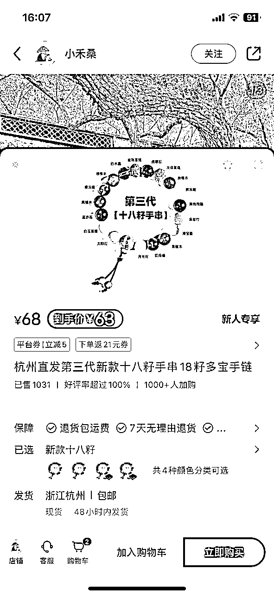

二、店铺带货
用“十八籽”做关键词引流，实际售卖文玩手串。

笔记多为视频：佩戴展示、打包出库。

销量：店铺两款热销品
价格39.9元，销量1.1w，变现约43.89万元。
价格19.9元，销量6681，变现约13.3万元。

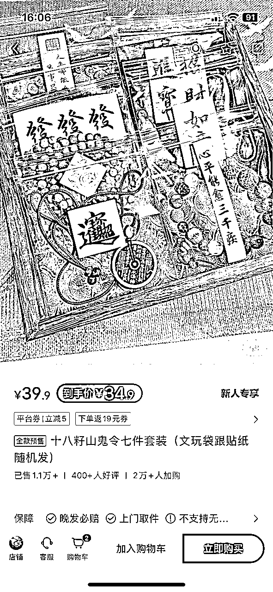
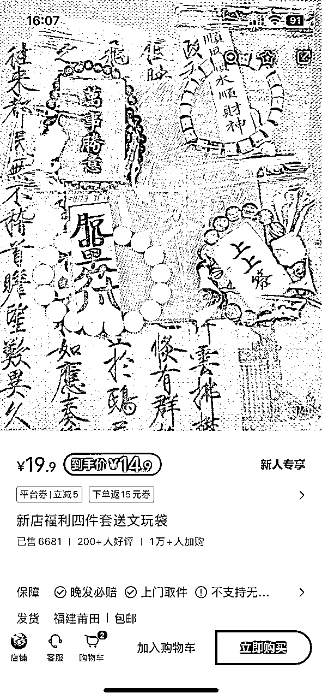

货源基本来自1688。

# 二、纯美学手作饰品

这一类没有玄学加持，卖的是“美”和手工感。

## 产品特性

比起流水线工业品，手作凝结了制作者的时间与精力，对追求艺术价值和稀缺性的消费者有吸引力。出于时间成本，产量天然受限，也迎合了小众心理。

## 案例拆解

账号：Shannai Jewellery
粉丝12.7w，总获赞收藏13.5w
品类：串珠项链、手链、耳饰
运营方式：近3个月几乎每天直播，笔记附带购买链接

前5爆款数据：
198-229元，销量8647，变现约180万；
288元，销量6672，变现约190万；
188元，销量5375，变现约100万；
198元，销量3174，变现约60万；
88元，销量1230，变现约10万。

### 内容形态

图文为主，分两类封面：

1、产品搭配同色系绘画作背景
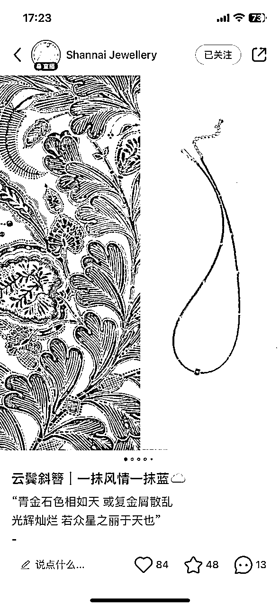
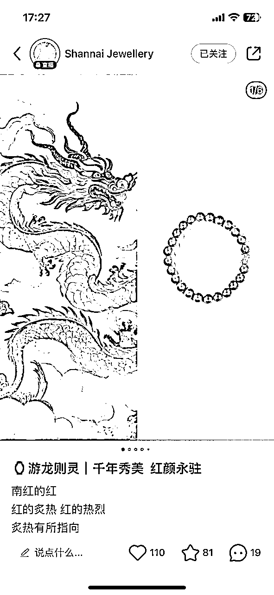

2、产品上身穿搭效果展示
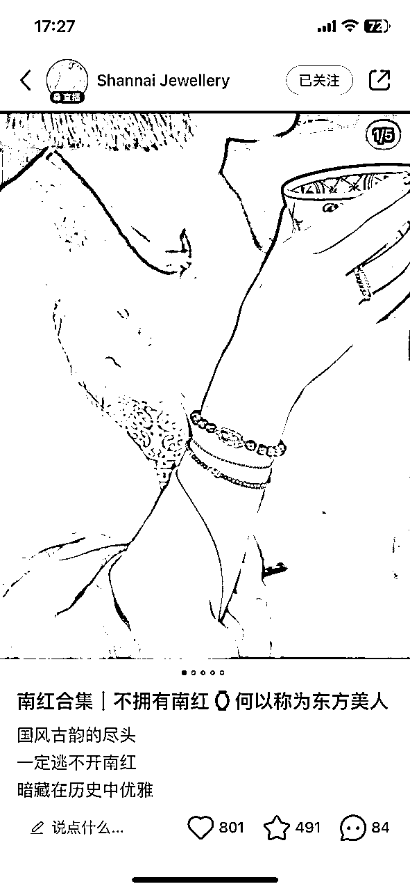
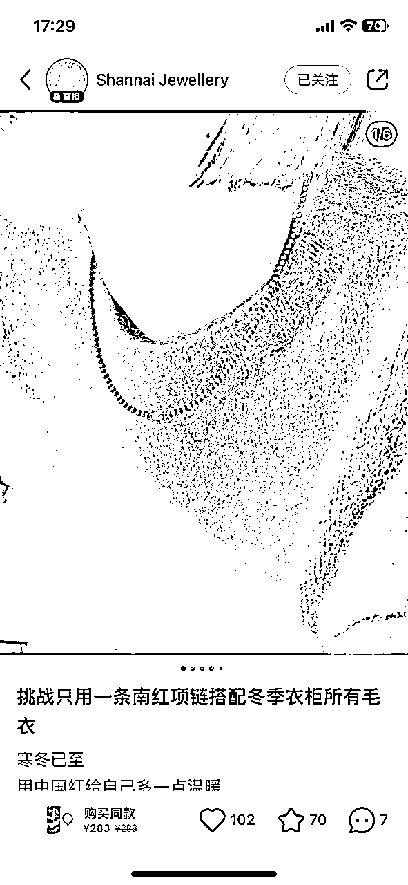

### 直播打法

语调温柔、语速慢；
台前陈列半成品和原料建立“手工真实感”；
中排摆成品；
主播半露脸，身上佩戴多款产品做直观演示；
讲解聚焦色彩、寓意、上身效果。

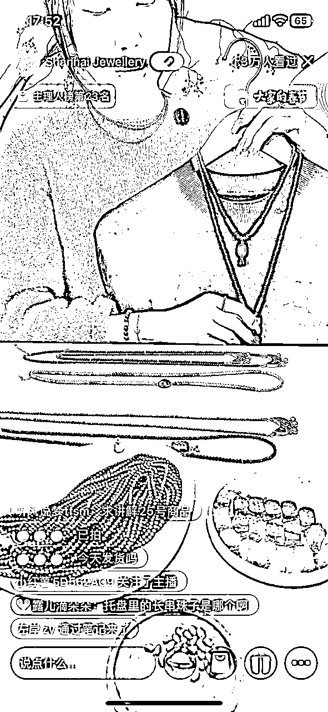
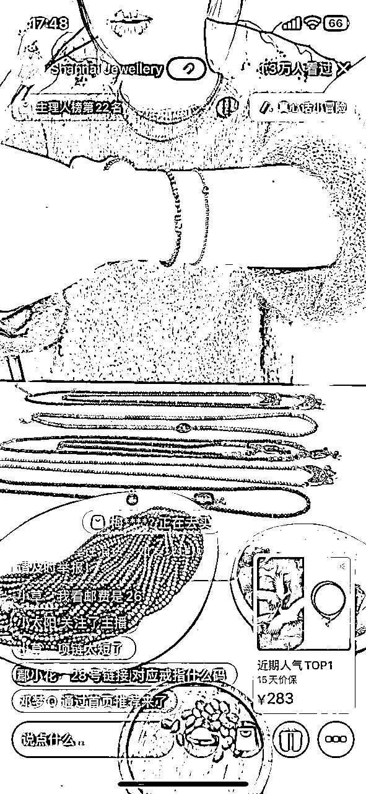

# 三、赛道本质拆解

整体叫手作饰品，其实分化明显。雍和宫、灵隐这类更像是带有宗教文创属性的品类，并非真正的手工制作。

真正的手作可再分为两类：

## 真正手作
全手工制作，强调原创性和独特性，买家很在意设计是否原创。价格受工艺精美度与难度影响大于原材料。

优点：能根据风格定制独一无二款式，可接私人定制，被低价同款冲击的概率小。

缺点：前期要投入材料、工具成本，耗时长；对审美和手艺要求高；新款式缺乏市场验证。比无货源模式更难运营。

## 包装手作
多为无货源或拿现有商品，用运营包装成“原创手作”。

优点：可直接上架已验证过的款式，对手艺零门槛，几乎不用制作时间。

缺点：同款易被搜索到，价格透明度高，容易被同行复制，缺乏差异化。

## 底层共性

看完📕上的头部账号，最核心的不是玩法多花而是风格统一。

手作饰品的核心受众虽都是女性，但不同审美圈层偏好截然不同。

要么先以产品定人群画像，再统一内容调性；
要么先锁定目标用户画像，再反推产品和笔记风格。

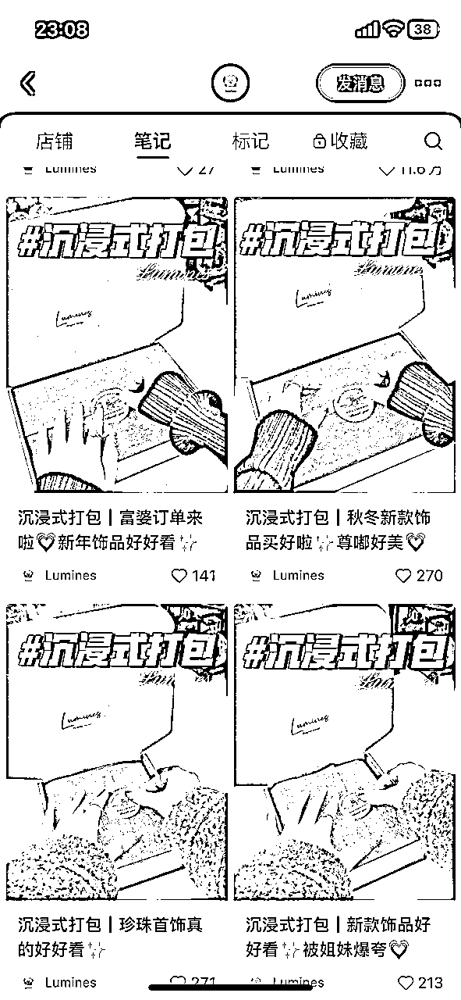
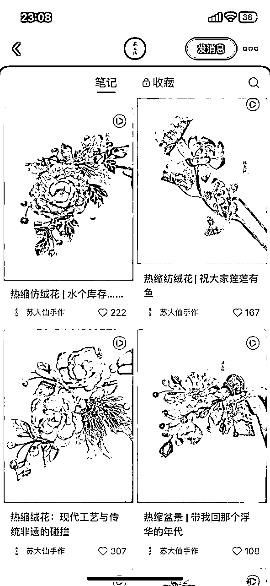
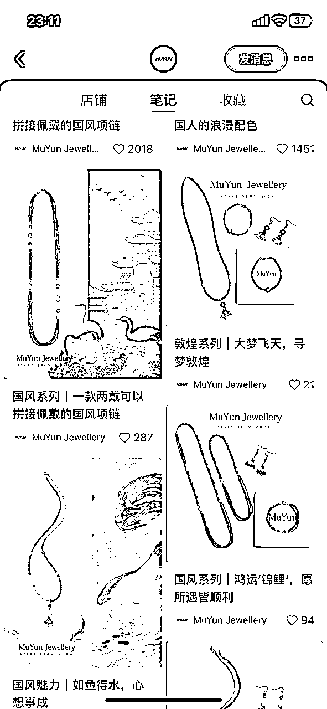

不要想着一个号覆盖所有口味，风格统一才能形成账号标签，用户才会形成粘性与复购。