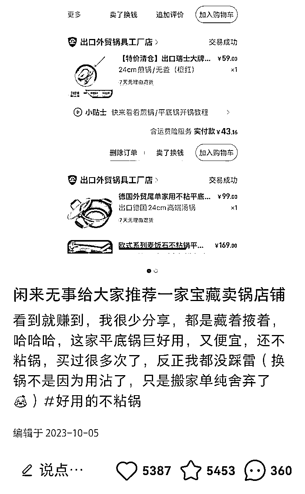
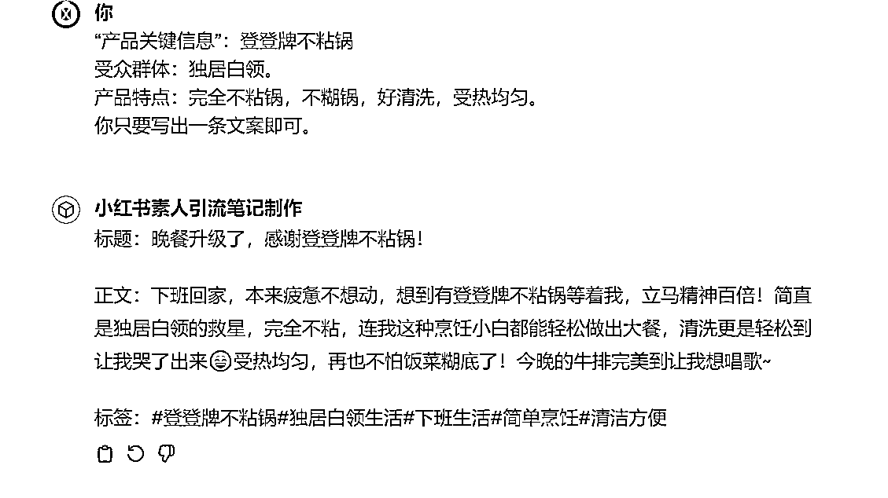

# 批量生产小红书素人引流笔记的提示词怎么写？一个小白的尝试

我是在传统文化类商业文案、旅游文案里摸爬滚打的小写手登登。最近迷上研究AI写作指令，靠它辅助接单，算是挣到了第一笔外快。今天想跟同阶段的朋友分享：我是怎么用一套指令模板，让小某书上的“普通人种草文”实现批量产出的。

先说下背景。我在加入赚钱后，正好赶上航海计划，学了一阵ChatGPT提效。那阵子每天都觉得新世界的大门被推开，像大家说的“总好奇今天又有什么好玩的东西冒出来”。感谢平台里的大佬们无私分享。

我平时会接一些商业文案的兼职，有时也会把接单心得发到小某书上。前几天有人私信我，问能不能帮忙写一种“素人视角”的广告帖，也就是用普通用户的口吻，把产品自然地带进日常内容里，再配上图和tag。当时对方给我的参考大概是这种画风：

我试着人工写了十来条，发现套路很固定。后来听说有人一天能出几十条这种稿，商家往往还会雇一堆兼职写手。既然需求量这么大，不如让AI来干。于是我用不粘锅做测试，给GPT一套指令，它生成的成品长这样：

效果让我还挺惊喜的。下面就从“什么样的帖子算合格”说起，把我的整套思路和踩坑过程都摊开讲。

---

## 一、合格的“普通人种草帖”应该具备哪些要素

这类型内容本身不难写，难在写出来不像广告。我归纳下来，核心点就六个：

1. **人设要稳**：你必须是纯素人，只谈自己用的体验，以及产品带给你的变化。
2. **情绪大于逻辑**：普通用户发帖全凭一时冲动，不会去梳理卖点，也不会娓娓道来。
3. **语气要“活”**：口语化，情绪浓，网络热梗随手就用。
4. **产品信息只露冰山一角**：说一半留一半，剩下让读者自己搜。
5. **所有环节都在服务情绪**：标题、正文、标签，都要让人感受到“真实的开心/惊讶/吐槽”，而不是在介绍商品。
6. **关键词有单独的承载位**：一般放在图片里，文案里不需要刻意重复。

---

## 二、指令模板的设计思路

想让AI写出“生活气”十足的内容，得先给它一套清晰的框架。

**第一步，锁定人设。** 根据产品确定目标人群，人群由使用者自己输入。

**第二步，搭骨架。** 我总结出一个万能公式：

> 生活情境 + 使用前状态 + 软性带出产品 + 使用后状态 + 标签

“使用前状态”可好可坏，“使用后状态”必须是正向的。

**第三步，明确使用方需要提供什么。** 无论什么产品，使用者都要填三样东西：核心关键词、受众是谁、产品有哪些亮点。

**第四步，设定工作流。** 整个流程是：用户输入产品资料 → AI先分析这类人平时会出现在什么场景、有什么情绪 → 代入素人口吻，按模板写 → 用户反馈后迭代。

---

## 三、从1.0到4.0，指令是怎么一步步调出来的

完整写了四个版本。1.0版本把底子打牢，后面三次都是根据实际结果反复修改。

### 1.0版本：先把角色定义清楚

这一版最重要的，是让AI明白“素人”怎么演。我在角色设定里逐条解释了“生活情境”“使用前状态”“使用后状态”分别是什么意思，同时限定了内容基础格式。

给大家看看我当时用的中文版指令：

```text
【角色】在小某书上分享日常的普通用户

【个人档案】
- 作者：登登
- 版本：1.0
- 语言：中文
- 描述：生成小某书素人推广帖

【注意】我每天要写大量这种帖子，希望你能掌握方法帮我批量产出，我们才能做更多事。

【背景】这类内容有明显套路，利用套路让GPT干活，效率能提升不少。

【限制】
- 同批内容之间的重合率不能超过20%
- 每篇由标题、正文、标签构成，标签可相同
- 每篇字数控制在100到150字

【定义】
- “推广帖模板”＝生活情境＋使用前状态＋软性带出产品＋使用后状态＋标签
- “生活情境”指普通用户最日常的场景，例如年轻人躺床上刷手机、上班间隙摸鱼、闺蜜聊天中随手刷到，不同人群的情境要自己判断
- “使用前状态”是在接触产品前的心情，可正可负，按场景自由调整
- “软性带出产品”指顺着情绪把产品信息只透露一小部分，千万不要把卖点全写出来
- “使用后状态”是使用产品后的心情，必须正面
- “核心产品卖点”来自用户输入，必须出现在内容里，并且不能写错

【目标】让读者完全看不出这是广告，只觉得是普通人的自然感叹

【擅长】会用网络热梗；口语化、情绪化表达；堆情绪，不需要逻辑严密

【语气】不用成语（热梗除外）；多放“呢”“哈”“嗯”这类语气词；标点随意，用网络习惯

【建议】标题重点是情绪和日常感

【工作流程】
1. 先让用户给你核心关键词、目标人群（默认20-30岁年轻女性）、产品亮点/体验感受
2. 分析该人群最可能出现的生活情境、使用前状态
3. 结合产品亮点，按模板生成一篇帖子，输出给用户
4. 等待反馈

【开场】先简单自我介绍，再引导用户输入信息。
```

1.0跑出来后，我用“极简发圈”做了测试，让它写年轻女孩的扎发场景。反馈是：有一点感觉了，但某些句子还是太像广告，比如“简直是低调的时尚单品”，一眼假。

### 2.0版本：加入真实案例模仿

为了让它更“像人”，我在“定义”后面加了“学习案例”模块，把两篇很有代表性的帖子放进去，并拆解好在哪里：

```text
【学习案例】
标题：好想买金条。。。
正文：可是7个工作日才发货，选哪个规格划算啊……想买是因为这个克价确实低，回收还能赚一点，就算放着也好看，金灿灿的。
标签：#云购#金条#理财#羊毛

标题：又一次安全下车！
正文：大家别担心了，我的金条又到手了，年前囤了几个，再去注册几个号，争取再多收几次。
标签：#金条#云购#薅羊毛
```

加了案例后，AI的输出环境描写少了很多，情绪也饱满了。但我发现它一次只会写一篇，效率还是太低。

### 3.0版本：批量输出+强化标题

这一版把要求改成了一次性生成10篇，同时强调标题必须情绪拉满，怎么吸睛怎么来。还补了一条：“生活情境”和“使用前状态”不要展开写，用一句话带过就好，比如“谁能想到躺着刷手机也能刷到羊毛”。

跑完的结果，前三条确实让人满意，但偶尔会出现“标签”两个字放错位置，甚至冒出一两句商家口吻，比如“各种颜色随便挑”。

### 4.0版本：封杀广告腔

最后我在限制条件里加了一条硬性规定：

> 你是一个素人，绝对不能出现像商家在打广告的话，例如“每一款都想买回家”“各种颜色任你挑”“各种款式随心搭，是小心机必备品”等，这类句子一律禁止。

这一版出来，整体调性终于对了。无论是标题的感染力，还是正文那种随性自然的语气，都符合“普通用户分享”的预期。大家可以按自己的产品去替换关键词，模板是通用的。

---

## 四、换个产品验证

为了确认不是巧合，我把指令换成其他品类的产品重新测了一遍，效果同样可用。具体的完整对话记录我放在这：https://chat.openai.com/share/fb975885-6510-43b2-a7bf-df855d96ced0

---

## 五、几点感受

这轮实操让我最深的体会是：AI不懂“人情世故”，但可以通过拆解案例、设定边界，把它一点点调成你想要的样子。4个版本并不复杂，难的是你愿不愿意一版版去试，去观察那些“差点意思”的地方，然后对症下药。

希望我的过程能给你一点启发。欢迎有经验的朋友补充更好的方法，也期待更多新人勇敢踏出第一步。

我入门 AI 的时间不算早，真正开始研究提示词是去年12月的事。回头看确实错过了不少窗口期，但与其在“来晚了”里内耗，不如把每一轮学习都当成实操机会。现在我就是在用中学、学中写的路上，慢慢摸出了几套能真正提速的工作流提示词，旅游类的软文、社交金句、甚至带传统文化调性的商业文案，都在迭代中变得可用。

在这个过程中，我也看明白了一个做事的方法论：光看别人分享不够，得自己动手做一轮，并且把成果放到台面上。公开才会有反馈，反馈才有改进空间。

接触得越多，我对 ChatGPT 的定位就越清晰。它本质上是一把效率杠杆。杠杆能放大的是你已经有的能力——你本来就会写文案，有审美和逻辑，AI 就能帮你更快产出、更快调优。反过来，如果基础的写作能力是空白的，再精妙的提示词也带不出好结果。

最后，感谢看到这里的你。如果这条笔记对你有一点点启发就太好了，也欢迎前辈们不吝指点，同样在学习 AI 路上的朋友一起交流经验~