# 风向标拆解第3期-手艺人垂类知识付费是一个小而美的生意吗？-瑞瑞瑞jio

不靠流量明星，一个“迷你钩织”工作坊如何做到年入千万？

如果把一门手艺变成收入来源，你希望它热闹，还是低调？

今天拆解的案例，属于后者。一位名叫立夏的创作者，专门做“微钩”——用钩针钩出迷你织物，作品精致小巧，既可以做饰品，也可以当摆件。先看一组实物图：

在年轻用户聚集的分享社区里，搜索“微钩”只有13万篇出头的内容，赛道确实小众。再看搜索下拉词，用户基本分成两类：一类想学，一类想买，想学的约占八成。
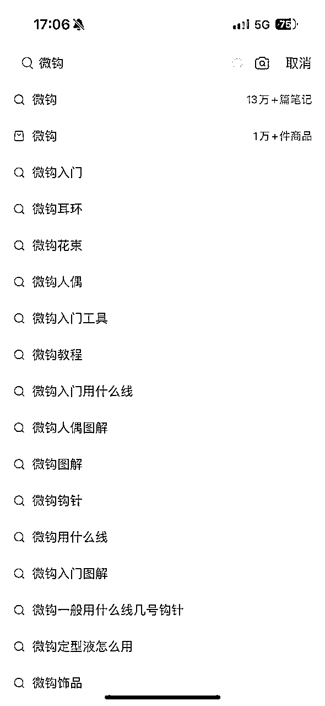
粉丝中女性占93%，18岁以下的占了将近一半。可见这种手作正在吸引新一代年轻女孩。
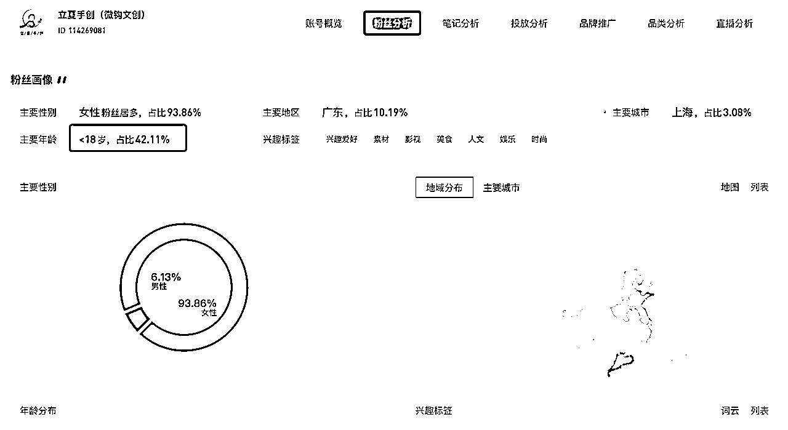

账号内容主打图文，更新节奏是每星期两篇。内容方向包括作品展示、带货、线下文创沙龙/市集、品牌采访与非遗项目宣传等。流量来源主要是系统推荐，没有明显的投放痕迹。
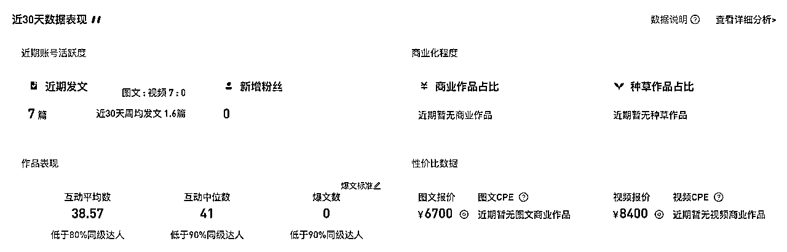

从账号主页来看，业务拆得很简单：微钩制成品、材料套包、教学课程。真正扛起收入的，是课程。
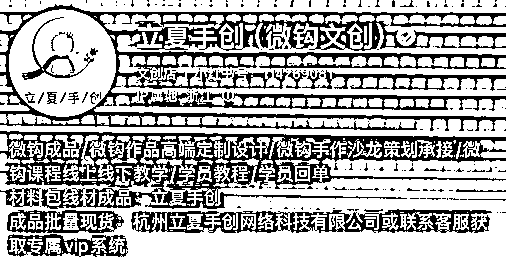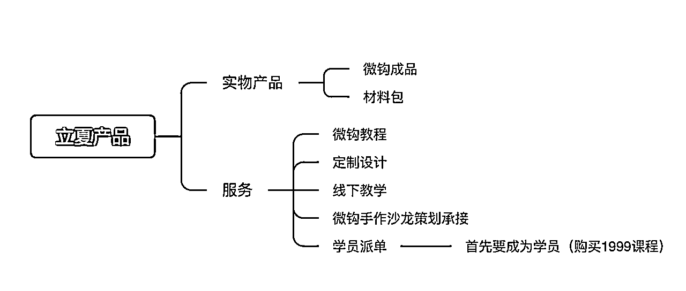

这堂课程定价1999元，为什么还有人买单？拆解后发现，它的价值感来自四件事：
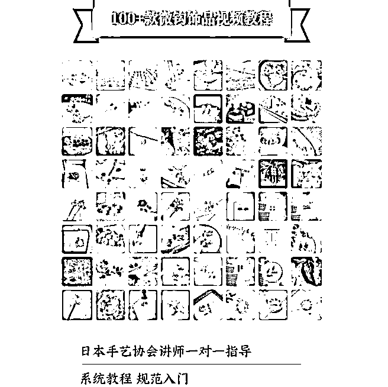
- 稀缺：主流电商平台找不到同类课程，几乎没有对标。
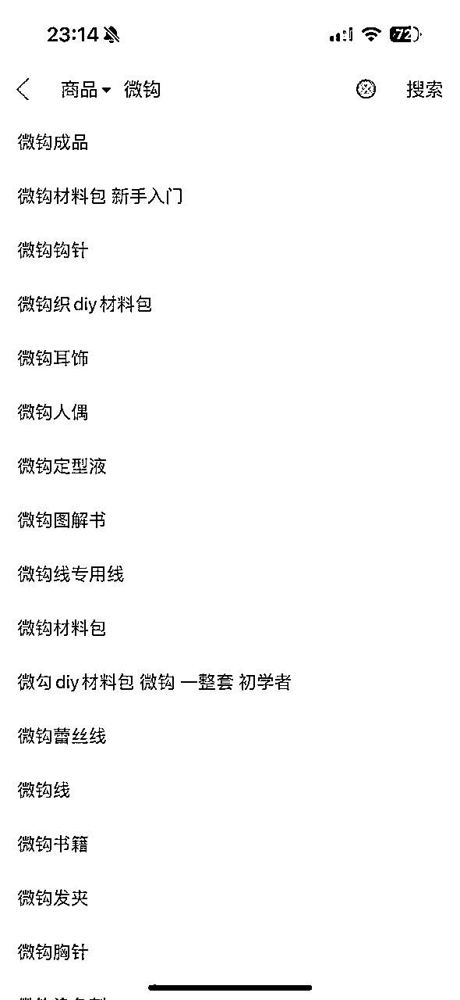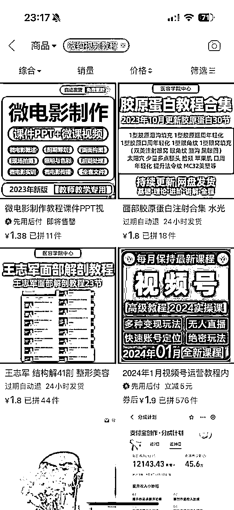
- 量大：整套课程包含100节视频课，让学员觉得一次就能学透；
- 背书：日本的手作认证机构参与合作；
- 服务：报名后会安排老师单独辅导。

从开店算起，大约18个月，她在一个平台的累计成交额超过2200万元。分项看：
- 微钩实物类：约50万元；
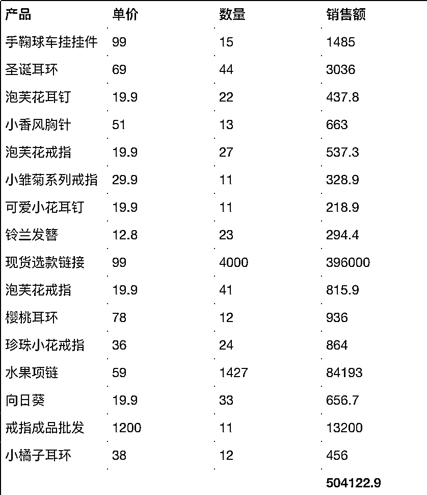
- 材料和工具套包：约214万元；
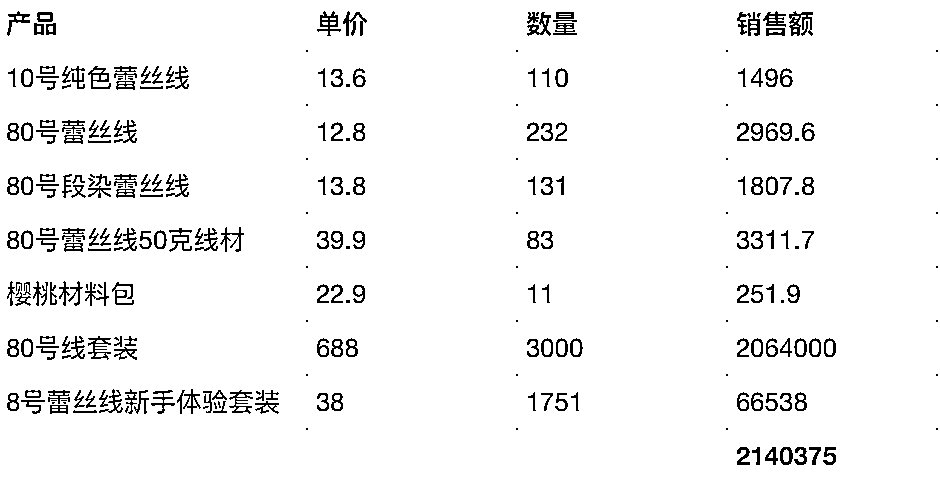
- 教学课程：约1972万元。
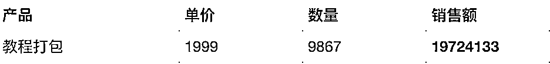

课程占成交额约九成。若是把传统电商、私域和实体渠道也算进去，总盘子还会更大。

成本端也能估一估：以一款钩织用线为例，售价13.6元，批发平台同规格6.5元，毛利接近50%。课程除了人工辅导成本，几乎不增加边际成本，按70%毛利粗算，单是这个平台，一年就有千万元级的利润。放在小众品类里，这个数字相当惊人。

想照做这套打法，四步就能起步：

第一步，开店。按个人经营、个体户或公司三种身份，选合适的店铺类型就行。
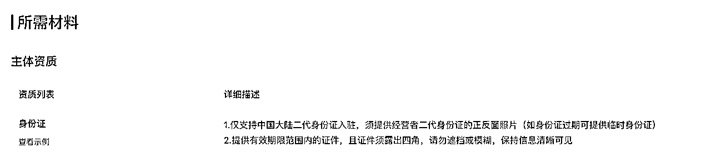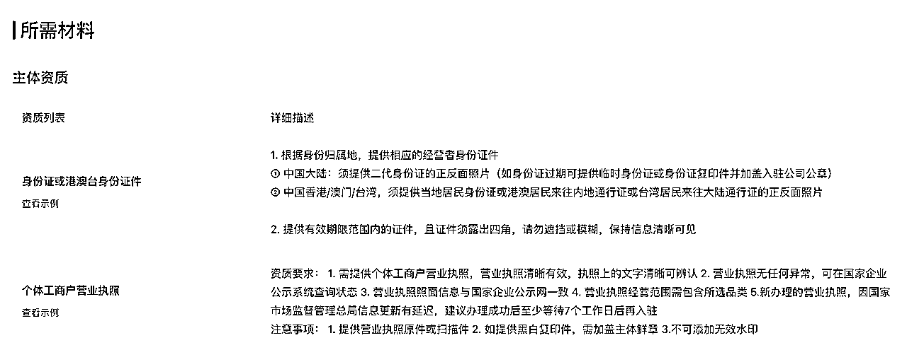

第二步，发笔记。内容配比可以直接参考：8成做作品展示、引导免费流量；1成挂商品链接、直接转化；1成讲品牌故事、抬高调性。形式上以图文内容为主，偶尔加短视频，每星期两篇。

第三步，做产品。实物上，成品和材料套包一起卖，同时优化上游货源，找到稳定的合作厂家。服务上，除了卖课，还可以增加线下手作沙龙、按需定制和学员接单派单，给学员创造副业机会，反过来带动课程销量。

第四步，放大。手作天然能和很多兴趣圈层联动，比如日常美学、娃娃收藏、汉服圈，都是现成的流量入口。一个号跑通后，可以多开几个号，再把同样打法搬到其他视频平台，扩大覆盖面。

最后说点实在话：这门生意能做起来，前提是你真的热爱且擅长某一种手艺。案例里的主理人立夏，背靠互联网大厂的运营经验，还有实体店和前期资金积累，不是完全白手起家。普通人想试，建议先用最小成本把模式测试一遍，等模型跑通再扩张。

把热爱变成收入，从来不是童话。找到对的路径，窄门也能走成宽路。