# 运营层面的隐形失误，会让你一年少赚五百万

> 来源：[https://ht16ej1tui.feishu.cn/docx/TEiLdqr5BopyvDxB4IZcC0arnSf](https://ht16ej1tui.feishu.cn/docx/TEiLdqr5BopyvDxB4IZcC0arnSf)

嗨，我是珍妮，教育赛道年GMV 1100万-1600万的幕后操盘人，和陈铭ivy一起创业。

这是我们之前发过的复盘，欢迎去看看。

复盘1：
https://t.zsxq.com/17tvEOFgZ
粉丝三千月入二十万，小红书低粉高变现的冷门打法

复盘2：
https://t.zsxq.com/17RnIxsp7
小红书教育赛道年GMV一千六百万，小团队创业的实操心法

复盘3：
https://t.zsxq.com/17clCvA0e
老板避雷手册 | 年营收一千一百萬背後，如何辨別不合適的運營、供應商、合伙人？

我在运营上摔過的坑太多，直接导致我们23年少赚了500万。你也看到了，22年我们是1600万营收，23年只剩1100万。今天我就聊聊：运营端哪些细节不能大意。

【说明：本期内容聚焦公域引流与私域宣发，以小紅書留學賽道和聚光投放訓練營為例】

# 本文涵蓋：

1.運營的底层逻辑：为何學得再多也變現不了
1.1 我找的真的是可对标的账号吗？
1.2 我的產品在這個赛道有沒有「人无我有」的壁垒？我有在内容里体现出来吗？
2. 收入在下滑时，如何調整战略方向
2.1 赚这两类人群的錢，收入會越來越高
2.2 为何现在赚中產的钱會越來越少
2.3 若仍想做中產生意，该怎样轉向
3. 运营颗粒度實操拆解 以聚光投放訓練營海報設計為例
3.1 配色判斷
3.2 站在用户角度
3.2.1 先鎖定目标客戶是誰
3.2.2 目標客戶在哪裡，如何讓他們看見
3.2.3 目標用戶真正想要什麼
3.2.4 我的產品和同行差在哪，如何把「人无我有」的優勢說清
3.2.5 多用數字，優先用奇數
3.2.6 多說人话，少说术语
3.2.7 確保客户能看懂你在讲什么
4. 收尾承接 如何从現有團隊裡找到下一個我

# 运营的底层逻辑：为什么学了那么多依然变现困难

很多运营一上来就找对标账号，抄爆款，最后粉漲了變現為零，天花板极低，甚至连粉都漲不动。

根源是學了一堆課程、技能，缺了商業運轉的底层思維。從沒問過自己：

1.1 這真的是我要學的對标帳號嗎？
1.2 我的產品能否在這個賽道建立「人无我有」的競爭壁壘？內容裡有沒有體現出來？

## 1.1 这真的是我要找的对标账号吗？

以留學賽道為例，各大IP都愛宣傳這個賽道，朋友圈都在說：今年我們的一個IP号多，近期我們找到新打法，又起多少個号。

商業邏輯之一就是：剛有點成績的人就拿出去吹了。

可以半信，不可全信。

這個IP我認識，就讓人把他20多個矩陣號全扒了，把每篇筆記的發佈時間、贊藏評數據、賬號起號時間、首篇筆記時間全部拉出來。

扒完後我比較忙，沒有去實操，只跟ivy說：這個打法可以模仿。

幸好我沒帶全團去做。扒數據一個月後，他的20多個號裡有18個集體停更了。

如果是封號，不至於連藍V矩陣號一起全掛，世界上哪有一次封18個號這麼慘的，這明顯是主動停更了。

說明他已用真金白銀和時間踩出了一條血路，告訴你這條路走不通。

你只看到他一個爆款，就看不清整盤棋。抄他爆款，你就是下一個他。

他的利潤是真是假，你不知道。

若利潤是真的，要麼我扒到的都是他放出來迷惑對手的號，他還有隱藏號；要麼這個項目只是試點，真正賺錢的項目在你看不見的地方，他只是把利潤掛在这个项目上混淆視聽；要麼他的引流是真的，但私域打法你付費前看不到。

但這個核心判斷，幾乎沒人提。只會被告知：抄爆款，爆款抄不好就是你筆記不行。

救命！寫出爆款的人自己都躺平了我還抄什麼來著！

你技能再花哨，九陰真經再牛，抄錯爆款一樣賺不到錢！

我辛辛苦苦學小紅書運營、銷售、轉化，不是要朋友圈發爆款博虛名，是為了賺錢啊！

這種錯誤的爆款，學它幹嘛，它根本不配！

運營tip1：
要持續追蹤對标賬號及其矩陣號，看是否突然停更。
不管對方如何包裝自己有多牛，你得親自去核查。把虛的東西剝開，看真實數據。

## 1.2 我的产品真的能在这个赛道有「人无我有」的竞争优势吗？我有在笔记中体现这种优势吗？

### 一個產品的競爭壁壘主要體現在四個維度：

1. 運營能力
2. 銷售轉化率
3. 交付服務與好評率
4. 產品本身與同行的差異

大部分賺不到錢的人，這四項都沒有「人無我有」。

缺1，就缺不斷挖新流量的能力。
缺2，就成交困難。
缺3，客戶就不會復購。
缺4，客戶不會被你吸引，也不會非要在你這裡買。

其中2我不太懂，Ivy很懂。
關於1、3、4我都實操過，我們的A業務能做到老客戶持續推薦新人，不投放聚光的日子裡引一次流客戶反覆續購。年終一算到手利潤率56%，就靠兩個小紅書號起來的。

這就是1-4做好的力量。那年賺得太快，我能一年內辦完婚禮、備孕、生娃、做1600萬+GMV，還有時間練孕婦瑜伽、做菜、每周做兩三趟頭髮護理。

以留學賽道為例，我常泡同行群，同行說現在難做，要抱團取暖。

實際上，因為疫情，多數中產收入縮水，能去英澳的現在去小眾國家，只能去小眾國家的直接放棄留學。

能繼續去英澳的，付錢也不像以前那麼爽快了。

很多人還在做英澳碩士留學，可三年前因疫情讀研的人，現在要申雙碩士、申博了。

此外，小紅書這兩三年被中介用素人號、測評號種草英澳留學中介後，留學生看到這種號推中介就想罵人，甚至發帖：再也不在小紅書找留學中介了，全是托。

留學行業裡，
產品不頂尖，去不到服務留美富人的層次，
性價比也不夠，去不到服務小眾國家的人，
還停留在英澳賽道賺中產的錢，就會越做越窮。

因為客戶觀念已變。

你不知道客戶變了，是因為你一直盯著同行的爆款，從沒去看客戶主頁發了什麼、在抱怨什麼。

他們在抱怨「家裡破產，上不了學」。在抱怨「爸爸說今年生意不好做，讓我把留學計劃調整一下」。

所以你盯著同行有什麼用？同行只能參考，客戶才是買家。同行掉坑裡，你跟著掉坑裡。

如果你現在還在做英澳留學，甚至只懂文科不懂理工科，唯一的優勢是免中介費加和同行看不出差別的好評，該怎麼辦？

英澳留學中介業績下滑的解法：
1. 不做英澳，轉小眾國家。
2. 繼續做英澳，調整產品組合提升性價比。比如有人專做半DIY，把PS、CV、背景提升、潤色、成績單單賣，吸引大量諮詢，現在仍有人禮貌問價。

他們用這個方式讓別人覺得：這個中介好真誠、好良心，最後客戶照樣買了經典全家桶、豪華全家桶等禮包。

當然會有人反駁：同行裡還是有做英澳很香的，為什麼我不能做？

是，每個賽道都有賺錢的，不能拿別人的錢和新玩家比。你要知道：別人現在賺錢，前幾年賺得更多，為何現在下滑？

而且對方已經鋪了這麼多矩陣號，說明留學行業利潤大，才會在小紅書兩三年內被學生罵：全是托。

正因為利潤大，運營打法才變化快。別的行業兩三年前的玩法還能用，留學行業每三個月客戶就看膩同一套玩法，因為太多商家抄爆款。

作為剛入行的小紅書留學運營新人，你拿什麼和別人的矩陣號比？比打法更新速度？比矩陣數量？

如果你做的仍是英澳留學申請，只能從上面兩個解法破局。

要麼轉行找藍海賽道，要麼別針對留學申請學生的年齡寫稿子，這個年齡段的孩子什麼都看透了。

要麼換平台。但小紅書是留學生最集中的平台，其他平台聚焦度遠不如這裡，換平台會心疼。

關於英澳留學，我給出的解法，本質是從產品四大優勢的1和4去改變：運營能力+產品與同行的差異。

運營tip2：
從這四個維度去找「人無我有」的優勢。若都沒有，就換目標客戶、換平台、換品類、換賽道。

# 如果你的钱越赚越少，你要怎么调整大方向

## 2.1 赚这两类人的钱，你会越赚越多 & 2.2 为什么现在赚中产的钱，你会越赚越少？

社會大體可分三層：頂階富人、中產、底層。

大部分人沒能力服務頂階富人，只能做中產和底層。

疫情三年下來，中產要麼被裁員要麼收入縮水，花錢比以前謹慎很多。

你以前靠中產賺錢，現在賺的就會越來越少。

頂階富人現在依舊有錢，底層也永遠需要勞動力，不可能被裁員。

唯獨中產坐辦公室的多，幹的不是最底層的活，裁員就裁員，降薪就降薪，中產心裡苦，但不得不接受，否則下一個中產會頂上，甚至廉價大學生來替代。

中產錢包縮水，你還拿老產品賣，中產又不傻，憑什麼買你賬？

當下賺頂階富人和底層的錢，你才會越賺越多。未來中國會走向M型社會，中產會越來越少，要麼滑到底層，要麼攀到上一層。

所以，如果你的客戶基本都是中產，一定要提前準備產品轉型。

## 2.3 如果你还想赚中产的钱，你要怎么调整大方向

若非要繼續做中產生意，就得提供性價比最高的產品，用比底層產品高一點點的價格，不能高太多，去賺中產的閒錢。

中產以前最愛買買買，從百達翡麗到名牌包、輕奢旅遊，現在開始看重性價比了。

現在很多大商場流行賣「洗個頭髮」，本質就是給以前愛做髮型的中產，提供一個價格偏低的護理方案，爭取賺走中產手裡的閒錢。

以上是關於商業運轉底层邏輯的一點分享，希望對大家有所幫助。

# 运营细节实操分享 以聚光投放训练营宣传海报设计为例

接下來的分享，和運營的顆粒度有關。
我會以「如何設計宣傳海報」為例，拆解做運營的人要觀察哪些要素。

3.1 配色分析
3.2 用户视角
3.2.1 先確定你的目標客戶群是誰
3.2.2 找到你的目標客戶群在什麼位置，分析在哪裡曝光才能讓對方看見
3.2.3 想想你的目標用戶群需要什麼
3.2.4 確定你的產品和同行產品有什麼區別，如何體現「人無我有」的優勢
3.2.5 多用數字，尤其是多用奇數
3.2.6 多說大白話，少說文縐縐的話
3.2.7 確保你的客戶能看懂你在說什麼

今年1月，內容經紀人一三約了個局：聚光投放訓練營，把ivy、叁斤、王自在、陽陽、我拉在一起打磨一個訓練營。

最後因各自主業要跑，而聚光訓練營是要帶老板們從筆記源頭到投放設置全套調整，工作量太大，撐不住30天營，最後改成知識星球。

我發這個不是讓大家買，因為我們最後沒做，但拿出來可以讓大家看運營打磨的細節在哪裡。

這是最開始的原始海報【1版】，這是打磨後的海報【2版&3版】【千萬別掃裡面的二維碼交錢，因為我們最後沒做訓練營了！】

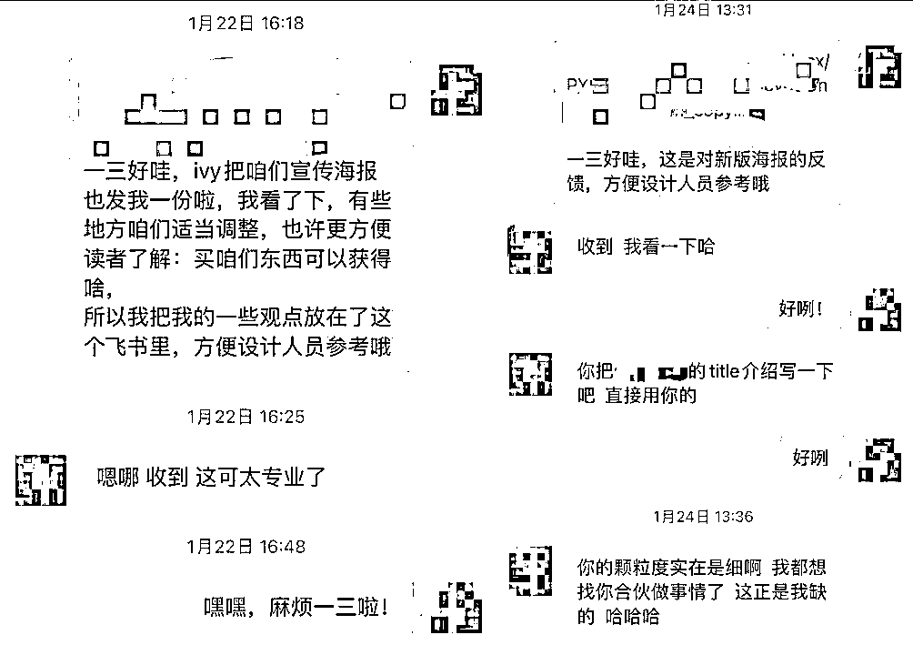

## 3.1 配色分析

下方圖片是當時的「修改歷史」，高亮字塊是「重點分析」

左中右分別是1版&2版&3版

#### Part 1：
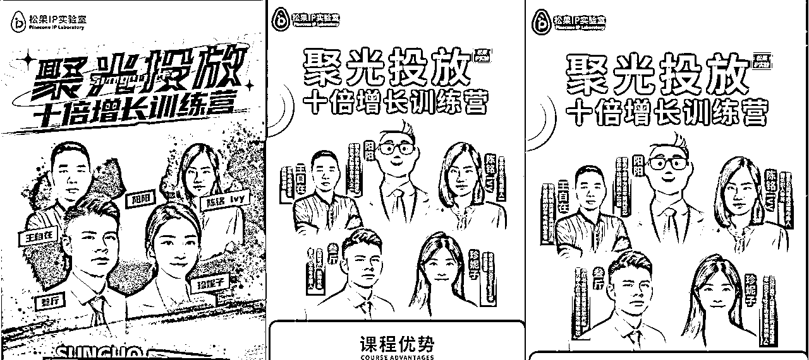

這是我當時的反饋：
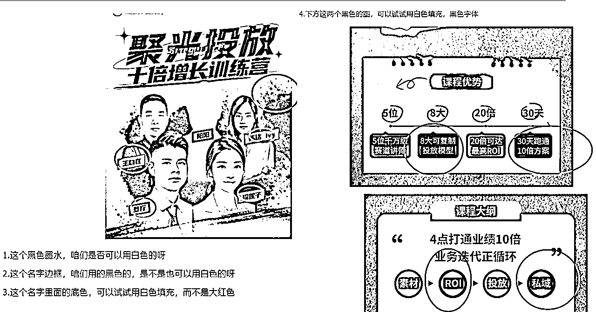
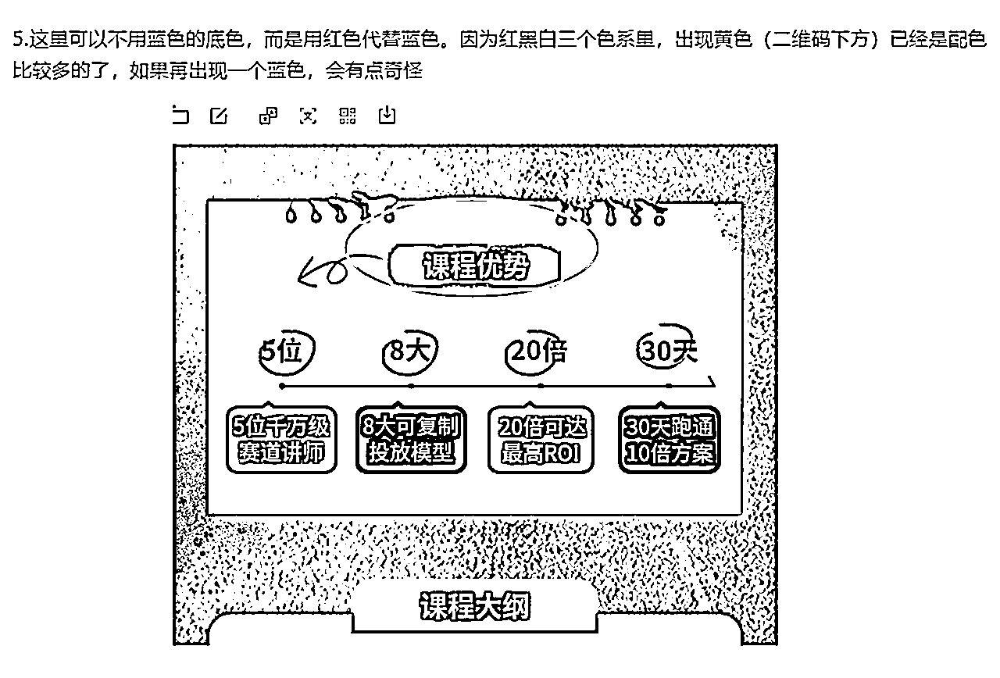
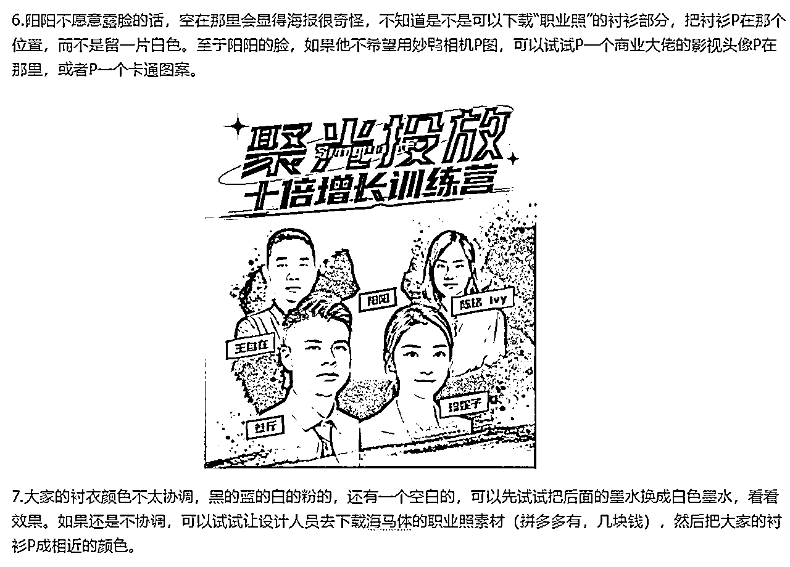

重點分析：
紅黑和紅白都是對比色系，考慮到其他地方已有松果的logo，這時sunguo IP不需要再那麼顯眼，所以弱化成白色。

一定要統一顏色。對一張海報來說，主題色系兩個就夠了，比如紅黑、紅白。不要又紅又黑又白又藍又黃。【珍妮呆滯臉】

我當時上傳寸照時，好多年沒出門上班，臨時掏不出寸照，就用妙鴨相機生成了一下。妙鴨相機美顏確實猛，生成了好幾個跟本人完全不像的我，但我也將就著發了。

發給一三時，我打包了四張照片給她，分別穿淺黃色衣服、白色衣服、深色衣服。因為我不知道其他人的寸照是什麼顏色，我想和大家主色調統一，方便設計人員隨時替換我的照片。

收到海報時我都愣住了，Ivy穿粉色襯衫，叁斤穿藍色，王自在穿黑色，陽陽不願露臉，只出現了白色人頭，差點把我笑出聲。

## 3.2 用户视角

### 3.2.1 先确定你的目标客户群是谁

我們的目標用戶主要是：
在小紅書平台「已經或即將開聚光的老闆和做投放的投手」。
而且，我們尤其針對做矩陣號的老闆，而不是單個帳號的個人IP。
【因為單個帳號的個人IP已經能從小紅書「關注流量」獲得很多流量了，除非他想擴張業績才會考慮鋪IP矩陣號】

所以大家會看到我一開始寫的那篇「老板避雷手册：如何識別不靠譜的運營、合作商、合伙人？」https://t.zsxq.com/17clCvA0e
其實這也是為當時的訓練營做鋪墊而寫的。

### 3.2.2 找到你的目标客户群在什么位置，分析在哪里做曝光能让对方看到自己？

我們的目標客戶群，不僅僅在生財，還可能是在小紅書搜怎麼做聚光投放的老闆，還可能是關注叁斤等人公眾號的老闆。

所以，在介紹叁斤時，我們不能寫：「航海教練」，因為生財以外的人不知道航海是什麼。

在介紹ivy時，不能只寫「留學行業公司創始人」，因為生財以外的人不一定認識ivy，不知道ivy曾經做過什麼。Ivy的往期精華請戳：https://t.zsxq.com/17tvEOFgZ

於是我有了下面的反饋：
#### Part 2：
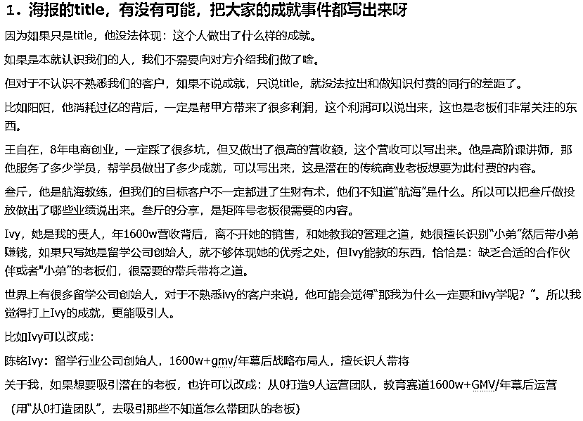

### 3.2.3 想想你的目标用户群需要什么

針對老闆，他想要的不是看我們怎麼吹牛逼，他要一個降本增效的解方，讓他的筆記跑得通，有更多人禮貌問價，成功加V。

尤其是做矩陣號的老闆，他想知道：怎樣比同行花更少錢，佔據更大市場，創造更大利潤。

而且，跑矩陣號的老闆基本都不喜歡透露自己的產品或帳號，所以不可能拉群把老闆們的投放過程拿出來分析並做案例，只能單獨拉小群帶他們實操，然後配上通用版的降本增效投放課程。

所以，老闆們都需要提高自己的矩陣號「搜尋流量」和「首頁推薦」流量。

解方是：
A. 從素材源頭調整，把筆記寫對。筆記寫不對，寫出爆款也是浪費錢。沒寫出爆款也投不了放。
B. 拿到這個行業的內部投放數據或經驗，讓有經驗的投手教自己。

此外，所有用戶都對一上來就標明價格的產品不感興趣，不然營銷味太重了。

不要急著收錢，先想想自己能給用戶帶來什麼。

尤其是老闆，老闆只優先關心產品能不能解決他的用戶痛點，能解決需求、價格合適，他就買了。

不能解決需求，價格再便宜他也懶得買。
價格超預算，他一樣不會買。

老闆不是大冤種，他們能把公司從0到1做起來，他們腦子裡的帳單計算系統比基層工作的人都強。

所以沒有必要在海報最上方就放一個收款碼。

所以，有了我下面的反饋圖：
#### Part 3：
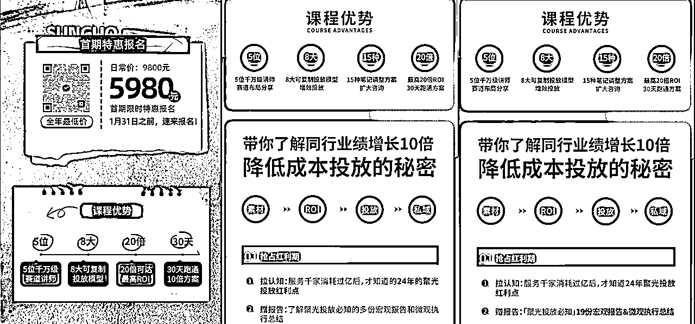

這是我當時的修改方案：
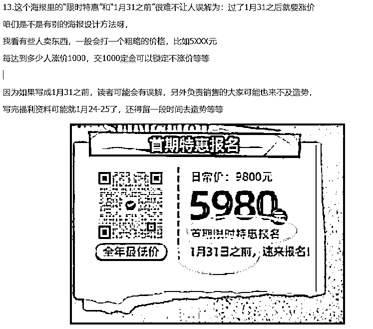
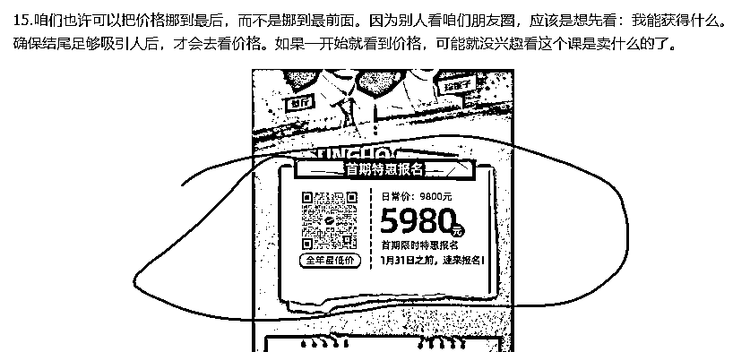
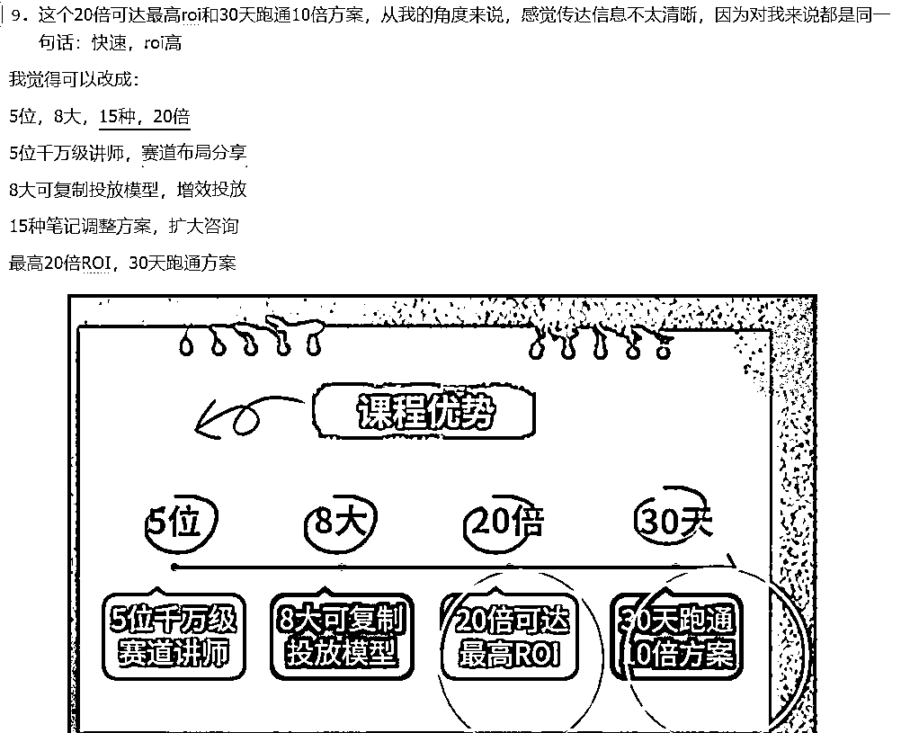

重點分析：
關於「5位，8大，15種，20倍」這個詞，這裡我調整了順序，把15種調在了20倍前面。

至於加這四個關鍵詞「賽道布局」「精準投放」「擴大諮詢」「30天跑通」的目的，都是為了給讀者揭示一個「結果」讓他知道我能從這得到什麼。

### 3.2.4 确定你的产品和同行产品有什么区别，你要怎么去体现「人无我有」你的优势

很多人都在做IP訓練營，或者帶老闆們搞錢。

有的人是提供一個已經跑通的項目，
有的是提供合伙人平台方便交流&資源整合，
有的是做細分賽道，如教育賽道、電商賽道。
有的是做平台細分，如帶你在小紅書賺錢、在抖音賺錢。
有的是做環節細分，如：運營課程、銷售課程、公域成交課、私域成交課等等。

而我們提供的，是「聚光投放訓練」。

聚光是23年6月火起來的，小紅書慢慢開啟的商業化步驟。很多老闆之前只會做運營，卻沒有投放經驗，所以花出去了很多錢，也沒打出個水花出來，只是為了給小紅書交保護費罷了。

总有人问我：小红书上的投放，为什么我们能做起来？
我的答案很简单：因为团队里都是真刀真枪跑过项目的人。

叁斤、王自在两个，本来就是专职投手；阳阳对小红书平台侧的机制门儿清；Ivy 负责策略统筹。这几个人做过的行业，家居、文旅、电商都算，跑出来的数据不含水分。
市面上大多数 IP 训练营，给不出这种“人无我有”的聚光实操底子。

所以当初设计课程时，我特意把这一点放大。当时记录下来的思路是：

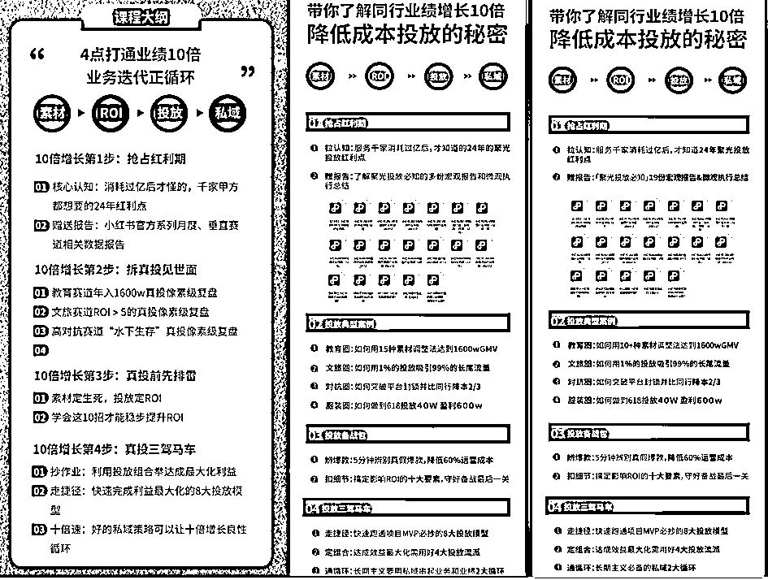

这是我当时的回复：

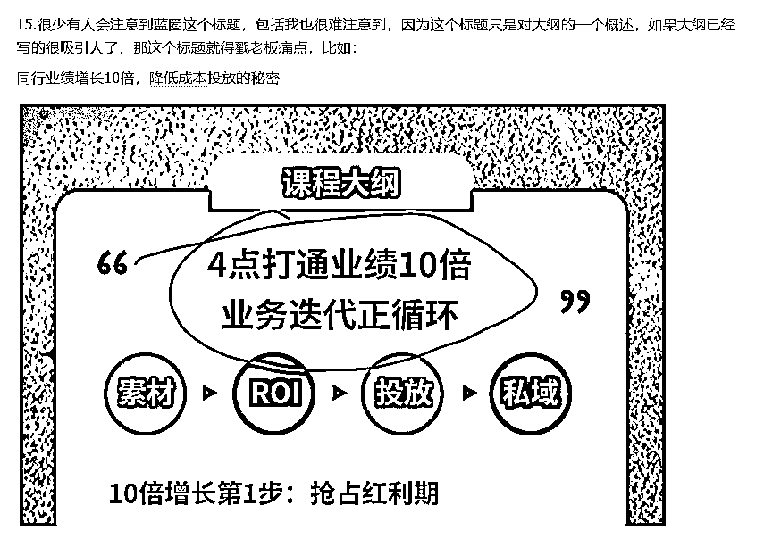

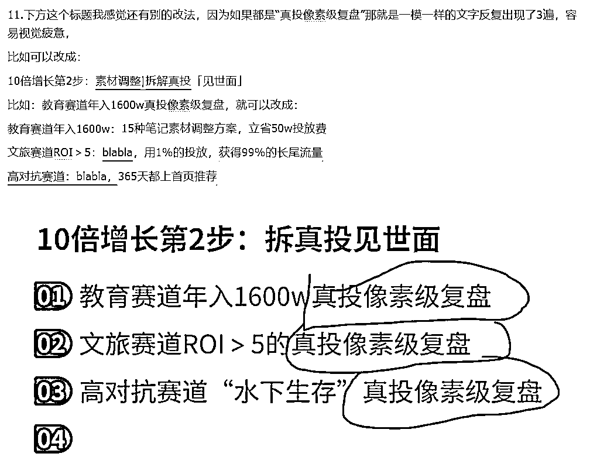

先说“素材调整｜拆解真投”这组词。
我想说的是：课程不只教你怎么投，更会带你从源头修内容素材。素材本身不行，出价再高、计划再多，也跑不出成绩。

“长尾流量”和“首页推荐”，是我刻意拆开的。
平台上的矩阵账号能稳定拿到的自然流量，无非两类：推荐流给的曝光，搜索流带来的访问。搜索流量通常能持续很长，所以我会把它单独叫作“长尾”。
而“关注页面”那种入口，通常更青睐有人格的账号。缺少人设的矩阵号，基本吃不到；除非你做的是情绪价值型内容，这我上一篇文章有详细说。

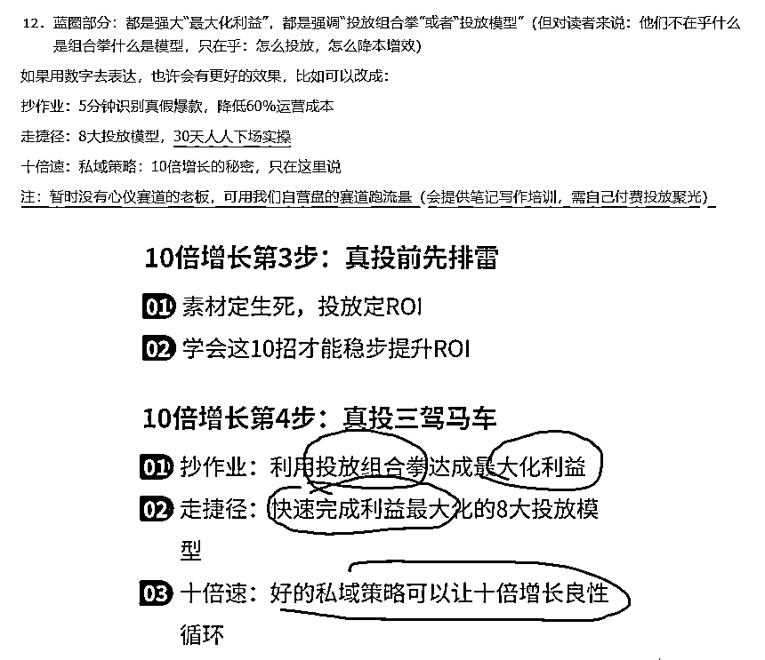

“30天人人下场实操”，是写给目标客户的定心丸：这不是听课课，是要亲自下场，方案还会随数据反馈随时调。
后头那行“注：暂时没有心仪赛道的老板，可用我们自营盘的赛道跑流量（会提供笔记写作培训，需自己付费投放聚光）”，则是替还没开聚光账户的老板准备的。

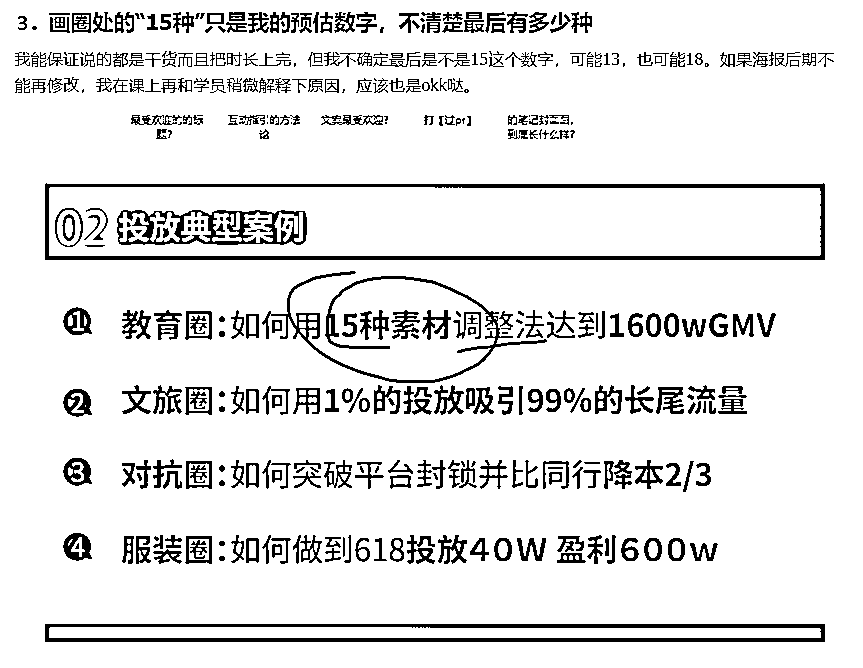

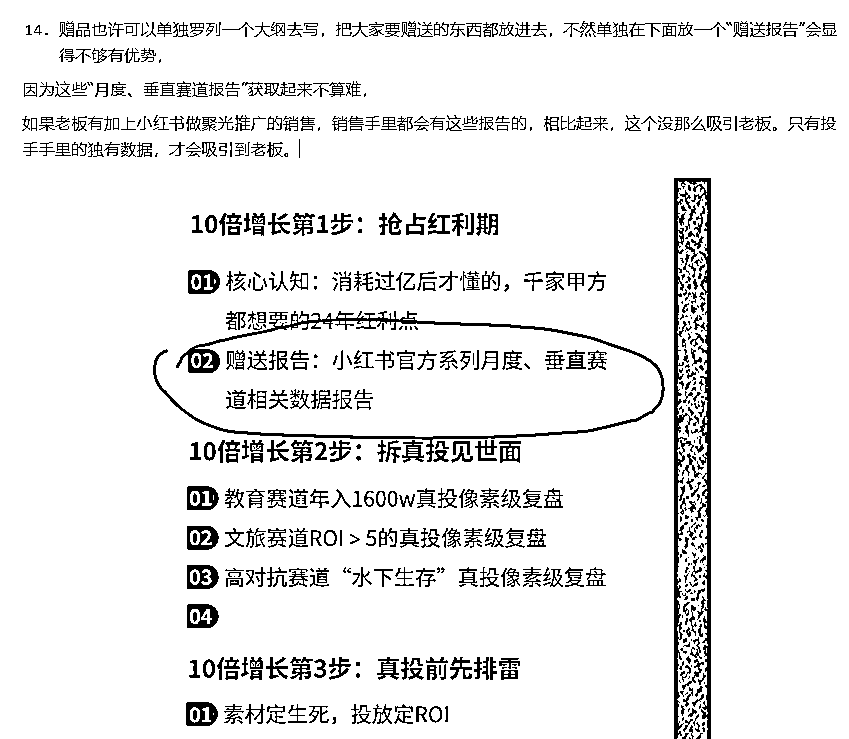

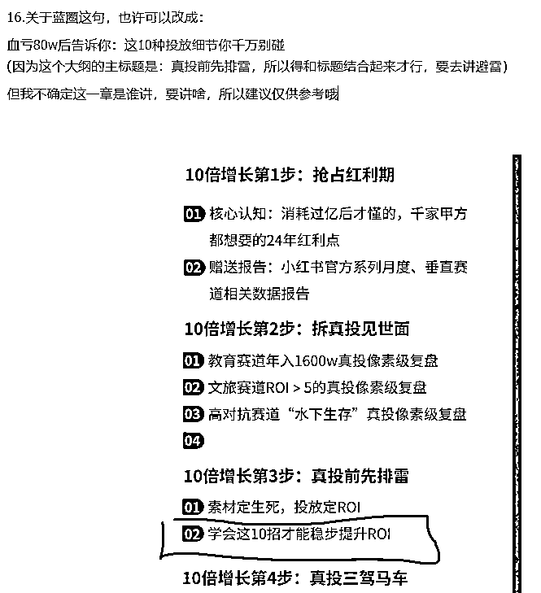

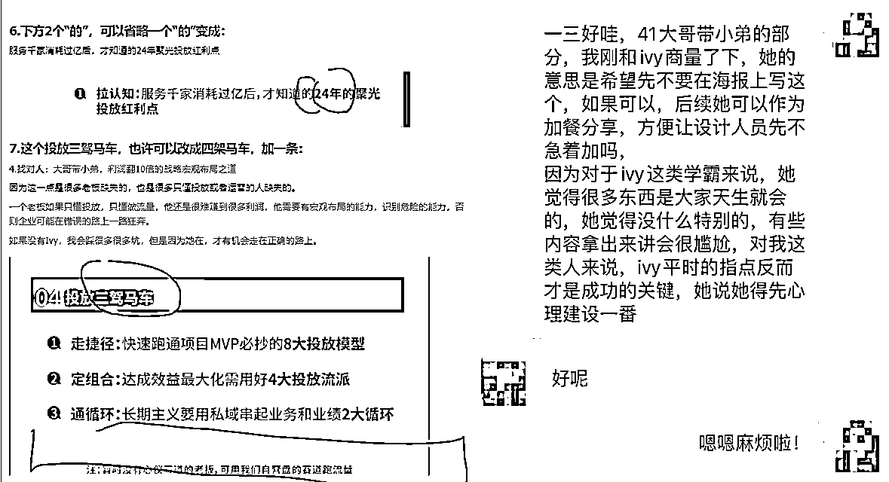

再多说一句：原本设计过“大哥带小弟”的卖点，后来没放。
因为 Ivy 看到会不自在，她抗拒给自己加光环。有些老板相反，账上没钱也要把盘子吹成几个亿。像她这样连吹牛都不屑的人，太少。我有时候还替她惋惜——稍微包装一下，也许能多签不少客户，她偏不。

下面聊三个文案技巧。

第一，多用数字，尤其奇数。
模糊的“很多”“不少”都不如一个具体数字。且奇数比偶数好记：3、5、7、9 都是。可以说“3分钟学会”“5个方法”，别再说“几分钟”“几个方法”。
对应的反馈：

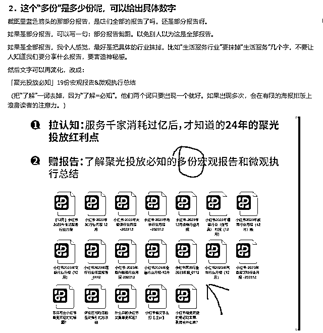

第二，说人话。
三个字能讲明白，就别再堆到五个字。读者没有义务替你拆句子。

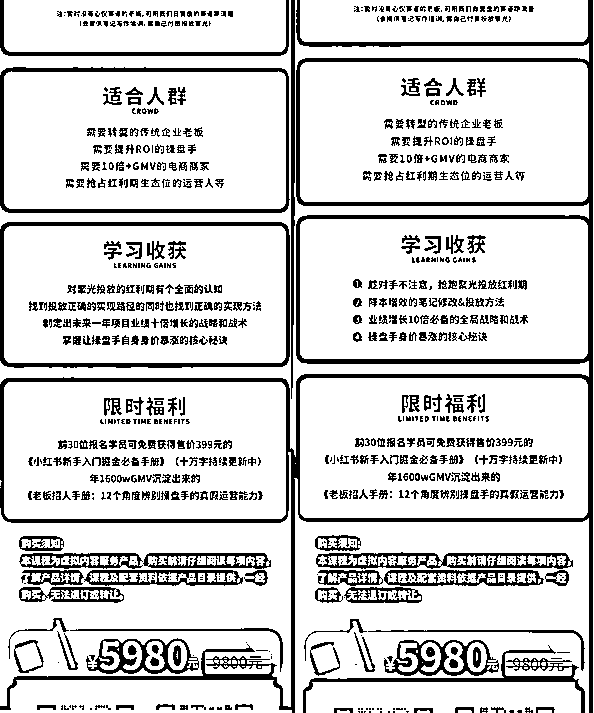

那会儿我的建议是：

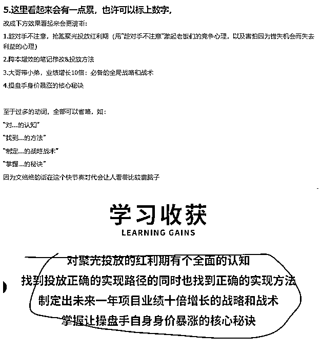

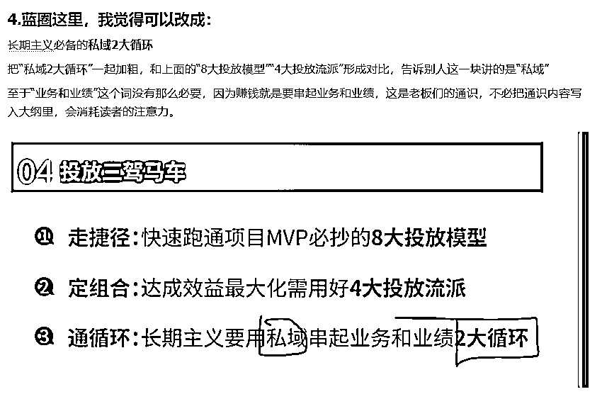

第三，确保客户能看懂。
客户可能不知道“聚光”，更不会明白“水下生存”这类黑话。
盖洛普那篇文章里我也说过：别把“盖洛普”三个字单独扔进标题；要放，就搭配其他容易理解的关键词。因为不是所有用户都认识这个词。

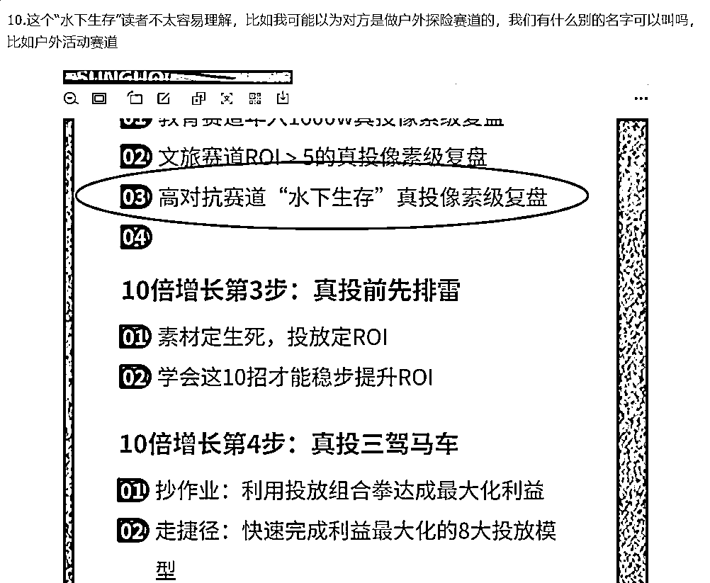

下面进入致谢。

先谢谢 Ivy。
你们眼里那个做成两年千万 GMV 的我，其实是靠无数个错误喂出来的。每次试错，烧的都是公司的真金白银。创业公司最怕现金断流，但她还是放手让我试，只会在 ROI 不对劲时把我叫停。
而且，她家阿姨做的牛肉丸真的绝。我这个连账都算不明白的人，白吃白喝，还一路混成老板，在家工作第四年，小日子不差。

没有她的鼓励、支持、陪伴，没有她的销售转化和战略判断，我大概会在某个路口直接迷路。不只是没现在这份成绩，连这篇文章都不会有。

我特别怕对外谈合作，一碰账，整个人就像被抽空。作为一个 i 人，每回社交完，我都要瘫在沙发上很久才能恢复元气。所以我问 Ivy，能不能由你去当对外商务对接人。
她应下了。
可她也是个 i 人，身体还在慢慢调理，依然选择把这块担子接过去。
没有她，真的没有我。

这世上和我相似的人太多了：懂点英文、懂点翻译、懂点设计，做过公众号小编，站过讲台，又想赚钱。
为什么最后是我跑出了成绩？
我猜，差别在于我遇到过的老板们。

最早那位，觉得我助教干得不错，打算让我做助教管理员。我跳槽了。
后来又遇到两位，都觉得我课讲得好，想让我当金牌老师。其中一位还劝我：25 岁找什么对象？我 30 多也没结婚，公司里单身的可多了，好好上班。
我听完反而下定决心：老板这岁数都没对象，这公司的姻缘福报我不信。我本来就怕找同行，别把单身气场传给我。辞了。
再后来的老板，要我当他的金牌写作机器，日夜盯稿、倒时差。月薪 1.5 到 1.8 万，但没个准。我总担心下个月只剩 1 万，压力大到满脸长痘，相亲都受影响。那年中秋，我正泡温泉，还被他叫起来熬夜补锅。于是又辞了。

辞职两年后，那位老板还来打听我在做什么；更早那位，2023 年夏天打电话让我回去。
我都不好意思讲：那种拼了老命一个月也就挣两百块的班，我真的无福消受。

只有 Ivy 看见了我真正想要的生活。
我不想天天管助教；不想当那个穿梭在各校区、连交通补助都没有的改作业机器人；更不想为了赚钱熬丑自己。
我想要更大的价值感，想要自己说了算的时间表，想睡饱觉，想避开通勤。我想趁还年轻，找到一个我够得着的最好的伴侣。
当时我刚分手，25 岁。不趁这个时候认真找，还等什么时候？
我还想结婚，想生孩子，想体面地老去。等我 60 岁，要做全小区最有气质的老太太，当广场舞领队，把孩子们孝敬的金条拿牙咬一咬，再留给孙子孙女。

前东家们只关心我有没有按他们的期待待在岗位上，有没有当好那台廉价劳动力机器，替他们持续产出。
没人问过：我想坐什么位置，想过什么日子。
Ivy 问，而且她还希望我飞得更高。
她是我的伯乐。因为她在，我才有今天。

每个老板手边，大概都藏着这样一个“我”。
差别只在于：你有没有察觉他的需求，并愿意满足；有没有让他相信，他并不想单飞，只想跟着靠谱的人把事做成；有没有放手让他试，同时在偏离时把他拉回来。
一旦做到，他会还你巨大的利润。

你找千里马，千里马也在找你。

再谢靠谱。
我的稿子能篇篇加精，全靠她在后面把关。
初稿其实很乱，我自己毫无察觉。靠谱提醒：别因为写过很多篇，就默认读者读过你从前的文字。把每次写作都当成第一次露脸。先把框架捋清——你说的运营端，是公域还是私域？再想想标题怎么增强情绪，让人扫一眼就点进来。

谢生财。
发帖之前，真没想过会被一堆大佬主动加好友。
我老早就想了解人工智能儿童教育，始终没有入口。直到帖子发出来，刘娜出现了。
她是上海高校工科教师，做 AI 算法十几年，机器人方向也有五年。读博期间做过私域副业，最高一年赚到接近一百万。
她瞄准的是儿童教育赛道，正好踩中我这个打算等孩子满五岁就送去学 AI 的妈妈的心。

也谢玩赚合伙人。
我进来本来是想请靠谱和芷蓝姐帮我定新赛道的变现方向，结果当天就碰见一泽。
这是他当时的往期精华：
https://t.zsxq.com/11Y12be1r
https://b23.tv/ic8qBDw

我找他请教矩阵账号怎么高效扒小红书数据，他当晚拍好示范视频发给我。我又继续提更多需求，等着他打磨一个真正适合小红书矩阵账号的扒数据机器人：不要花里胡哨，只要最精简、最顺手、最能保护企业隐私。
进玩赚合伙人，等于同时得到靠谱和芷蓝姐的点拨，还捞到一堆跨界高手，超值。

谢拱卒。
做聚光训练营时，卡过一个现实难题：不少老板并未开通聚光。
针对还没开户、又没有自营赛道的老板，Ivy 和我打算先用自有赛道帮他们跑，顺手培训笔记写作。
可这类产品有个特点：返佣周期被拉得很长。怎么办？
拱卒给了一套很管用的解法。虽然最后训练营因我个人的原因没上线，但那些建议我牢牢记住了。

最后谢叶叶。
她是一名盖洛普教练。
我真心劝那些准备和朋友一起做生意、或者在创业的人，先去找叶叶测一轮盖洛普，看清彼此的优势怎么摆才最互补。
2021 年年初，我和 Ivy 就认识叶叶了，当场被她的优势分析折服。这几年她做的案例越来越多，我相信她的建议对各位老板同样有效。

最后，愿大家在 2024 甲辰龙年，财旺福旺运道旺，人旺福旺身体旺，越走越旺，旺上加旺！

