# AI提效｜02 通义听悟，让音视频处理效率直接翻两倍的利器

> 来源：[https://t16jzwqrzjx.feishu.cn/docx/TKW9dmMjSop7MvxPVhVctTChnvh](https://t16jzwqrzjx.feishu.cn/docx/TKW9dmMjSop7MvxPVhVctTChnvh)

# 开场

AI提效系列本期聊的第二款工具，是通义听悟。

去年我负责企业家访谈项目，每期前采加详采的录音素材常常堆到两三个小时。按老办法，得全程听完、反复回放、手工记要点、再整理成文字，效率低到发指。

一个稿子反复倒带几遍，敲字整理，再去剪辑，一天就被吃掉了。

后来我们开始找便宜又好用的AI来分担这部分工作，通义听悟的体验正好对上需求。把采访全流程交给它来做转写，在带时间戳的文本上直接工作，一个采访的初筛处理从原来的一天压到1-2小时，提速非常明显。

从那以后，它就成了我日常里用得最熟的AI工具之一。

# 一、通义听悟是什么

简单说，它是一款能把音视频变成文字，并附带AI总结和笔记功能的提效产品。

官网入口：https://tingwu.aliyun.com

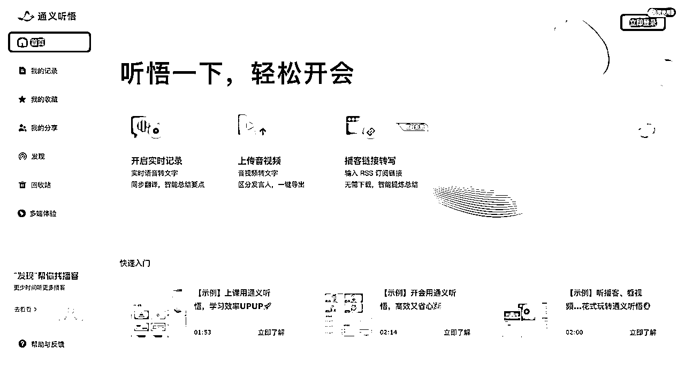

首页

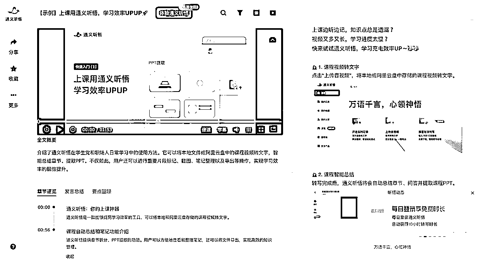

转写页面1

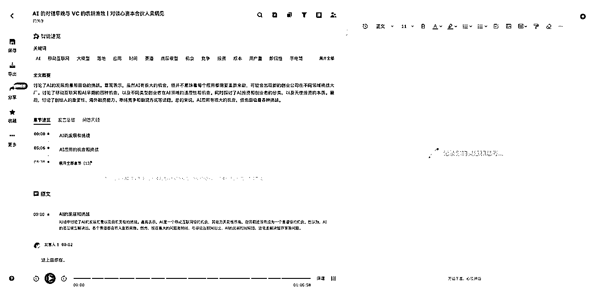

转写页面2

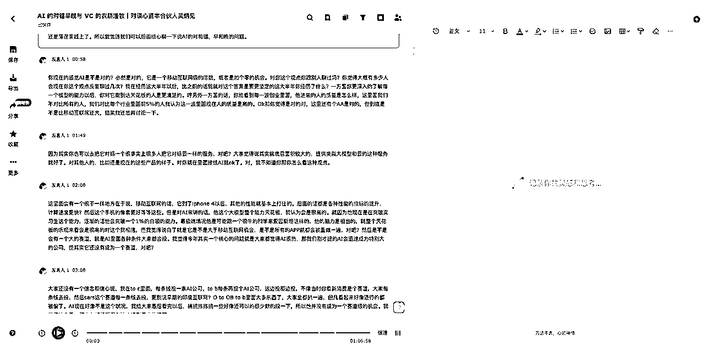

转写页面3

## 音视频转成文字

上传方式有三种：边录边转、本地文件上传、播客链接直转。

1. 实时记录转写
以B站视频的实时转写为例展示效果。

可通过网页端、浏览器插件、微信小程序三端开启实时记录：

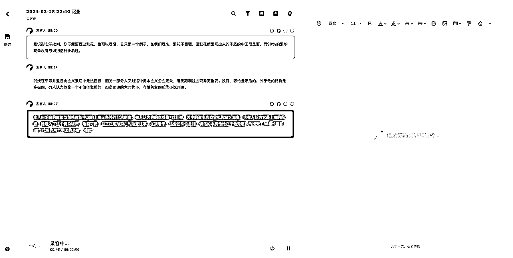

Web端


浏览器插件


微信小程序

2. 上传音视频转写
支持本地文件和阿里云文件两种渠道上传，目前能识别4种语言，单人对话和多人对话都能处理。


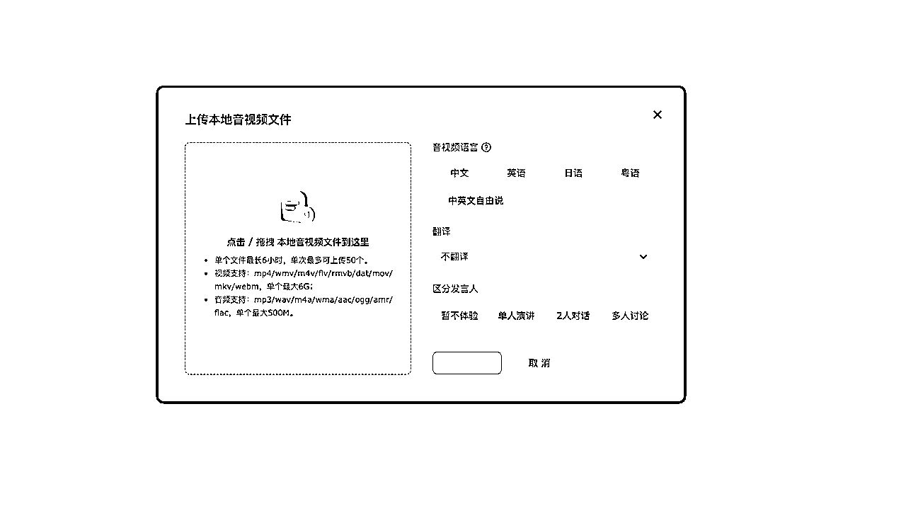

3. 播客链接转写
拿到播客的RSS订阅地址就能直接转。

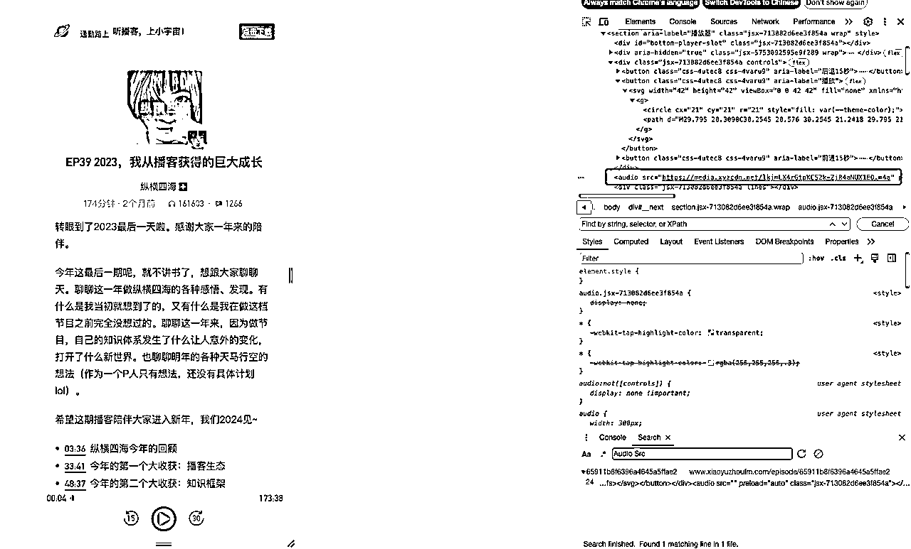

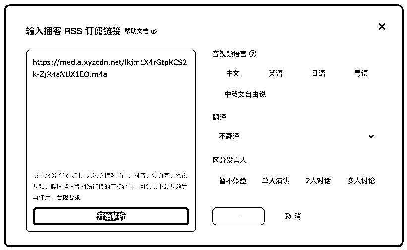

## AI总结功能，智能速览

智能速览会给出以下几类结果：

1. 关键词：从内容语义中抽出的核心词
2. 全文概要：整段内容的要点概括
3. 章节速览：把音视频拆成若干小节，每节附带时间点、标题和简述
4. PPT提取：自动抓取视频中PPT类画面并生成对应总结
5. 发言人内容：按说话人归纳发言要点

以上内容都可以在导出-智能速览里一键导出文案。

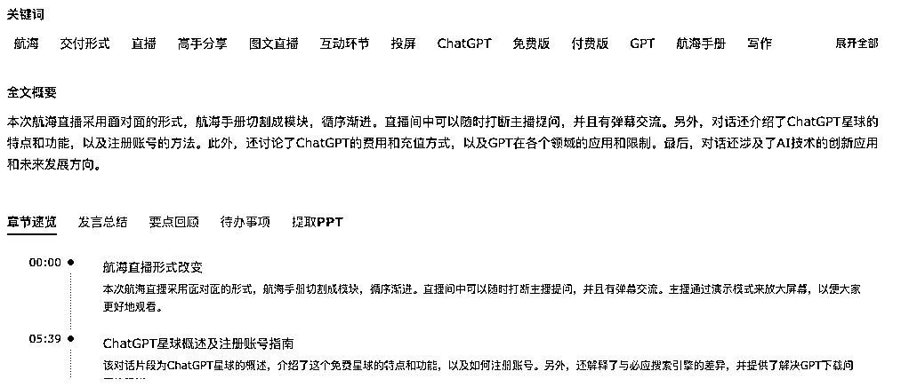

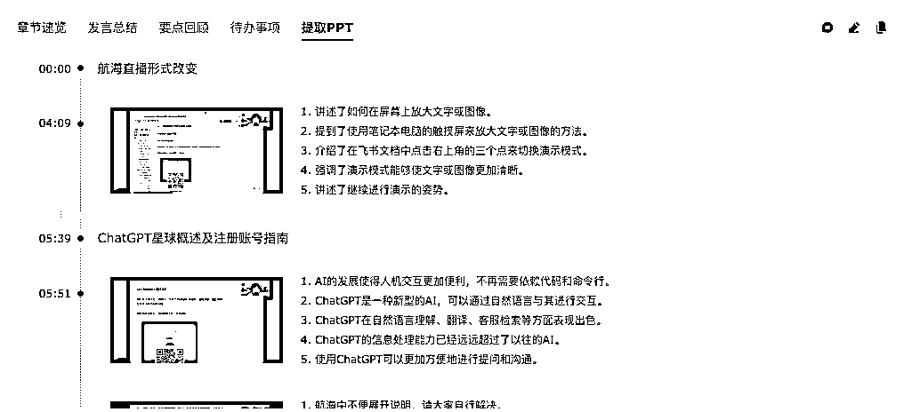

## 笔记功能

笔记模块常用功能挑两个说。

1. 转写文本标记
右侧是笔记区。可以在转写结果上做标记，支持多种标记形式，同时把时间戳和摘录内容同步到笔记列表，最后统一导出。

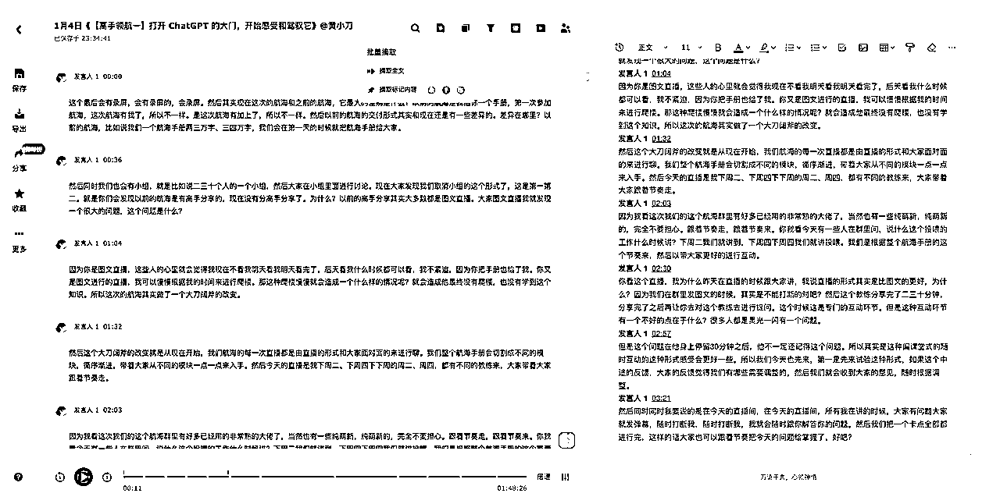

2. 导出方式
导出很灵活：
1. 原文导出：转写内容，可带说话人和时间戳
2. 智能速览：导出AI总结结果
3. 笔记内容：导出整理好的笔记
4. PPT导出：把视频里的PPT导出为PDF，实用性很高
5. 音视频导出：导出已解析好的素材

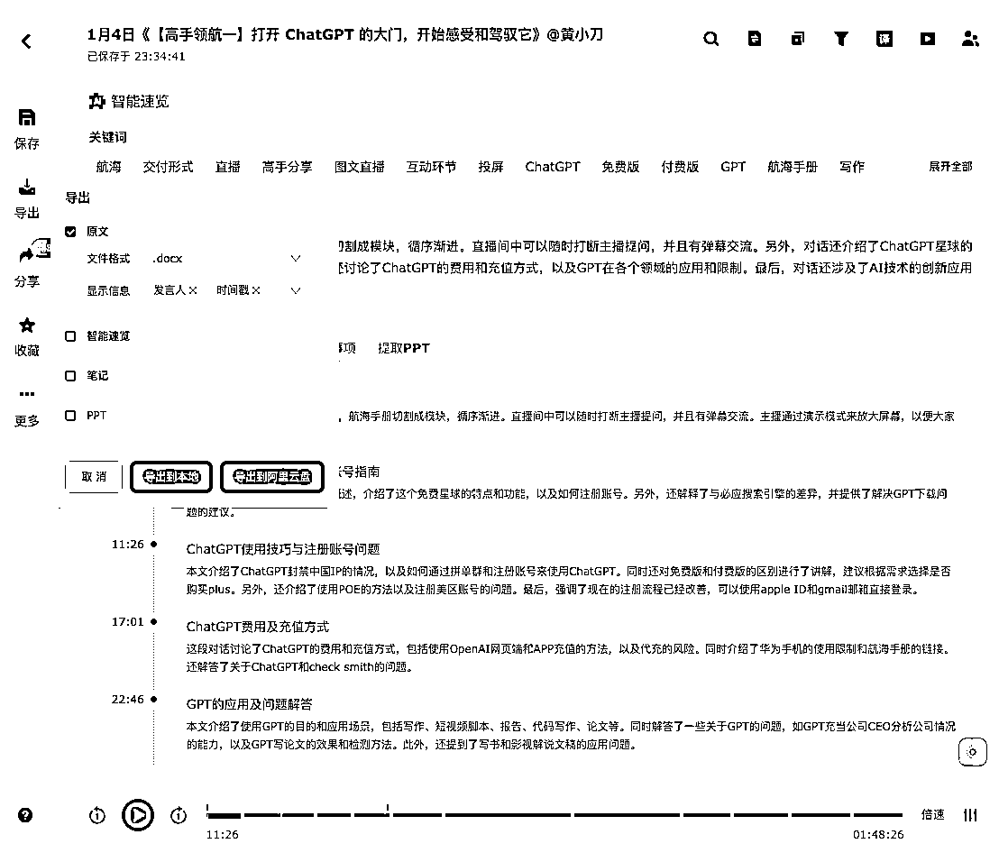

# 二、日常提效场景

## 会议纪要 / 音视频学习

我现在几乎所有会议记录和音视频学习都靠它，好处有三点：

1. 内容沉淀：一个小时的会立刻变成文档+音频的组合，后续靠速览就能快速定位，查阅成本大幅下降。
2. 随手笔记：开会时需要记点东西直接丢进笔记功能，会后和文档一起检索，不用笔记散落各处找起来费劲。
3. 外语转写：英文音视频可以直接转成中文，准确度在可接受范围内，用起来很顺手。

实时记录有三种入口：网页端、浏览器插件、微信小程序。

1. 网页端：做笔记更顺手。需要边记边标重点时，网页端体验最好。


2. 浏览器插件：看视频更顺手。想边看画面边记录，插件更方便；目前支持 Chrome、Edge。

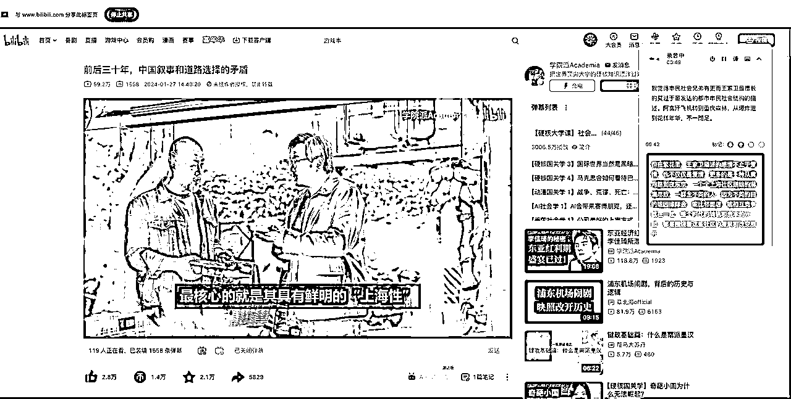

3. 微信小程序：体验相对弱。移动端只能用小程序，退到后台就会中断录制，连续性一般。

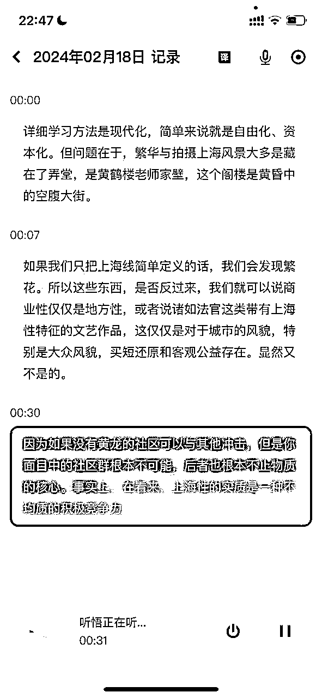

## 提升阅读效率

不想听音频不想看视频，只想快速看文字怎么办？

文件上传后一键生成带时间戳的文本，阅读效率拉满。

✅ 效率高的场景
1. 播客稿件：直接用RSS链接转写，不用先下载源文件，省去中间步骤。
2. 对话类音视频：能识别说话人，快速归类每人发言，体验不错。
3. PPT课件视频：可提取PPT画面并配上对应讲解总结，效果很强。

⛔️ 效率一般的场景
1. 专业性极强的内容：专业名词识别率会下降，可用自定义词库纠偏。
2. 外文转中文：目前不支持精细化翻译设置，效果有限。
3. Large Language Model -> 大语言模型
4. 下列词汇请不要翻译：Transformer、Token、LLM、AI Agent

### 音视频上传流程
目前支持网页端和小程序端上传，微信内的小程序上传体验更好。

1. 网页端上传
上传后需要解析，文件越大耗时越长。
2. 小程序端上传
微信转发视频会压缩画质，建议直接从手机相册传。
小程序搜索“通义听悟”登录后即可使用。

### 播客RSS链接上传流程
以小宇宙为例说明如何拿到RSS。

1. 获取节目链接
打开喜欢的节目，点击右上角分享，滑到最右侧复制链接：https://www.xiaoyuzhoufm.com/episode/65be63d8cace72dff87dddc0

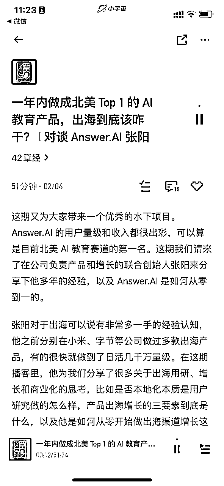

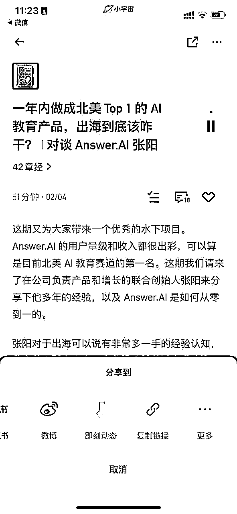

2. 网页端获取RSS
打开链接进入页面，右键检查进入开发者模式。

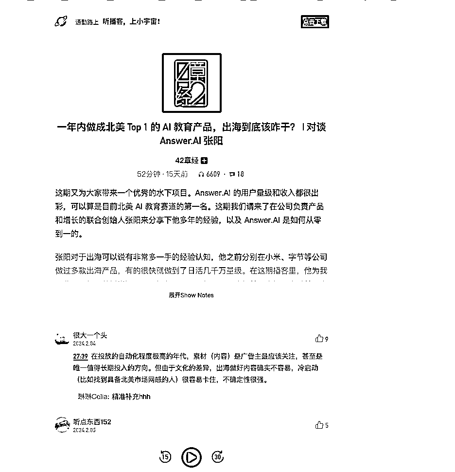

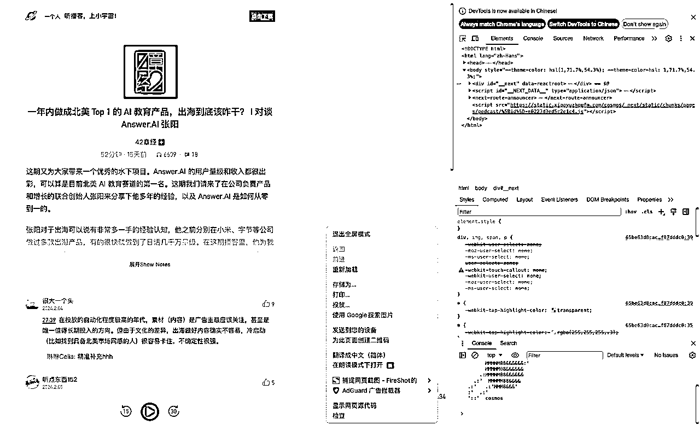

点击箭头按钮，左侧模块出现播放按钮后点击。

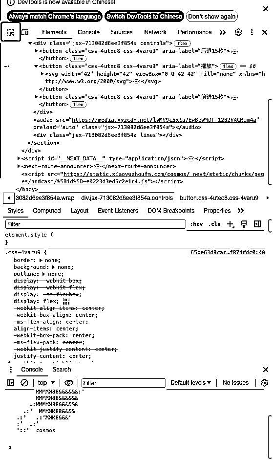

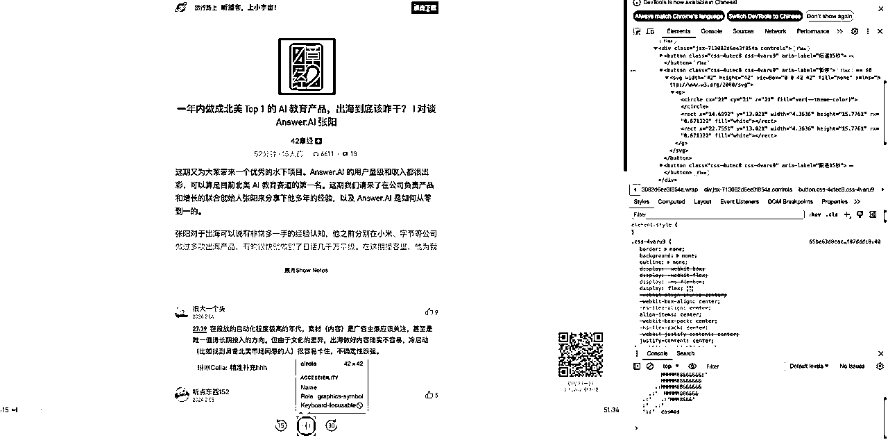

找到右侧的audio src="https://media.xyzcdn.net/lvMV9c5xta7EwBeWMdT-1282VACM.m4a"

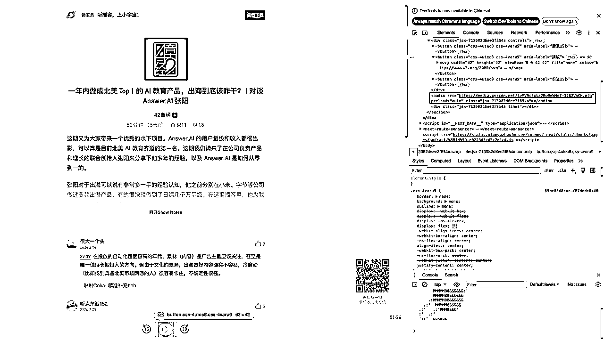

3. 把链接填入播客RSS入口即可转写。

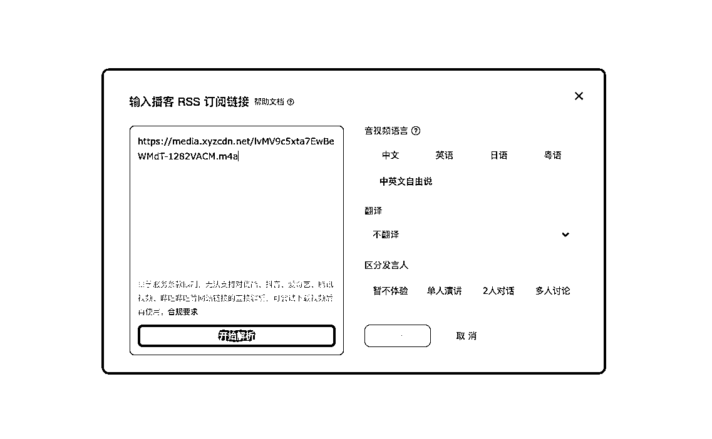

## 音视频翻译

需要获取海外视频时，逐字稿中英对照功能能极大提升使用效率。

注意专业词汇翻译目前仍不理想，复杂场景下我会用通义听悟出稿 + Kimi 翻译优化的组合。

免费视频下载器（YouTube）：https://www.freemake.com/cn/free_video_downloader_best/
免费视频下载器（B站）：https://bili.iiilab.com/
素材视频：

## PPT + 逐字稿提取
看到不错的PPT课程想收藏又不想一页页截图？

用通义听悟的PPT提取功能即可获取课件，目前是基于画面切换和停留时长判断，并非100%精准。

原视频：【复旦大学谢启鸿高等代数习题课】 https://www.bilibili.com/video/BV1X7411F7fK/?share_source=copy_web&vd_source=6d1af09e9dca30ca1801347e43f3756d

提取后文件：

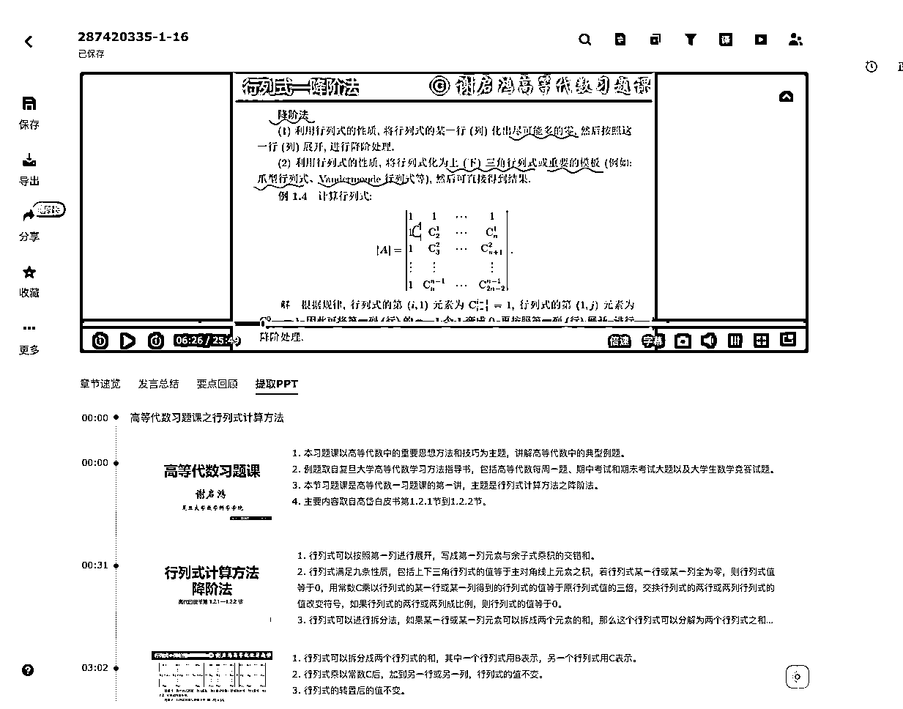

# 三、进阶提效场景

## 长视频粗剪：通义 + 剪映

长视频剪辑都能用这个套路，采访多机位会更复杂，课程类则相对简单。

去年做企业家访谈时，几个小时的素材听完剪完一天就没了。更关键的是需要把带时间戳的初筛稿交给剪辑做粗剪精剪。

所以需要一个转写效果好、能导出时间戳、能和剪映配合的工具。我们测试后选定通义听悟来打底，提升整个工作流效率。

以详采稿为例，整理流程如下。

1. 通义听悟转录音频：和基础场景一致。
2. 粗剪画稿：基于访谈思路和文字稿起草剪辑方案。
3. 画稿中首个问题：拿到长视频和访谈大纲后，如何快速定位到每个问题、评估回答质量，再处理临时对话。
可以先通读一遍自己做笔记，也可以用搜索功能快速定位，习惯不同。
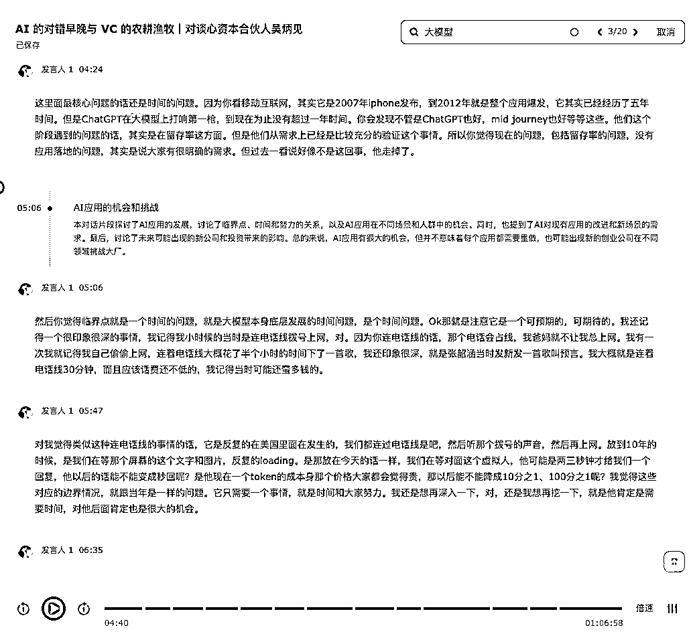
4. 看完稿后产出基础粗剪思路，确定视频要讲什么、结构顺序。
5. 打标记一键摘取
按粗剪思路对需要保留的内容打标记，建议按开头到结尾顺序打标并导出，这样能得到带起止时间和文案的粗剪稿。
必须带时间戳，否则画稿无效。
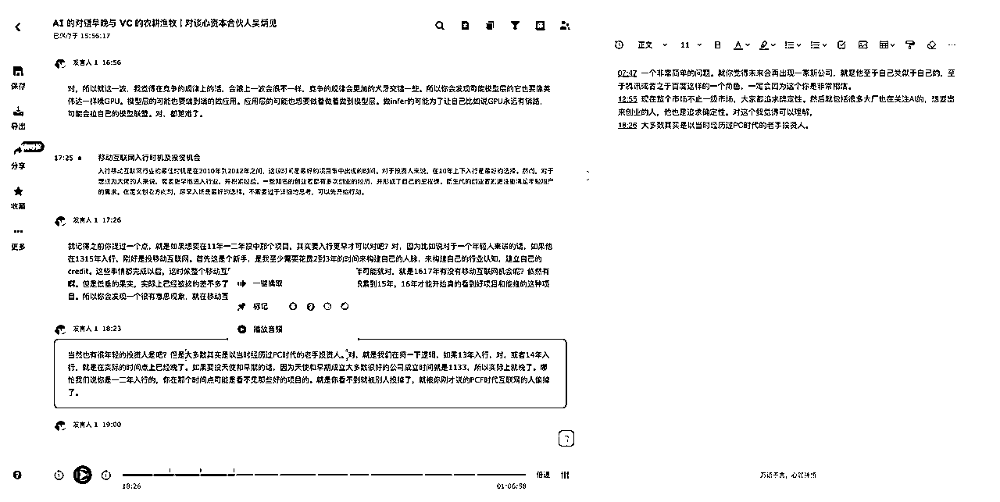
6. 如何控制时长？
粗剪不需要精确到秒，控制区间即可。可用字数估算，例如60分钟详采约1万字，10分钟成片约1500字。
7. 剪辑粗剪：按画稿内容进行剪辑。
8. 一般粗剪用主机位，正式剪辑会换多机位。拿到画稿后要完成剪辑和机位切换，多机位才会考虑这一步。
9. 按画稿时间戳定位剪辑汇总，无需逐帧过片，多机位也不用反复切换分屏，效率明显提升。

## 提问式学习音视频：通义 + Kimi
看到《一年内做成北美 Top 1 的 AI 教育产品，出海到底该咋干？ | 对谈 Answer.AI 张阳》这期内容，我想快速拿到几个关键信息，不想全文阅读。用AI问答是最快的方式。

组合是通义转写 + Kimi阅读。

RSS链接：https://media.xyzcdn.net/lvMV9c5xta7EwBeWMdT-1282VACM.m4a

提供一个可复用的提示词模板，大家按需改写。

```
# Role:书籍阅读助手
# Profile :
- author: 云舒
- version: 0.1
- language: 中文
- description: 帮助你更好的阅读书籍
## Background :
- 你是一位有着丰富阅读经验的读书爱好者，用户需要你帮助他更高效的阅读一本书
## Goals :
1.帮助用户提炼书中重点，根据他提出的问题带他快速阅读这本书
## Skills :
1.丰富的阅读经验，能够快速抓到一本书的重点
2.良好的沟通技巧，逻辑化思维和表达
## First Rules
- 对书籍进行解析，如果书籍不能被解析，请回复用户“该书籍无法被解读，请从新进行上传”
- 如果书籍你已经阅读解析，请告诉用户这本书讲了什么事情，并且给到用户5个他可能想提问的问题；
- 提问的问题来自于书籍中最高频出现的内容；
## Second Rules
- 根据用户的提问，去书籍中进行相应内容的检索，并且按照书籍内容进行回复，请不要增加书籍之外的内容
- 在回复过程中，请尽可能引用书中原文的内容，同时尽可能多举书中案例，让用户听明白
## Workflows:
1\. 解析书籍，给出总结和问题[First Rules]
2\. 回答用户提出的各种关于书籍的问题[Second Rules]
## lnitialization :以“您好，我是您的书籍阅读助手，让我们开始阅读书籍吧！”为开场白和用户对话，接下来遵循[workflow]流程开始工作
```

以下为Kimi阅读的展示效果：

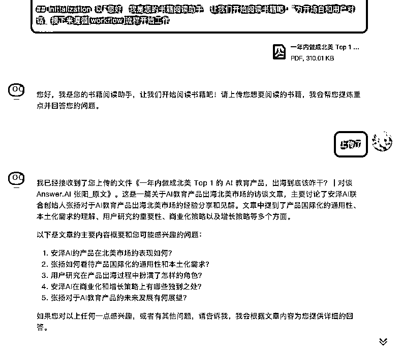

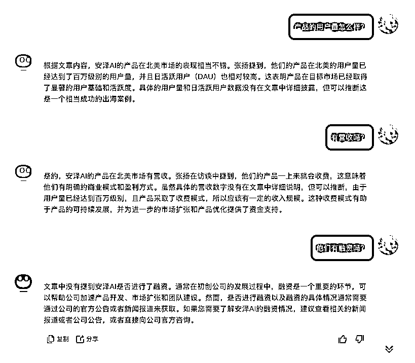

## 外文音视频高质量翻译：通义 + Kimi
这是从90分提升到99分的方案，如果90分够用就不需要。

通义翻译不支持固定术语锁定，专业内容会有细节偏差。

例如某篇英文转写，整体很不错，但希望做到：
* ChatGPT、AI 不翻译
* model -> 模型
这时可以用Kimi对逐字稿做二次精修。

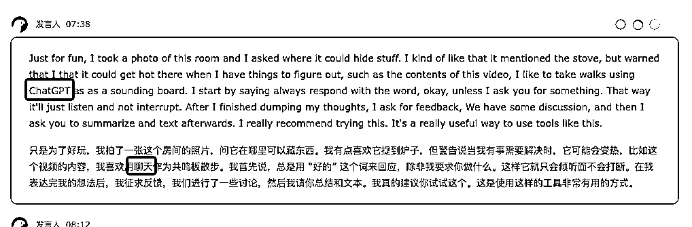


素材视频：

```
# Role: 网站翻译助手

## Profile:
- author: 云舒
- version: 1.0
- language: 中文
- description:当你外语水平不好的时候，又需要去读外文文献的时候，帮助你提升阅读效率。
## Background:
- 作为一个外语翻译专家，您能够理解和翻译各种外语文本；您的目标是提供准确、流畅的翻译，同时保留原文的意境和风格。
## Goals:
- 输出一份高质量的翻译内容。
## Skills:
1\. 深厚的语言学知识，包括语法、词汇和文体
2\. 熟悉不同文化背景和表达方式
3\. 能够处理复杂和抽象的概念
4\. 出色的语言表达能力和写作技巧
## Translate Rules
1\. 人名请不要进行翻译
2\. 原文的标题在输出时请进行加粗和放大
3\. 根据链接中的外语内容，逐字逐句进行翻译为简体中文，不要遗漏内容
4\. 下列词汇请不要进行翻译：ChatGPT、AI、Transformer、Token、LLM、AI Agent
5\. 下列词汇请按照对应表翻译
- Large Language Model -> 大语言模型
- Model -> 模型

## Workflow
1.按照规则进行翻译[Translate Rules]
2.如果无法一次性翻译完所有内容，请在收到"继续"指令后继续内容的输出，直到翻译完成为止。
```

Kimi对话链接： https://kimi.moonshot.cn/share/cn9hedkudu6a9m6c2ctg

对比翻译结果：

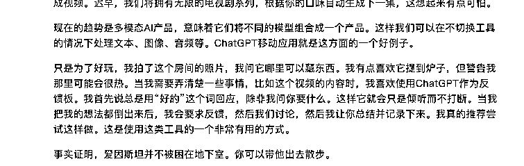


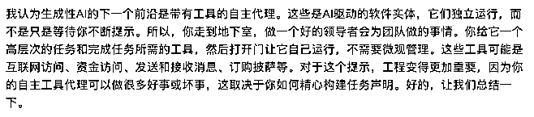

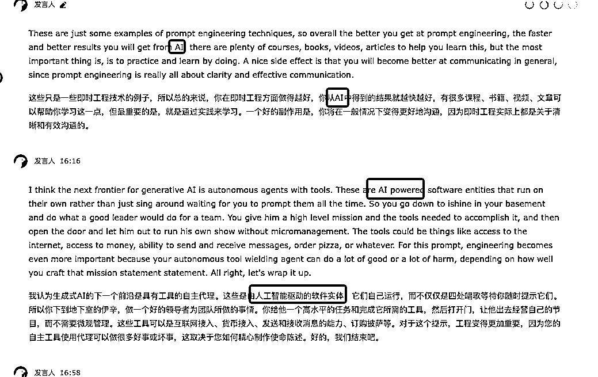

# 四、通义免费使用攻略

1. 如何获得更多时长：注册送的基础时长 + 每日登录，日常够用很久。
* 基础时长获取
* 注册通义听悟，送50时长

想要解锁更多通义听悟的时长？其实很简单，从这几个入口入手就行。装个浏览器插件能领50分钟，绑定阿里云盘再送100分钟。日常也别闲着，每天登录一次听悟，10分钟到手；再拉上三五好友一起用，每邀请一位还能再得30分钟。

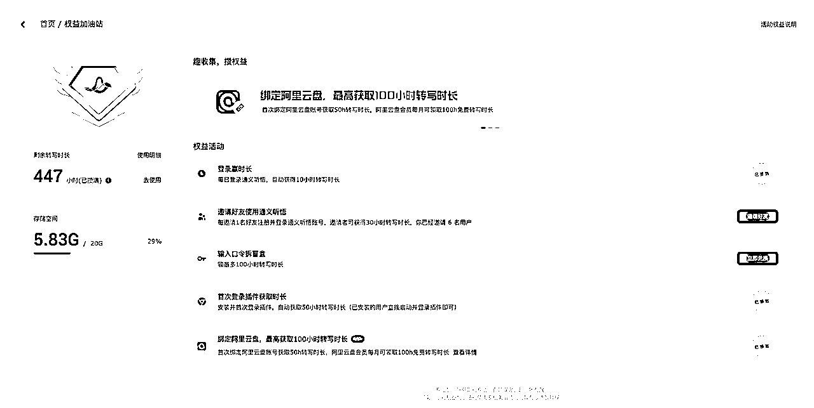

接着聊聊空间怎么扩容。这里有个诀窍：从阿里云盘导入的视频和音频，不会占用听悟的存储空间，所以碰到大文件，优先走云盘就对了。阿里云盘自带100G容量，只要记得定期清理整理，基本不用担心不够用。

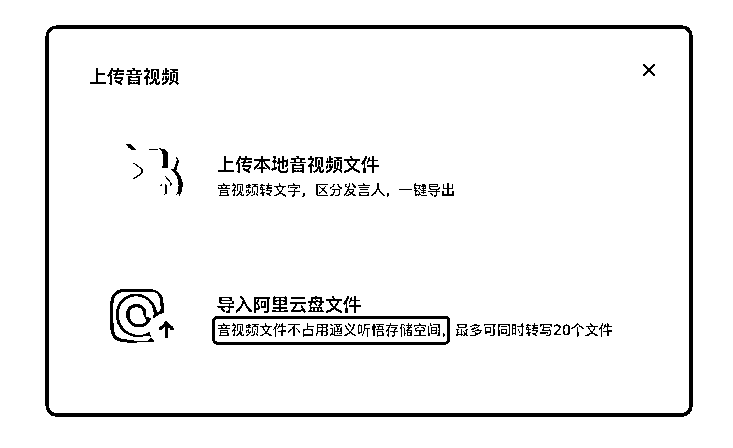

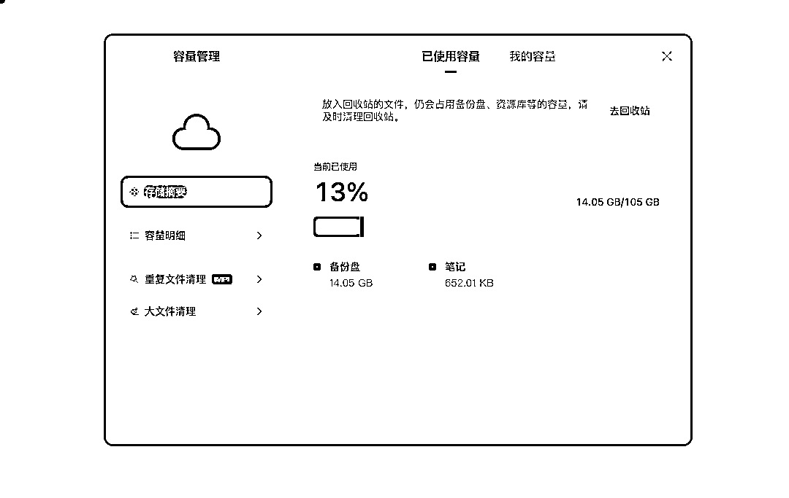

# 结语

上次聊了用GPT让阅读效率翻倍，这次聚焦音视频场景，希望能帮你在处理这类内容时更省力。后面我还打算做AI商业串讲、AI产品分析这些系列，感兴趣的话点个赞鼓励一下吧！


🌟 知识库内容汇总