# 小红书聚光投放，出境游月营收770万投放复盘

我是叁斤，在小红书赛道摸爬滚打了4年，一直帮中小企业做账号操盘。前两年大家都在拼命薅自然流量的羊毛，我反而慢慢把重心挪到了聚光投放上——与其跟平台算法玩捉迷藏，不如顺着平台的游戏规则走。

现在出境游有多火不用我说，我手头操盘的一个号，专做出境游，一个月私信开口量稳定在2500+，导到微信差不多1700+，月营收做到770万左右。这个赛道客单价本来就高，所以这个成绩单还算拿得出手。

这篇就以出境游为样本，把整个聚光投放的打法揉碎了讲清楚：怎么搭矩阵、怎么投搜索和信息流、怎么做笔记赛跑，关键是全程做到0封号、高效引流。所有做客资收集的行业，底层逻辑都是通用的。

先放个目录，拉个进度条：
1. 骨架搭建：高转化矩阵怎么搭
2. 投放策略：笔记赛跑全流程
3. 收尾总结：BKSF组合营销

---

# 一、骨架搭建：高转化矩阵怎么搭

底层思路就一句话：小红书矩阵账号 + 聚光投流。矩阵号用来补自然流量，投流用来保障引流顺畅和人群精准。

## 1. 品牌矩阵

同一个品牌名下，可以拆出好几个矩阵号，按产品线、地域、功能去分配，每个账号精准锁定一类人群。

举个例子：一个境外游旅行社，手里有多个目的地产品，那就一个目的地一个账号，内容全部围绕这一个产品去打。

内容配比上，每个账号发20%的干货内容去薅自然流量，剩下80%的营销内容全部用来投流。如果没打算所有账号都投流，那就把自然流量的用户集中导到某一个投流账号上，这样能做到最低成本、近乎0风险的引流。

具体怎么操作？比如A账号是品牌主号，正常投聚光；B、C、D账号做不同目的地，不投流，用户只要来咨询，就引导他们去A账号私信。

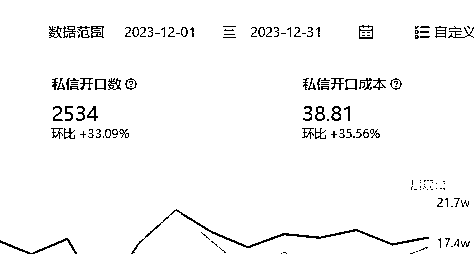

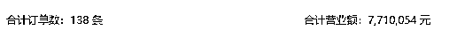

补一个企业号注册的知识点：正常情况下一张营业执照只能认证2个企业号，但如果企业满足以下任一条件，可以突破限制：1）拥有多个分支机构的连锁企业；2）注册资本超过1000万的大型企业，含多个子品牌及业务线。属于这类企业，可以特殊申请额外认证账号。

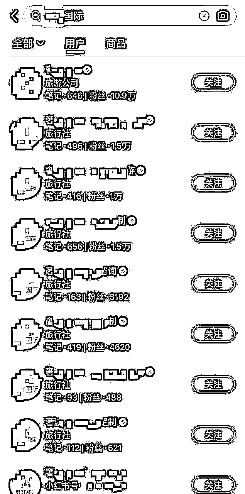

## 2. 内容矩阵

如果认证不了那么多企业号，又想玩矩阵，还有三种内容打法：

**素人代发**：做好产品体验、种草类的“真实”分享文案和配图，找兼职代发，市场价5-10元一篇。注意业务范围——只在某城市引流，就只收本地代发。内容可以偏软广，发布后记得在评论区@主账号进行联动。

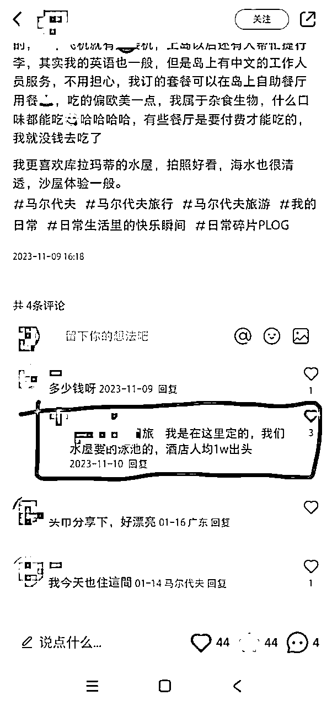

**客户分享**：素人代发多少有点“演”的成分，想要真实感，就去找客户。客户发笔记的信任度天然高，但他们的运营经验基本为零，数据不会好。这时候需要我们提供图片参考、标题建议，甚至可以给点好处：发一条小红书给折扣或者返现。但注意别太离谱——客单价几万几十万的单子，发一条客片只给5块10块的，说不过去。我们实际的打法：销售先跟客户沟通好，客户同意后我们给参考图，让对方拍类似风格的图，标题文案我们来写。这么操作下来，爆文率比客户自己瞎发高出一大截。

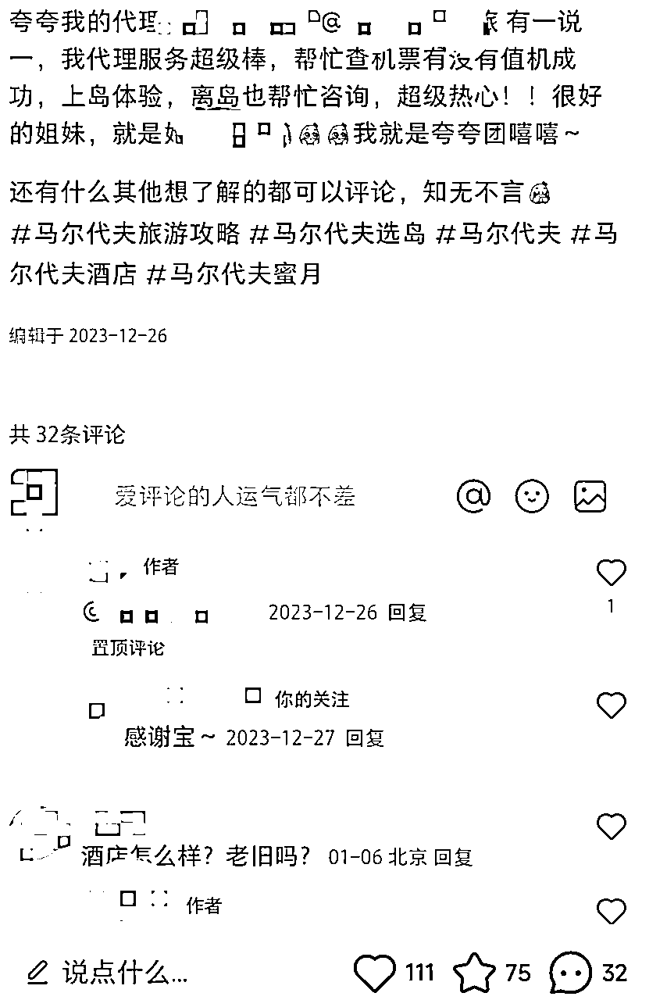

**伪素人（员工）矩阵**：内容和素人代发差不多，都是种草分享，区别是账号固定，可以用员工账号。简介里@主账号，正常发笔记就行。但因为账号没有认证，发内容时特别注意别违规——旅游行业就不能直接推产品。

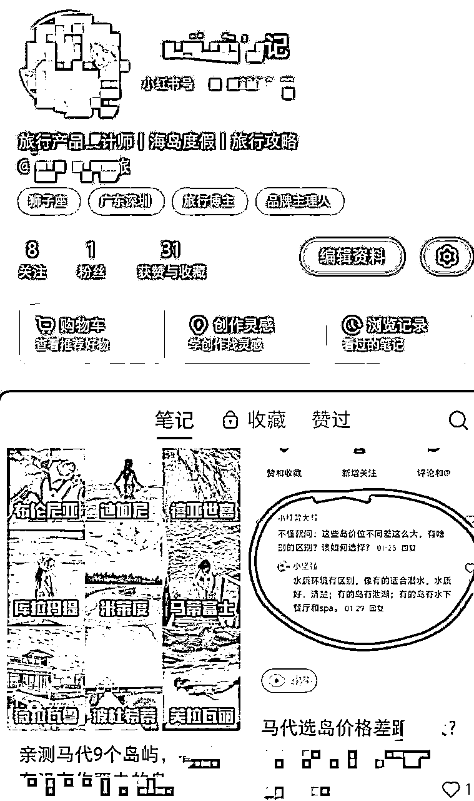

## 3. 主理人矩阵

最后这个矩阵模式，是小红书最推荐、也是效果最好的一个，难点高，但转化和用户信任感都极强，值得长期深耕。

说白了就是打造IP。突出行业专业身份 + 业务范围，关联主理人账号（一个企业号可以挂3个主理人）。内容以真人出镜为主，讲产品细节、服务流程，用专业身份种草，拉近跟用户的距离。

旅游行业举例：主理人可以打造导游或旅行体验师的人设，推荐地域信息、路线玩法、服务特色、酒店试睡等，内容以实景+真人出镜为主。一次拍摄可以积累大量素材，拆出很多条内容。

我操盘过好几个行业、投放过不少账号，横竖对比下来，**主理人+企业号矩阵是效果最好的组合**。主理人账号的自然流量和点击率普遍比企业号好，但只靠主理人账号也不行——不结合聚光，人群容易跑偏，而且没法规模化引流。

主理人人设参考：
- 员工人设：以员工视角切入，比如“在XXX公司上班是什么体验”
- 品牌虚拟IP：虚构品牌形象出镜，旺仔、雪王都是例子
- 创始人设：以创始人身份分享创业经历、品牌故事、品牌愿景，让用户既支持你这个人又支持你的产品
- 小编人设：最常见的，以小编口吻写营销文案，盼盼、扫描全能王都是这种
- 岗位人设：旅行体验师、摄影师、设计师、客服等

主理人形象这块，头像要突出专业身份或产品，真人头像更有说服力；昵称带出称谓和作用，比如“海岛旅行体验师xxx”；简介@官方账号联动，写清楚账号价值、更新方向；定位根据人设来，可以是老板也可以是员工；内容方向就是专业知识、产品测评、品牌故事、实力证明这些。

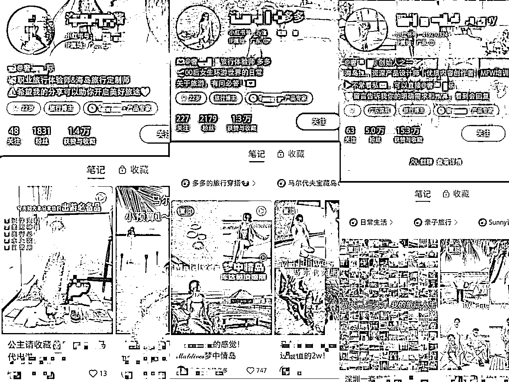

## 4. 矩阵关联

账号之间怎么互相关联？四种方式：
1. 简介互@——业务方向不同就@不同的账号
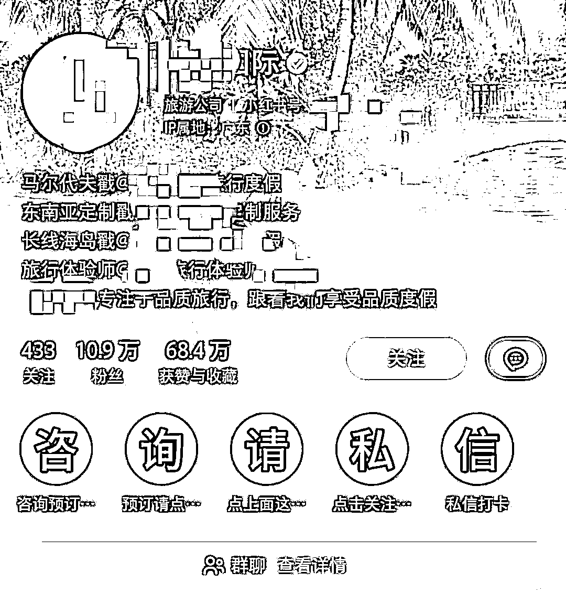
2. 绑定主理人——一个企业号绑3个个人主理人+3个企业主理人
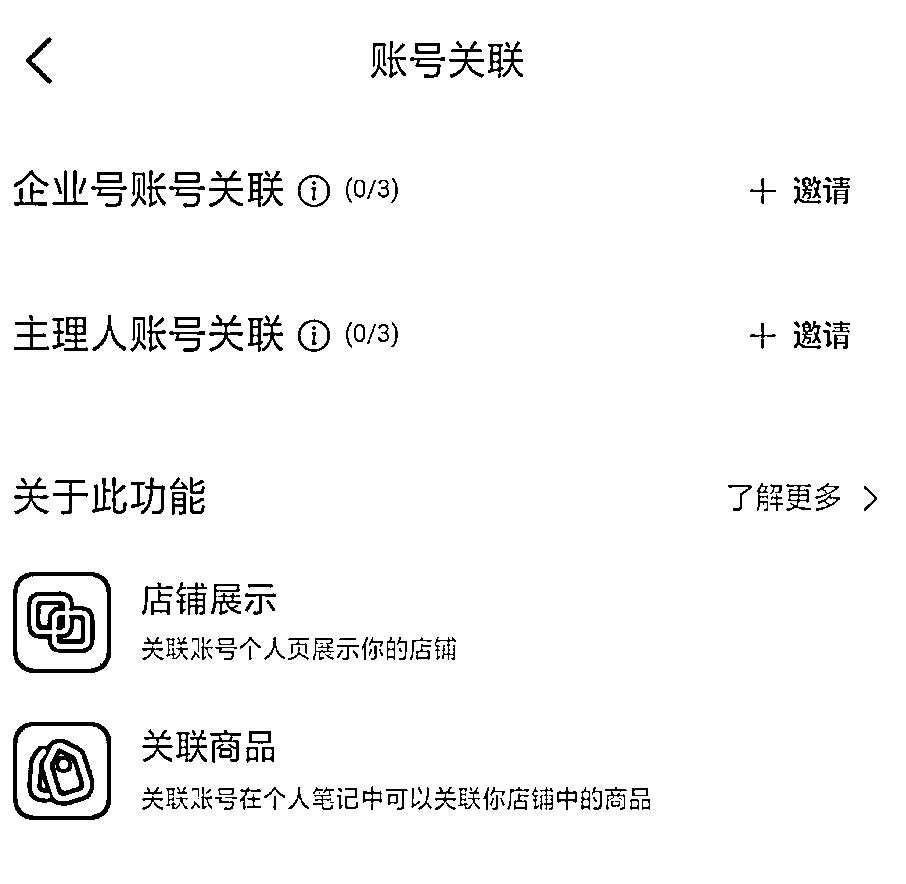
3. 笔记里或评论区@——正文里直接@账号指路，素人号就在评论区@主账号
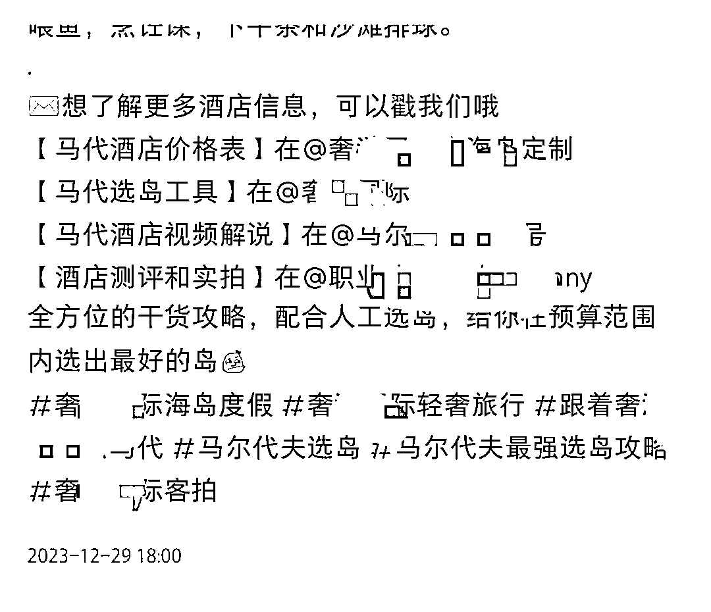
4. 员工账号——企业号可以绑定员工号和个人号，主页会展示，还能获得私信营销等营销工具
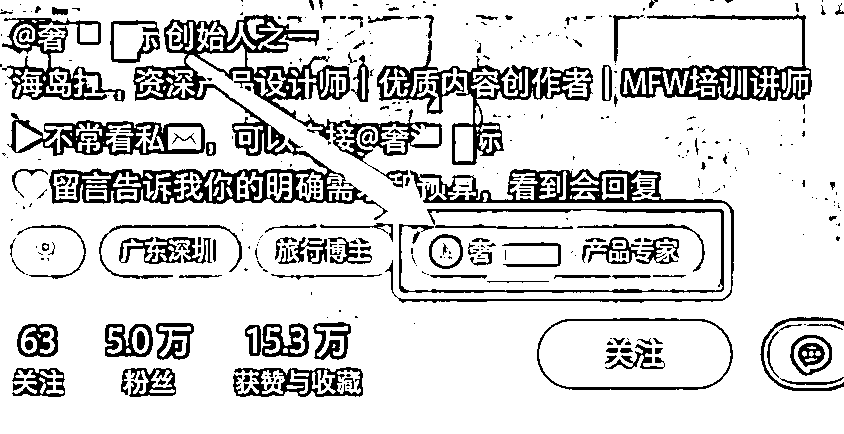

# 二、投放双核：搜索 + 信息流

矩阵搭好了，接下来看投流布局。我操盘的几个品牌内容主力都在图文，所以投的是搜索+信息流，视频流没投。如果你的产品需要视频来表达优势，可以加视频流，它本质上也算信息流的一种。

## 搜索投放

小红书上60%的日活用户都有搜索行为，在生活决策这一块，它正在从百度手里抢份额。搜索流量的精准度比信息流高太多，所以这是我投放的重中之重。

搜索投放的关键词可以加到1000个——不能太少，太少投不出去；也不能太多，太多人群跑偏、成本飙升。一般策略就是：主关键词+相关词。

主关键词就三类：
1. 品牌词：上海迪士尼、迪士尼
2. 品类词：上海旅游、上海旅游攻略
3. 竞品词：环球影城、香港迪士尼

这些都是跟产品、服务、品牌直接相关的词，搜索量大但竞争也大，所以要再补一些相关词：
- 需求词：春节去哪里旅游？
- 长尾词：上海迪士尼门票
- 间接相关：旅行需要带什么？

如果到了旺季、预算充足，想扩大品牌声量，可以追加“抢占赛道”投放。这个玩法能把笔记推到关键词搜索结果的前1位或前3位，费用相当高，所以关键词必须精准，而且别贪多。

## 信息流投放

信息流同样重要，但一般会针对精准人群画像去投。人群搭建分三层：主人群+相关人+人群包。

**主人群**：攻产品直接相关的人群。出境游我会直接锁奢美人群、精致妈妈、精致中产这类高消费力标签，关键词兴趣也全选旅游相关，只要近期有过搜索、互动、阅读行为的用户都圈进来。

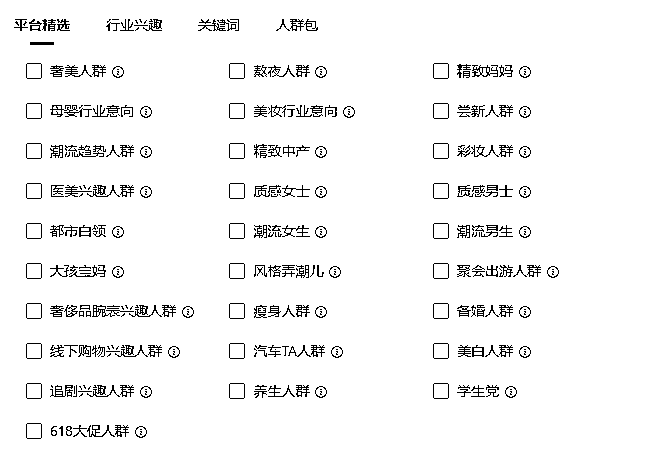
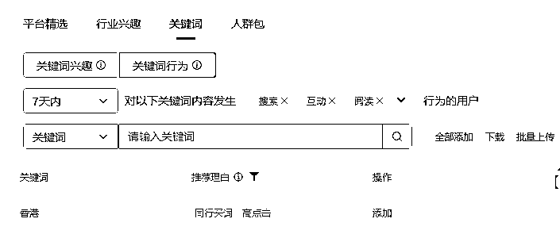

**相关人群**：跟产品有关联或潜在意向的用户。出境游我会配上母婴行业意向、大孩宝妈、备婚人群、都市白领。关键词兴趣同样把相关词汇加进来，但系统限150个上限，所以宁缺毋滥，越精准越好。

**人群包**：如果开通了定向人群（DMP），可以加人群包，按自己产品筛，或者让直客帮忙加一些海外人群包。

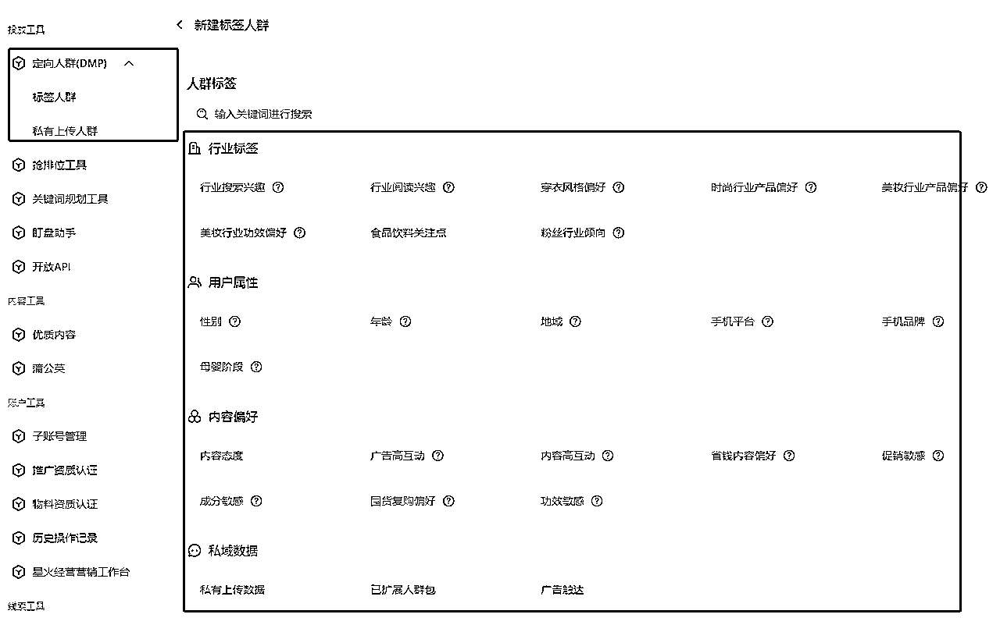

# 三、投放策略：笔记赛跑

我的聚光投放核心套路就四个字：笔记赛跑。先筛选优质笔记建立智投计划赛跑，再根据数据细筛出高转化、低成本的笔记，继续加码。

## 投放标的

我投的大部分都是客资收集计划，预算充足的商家会搭配抢占赛道。客资收集不选落地页，直接用笔记投放，推广目标选**私信开口量**。

这里要区分两个概念：私信咨询量和私信开口量。
- 私信咨询量：用户点一下咨询组件就算一次，不管他有没有说话
- 私信开口量：用户点了咨询组件，并且发了第一句话，才算一次有效开口

这个区别直接影响后续触达——用户如果不说话，你们就是陌生人关系，24小时内只能给对方发1次文字（自动回复不算），沟通效率卡得很死。

## 笔记怎么初选

投笔记要挑高互动、高转化的，不限时间，老笔记也能翻出来投。

**高互动**：用户有从众心理。低赞笔记让人不想点，低评论笔记让人不想评。所以我优先选高赞高评论的笔记，互动数据会让新用户更愿意点击。聚光投放没有时间限制，我手里转化最高、成本最低的一条笔记，是1年前发的高赞爆文，现在还能打。

**高转化**：光有互动不够，得能出单。两个筛选维度：
1. 产品转化：对比自己家的产品，看近期哪个卖得最好，就筛这个产品的笔记去投。比如投马尔代夫时，就看哪个岛屿近期转化最高，把相关岛屿的笔记挑出来投。
2. 评论需求：翻评论区，看有多少人在问“怎么买”“你们有XX地区的吗”“多少钱”“求报价”这类需求性评论。

## 全站智投筛笔记

初筛完成后，把笔记分类——合集、单推、干货、产品宣传页分开。前期笔记不多的话，只要人群和兴趣差别不大，扔进一个计划里测试也行。

计划建立实操要点：
1. 新建「客资收集」+「全站智投」计划，命名要分类明确，方便自己区分
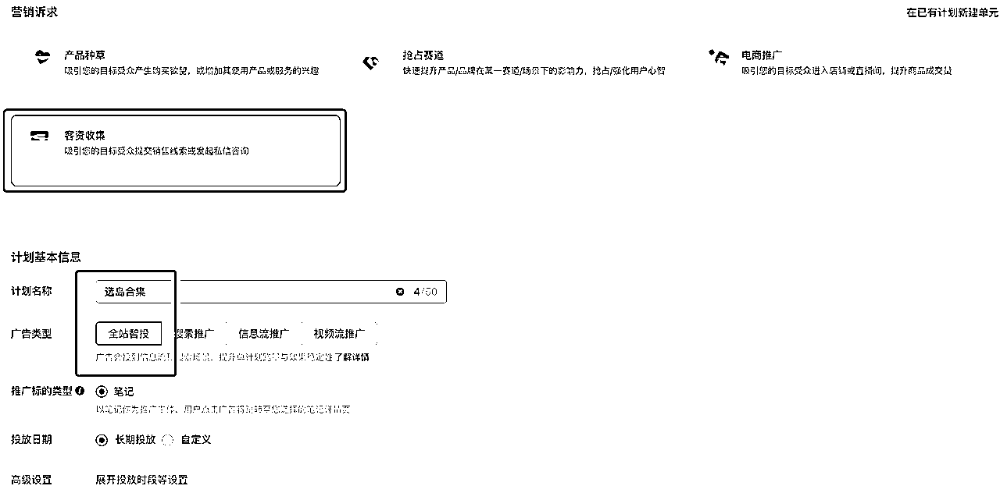
2. 预算设置约200-500，按你测试的笔记数量来——200块测3篇笔记差不多。笔记超过10篇，预算要往上提，不然跑不出效果。消耗速度选匀速。
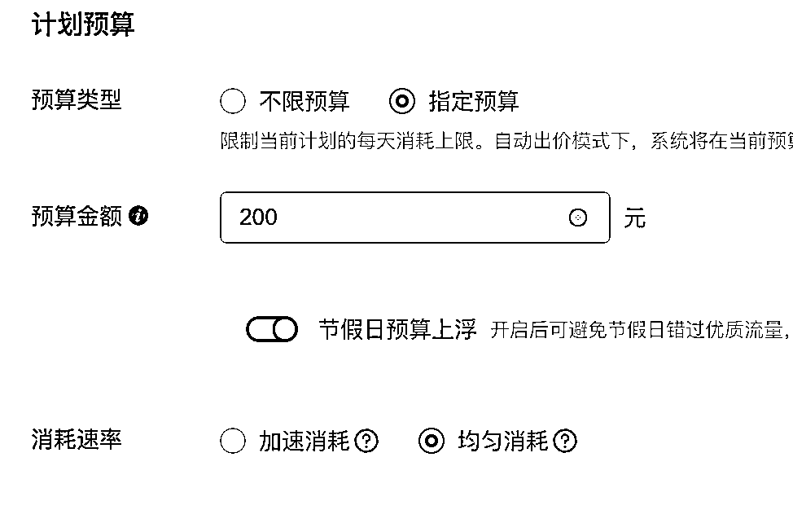
3. 定向按受众人群来。出境定制游基本不会有18-22岁的主动咨询，所以我会直接把这个年龄段去掉。
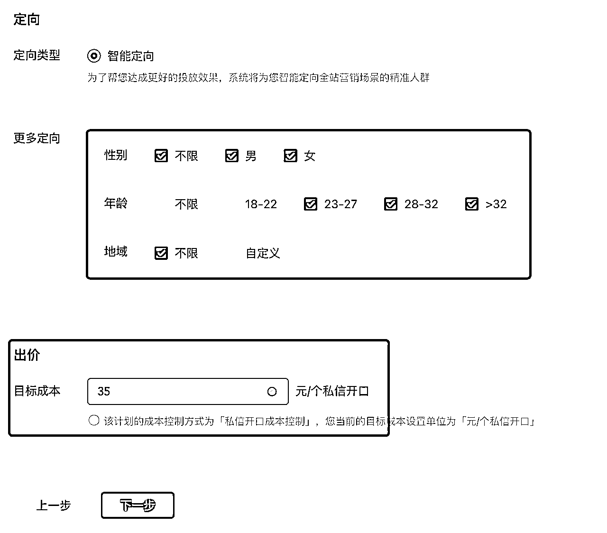
4. 私信开口成本设得比行业均价低一点就行，不知道均价可以问直客。

5. 封面优选和标题优选都打开，系统会根据点击率自动优化。如果有固定封面，这项可以关掉。6. 私信组件务必打开“立即咨询”，再编辑一条置顶评论，这样用户在评论区就能直接跳转私信。
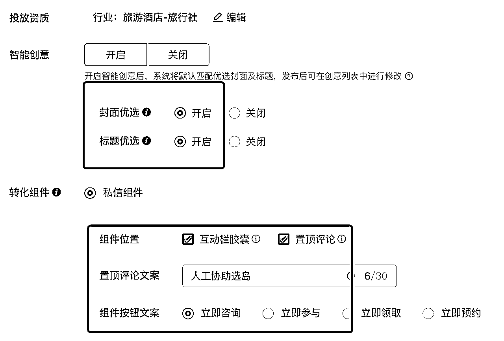

## 笔记怎么细筛

全站智投跑出精准需求需要时间，开始1-3天消耗低、咨询少很正常。大概跑5-10天，手里有基本数据后，再按以下指标筛笔记，不达标的关掉计划：

- 消耗：投放周期内没消耗掉钱，或消耗量极低的——关
- 开口数：一个开口都没有的——关；开口数特别优秀的——留着
- 开口成本：成本高到无法承受，或明显高于平均值的——关

只留下有消耗、开口咨询不错、成本也低的笔记继续投，或者直接进入下一阶段放量。

## 放量投放

优质笔记筛出来后，要么留在全站智投里继续加钱（加多少看预算），要么单独给笔记建「信息流+搜索」计划，操作逻辑和前面说的一样。计划建起来之后，每天盯紧成本有没有变高。小红书用户的兴趣点随时在变，产品热点过了成本就涨，热点来了成本就降——

比如新加坡开放免签那阵子，新加坡相关咨询的成本直接跳水，咨询量还肉眼可见地暴涨。

# 总结：BKSF组合营销

前面这套运营骨架，跟小红书的“BKSF模型”基本吻合，只是我额外加了内容矩阵这一层。

- B：品牌/官号矩阵
- K：KOS主理人
- S：搜索投放
- F：信息流投放

打法归纳一下：
1. 品牌账号矩阵负责产品营销和专业内容输出
2. KOS主理人账号负责获客和信任背书
3. 追加内容矩阵做声量造势
4. 主攻搜索：60%预算投搜索广告，用细分关键词触达不同人群
5. 40%预算铺信息流，有视频内容的话，可以拆20%投视频流

真正做到低成本、高转化的秘诀，就在KOS和内容矩阵这两块。

---

以上就是我的聚光投放全复盘，希望对正在做出境游或者任何客资收集行业的你有点启发。2024，一起多多爆量！