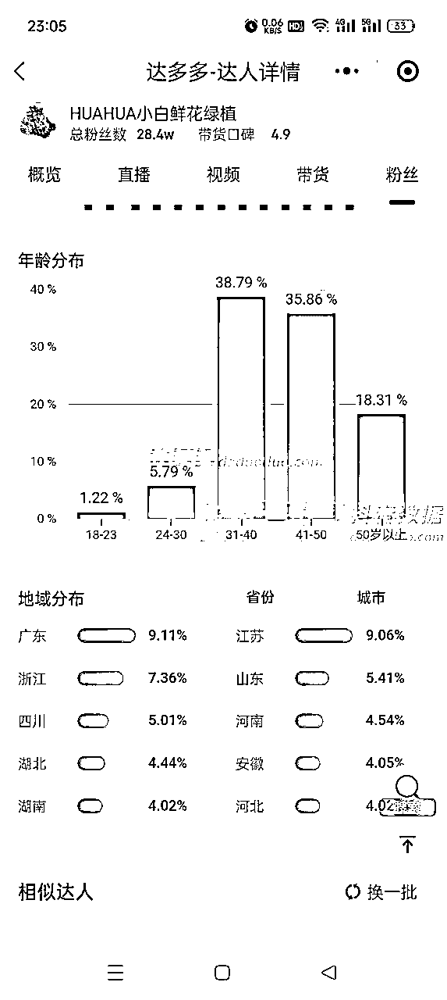
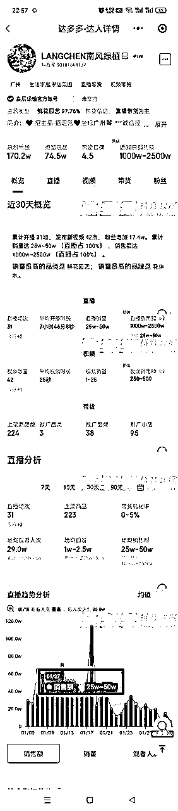
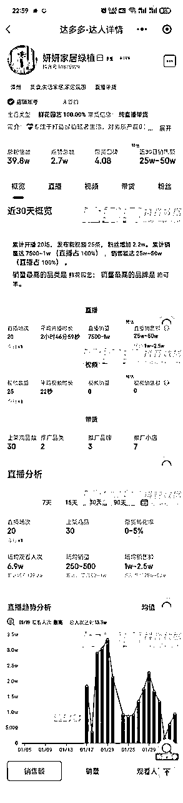
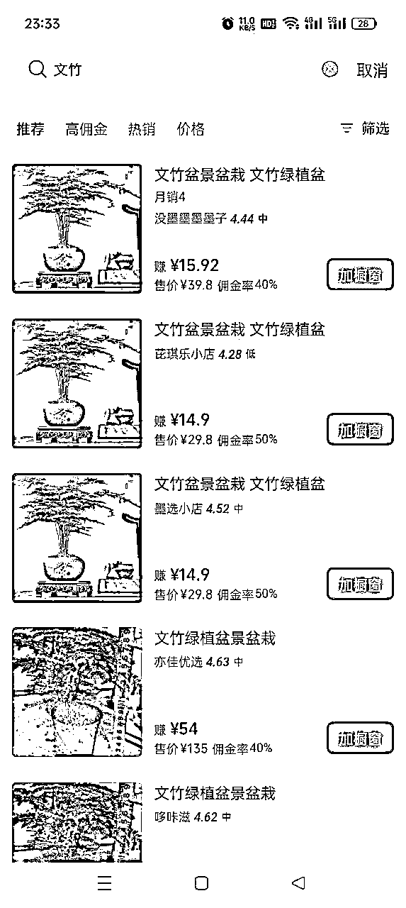

# 风向标拆解第三期：年后重启，花艺绿植号是不是又能冲了？——晓蓉

大家好，我是龙哥。今天拆的这个赛道，是花艺与绿植类账号在春节之后的窗口期。

生活水平在往上走，人们对情绪价值和居住氛围的关注也在不断提升，花艺、绿植的消费随之水涨船高。尤其是情人节、母亲节、春节这类节点，需求会迎来明显爆发。

需求侧的变化：

家庭与办公场景的绿化需求持续抬头：生活品质升级，审美和环境舒适度变得重要。家里养几盆绿植，既能舒缓心情，养活一盆还能带来很强的成就感。

送礼场景从未掉队：鲜花和绿植一直是走心礼物的首选，日常坚挺，节日更猛。

健康环保认知在渗透：除了好看，花草还能净化空气、调节室内湿度，实用价值被更多人认可。

物流条件更友好：入春后气温回升，绿植的运输损耗降低，冬季多地不发货的限制也随之解除。

核心受众画像：

40-50岁的女性群体，是花艺绿植内容的主要消费力和决策力人群。

变现路径：直播带货是转化效率最高的形态，短视频和图文内容负责种草承接。

利润空间：

账号内容怎么做：

围绕养护做专业心智：持续输出绿植的养护干货、常见问题排查、从0到1的种植教学，精准解决用户养不活的痛点。

其他可延展的增长点：

社群沉淀：搭建绿植爱好者圈子，提升用户粘性和复购。圈子里可以互换养护经验、晒成果、聊品种，形成自转社区。

付费课与周边：上架付费的进阶种植课程、个性化养护指南，同时售卖花盆、营养液、专用基质等高关联周边，实现内容、服务、商品的闭环。