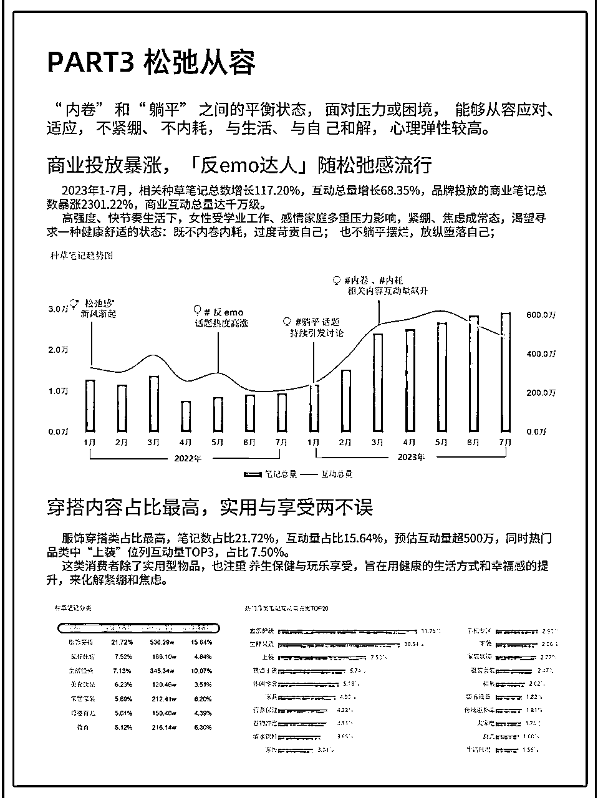
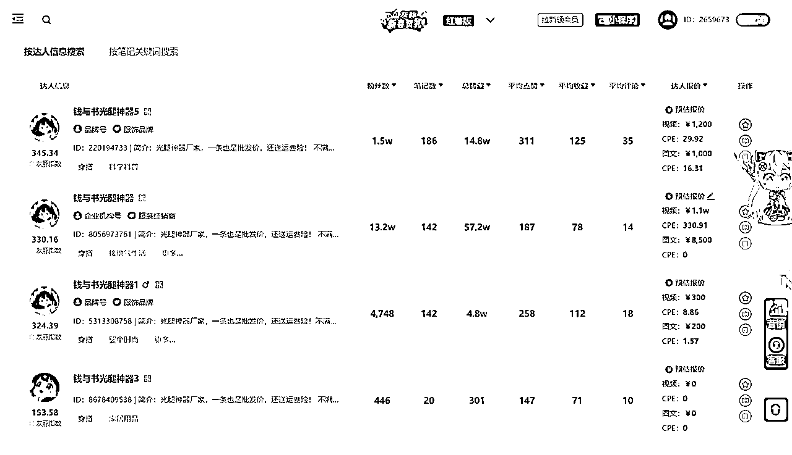
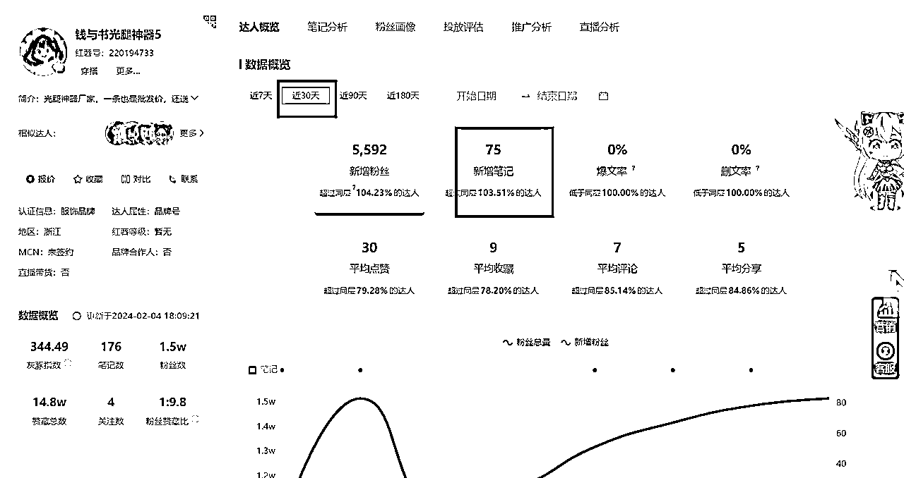
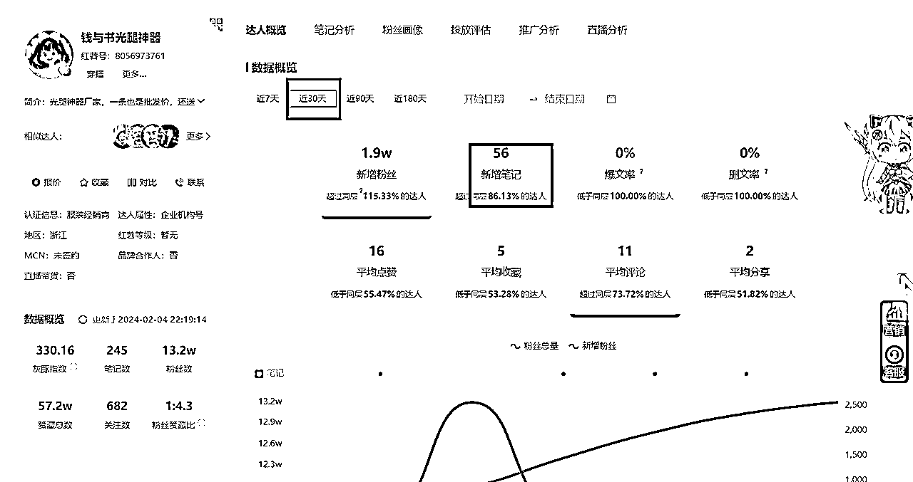
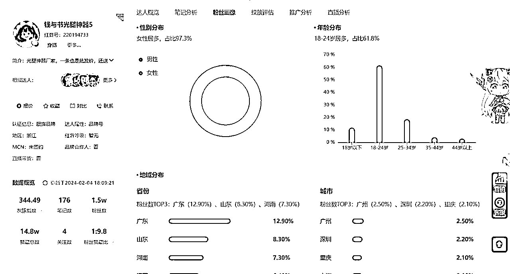
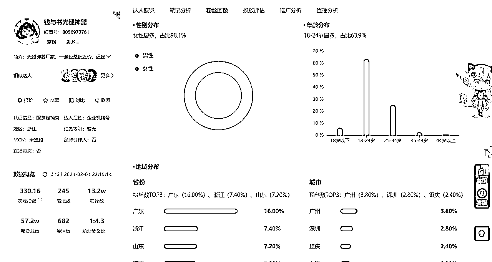
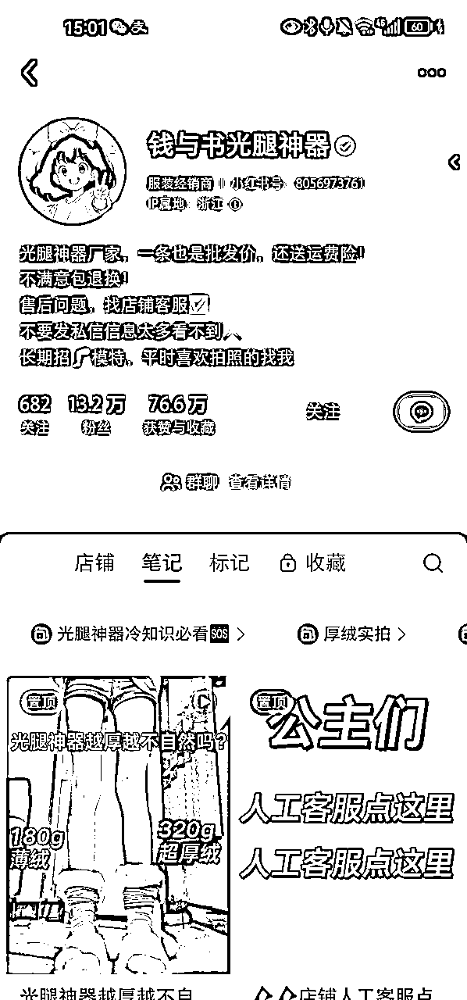
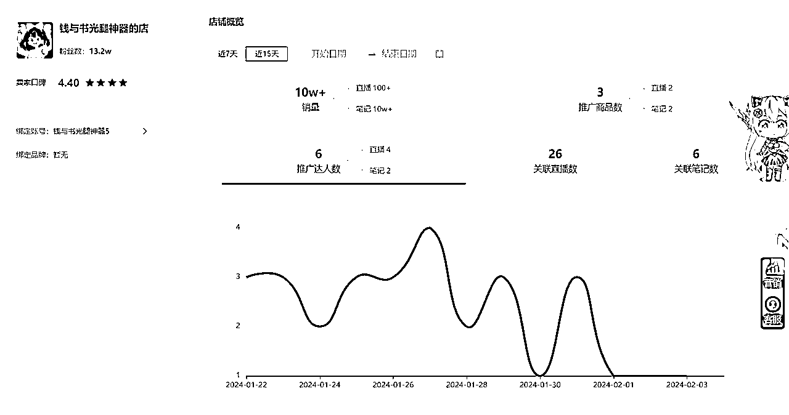

# 风向标拆解第3期 | 小红书50w+爆款案例：光腿神器

> 来源：[https://cinlqbndr6j.feishu.cn/docx/UaXwdyS23obBZXxZfMxcuJKwnuh](https://cinlqbndr6j.feishu.cn/docx/UaXwdyS23obBZXxZfMxcuJKwnuh)

# 背景

小红书商业化加深，店铺赛道迎来新一轮爆发。品类井喷的背后，真正能跑出爆款的都遵循着共通的底层逻辑。

本次拆解的主角是“光腿神器”。这个品类女性用户粘性极强，尤其在冬季，贴身不显褶、自然像真腿的视觉效果，是大家的刚需。可市场上同质化严重，商家要想突围，先得解决如何被看见、如何被信赖的问题。

# 定位

小红书的用户属性无需多说，女性用户超85%，对美妆、时尚、穿搭、旅行、美食等内容有极高关注度和付费意愿。最新内容分布显示，服饰穿搭类占比居首，且“穿衣自由”话题热度已达千万级。在这样的环境下，光腿神器大卖几乎是必然趋势。

# 案例拆解

**账号基本面**

账号名：钱与书光腿神器，属多号矩阵运作

粉丝量：15万

店铺累计成交突破80万+，在小红书站内同类目销量排名第一

积累素人晒单笔记超4500条

**近30天内容表现**

以短视频为主打，频繁做横向对比，真实感拉满

矩阵账号保持日更频率，单日最低2更

**粉丝结构**

女性用户占比超95%，核心集中在18-24岁，典型为爱美、爱分享的年轻女性群体

**运营亮点**

账号简介挂出招募腿部模特的信息，为大量对比型视频素材提供了稳定来源和可信度背书

**转化路径**

以笔记自销为主力，近15天内仅靠笔记就贡献10万+销量

达人投放使用克制，仅合作6位

以上就是本次小红书爆款打造的拆解思路。初次尝试此类拆解难免有疏漏，也欢迎同行多交流指正。