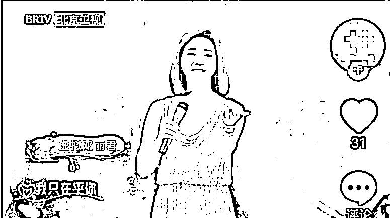
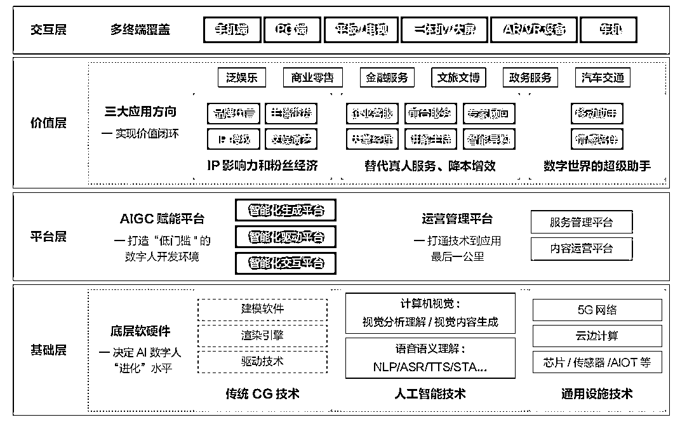
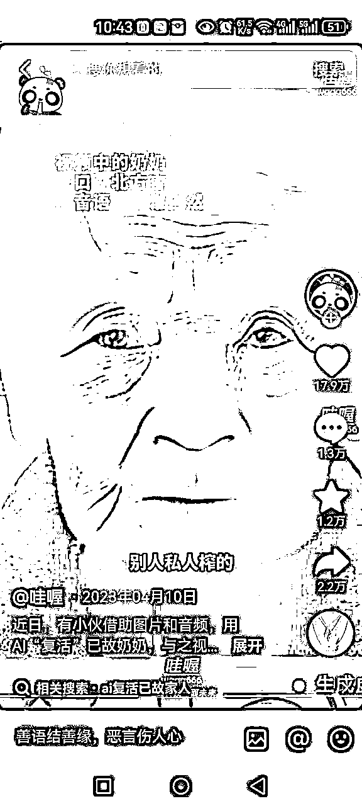
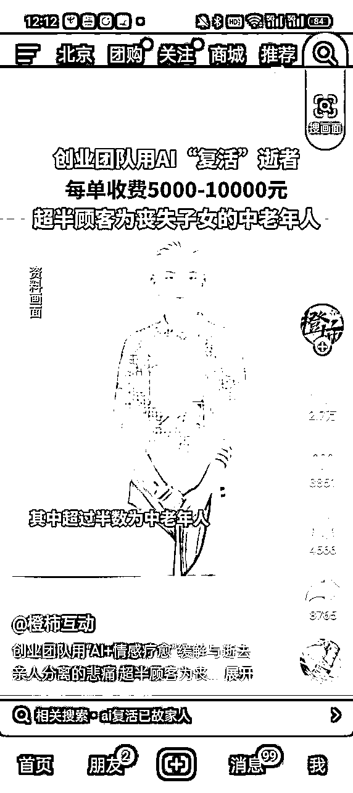
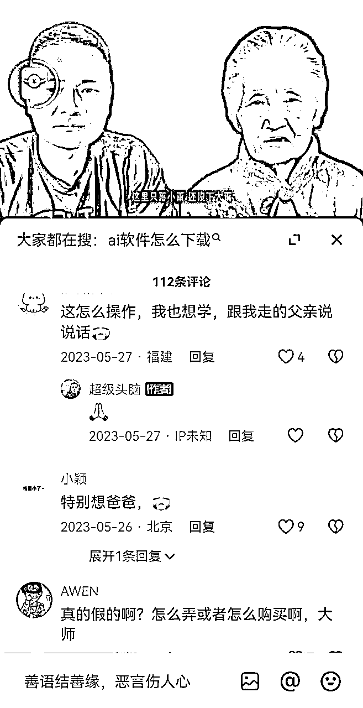
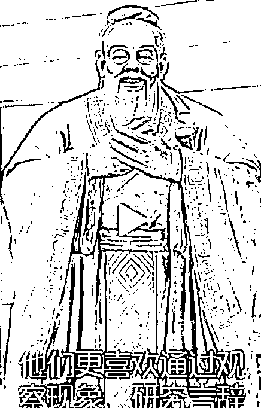
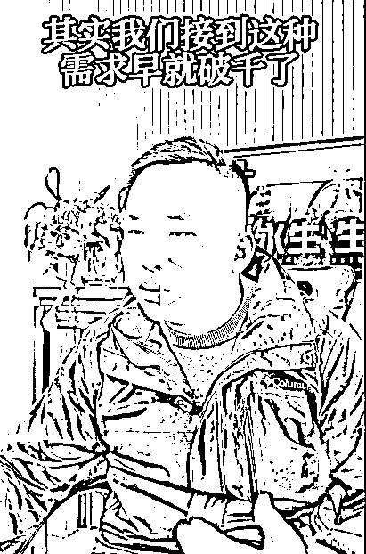
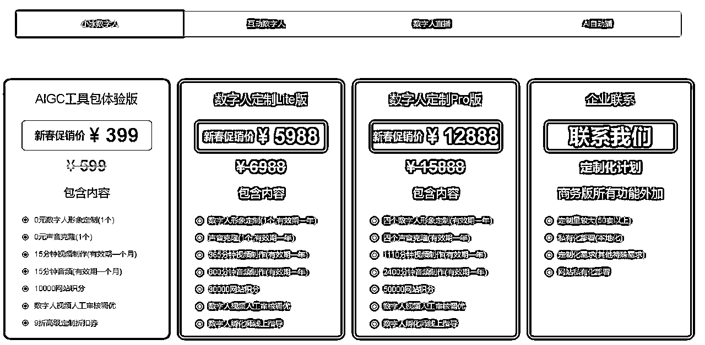
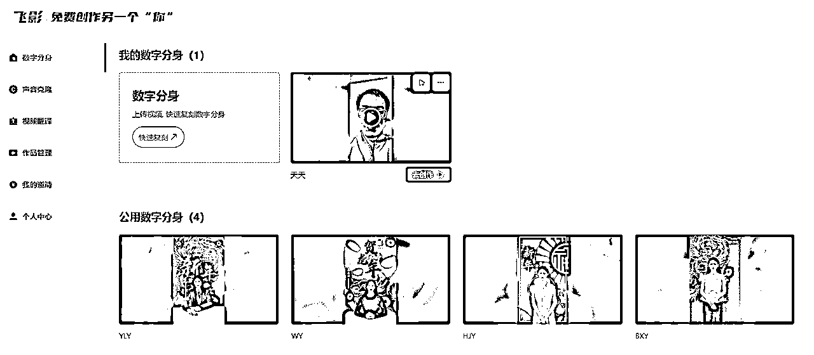

这周的深度拆解对象，是我自己在项目选择中折腾很久才定下来的方向。

年初听说某个短视频平台的流量红利要来了，没多想就决定往那边走。在此之前，我对那个领域几乎一无所知，完全是从零开始。最耗心力的环节其实是选题，我在很多个方向之间反复犹豫，始终拿不定主意。直到把“AI复活”以及它背后的数字人产业链摸了一遍，才慢慢看清了一些东西。

我的结论分两层。

一层是，“AI复活”这个概念的热度被高估了。它听起来有话题感，但放到真实场景里，能触达的需求很有限。它并非大众的刚需，还存在道德层面的争议——有些评论认为，把逝者做成数字形象，反而会让人更难从悲伤里走出来。另一层是，数字人本身才是更值得关注的方向。2023年它已经在主流视野里频频露面，央视的节目里更是随处可见，到2024年，电商领域才真正到了大规模应用的时候。无人值守直播间配数字人形象，省下的成本实实在在，没有理由不火。

再看三个印象很深的案例。柳夜熙，一个虚拟美妆博主，上线抖音没几天点赞量就直接破百万，几乎一夜之间冲上虚拟偶像头部；卫视跨年晚会的舞台上，邓丽君被重新“请”了回来，与周深合唱，瞬间击中了好几代观众的集体记忆；《中国诗词大会》还把“苏轼”做成了数字嘉宾，直接在演播厅里给选手出题，和主持人、选手面对面互动，那个画面确实让人印象深刻。

这份来自商汤智能产业研究院的数字人产业生态“拼图”，很值得反复琢磨。

先聊需求端。AI复活能辐射的人群比想象中宽得多：遗属和亲友是最直接的群体，学校和科技爱好者也包含在内，娱乐产业更是有巨大的想象空间——举个例子，迈克尔·杰克逊如果被做成数字分身，商业价值难以估量。以我个人的判断，养老场景未来也会有它的一席之地，用数字人分担陪伴和疗愈功能，是有可能的。

具体拆解三类目标人群。

第一种，失独父母与独居老人。他们对“再一次见到亲人”的期待远超旁人能理解的程度，心里积压着太多遗憾和没来得及说的话。这类人买的不只是一段视频，更是一种情感补偿，一处释放思念的出口。

第二种，教育机构。他们怀着对历史的浓厚兴趣，希望用更鲜活的载体来讲过去的故事。产品设计的重心应该放在还原史实与教学价值上，落地场景包括博物馆展出、辅助学习软件等。比较棘手的是需要线下资源的配合，难度不算低。

第三种，想掌握技术的副业人群。他们看中的未必是AI复活本身，而是数字人在商业层面的应用潜力。电商带货、短视频生产、媒体运营，到处都能用到。他们想要的是快速学会制作方法，再把它用在自己的业务上，代替真人出镜、压缩人力开销。这类人的付费意愿很强，学习动力也充足。

产品端分成两个方向。一种是老照片修复型的服务，适合预算有限的家庭，操作门槛低、收费不高，可以做成体验类应用，靠广告点击或者别的模式补贴收入。另一种是完整的数字人定制，以旧照片和声音记录为基底，需要专人负责对接和交付。市面上这类服务定价通常在五千到两万元区间，具体看工作量、内容要求和视频时长。不同平台对数字人生成的计费标准各有差异，这部分的成本也要提前算进去。

流量端，我观察到的现象是：AI复活虽然听起来高大上，但真正下场做的人其实不多。去年四五月份被媒体集中报道过一轮，之后几乎没有更多波澜，多数时候只是作为新闻素材出现。

起步阶段可以先做截流。到各大短视频平台搜相关话题，主动私聊有潜在意向的用户，但这个打法只适合早期拉种子用户。

内容方向建议和公众号打通，让用户在关注后填写登记信息，方便后续联系。

直播的玩法不太一样。以情感互动和成品展示为主，打造氛围感，但千万不能在现场演示制作流程——既是在免费教同行，也会破坏这个行业在用户认知里的高端感和神秘感。真正促成交，还是要引导到私域。

如果没时间精力做视频和直播，投流是更省事的路子。客单价高，投放成本很容易就被利润覆盖。

变现路径主要有三条。

第一条，内容带流量。让历史人物“复活”开口说话，内容天然自带传播力——孔子那段口播视频就是一个例子，引来大量围观，再顺势转化到广告或私域。

第二条，接单做交付。以公司名义运作，和客户签正规合同，才能在法律层面守住底线。操作上有两条必须做到的：一是素材收集，把逝者生前的照片、视频、文字记录和声音样本汇总起来；二是权限确认，必须拿到逝者家属或明确权利人的许可，尊重隐私是最基本的要求。如果下单者不是亲属，潜在风险就会变大——你很难核实对方提供的资料真假，也无法确定素材对象是否真的已经离世，这样的单子很容易被用在不合适的用途上。

第三条，做课程。前面提过的副业人群，真正想购买的就是数字人制作技术。不需要接单服务，直接把这套本领打包成课程卖给他们就行。

最后盘点一下我研究过的几个工具平台。

腾讯智影，播报型数字人，适合新手练手。入门教程和注册链接直接搜索就能找到。

国内几大厂商也都有自己的数字人产品，但方向大多偏向播报类。我个人时间有限，没法逐一实测，如果你用到了好用的平台，记得在评论区推荐给我。另外知乎上有篇文章叫《AIGC背景下短视频创作者要了解的15个数字人工具》，信息量很大，值得翻一翻。

接下来聊几个海外工具。

D-ID，来自以色列的一家人工智能公司。他们之前做过的Deep Nostalgia（把老照片里亲人的脸做动态化）和LiveStory（为照片添加声音，让里面的人开口讲述自己的故事）都曾在Tiktok等海外社交平台上爆火。D-ID的主要方向是AI Avatar生成视频，而且相比HeyGen，它给的免费credits更多，可以更长时间地体验功能。

官网：https://www.d-id.com/

HeyGen（访问需梯子）。主要覆盖广告营销、企业内部培训、讲解演示、销售展示这类需要真人口播出镜的场景。它的定位更偏向C端用户，能体验到的数字人功能也更丰富。

官网：https://www.heygen.com/

Video-Tetalking（开源项目，适合有开发能力的人）。这是一项让视频人物嘴型与外部输入音频同步的技术。操作非常简单：放进去一段任意视频和一段音频，输出的新视频就会自动匹配口型，甚至还能根据声音内容调整面部表情。

地址：https://github.com/OpenTalker/video-retalking

微软小冰。官网：https://aifeng.iiii.com/

飞影数字人。地址：https://flyworks.ai/setting?code=K9zsWxJhSTq

参考文档附在这里：风向标拆解5组 中老年人知识付费、8组 中老年知识付费，以及一篇深度复盘：如何打造一个盈利的中老年知识付费公司（国学类）。欢迎圈友来链接交流！

