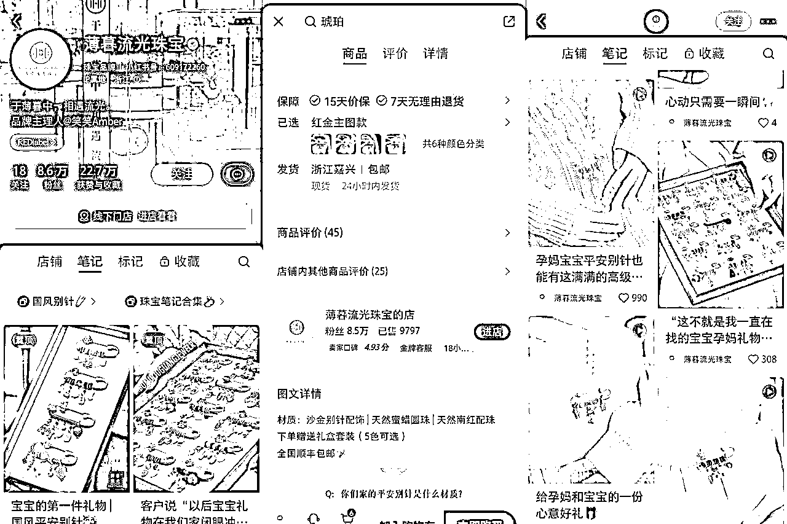
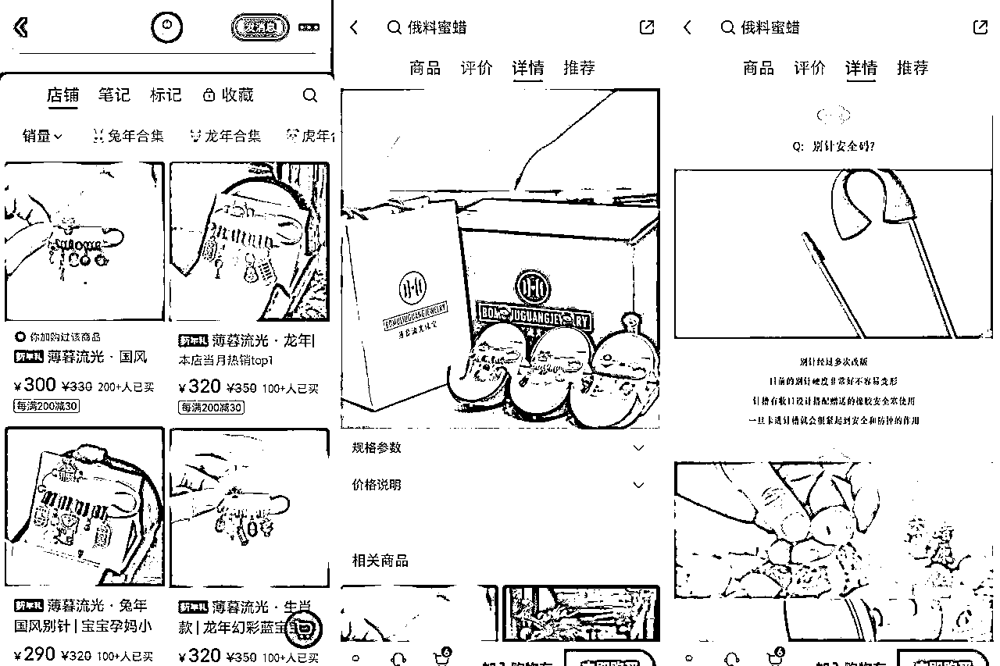
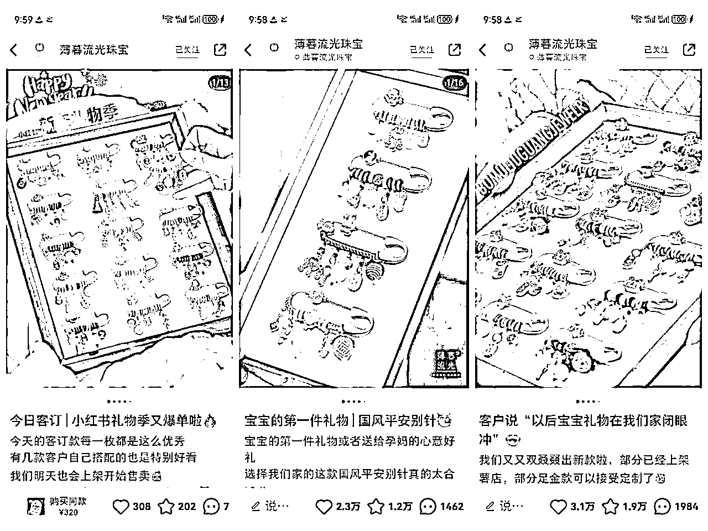
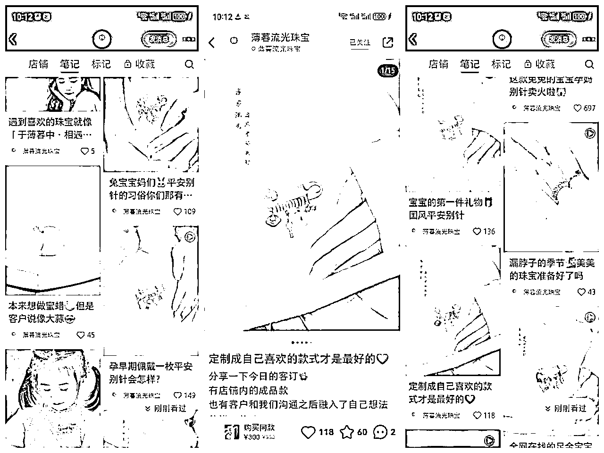
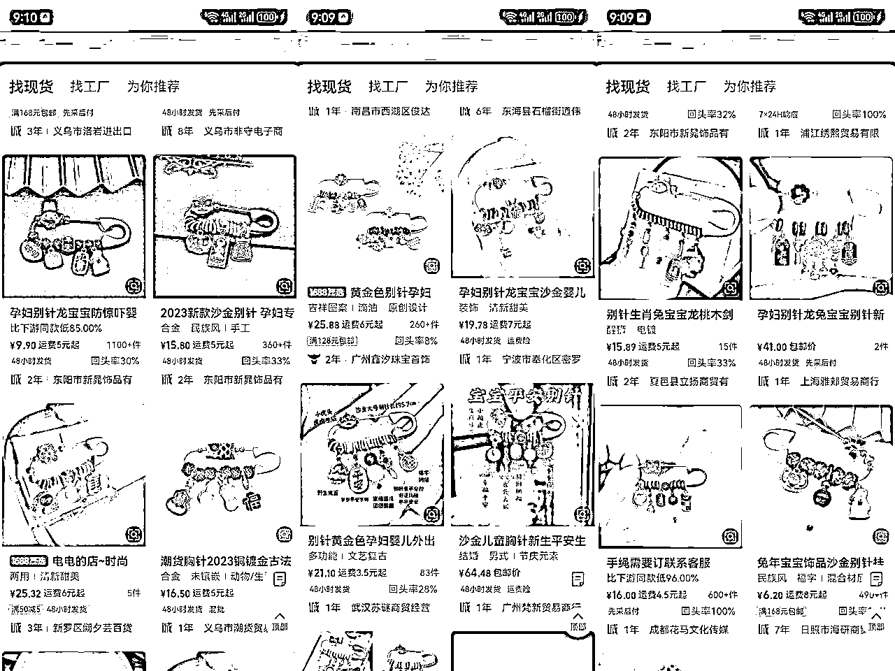

# 风向标拆解第3期｜小红书爆款手作饰品“宝宝别针”是怎么跑出300万+销量的 ——加加

## 1、基本盘长什么样

卖的是宝宝别针，属于高客单手作饰品品类。账号起初打的是泛饰品路线，后来彻底被宝宝别针带飞。

为什么能火？需求很清晰：孕妈自己买求个平安寓意，亲友送礼也刚好踩中点。商家在细节上做了安全处理，把针头包好，还配了礼盒包装。小巧精致，寓意又好，价格带从290元到4327元不等，送礼体面。

目前还没叠加寺庙开光这类增值服务，这块如果后续能补上，溢价空间会更大。

起步阶段走的是引流私域成交的老路。现在能查到的薯店累计销量约9797件，销售额粗略估算在300万以上。

## 2、流量是怎么打出来的

品牌号和运营助理号都没有做直播，全部靠笔记内容在跑。

关键词矩阵铺得很开：宝宝礼物、孕妇礼物、闺蜜送礼物等等。直接搜“孕妇礼物”，账号笔记基本排在前几位。内容形态很简单，就是产品特写+上身佩戴图，不露脸也不需要复杂拍摄。

投放上也做了一定的付费，有投广告，也有找达人合作带货。

## 3、货源怎么解决

1688上就能找到同类款，普通材质的批发价在10-30元区间。若要上更好材质的成本会上去，但终端售价也会随之拉高。

## 4、利润大概怎么算

按已知的近万件出货量、300万销售额来倒推：

产品成本约30万左右；
达人带货佣金按30%算，推广费用大概在30-90万区间；
这样算下来，净利大约在180万-240万之间。

## 5、怎么复制和放大

现在小红书做宝宝别针的头部就屈指可数，市场依然有空间。品类逻辑跟手串很像，都是手作饰品，但人群更垂直，锁定孕妇和新生儿家庭，自用图个好意头，送礼也新颖。

玩法上可以做生肖年份限定款，做差异化图案；也可以借鉴手串赛道的打法，叠加寺庙开光的文化附加值。在抖音、视频号端，用寺庙场景拍图文视频，进一步强化寓意感，价格带还能再往上走。

## 6、总结一张图

对自己动手做手作有兴趣的，可以原创设计，或者在基础款上做小改，比如刻名字姓氏、加入金木水火土元素等。

如果走纯代工进货的路线，建议尽快绑定寺庙开光的故事线，讲法更完整，也更有传播力。