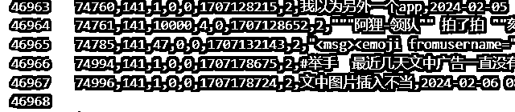
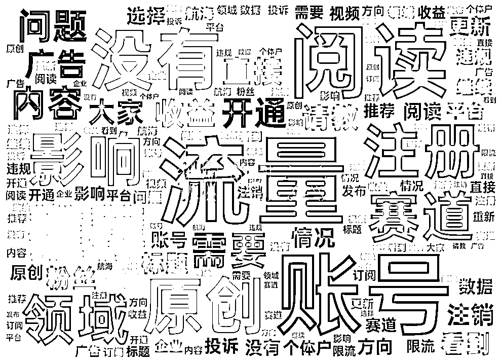
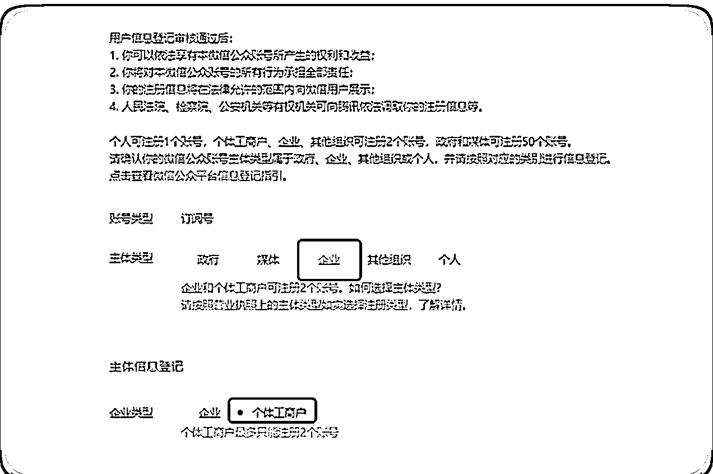
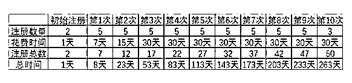
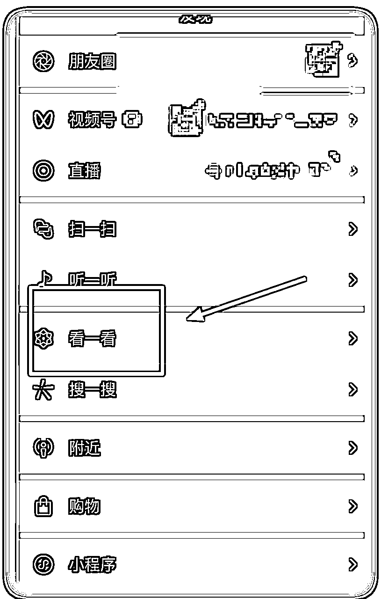

# 复盘｜👸号爆文写作12月航海 · 结束后的继续航行指南

12月航海收官都快两周了，你的手还在键盘上么？

上个月我有幸担任「👸号爆文写作」航海的教练，和一帮船员一起琢磨、一起掉坑、一起爬出来。这趟航程我自己也收获很大，今天把航海笔记整理出来，算是给还在海上漂的兄弟们一个落脚点，希望大家在航海结束后能继续开船、继续变现。

航海从来不顺风，我在群里看到的提问千奇百怪。

最扎心的共性痛点只有一句：文章发了没人看。

不过也有不少船员通过反复打磨、死磕迭代，终于吃到正反馈，摸清了自己的方向和写法。

航海期间，教练团靠精选日志、干货拆解和多轮互动托着大家往前走，也真的帮不少人赚到第一笔钱。

但航海一结束，每天报喜、答疑、互拆的氛围没了，如果此刻还没看见收入，很容易泄气。所以我把这份总结提前备好，盼着大家能扛过冷静期，乘风继续深耕。

祝各位航后持续进步，一起把生意做活！

# 开篇数据

官方口径显示，本期「👸号爆文写作」航海报名船员1774人，实际上船1540人。

截至2024-2-5，我从5个航海群里扒了数据，累计抓取记录高达46967条，

从这些原始信息里筛出可用的干货，供航海结束后仍在坚持的伙伴参考，里面提到的答疑链接也能回溯查阅。

原始数据表我也放出来了，方便大家看自我介绍顺带挖掘资源，或许能碰撞出合作。

另外别忘了回看其他船员的航海日志，特别是精选日志，链接在龙哥盟·航海资料库，里面有很多实战案例。

# 问题盘点

我在聊天记录里用 #举手 标签筛选了所有提问，共1129条。

做词云后高频词出来了：流量、号、阅读、没、注册、影响、推荐、赛道、领域。

大体能归纳为三大类硬骨头：

*   账号怎么注册
*   没流量 没阅读 没推荐 没影响
*   选什么赛道 选什么领域

先把面貌摸清，再来找解法。

# 问题拆解

遵循二八定律，解决20%的核心问题就能覆盖80%的困扰。下面是我整理后的重点，供参考。

### 账号注册

讲的是订阅号，别去注册小程序或服务号。

A. 身份证一证一号，一个手机号可绑五个号。

提醒下个人号，目前一个普通号只能注册一个订阅号。旧号提示被占用可以直接解冻找回，说不定还能捡回带留言功能的号，现在留言号市价几千块。

B. 注册方式

可以参考官方教程，用个体户身份去注册👸号。

企业号如果已有个体主体，最高可注册50个。下方是兔子鱼教练分享的注册实拍，大家可对照操作。

注意，刚注册的号通常是裸号，粉丝为零。别上来就冲直升机买粉，我见过好几个船友买粉后被封，直接失去开流量主资格。

先稳定发几篇内容，再考虑补粉。买粉渠道淘宝搜「订阅号」即可，自行甄别。

另外别担心前几篇没收益，开通流量主后历史文章底部广告也是会继续结算的。

### 流量、推荐、阅读为零

没有万能答案。

我的实操建议是短平快项目靠模仿。

模仿之上加一个闭环思维：立假设 -> 去试 -> 再立假设 -> 直到跑通。

这不是你一个人的病，是所有项目、几乎所有商业的通病。没流量不是项目不行，而是假设还没对。

我的打法一直是：立假设 -> 去试 -> 再立假设 -> 直到成功。

具体三步走：

1.  立假设：刷同类号，看到想点进去的标题就进去，顺手看底部推荐。问自己谁会看这篇文章？什么钩子让她点进来？是标题、封面还是开头？
2.  验证假设：把一个或多个假设做成文章，单条测试量不低于20篇，看是否出现正反馈，跑通MVP。
3.  重复1-2，直到出现稳定结果。

### 赛道、领域怎么选

先泼冷水：名人名言、影视、极简生活、职场、军事、历史，这些所谓热门赛道真有那么香？我并不信。

没有哪個赛道能一直赚钱，赚钱赛道是会迁移的，需要我们自己去捕捉。

靠别人推荐榜单不如自己上手试。亲手试过才知道这个赛道适不适合自己，能不能变现。

别怕试、别怕错，多试几次自然能找到自己的钱路。

试的过程中要复盘总结，不断学习升级，才能在后续竞争中站住脚。

那怎么找赛道？

我常看的地方是：

对标账号的收藏历史、关注列表

*   感性筛选：优先点开让你心动想看的标题，收藏能让你想分享、想点赞、在看的文章，关注那些让你情绪波动大的作者。
*   数据辅助：阅读量只是参考，重点看点赞、转发、在看等互动。阅读相近时，互动高者更值得学。
*   单篇拆解：看标题的情绪点和用词，文章结构是否热点+干货结合，是否有反常识观点，如何引导互动。

一个小技巧：看到好文章直接转发到自己收藏夹，回头慢慢复盘模仿。

赚钱记住三不兼得：事少 钱多 风险小，这三者不会同时成立。

*   别把鸡蛋放一个篮子。别用所有号写同一个赛道，分散风险。
*   别信一夜暴富。靠几篇10w+起家是神话，需要时间积累。

### 典型Q&A

Q：做武汉本地旅游细分，会不会受众太窄流量上不来？
A：可以集中产出，将武汉旅游类内容在同一时期多次发布，像头条+次头条+多篇矩阵，短期内形成内容集群，提高曝光。

* * *

Q：AI只用来做配图可以吗？现在有两个号，是做两个赛道好，还是一个大赛道下分两个子方向好？
A：AI生图没问题，注意规避版权。

关于账号策略：时间精力充足就开两个赛道，分散风险；资源有限就聚焦一个大赛道下的两个子方向，深度更好。我个人更倾向前者。

* * *

Q：手册说爆款要拆开头过程结尾再仿写，是不是直接抄标题和选题改改、内容也模仿就行？原创度会不会不够影响入池？
A：能通过原创审核就说明原创度达标，除非被举报。

我有时看到好标题直接照用，内容用AI二次创作再过一遍。

* * *

Q：不开原创会有影响吗？会不会不推流？我看一个对标号从不标原创，也有10W+，还是老号带留言，去年9月才转赛道。
A：不开原创会影响推荐和权重。平台优先推原创，搬运权重低，搜索曝光也差。

对方每篇10W+大概率是老号沉淀久、粉丝基数大，不能作为参考。

* * *

Q：11月开始做的带留言老号，军事领域出圈一个多月后换领域又换回来没起色，要不要注销？舍不得留言功能。
A：别注销。注销可惜，直接再注册新号也不迟。

* * *

Q：靠模仿起来的号，被举报三次申诉成两次，现在流量稳定算入池了，是继续模仿还是自己找素材？模仿长久吗？
A：短平快阶段模仿最快，等有稳定流量和粉丝后可逐步过渡到原创找素材。

模仿能快速产出、稳定阅读；长期发展要从模仿中提炼方法，再融入个人观点形成风格。

* * *

如果你遇到的问题在以上还没覆盖，先去原始数据里搜一下。问题本身不难，难的是下场实操。

# 资源合集

自媒体做起来离不开素材积累和灵感捕捉。赛道、素材都是平时刷内容时多留心就能沉淀下来的。

下面分享几类实操资源，希望能加速大家的创作。

## AI提速提示词

用于加速👸号文章伪原创写作。把民生类换成其他主题即可使用。-- 据伟豪教练提供

"请根据以下指示撰写一篇文章：

-我是一名👸号xx文章的写作者需要仿写文章

-你是一位擅长伪原创写作的专家，具备将原有文章内容进行创新性改写的能力，

*   模型：4.0

-文章内容包含，

1.  仿写文章：[请向我索要为你准备文章素材]

1.  目的：[文章的目的，提高完阅读率，保证生成内容重复率低于 30% 成为🛰️👸号的爆文]

1.  风格：[自己根据仿文选择合适的风格，客观中肯，正式与信息性，解释性，警示性与直接性，分析性，分析讨论]

1.  结构：

*   引言（要求 50 字）：简要介绍主题和文章，要包含有异常，有捷径，有性暗示，有暴力，有民生问题，有民族主义，有情绪，有金钱，有数字，九个要素要让人有强烈读下去的欲望，要达到（开幕雷击）的效果。。

*   背景（要求 100 字）：提供相关背景信息，描述当前情况。

*   主体部分（要求 400 字）：包含多个论点，每个论点都要用数据、事实或例证支持。

*   对比和对立观点：如适用，提出并分析对立或对比观点。

*   案例研究/实证分析：如适用，提出相关案例研究。

*   讨论（要求 200 字）：深入分析主体内容，讨论其广泛含义。

*   结论（要求 200 字）：总结文章主要内容，提出建议或解决方案。

*   根据引言为文章写 10 个标题：

标题内容包含，有异常，有捷径，有性暗示，有暴力，有民生问题，有民族主义，有情绪，有金钱，有数字，包含九个要素中的一个或者多个，要让人有强烈读下去的欲望，要达到（开幕雷击）的效果。

*   我为你提供文章素材，按照任务要求写 10 个标题

1.  手法：

*   使用事实陈述和逻辑推理。

*   结构化分段，每段聚焦一个中心思想。

*   如有对立观点，运用平衡对比和实证支持的方式进行分析。

要求：

1.  生成内容重复率低于 30%。

1.  保留时间、地点、数字、政策名称等关键细节。

1.  遵循原文逻辑，避免引入歧义。

1.  不创造新概念、人物，确保内容真实性。

任务流程：

-请按引言（要求 50 字），背景（要求 100 字），主体部分（要求 400 字），讨论（要求 200 字），结论（要求 200 字）顺序根据以下步管执行任务，每完成一项任务请与我确认是否满意，我回复满意后你再执行下一步，必要时请求我提供相关信息

请根据以上指示仿写文章，确保内容逻辑清晰、信息准确、风格一致。"

## 图片素材渠道

【图片哪里找？】仅供赚钱圈友参考 -- 据兔子鱼教练整理

一，APP类

1.  📕APP
优点是审美在线图好看，缺点是部分图禁止商用二改。判断方法看博主简介是否写明严禁二改、严禁商用，有写就别用。没写可下载后裁掉水印使用。

1.  堆糖APP
图多且多为免费无版权，常被📕博主用作背景图。缺点广告多，可开通2元/月会员避开。

二，网页类

1.  Pixabay  http://pixabay.com/
1.  Pexels  http://www.pexels.com/
1.  Unsplash  www.unsplash.com
1.  Gratisography  www.gratisography.com
1.  VisualHunt  https://visualhunt.com/
1.  Cupcake  http://cupcake.nilssonlee.se/
1.  Photock  https://www.photock.jp/
1.  kaboompics  http://kaboompics.com/
1.  StockSnap  https://stocksnap.io/
1.  FANCYCRAVE  http://fancycrave.com/

## 👸号细分领域选择

后台发文选领域时拿不准，可以参考这份分类表，覆盖面很全。

注意手机版订阅号助手没有领域选项。

希望这些总结和资源，能帮助还在航海路上深耕的伙伴继续前行。

最后祝大家新年大吉，龙哥盟！