# 三农账号从0到月销300万：📕卖苹果的实操拆解

最近有朋友拿着家里的千亩果园来问：想从零开始做📕，该怎么起步。这篇就把最近参与的📕店铺航海的实战经验，结合一批低粉高成交的对标号，帮你把单品生意在📕上跑通的底层逻辑讲清楚。

筛选对标的思路很简单：店铺排名靠前、粉丝不高但订单量很漂亮、笔记数也不多。这样新手能最直观看到，高质量的内容怎么换来成交。

目前挑出来的四个典型号如下：

1. @桃社长鲜果园，企业认证号
发布笔记 97篇，首条发布时间 10-20
客单价 39.9元，店铺销量 1.5万+，店铺总销量 60万+
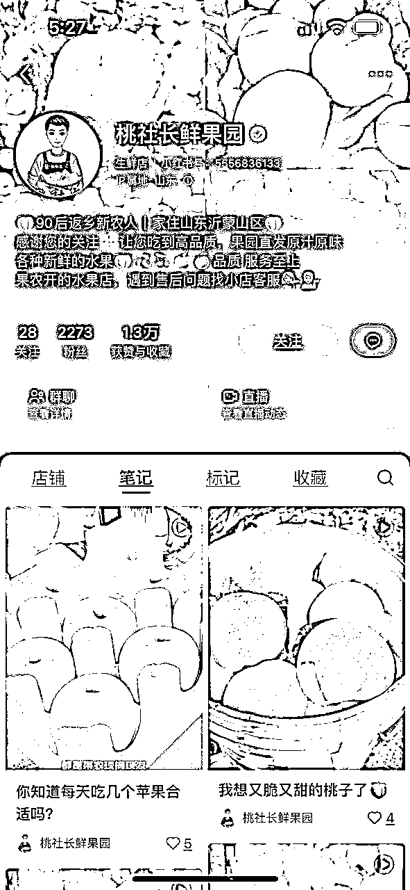
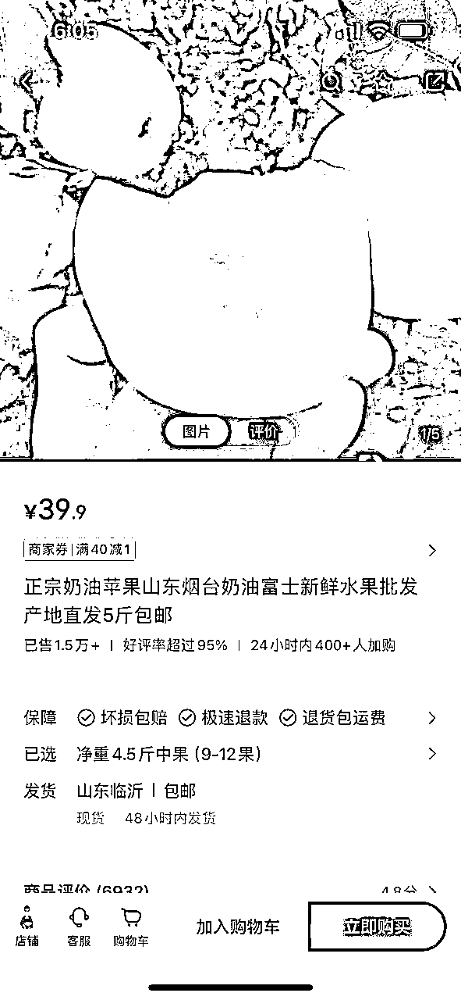
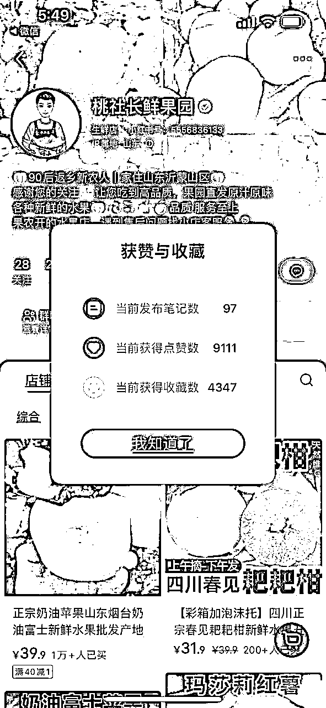
https://www.xiaohongshu.com/user/profile/63dcdfa50000000027029015?xhsshare=WeixinSession&appuid=6323dd34000000002303c70a&apptime=1707126598&wechatWid=225c1c2276fb80ba44bfa5ccd871d186&wechatOrigin=menu

2. 青山集 新疆农场
发布笔记 209篇，首条发布时间 10-7
客单价 56元，店铺销量 1.5万+，店铺总销量 84万+
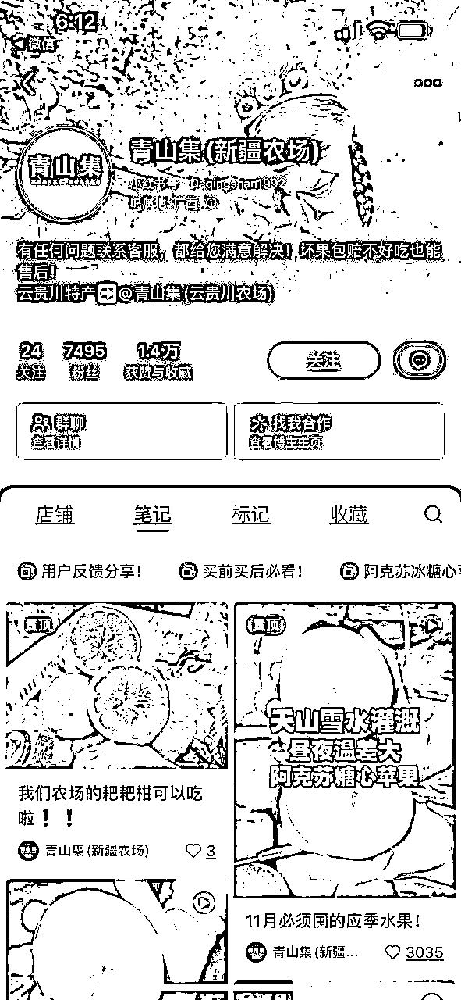
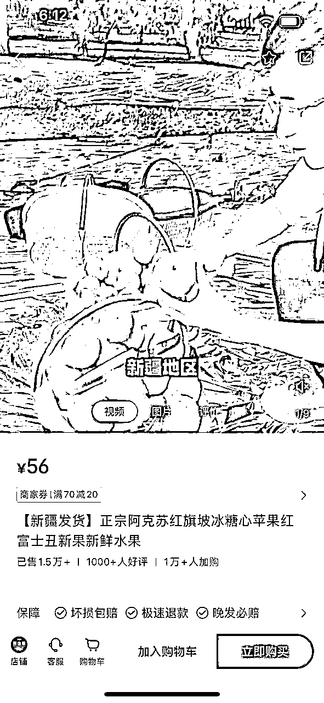
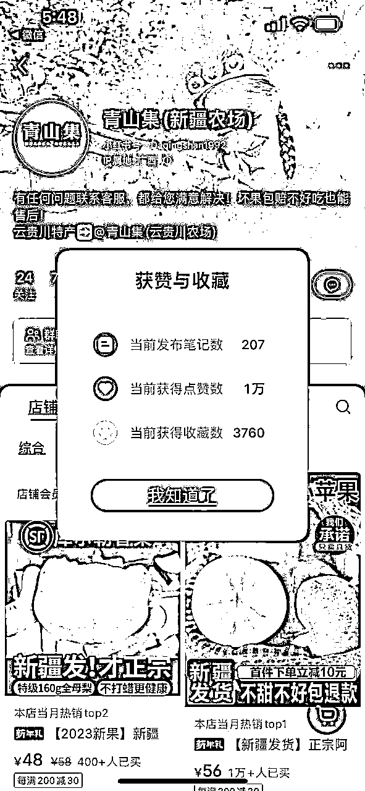

3. @鲜果时光
发布笔记 482篇，首条发布时间 9-22
客单价 56元，店铺销量 9.4k+，店铺总销量 50万+
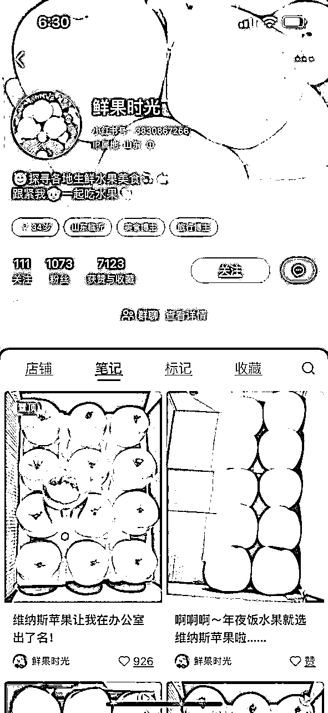
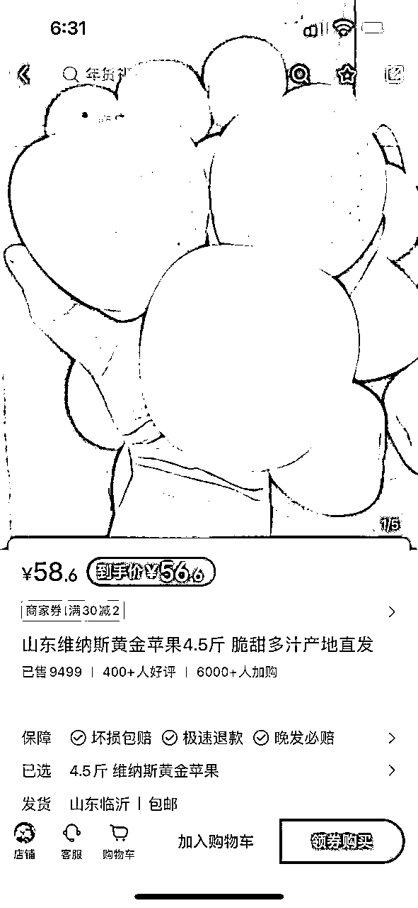
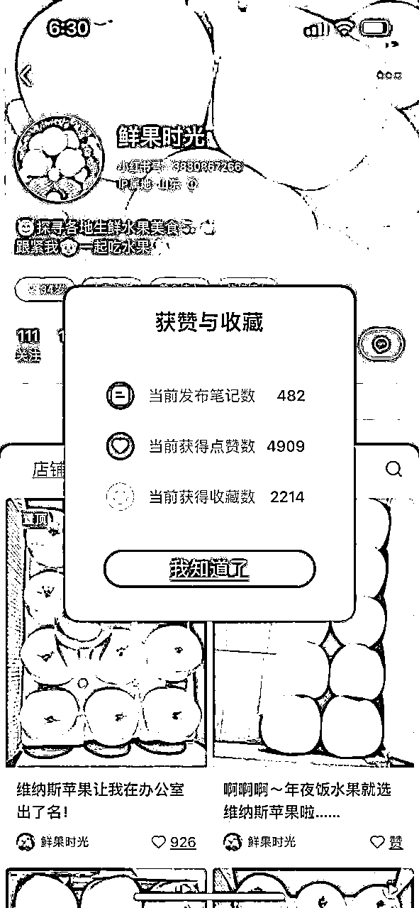

4. @买买买上瘾啦
发布笔记 310篇，首条发布时间 9-13
客单价 19.9元，店铺销量 3k+，店铺总销量 6.5万+
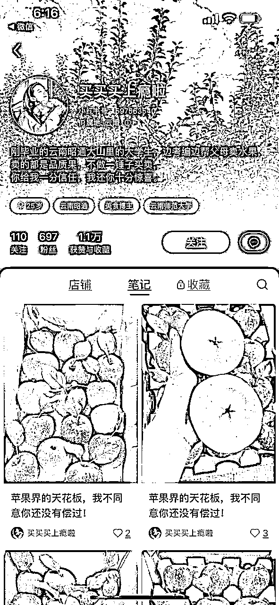
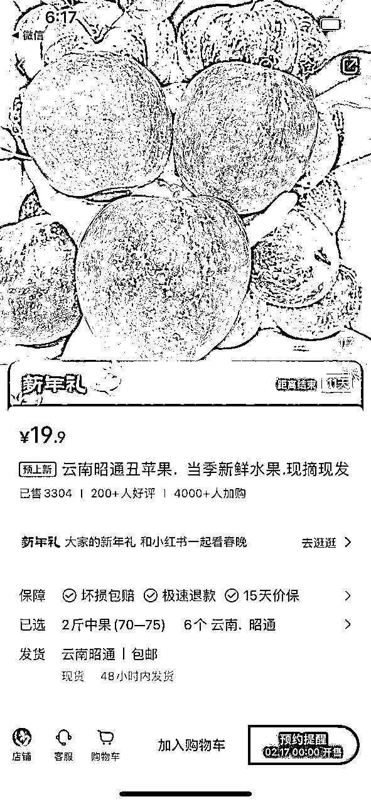
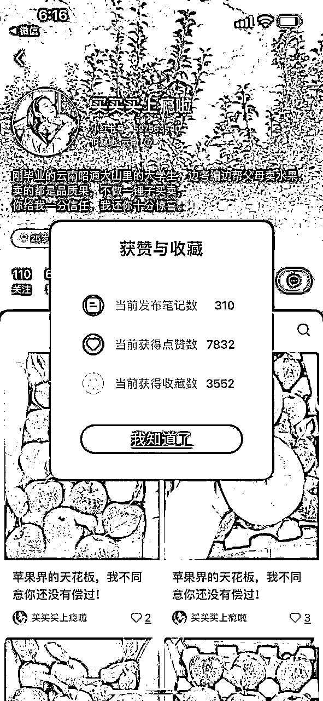

# 一、流量是怎么跑起来的

这四类号基本都是靠内容自然分发，没看出明显的付费投放，节日性投放暂时无法判断。

账号人设包装基本集中在两类：自有农场果园、学生助农。头像和背景图多用水果、果园实景。

内容打法高度统一：产品实拍+发货过程+果园实拍混搭。个别号有爆款，但节奏都很高，每天至少3更，多的时候6到8更。内容形态以图文挂车为主，部分会有人出镜。有些博主还会拉一个50人左右的小福利群做沉淀。

总结下来，📕对同一个单品持续输出笔记，找到可复用的爆款模版后，起量非常快。

# 二、货源怎么解决

抖音精选联盟
这四种产地的苹果在抖音精选联盟都能搜到，佣金大概在20%到30%，到手价比📕低5到10元。
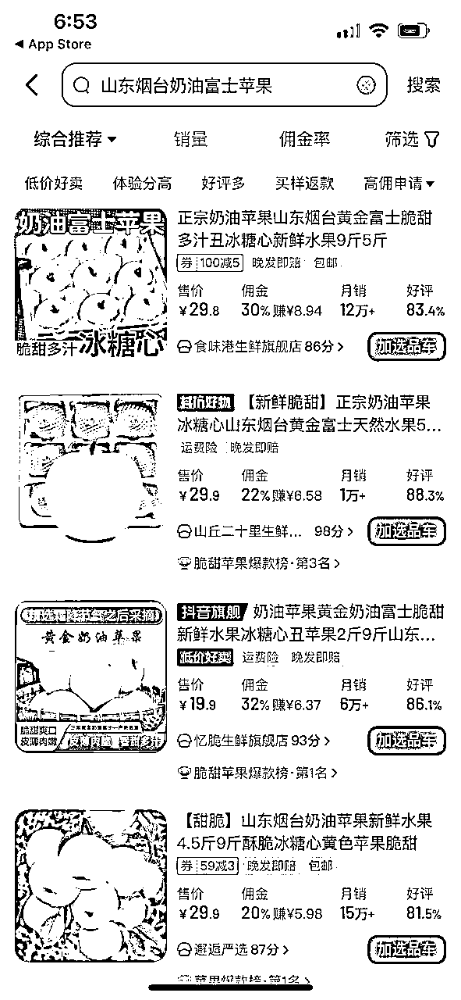
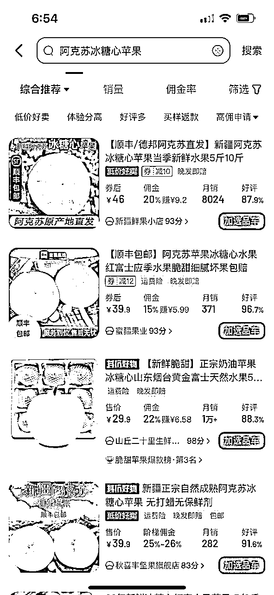
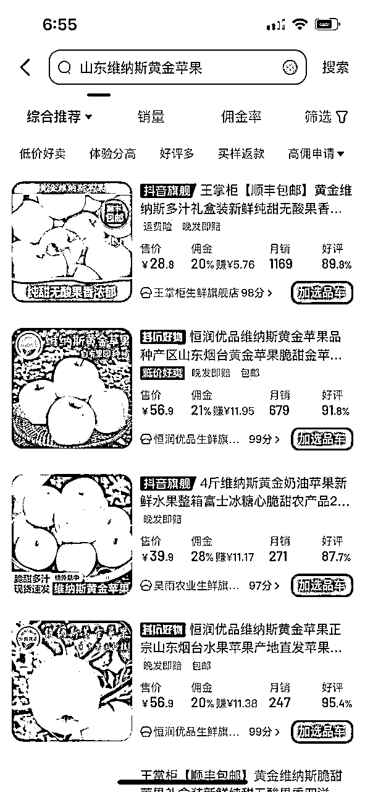
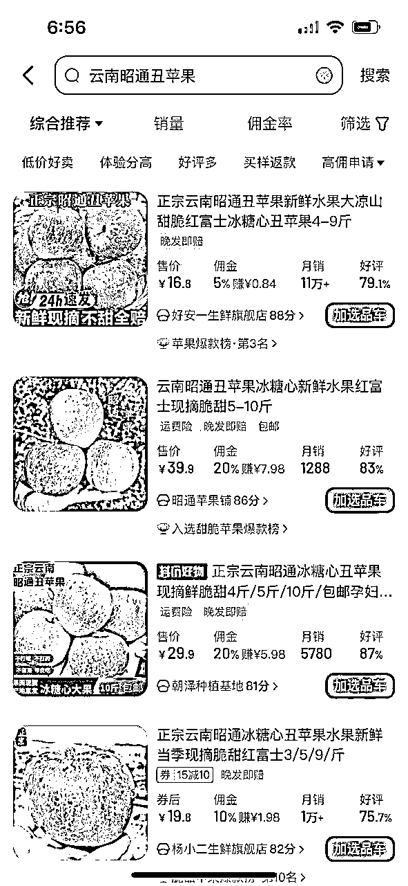

无货源模式
拼多多或1688都能找。拿1688举例，同样产地的水果定价大约是📕售价的50%左右。
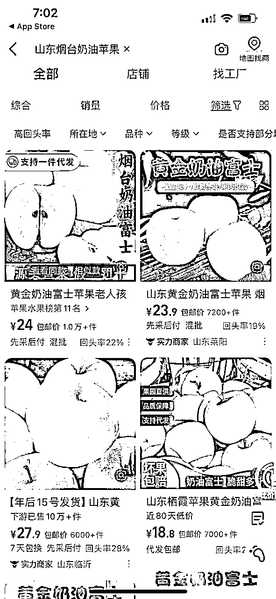
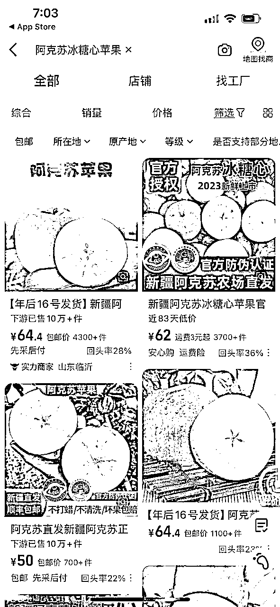
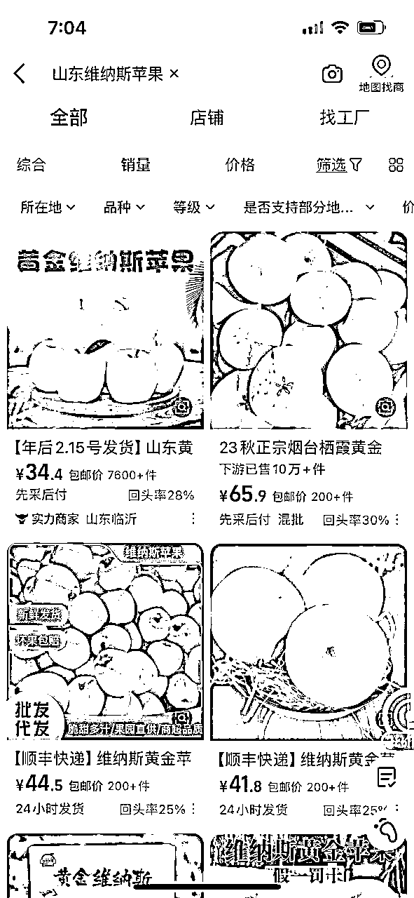
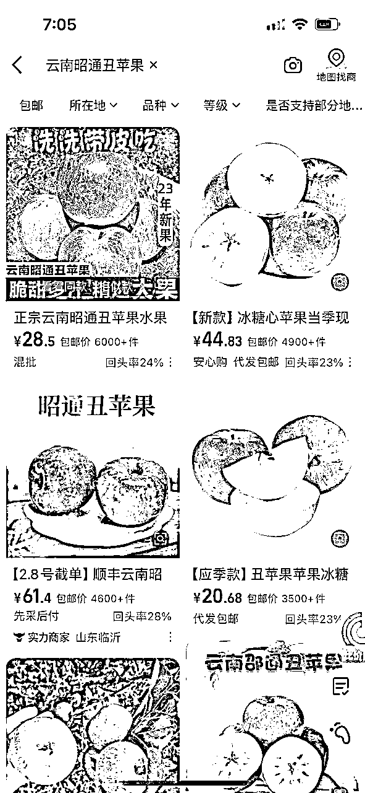

# 三、利润怎么算

核心公式仍然是 利润 = 收益 - 成本

收益：可以用第三方平台估算，也可按店铺销量乘客单价估算GMV。
利润率：看精选联盟佣金或平台差价。
成本：要算开店保证金、平台抽成、退货率、人力、物流、售后。算的维度越多越准。

1）收益侧
利润率区间在20%到40%
新手0经验的单账号单店，月GMV做到2万到3万是常见水平

2）成本侧
资金投入：📕开店保证金+少量投流+垫资+工商执照，个人店可免执照。开一家店成本≈1000元+垫资
退货率预估5%

3）综合判断
按最低标准算：利润率20%，退货率5%
最关键的风险点有三：
第一，水果品质是否对得起描述，口感直接决定评价；
第二，物流时效，新鲜度决定口碑，爆单时能不能扛住发货节奏；
第三，质量问题带来的售后爆发，退货退款、仅退款都会吃掉利润。

个人没做过生鲜，按保守估计。找到靠谱供应商把这三件事解决，净利润15%以上是可期的。有自有果园的新手，没有📕经验，单账号月GMV做到2万左右，赚点零花钱完全没问题。

# 四、从0到放大的实操路径

以第4个小号为模板，可以归纳为：

玩法：图文怼量起号，挂车带货
货源：走无货源就自己开店对接供应链交保证金；自有果园就自发货，只剩内容制作和开店成本
起号：照搬对标号的包装和内容节奏
放大：矩阵化运营，可个人店也可企业店，一个企业店可关联6个子账号

具体步骤

1. 开店准备
资金：保证金+少量投流+垫资+执照费。个人店开店≈1000元+垫资
一人前期开2-3个店，用自己及家人身份。跑通后转企业店做关联

2. 图文起号
要求：画质清晰，≥2张图
素材：自有果园实拍最佳；没有就用站外素材做二次处理
去重：加贴纸水印、抠图、拼图、升画质
连更打法：一天至少5条图文，用数量换爆款概率

3. 果园直播
场景选果园或打包发货现场
时长：单场2-4小时

# 五、结论

对有自有果园的新手来说，生鲜内容门槛不高，坚持高频垂直输出，单账号总销售额2-3万、净赚几千元，按15%净利润算是有现实操作空间的。

供应链稳定后，核心是解决爆单时采摘人力和发货时效，再用直播提升转化效率，配合矩阵账号放大，规模是完全可期的。