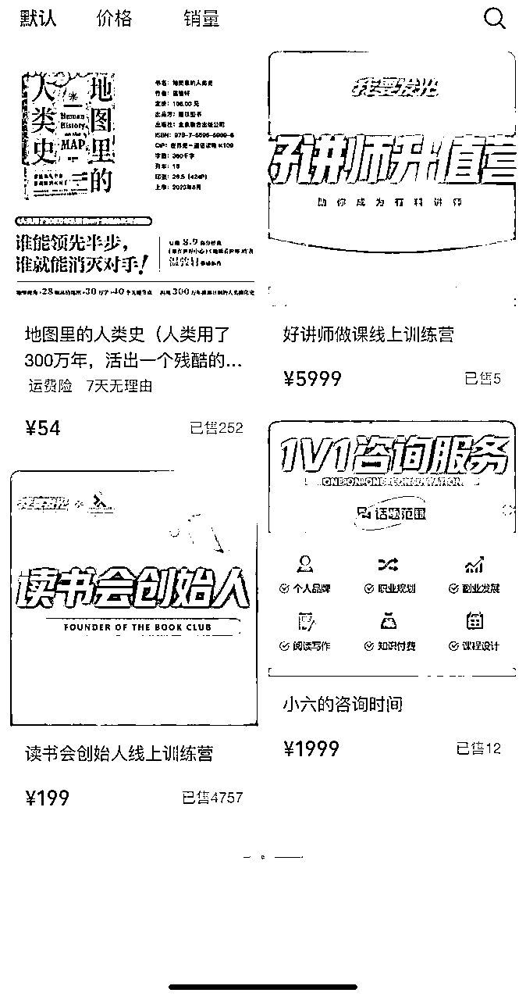
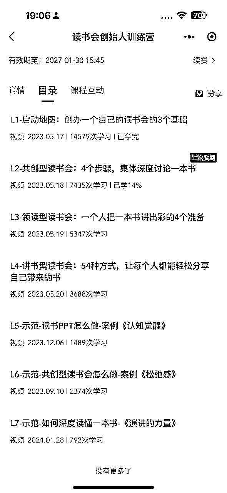
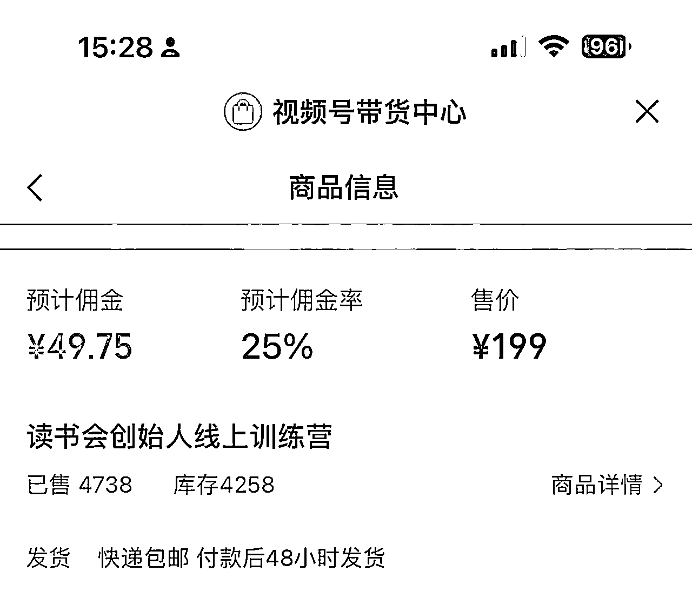
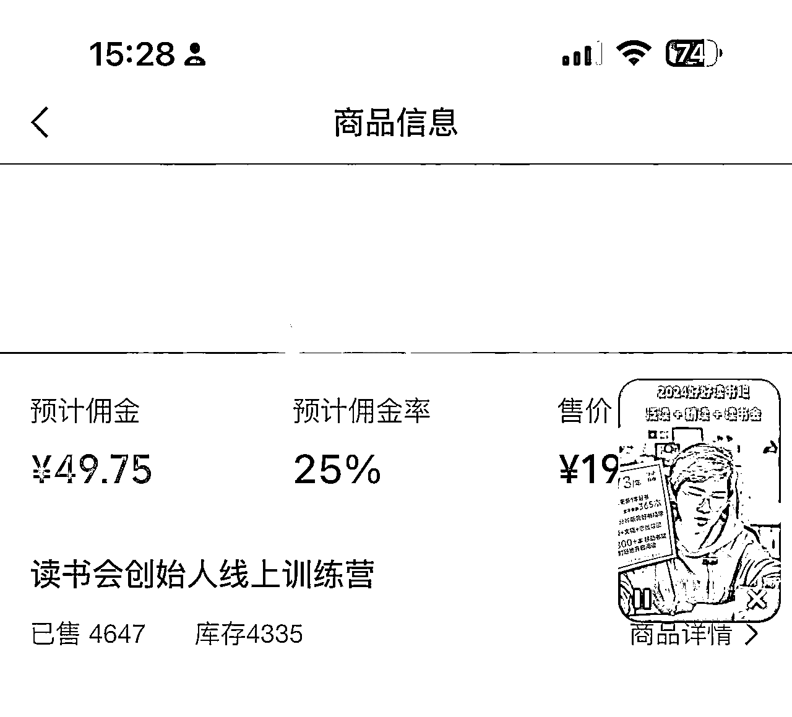

# 视频号里闷声赚钱的知识付费，我拆了一个真实案例

说实话，视频号刚推出那会儿我就拿到了内测资格。当时心里隐约觉得这是个机会，但一直没真正动手研究。眼看着2024年都过去一个月了，才在赚钱和鱼丸的推动下，认真把视频号从头到尾琢磨了一遍。这也是我第一次正式做拆解，写着写着反而来了兴致——不过是想抛块砖，把圈子里更多高手引出来聊聊。

先说我对几个平台的感受吧。抖音的口号是“记录美好生活”，但现在的抖音已经明显偏向了兴趣电商，本质上是做生意的场子；📕呢，更像一个帮用户做决定的信息池。而视频号给我的感觉完全不同——它更像是鼓励人人都能上场创作的舞台，尤其对普通人特别友好。

作为一个普通人，我当然也想找个切口挤进这条赛道。刷视频号的时候，我特别留意那些“普通人也能做的知识付费”，来回观察之后，发现两个特别常见的切入点：一个是**读书**，一个是**口才**。

这期拆解的案例，就是**从读书切入**的。好几个读书类账号都在推同一个产品，叫《读书会创始人》——简单说，就是教你如何从零发起并运营一个读书会。

这位博主橱窗里总共挂了4类产品：

1. 《读书会创始人》——199元
2. 1对1咨询——1999元
3. 《好讲师做课训练营》——5999元
4. 实体书籍

## 流量是怎么滚起来的

跟踪了3天，我注意到这个发起人的操作路径非常清晰：核心阵地就是**社群、朋友圈、视频号直播**。

每位对读书会感兴趣的人，都会被引导加到个人🛰️，随后被拉进社群。社群里没有太多硬性管理，更多是设定基础规则后，让成员自行共创。目前一共有10个社群，发起人的主要工作就是做好服务、答疑，剩下的事儿，群里的人会自发帮他做裂变。

说白了，流量来源就是**社群的成员自己开直播拉新**。只要一个人觉得“做读书会能赚钱”，想试试靠这个挣点收入，那他就自然而然成了推广者，主动帮你带新人。

## 产品是怎么设计的

整个产品体系其实就两个方向：

1. 帮读书会创始人把读书会从0搭起来，获得变现能力
2. 帮助成员进一步成长——包括咨询、读书会活动、书籍、进阶课程等

引流课程直接放到小鹅通上跑，第一期直播的录播顺手就变成了正式课程，完全不用额外录一套新内容，边际成本特别低。

## 利润到底怎么算

这次拆解我重点盯的是199元的入门产品。

我是1月31号下午15:28下单的，买完之后顺手就申请了分销权，刚好能看到后台数据：当时累计已售**4647份**。写到这儿的时候正好是2月3号下午15:28，我又看了一眼，已经变成**4738份**了。

也就是说，3天时间，卖掉了91份（刨掉我自己那一单，日均近30单）。每单毛利149元（分销佣金要扣除25%），光这一个产品，发起人每天进账**至少4477元**，还不算其他的服务收入。

最妙的是，这4738份几乎全是买过产品的人自发帮他推广来的。我自己就是因为刷到一个读书主播在推，为了配合“交作业”才下的单。

将近5000人的社群里，其实只有**87个人**在做分销，转化率大概1.8%。但就是这87个人，撑起了大量订单。

而且每成交一单，就意味着多一个人可能成为新的推广者。放在更长的时间维度里看，这种被动收入做到日入过万，根本不夸张。

## 普通人怎么入局

如果你想复制这个玩法，其实路径很清晰：

**方式一：先当分销**
拿别人的产品来卖，赚分佣就行。像这个199元的产品，每单就能拿到大概50元佣金。

**方式二：自建社群**
如果你愿意深耕，完全可以复制发起人的整套模式，建自己的社群。定价多少，主动权在自己手里。

## 怎么把盘子做大

这个项目的底层逻辑，其实是用“读书”这个非常低成本的门槛，吸引一批爱读书的精准用户，然后教他们怎么在业余时间搞钱。门槛压得足够低，普通人自然愿意入局。

如果你精力够，就自建会员体系；精力不够，就依托发起人的社群，单纯吃佣金。

再说回发起人本身，目前交付不算重，社群运营也比较轻。如果他把分销转化从1.8%做到10%，那是指数级的裂变增长。想把这个盘子放大，两条路：**一是多平台铺渠道，二是把每一步的转化率做深**。

第一次写拆解，先到这儿吧。我接下来打算自己深度进这个圈子试试，不过我并不只想做读书会，还想把演讲融进去——一边读书，一边练口才。

如果你也对这个方向感兴趣，欢迎随时来勾搭，咱们一起把这事儿玩明白。