你有没有想过，让AI帮你一次性写出几十篇高质量文章？今天要聊的这款GPT批量写文机器人，就是干这个的。它基于OpenAI的GPT模型开发，属于自然语言处理工具，核心能力是生成连贯、有深度、质量稳定的文本。简单说，你给它一个提示或问题，它就能根据训练数据和算法逻辑，自动产出单篇或多篇文章。批量写作是它的强项，特别适合需要大量内容时的场景。

目前这个方案已经用在电商、小红书、公众号等方向，如果有深度需求，可以线下交流。V：zhuhou-xi

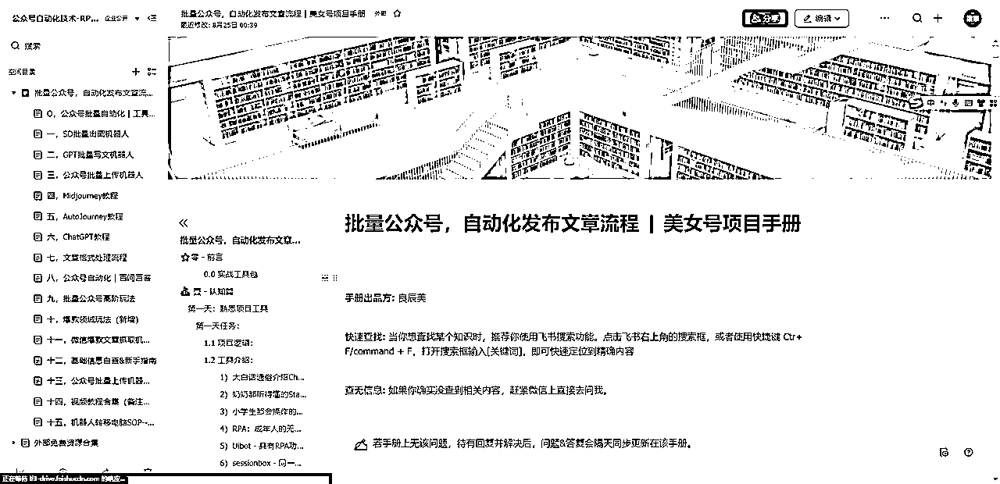

有一点要注意：机器人写完内容后，如果暂停再重新开启，需要先把前面GPT输出的内容剪切走。

### 一、整体认知

这个机器人本质上是一个“自动搬运内容”的流程。它利用大规模预训练语言模型，理解和生成自然语言，从而成为高效的写作辅助工具。应用场景很广：内容创作、文章生成、自动回复、编程帮助、教育辅导等。它的最大卖点就是批量处理，面对大批量文本需求时，能明显提升效率。

运行逻辑（见原图）：通过预先设定的Prompt，向GPT发起多次请求，然后把返回结果写入表格。

必备条件：需要安装相应软件并保持浏览器登录状态。

### 二、核心功能

##### A. 基础目的

用调好的Prompt，连续发送两次，拿到两次不同的输出。输入Prompt放在SHEET2工作簿（即模板中的prompt工作簿），输出结果自动写入SHEET1工作簿。

##### B. 高阶调试

你可以自己改Prompt内容，也可以调整向GPT发送的次数。

### 三、下载与安装

##### A. 运行环境
##### B. 压缩包
##### C. 配置步骤：选择Uibot创造者Creator

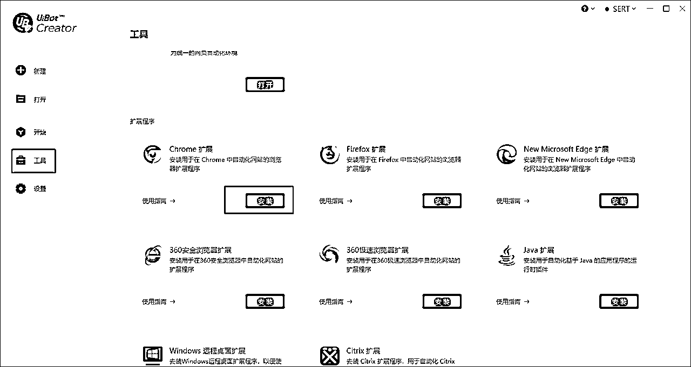

点击打开

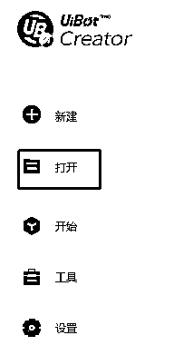

选择对应文件夹

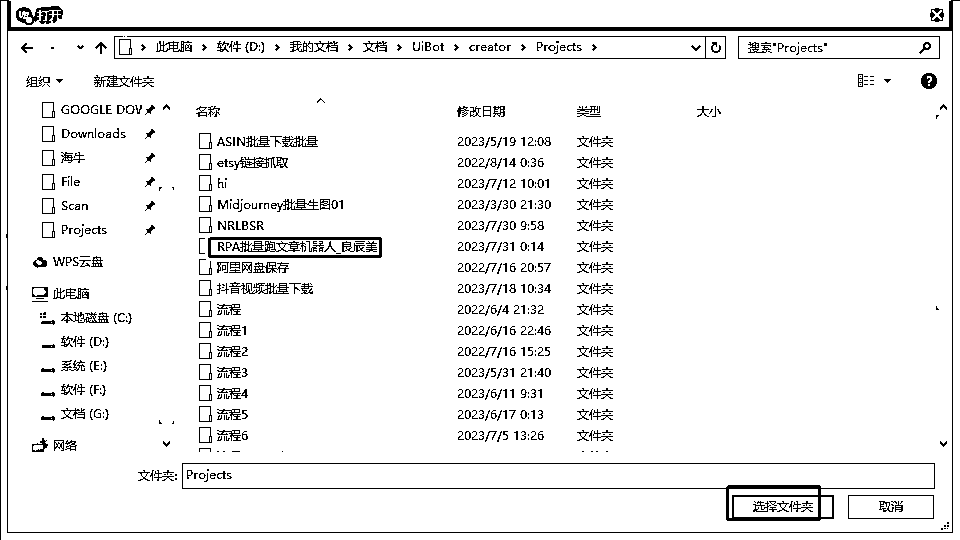

##### D. 启动运行

点击运行按钮，但务必保持ChatGPT浏览器页面处于登录状态。

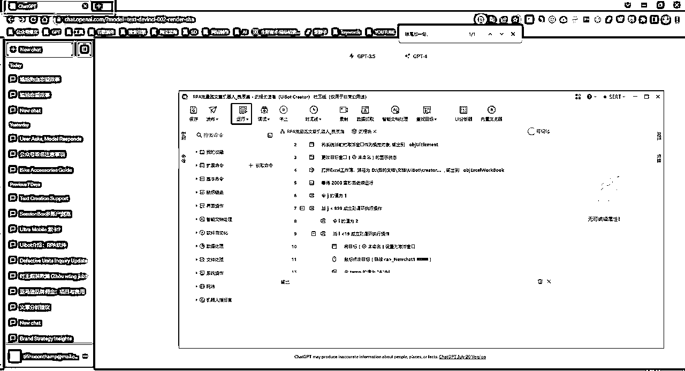

##### E. 运行要点

因为Prompt内容较长，建议把页面缩放至80%，这样更容易找到复制按钮。

<h9>1）循环次数</h9>

直接改这个数字，就能控制重复运行几轮。

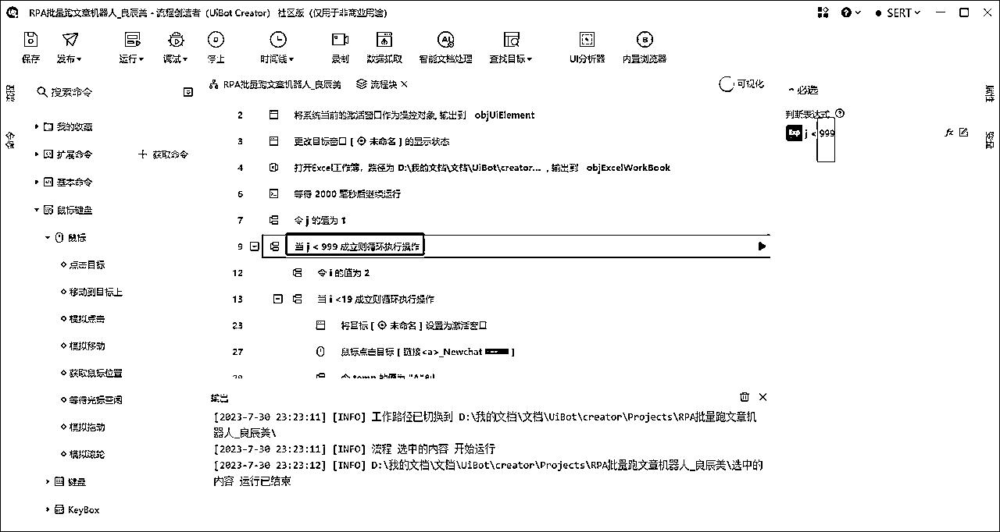

<h9>2）第二段Prompt复制输出内容</h9>

机器人是靠“结尾加一句”来定位第二次GPT输出的复制按钮。所以如果你改动了prompt2，这里的识别语句也要同步改。

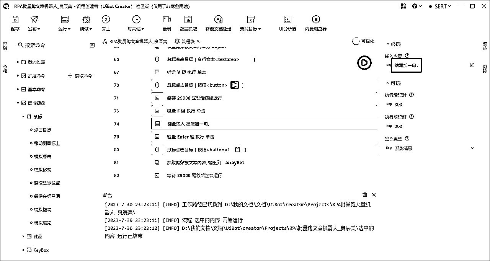

<h9>3）运行前一定关闭模板表格</h9>

否则第二次打开表格会变成只读状态，导致无法保存，机器人就会报错。

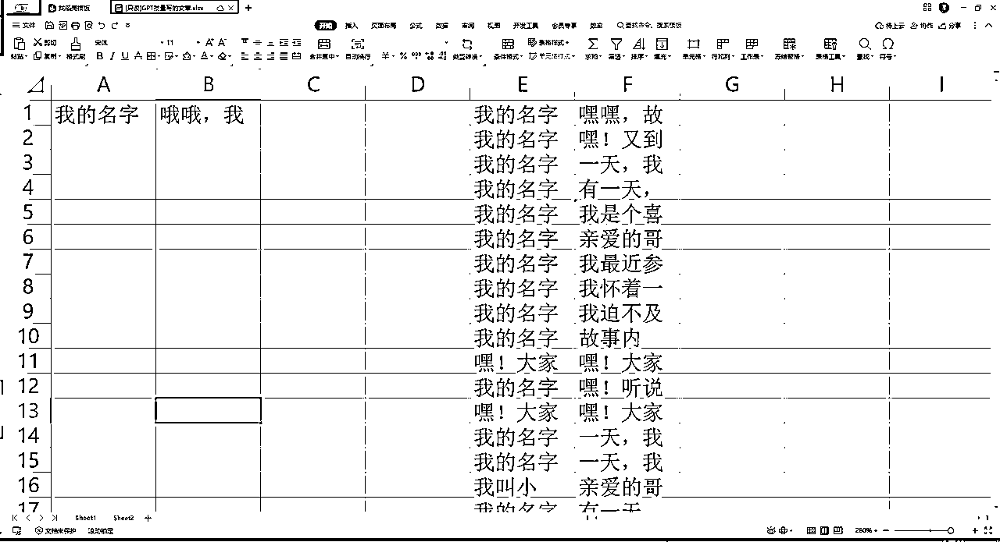

##### 4）怎么启动机器人？

第一种方式：

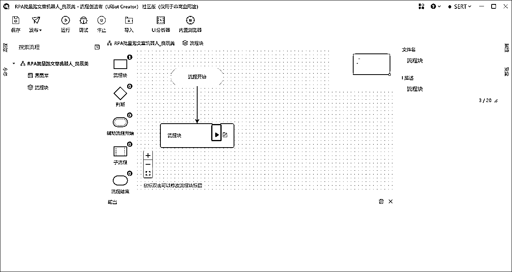

第二种方式：

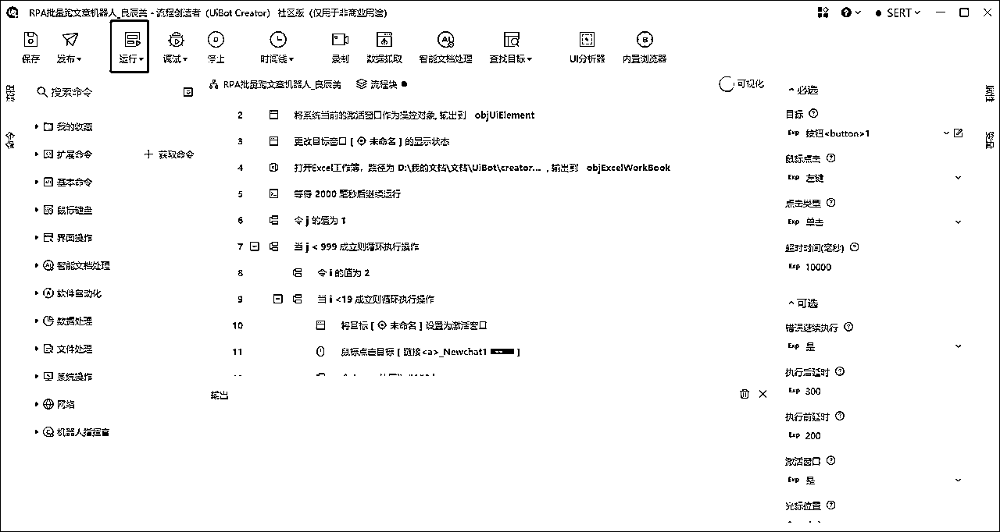

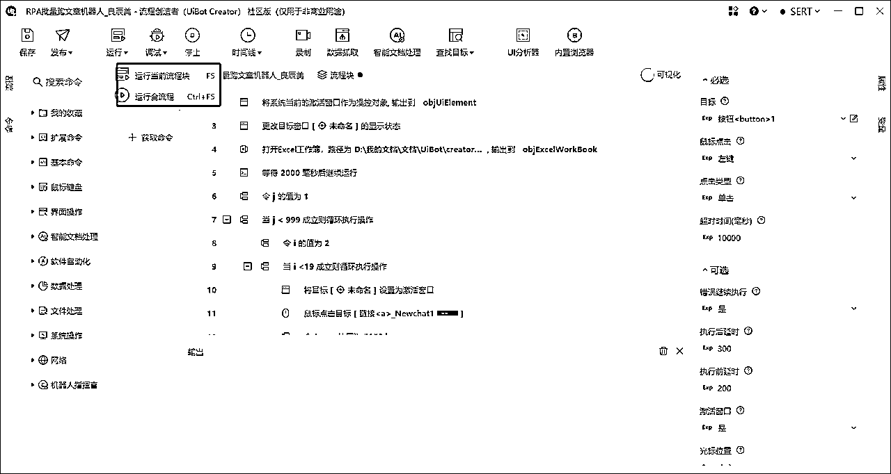

如果提示运行路径不存在，可以按下面的方法调整：

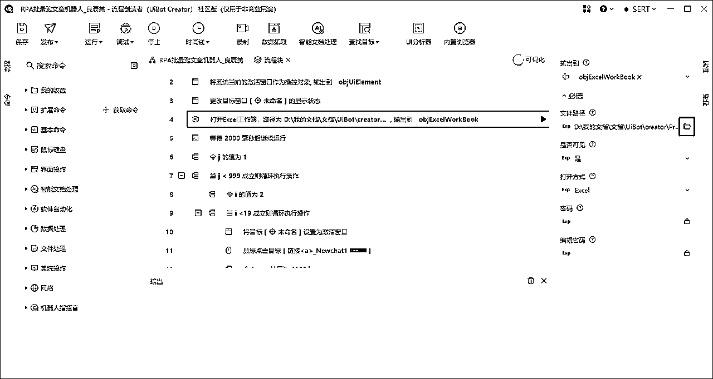

注意：GPT不要使用ARPM插件，否则会影响复制内容。

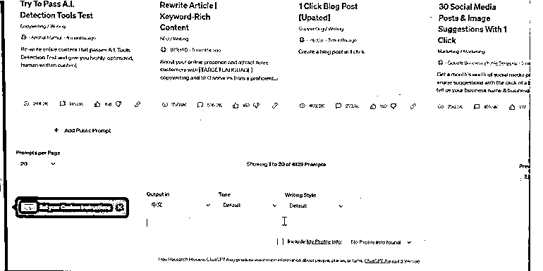

##### 5）运行完怎么处理？

运行结束后，要把SHEET1工作簿上的输出项A和B列内容剪切走，否则新生成的内容会覆盖旧内容。因为机器人每次都是从A1开始写入。你可以新建工作簿，也可以剪切到右侧其他列。

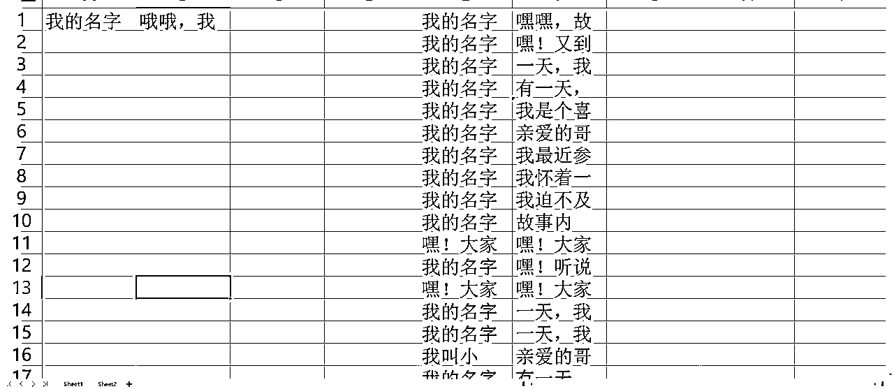

### 四、表格模板说明

##### A. 初始表格

<h9>1）表格文件位置</h9>

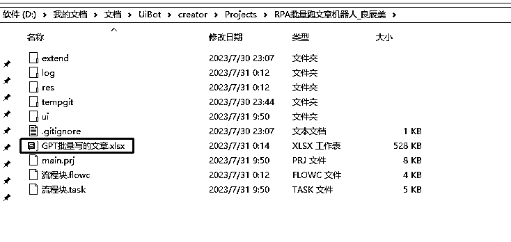

<h9>2）表格内容说明</h9>

sheet1初始是空白，

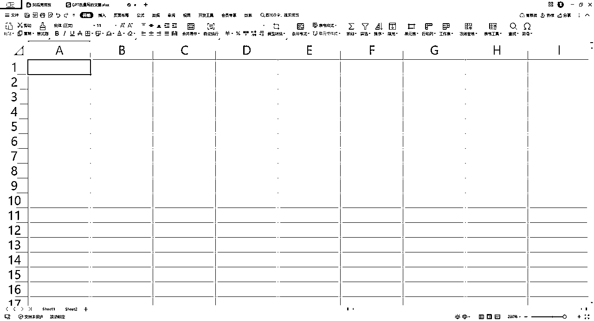

sheet2放的是Prompt语句，从第2列到第20列循环使用。你可以替换成自己的Prompt，但不要删除。

##### B. 完成状态

机器人会依次把GPT输出内容写入Sheet1的空白区域。

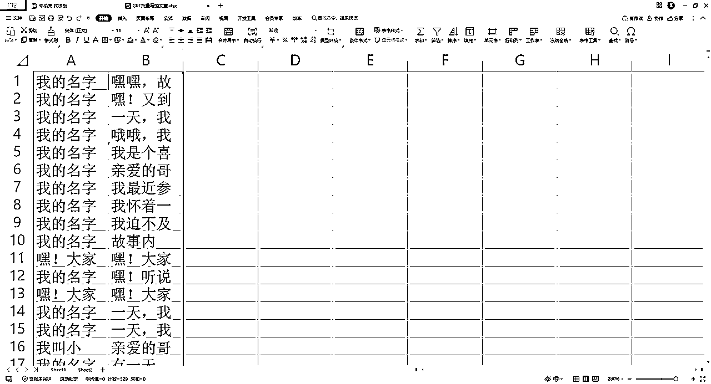

### 五、使用说明

##### A. 常见问题

Q1: 机器人报错怎么办？
提供出错截图，一定要包含全部界面，具体包括以下三部分：

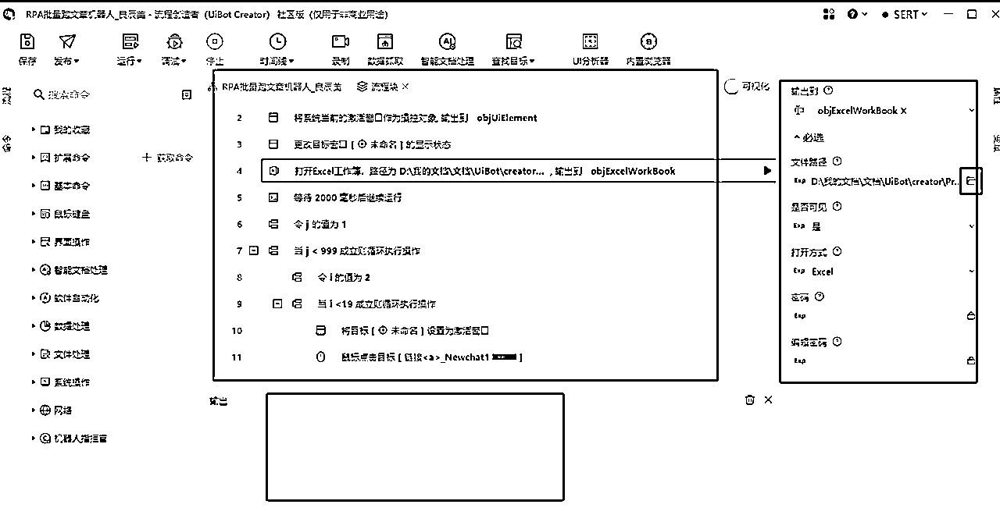

Q2: Excel输出工作簿sheet1没有内容？
先确认GPT运行正常，浏览器停在GPT页面时再点击RPA的运行机器人。这种情况通常都是GPT出错。

Q3: 机器人运行完成之后呢？
把SHEET1的输出内容剪切走，保持空白状态再开下一轮；或者让机器人长期运行，把循环次数改成99999。

##### B. 注意事项

- ChatGPT3.5版本每24小时约500次会话，每小时约50次；ChatGPT4.0版本，按2023.07.30的数据，大约每3小时50次会话。
- 电脑安装的软件太多（30个以上），或者内存不足（2G以内），都可能让运行出错。