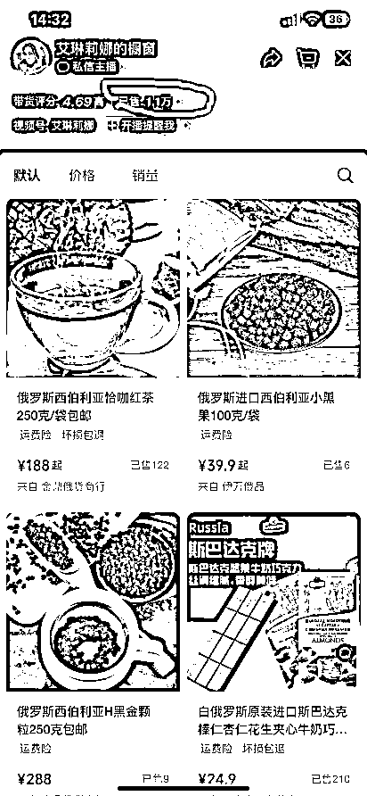
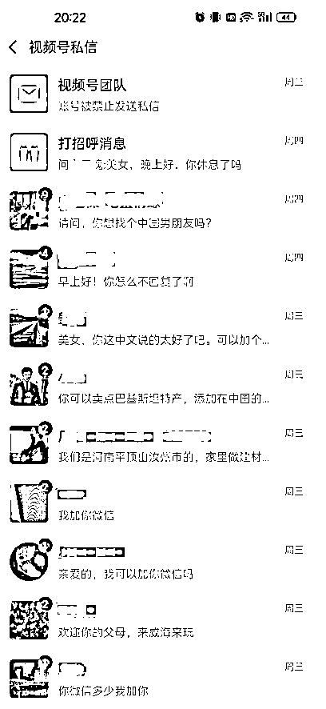
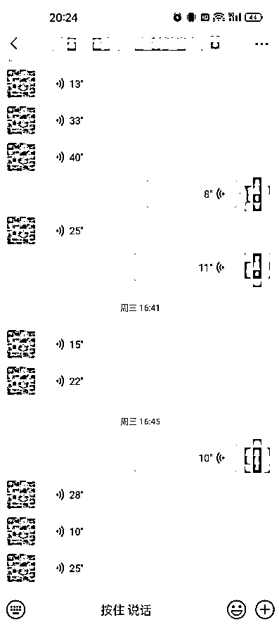
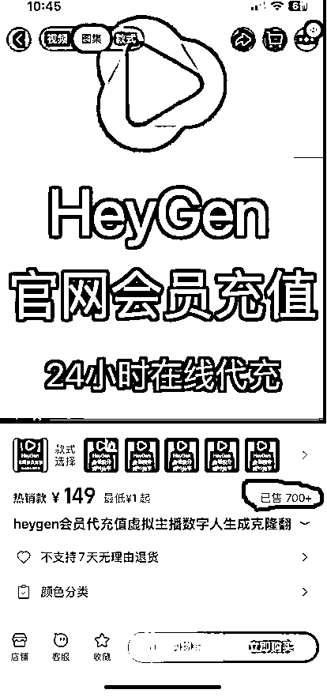
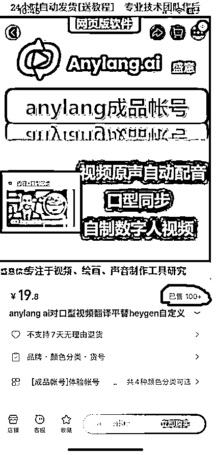

# 海外美女数字人变现：一个普通小镇青年的逆袭路

最近，海外美女数字人在各路的讨论热度越来越高。隔三差五就有朋友来问我：这玩意儿到底靠什么赚钱？真能赚到吗？

我上周刚在这个方向上跑通了一个小模型，单周流水五万多，不算夸张，但足够说明这条路走得通。只不过，我不想只丢下一句“靠短视频带货”就结束。任何一门赚钱生意，表面看是运气，背后全是个人经历里那些反复踩过的坑、磨出来的直觉，和慢慢修炼出来的判断。把我过去这十几年的故事讲完，你自然会明白，为什么最后走到我面前的，偏偏是这个叫“海外美女数字人”的机会。

这篇文章会比较长，但如果你愿意看完，我相信价值不止于一篇教程。

## 先放结论：海外美女数字人，目前最跑得通的变现路径是什么？

一句话，短视频带货。

把它拆开看，无非三个要素：

1. 平台，集中在抖音、快手、视频号、小红书这几大阵地；
2. 人设，核心标签是“热爱中国”，一位精致靓丽的海外女孩，在镜头前毫不掩饰对中国的喜欢；
3. 人群，最容易被击穿的是中老年用户。

这三个要素一旦咬合，就会产生一种奇妙的心理反应：用户从内容里感受到情绪共振，对这位数字人本尊产生好感和信任，最终愿意替这份信任买单。至于这套组合到底怎么落地，我会在文章的倒数第二个部分，把细节完整拆给你看。

现在，先回到一切开始的地方。

## 小镇出来的“笨小孩”

我出生在湖北境内一个极小的镇子上。主街从头走到尾，用不了十分钟。镇上的人，父辈们大多在同一家国营单位上班，我的父母也是普普通通的工人。

我上学特别早，班上同学普遍比我大一两岁。跟别人相比，我学东西总是慢半拍，理解力也不算突出，只能拼命用时间去追。偏偏从小体质差，感冒发烧是家常便饭，各类集体活动大多参加不了，因此在班里几乎是透明人。不过万物都是双刃剑。正因为没有朋友、没有活动、没有娱乐，我所有的时间和精力，几乎全砸在了学习上。别人玩的时候我在学，别人学的时候我还在学。靠着那股甚至有点笨拙的专注，从小学到初中，我的成绩单常年排在班里、乃至年级里靠前的位置。

中考结束，我凭成绩进了全市最顶尖的高中，也从小镇搬进市区。原以为这是我人生腾飞的起点，没想到，是我第一次撞上时代的南墙。市里的教学节奏、考试难度、同学层次，和镇上完全不是一个量级。我把过去那套“死磕”模式原封不动搬过来，每天熬到十一二点，甚至凌晨一点，成绩依旧是中下游。物理和地理两科更是像两座大山，死死压在排名上面。高二分科，为了躲开物理，我选了文科，但地理依然拖后腿。为了补弱科，我买过一堆参考书，试过各种办法，几乎统统无效。

实在没辙，我只好向父母求助，说想请一位家教来带我。父母给出的回应却非常坚决：成绩提不上去，就是没用功，请家教是乱花钱。三番五次沟通无果，我彻底体验到什么叫孤立无援。对一个十六七岁、正处在叛逆期的少年来说，这种心理上的重击几乎是毁灭性的。

从那天起，我开始了自暴自弃的日子：翘课、泡网吧、和陌生网友讲些有的没的、用单机游戏填满时间。

转变发生在高考倒计时第一百天。黑板上的数字越擦越少，我的心里莫名慌乱起来。有一天坐在教室里，脑海里突然冒出一个场景：我没有考上大学，回到镇子，进入父母所在的那家国企，每天朝九晚五，十年如一日，人生一眼望得到头。那种窒息感比任何说教都管用。我像抓住救命稻草一样抓住剩下的日子，拼命把落下的内容往回补。高考前最后一次模考，我的成绩已经回到班里的中游水平，尽管距离顶尖还有距离，但起码看到了希望。

## 考场上睡着，人生第一次被现实碾压

高考那天，我整个人异常轻松。平时刷过的模拟题比真题难太多，坐在考场上，甚至有种莫名的膨胀感。数学卷子做完，时间还不到一小时，我连检查都懒得做，趴在桌上睡了过去。监考老师走过来把我拍醒，示意我再看看卷子，我根本不以为意。考完试回到家，我妈递来印着答案的报纸，让我对一对分数，我碰都没碰。

等成绩真正公布的那一天，我盯着屏幕上的“400多分”，彻底傻眼了。第一反应是阅卷搞错了，我要申请复核。随后翻箱倒柜找出那张报纸，逐题核对，越对心越凉。那些错的题绝大多数我都会做，纯粹是粗心和心态作祟。如果是因为不会做而丢分，我认。但因为自己的得意忘形丢掉这么多分，我实在无法原谅自己。

一个从小学到初中长期被当作榜样的孩子，一夜之间，活成了别人嘴里的笑话。我不甘心，却也别无选择，只能去武汉一所三本院校，读了自己从小喜欢的英语专业。

大学校园里呈现出两个极端：有人抱着字典埋头苦读，有人在宿舍打游戏、谈恋爱。我这个既融不进学霸圈子、也看不上散漫状态的人，干脆把自己封闭起来，不是在上课，就是在图书馆。吃饭只求温饱，宿舍对我来说只是一个睡觉的地方。

期间，最难忘的一幕发生在学院英语角。外院组织高年级学长学姐和新生交流口语。我很清楚，口语对英语专业的人是门面，于是鼓起勇气开口发言。结果没说两句，就被一个学姐当场叫停，说我某个单词重音读错，发音很奇怪。周围随即响起一阵笑声，有人起哄说像印度口音。我逃回宿舍，冲进洗手间，把门反锁，哭得稀里哗啦。晚上蒙在被子里继续掉眼泪，连哭出声都不敢，怕室友听见。

消沉几天后，我决定直面现实：口语差，那就从零开始练。方法很笨——把课文音频放进MP3，一遍遍跟读、录音，反复对比，直到自己听不出和原声的差别，再把录音放给室友听，室友也听不出差别，才进入下一篇课文。

后来有同学告诉我，华中师范大学有一个全武汉最知名的英语角，全市高校的高手都会去。我带室友慕名前往，结果再一次被现实狠狠羞辱。当时站在我旁边的是两个武汉理工的男生，他们问了我的学校和专业后，聊了几分钟，其中一个人用英语阴阳怪气地说：就你这学校也好意思说自己是英语专业？口语连我这个非英语专业的人都比不上。

这句话像一把刀，捅破了我所有的自尊。室友当场表示再也不会去，我也难受得不行。但哭完以后，反而激起一股倔劲：你现在确实菜，被人按在地上摩擦是正常的。正因为菜，才更要往高手堆里扎，不断碰壁，不断发现问题，才能脱胎换骨。

从那时起，每周四、周五只要不下雨，我都雷打不动出现在华师英语角，一坚持就是整整三年。

三年后的某一天，我又在现场遇到当年那两位武汉理工的男生。我径直走过去，和他们打招呼，简单聊了几句。不到一分钟，他们脸上的表情从陌生变成了震惊，眼里写满了“不可能”。那一刻我终于相信：那个曾经连一句完整自我介绍都讲不利索的人，已经被彻底换掉了。

那天回学校，我没有坐公交，一个人走了半个多小时。一路上眼泪止不住地往下流，又忍不住傻笑。路人大概觉得我疯了，我无所谓。我只是替自己高兴——这三年来吃的苦、丢的脸、咬牙撑过的每一个夜晚，终于凝结成了一个全新的我。

大学期间，我考过了英语四六级、专业四级、专业八级，把口语练到可以靠它吃饭的程度，也在这一路上攒下了第一笔和第二笔关于坚持的认知。

## 每月600块生活费，我把口语变成了钱

大三下学期，家里出了些变故，我每个月能拿到的生活费只有六百块。这些钱不仅要吃饭，还要充话费、买书、坐车去华师练口语。冬天最难熬，上完课经常饿得眼冒金星。

我必须要找兼职了。但以我的性格，发传单、端盘子、当服务员，哪样都做不来；做家教能力上没问题，可谁会请一个三本院校的学生去给自己孩子补课？我只好把希望寄托在网络上。先是在一个叫“布谷堂”的线上口语交流平台找到一份主持人的活计，每周工资一百元，可惜平台没撑多久就关闭了。后来我又进了一个叫“口语陪练网”的网站，开始在线教英语。

刚起步，为了抢生源，我把一节课的价格压到二十到三十块。学生从一个变成两个，最后排到每天七八节，连续上七八个小时、不敢喝水、不敢去洗手间，是常有的事。每天结束后，整个人瘫在床上连话都不想讲，可看到银行卡里多出来的两三百块钱，心里又格外踏实。再后来，口碑渐渐起来，单价涨到每小时七十五元。大四上学期，我每天固定有四节课，再接一些散单，月收入稳定过万。要知道，那时候我们学校老师的月薪也不过三四千。

那是我人生第一次切身感受到：努力不只是用来感动自己的，它可以真真切切地兑换成钱和尊严。

## 深圳：光鲜办公室背后，是差点被熬垮的身体

毕业那年三月份，我一个人拖着三只箱子去了深圳。当时还没有从武汉直达深圳的高铁，我先坐车到广州南，再转去深圳北。落地后，我谁也不认识，只知道这座城市塞满了想翻身的人。我不怕苦，也不怕累，心里铆着一股劲：一定要在这里赚到钱。

到深圳的第一个月，我密集面试了三十多家培训机构。除了两家门槛特别高、我拼尽全力也没挤进去的顶级机构外，其他所有机构都给了我offer。我选了一家底薪最高的出国留学机构，底薪五千，再加课时提成。

公司办公地点在海岸城一栋5A级写字楼的32层，我拥有一间独立办公室，窗外是全景落地窗，桌上摆着一台全新的电脑。外人看，体面极了。事实上，我当时几乎把所有精力都烧给了工作：日均八到十节课，备课经常备到凌晨三四点。约定好的每周单休，也常常被临时加课吞掉。几个月熬下来，身体彻底罢工，我病倒了，不得不辞职回老家休养。

再次回到深圳后，我给自己定了一条铁律：钱要赚，但命不能被工作单方面透支。一个人，应该靠脑子和眼光去挣钱，而不是靠燃烧自己。

## 淘宝三个月不开张，直到盯上新百伦

一次偶然的机会，一位在美国打工的同学在QQ上联系我。她靠给国内亲戚朋友代购美国保健品，一个月能做好几万收入。我们一拍即合：她负责美国采购，我负责在淘宝开店、运营和接待客户。

我开始自学开店流程、制作素材、上架商品、装修店铺，全是从零起步。结果，整整三个月，一单都没开成。大学期间攒的钱马上要见底，再没收入，就只能灰溜溜离开深圳。现在回头看，那三个月交了一笔很贵的学费，它也让我彻底理解了一个道理：没有经过细致观察和深入研究就贸然冲进一个陌生领域，最终结果往往只会是惨淡收场。

但我没有被失败吓退。我心里很清楚：从美国进货、拿到国内卖，这条路一定走得通，问题只出在“卖什么品”上。于是我跑到了亚马逊，从自己熟悉的运动鞋入手。这一搜，还真让我挖到了机会——一双国内卖八百多的新百伦，美国只卖四百出头。哪怕算上国际运费，仍有一双三百多的净利润。我赶紧下单，等了大半个月拿到手，先自己穿了一周。结果特别惊讶：价格便宜不少，做工和质量反而比国内专柜还好。虽然是同一行MADE IN CHINA，但不同市场的货，差距就是真实存在。

信心有了，说干就干。我在淘宝上传了三双新百伦热门款，朋友圈也同步吆喝。订单很快涌进来，多的时候每天十到二十单。第一个月，净利润破了四万。这比我在培训机构当面授课要轻松太多了。

可惜的是，由于当时对电商规则的了解还太浅，又碰上同行恶性竞争和恶意投诉，店铺最后被关闭了。但正是这段经历，让我一脚踩进了新世界，也为后面真正赚到第一桶金的财富机会，埋下了一条长长的引线。

## 一双Keds帆布鞋，给我上了一堂粉丝经济课

有一天，一个女同学知道我能从美国带东西，于是托我帮她在美国买一双Keds的帆布鞋。鞋子漂洋过海到我手上，我翻来覆去地看：这不就是一双普普通通的帆布鞋吗？质量也说不上多精致，有什么好跨洋去买？

后来她和我详细聊了一番，我才知道这双鞋背后的门道。它是美国著名歌手泰勒·斯威夫特代言的产品，而在她海量同款里，这双鞋已经算是最平价、普通粉丝也买得起的“入门级同款”。我第一次被“粉丝经济”这四个字冲击到。一个人愿意为一双不起眼的帆布鞋付出远超它成本的价钱，买的不是鞋，而是偶像带给她的情感连接。

我迅速跑到贴吧搜索这双鞋的相关信息，发现求购帖比比皆是。再打开淘宝一看，卖这个牌子的店铺寥寥无几。一个巨大的缺口，就赤裸裸地摆在眼前。

这一次，我没有再冲动。吸取了三个月不开单的教训，我先沉下心研究产品、研究用户、研究营销方式，最后选定以微博作为主阵地，引流到微信完成闭环。

新账号注册才一两天，粉丝只有个位数的时候，就有陌生的用户主动来下单，而且是直接转的支付宝。说实话，那种感觉特别魔幻，也特别让人激动。那阵子我给自己设了一个相当反人性的节奏：每天保持至少十条微博更新，平均一个多小时发一条；手机二十四小时开着铃声，深夜有人咨询，我照样爬起来回复。每一双鞋到我手里，我都会拍下实拍图；发货以后，再把快递单晒出来。用足够的真实感，打消用户的每一次犹豫。

就这样，一年时间，我积累了大约一万微博粉丝，微信里沉淀了三千多个客户。这个卖鞋生意，我稳稳做了四年多，赚到了人生中第一个一百万。我在老家买了房、买了车、配齐家具家电，利用空闲时间考了驾照、教师证，也去了国内外十多个城市旅行，好好看了一圈世界。

当物质生活逐渐被填满，我心里那根关于学历的刺，却开始隐隐作痛。

## 一场昂贵的固执：30岁才换来硕士学位

从小到大，三本学历一直是我心里的一块疤。哪怕后来靠自己赚了钱，每次同学聚会，我依然有一种抬不起头的感觉。我不甘心。我想通过考研，重新证明自己一回。

于是我做了一个如今回头看挺傻的决定：放下当时正在不断进账的生意，注销微博和微信，回到湖北找了个学校，在图书馆里闭关备考。备考期间，每天早晨五点多起床，六点到图书馆占座，晚上回家还要在跑步机上奔跑。我极度讨厌跑步，因为太枯燥；考研也一样枯燥。但我告诉自己：只要我能把最抵触的跑步坚持下去，我就能把最枯燥的考研坚持下去。就这样，大半年后，我减了整整四十斤，人瘦了一圈，状态也焕然一新。

但现实教育了我：你的想法太简单了。毕业六年后再回到考场，体力、记忆力、专注力都远不如二十出头的时候，考研人数也比过去翻了数倍。第一年我考了366分，和我同学当年上岸的分数一模一样，但时代不同了，分数线水涨船高，我落榜了。短暂的沮丧后，我换了一所目标院校，再次闭关一年。第二年，我终于拿到录取通知书，上岸那年，我正好三十岁。

走进校园的喜悦，只持续了几天。迎面而来的，是论文、课程和各种琐事交错的日复一日。三年后毕业时，我虽然了却了学历执念，但也越来越清楚地意识到，这几年，我错过了太多本可以属于我的机会。短视频、直播、TikTok的浪潮一波接着一波，每一个风口站起来的时候，我都坐在教室里和文献较劲。如果给我重新选一次，我大概会用更聪明的方式，去完成那个关于学历的梦想——比如考个雅思，去英国用一年时间拿个硕士学位。但人生没有如果。所有的选择，都只能买单后继续往前走。

好在，那些年慢慢熬出来的学习能力、自律习惯和永不服输的韧性，都是带不走的资产。

## 重新归零，遇上海外美女数字人

临近毕业的那半年，我加入了一个在实战派圈子里口碑很好的社群，也参加了不少次实操训练。也是在那个阶段，我开始重新审视自己过去的微商经验、淘宝经验、小红书和抖音的种种变化。铁一样的事实摆在面前：上一代玩法已经过期，新机会藏在小屏幕里，藏在每一个能真正牵动用户情绪的内容里。

带着这样的视角，我关注到了“海外美女数字人”这个小众但增长极快的新方向。

如果你还没看过我上一篇文章，建议先去补一补，我在那篇文章里完整拆过一个真实案例。简单概括，从模型调试到文案打磨，从账号起号到商业转化，我踩了不少坑，也在不断试错中跑出了正反馈。标题里的“单周变现五万多”，不是运气，而是被前面那些故事一点点推着走到这里的必然结果。

## 海外美女数字人变现，最内核的逻辑是什么？

这部分，我把细节完整展开。

变现场景目前最清晰的，就是短视频带货，没有那么多花里胡哨的东西。

发布平台不外乎那几大短视频入口：抖音、快手、视频号、小红书。你通过数字人技术，生成一张足够精致、足够自然的海外女孩面孔，让她在镜头前说话、介绍自己、分享生活中的所见所闻，偶尔夸一夸某个产品。

人设不需要复杂，一个关键词足矣：热爱中国。她喜欢中国菜，喜欢中国的节日，能说一口恰到好处的中文，毫无掩饰地表达自己对这片土地的喜爱。这种设定一旦成立，最容易打穿的人群，是对祖国怀有深挚情意的中老年朋友。他们看到一个外国人如此真诚地为中国点赞，情绪会在短短十几秒里被点亮。这份被点燃的情绪，会快速转化为对这位“女孩”的信任，而信任，就是一切付费的入口。

所以，做海外美女数字人，真正的胜负手，从来不是画面渲染得多炫，也不是数字人技术多前沿。就算你的模型再漂亮，没有一套能精准戳中人群情绪的文案，依然只是空壳。真正决定成交的，永远是两件事：一是数字人模型是否足够真实可信；二是文案脚本能不能引发共情，在几十秒内换得用户的信任。

共鸣到了，信任到了，付费就是顺水推舟的事。

## 最后一段想说的话

回看我这十几年，高考失利、英语角被嘲笑、练口语练到想砸录音机、三个月不出单、考研落榜……每一件单独拎出来，在当时都像天塌了一样。但也正是这一路一次次被按在地上摩擦，又一次次站起来往前走，才磨出了后来对用户心理的感知力、对内容情绪的敏感度，以及把事情反复拆解、反复试错的耐心。

赚钱这件事，最稀缺的从来不是风口。风口年年有，真正缺的是你有没有能力识别它，以及敢不敢在错误里一遍遍把自己捡起来。

海外美女数字人，只是这条长路上，目前最明亮的一个出口。风已经吹到了这里，这次我会牢牢抓住它。

做内容变现，本质上就两条路可以选。

一条是走达人带货的模式，靠平台选品中心挑品上架挂小黄车。好处是省心，商家负责发货和售后的所有环节，你只管拍内容推流。缺点也很明显，品没选对，质量翻车，背锅的永远是你个人，信誉直接受损，而且因为中间环节多，赚到的差价并不算高。

另一条是自己开店从1688拿货。好处是利润空间自己说了算，货品的质量和定价也在你手里。代价是所有环节都要自己扛，从打包发货到客服售后，一点都省不下来。

1. 把私信用户沉淀到私域里再成交

这个打法核心就是把主动找你聊天的粉丝，引导到微信里做深度沟通。私信来的都是购买意向比较强的人，他们愿意和你建立一对一的信任，一旦关系维护的好，后续转化非常顺畅。操作上要记住三件事：第一，把私信用户当成核心资产去回复和经营；第二，主动去视频评论区互动，用高质量的回复去撬动更多潜在需求；第三，严格管理评论区风向，涉及平台敏感词的内容要及时清理，避免给账号带来限流风险。

1. 做数字人平台账号的资源交易

这条路考验的是信息差和资源整合能力。只要能稳定拿到账号并完成交付，后续的变现非常顺滑。因为现在数字人的内容需求爆炸，成本又极低，一旦渠道打通，出货速度会非常快。坦白说，这在短期内就是个很猛的红利窗口。昨天我刚发完第一篇长文，Anylang的风控就直接收紧，谷歌邮箱注册都封死了，后面我试了各种方法都没法绕过去。最后还是靠细抠全网线索才找到完整的替代方案和可行的注册路径。

1. 围绕海外美女数字人做课程服务

道理很简单，纸上看总归不如自己实操一遍。昨天文章发出后，很多同行来找我交流，聊下来发现大部分人对数字人的理解都只是浮在表面。很多时间都浪费在一些边缘问题上，比如电脑配置要多少算够用之类。每个人的学习节奏不一样，有人看个思路就能跑，有人就得要手把手带。正是这种差异，让知识付费有了天然的市场。文字、音频、视频、直播带教，不同形态都能覆盖不同人群的学习习惯，所以课程这条线我一直觉得是非常稳的变现方式。

想在这个赛道做出结果，没有捷径可走。绝不可能一口吃成胖子。你看我之前的经历就是最好的例子。第一步是大量输入和研究，找到一个真正能做的点子；第二步是执行力，遇到问题能不能快速调整；第三步是心态，能不能扛住失败不断迭代。失败是常态，赚钱更是九死一生，关键在于每一次摔倒都能复盘总结，把能力一点点堆上去。我觉得最重要的其实是自信，相信自己能做好，跌倒了再站起来，总有一天会达到目标。

最后感谢所有圈友的关注和支持，Pony由衷感谢。祝大家新的一年都能多挣钱，一起把财路越走越宽。有任何不懂的点，欢迎来找我交流：jingdu2024