# 房产中介成建材装修复盘增量口，怎么做才做到月入百万

先看大环境发生了什么。2021年恒大等房企接连暴雷，整个地产链条震荡。卖房的收入腰斩，下游的装企、家居、建材经销商一波又一波地关门倒闭。行业进入寒冬的同时，平台却在加码家装，2021年7月贝壳全资拿下圣都，2023年10月又花15.5亿收购爱空间，2023年贝壳家装营收就已破百亿。

时间线很重要。2022年之前，房产中介基本看不上装企、建材店。市场火的时候中介赚得盆满钵满，根本没动力给装修导客。装修客单周期长、成交慢、流程繁琐，给的返点又不高，谈合作几乎没戏，能谈的也只有头部大装企。

2023年后逻辑反转了。卖房难赚钱，中介开始主动找第二增长曲线，建材装修成了他们重点盯的流量变现口。我们在帮扶经销商时就吃到了这波红利，去年5月和8月两场帮扶，仅靠中介渠道就双双破百万产值。

下面用两个真实实操拆解怎么把中介渠道打通。

### 案例一：大城市直营连锁中介打法

门店画像：广州一家大家居装企，设计师、销售、监理等共70人。帮扶周期：1个月。中介渠道产出：进店带看56组，实际成交11单，整体装修金额150万。

大平台之外，本地化连锁或直营的中介公司才是主力军，再加上个体店正在被逐步兼并加盟。我们锁定的对象就是这些区域性体量较大的中介机构。

**1. 怎么谈下来**

直接跟老板聊能赚多少钱没用，对他而言这笔钱跟门店房租比起来可有可无，而且他更怕员工带装修耽误卖房。我们的谈法做了三个切口：

*   房租对冲：合作跑通后，靠装修返点把门店房租挣回来，等于门店经营成本里少了一项固定支出。
*   留住人：中介整体收入下滑，给员工多一个返点通道，既能稳住团队，也能让客户更愿意离不开他。
*   售房助推：二手房交易里墙体裂缝、发霉、局部维修是常见的成交阻力，我们提供专业背书，能给中介员工做装修知识培训，现场帮客户化解顾虑。

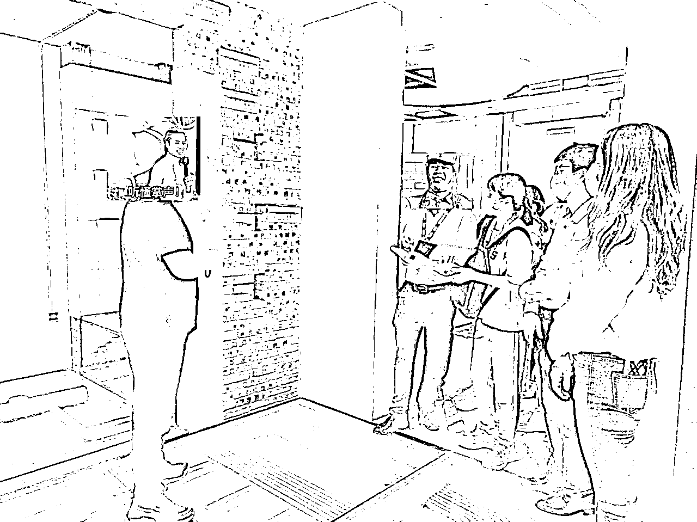

设计师在给房产中介讲解家装知识

**2. 利益分配机制**

*   到店有奖：中介员工每带一位客户进店奖励200元，周结。门店员工负责现场收款并拍照留痕，进店必须签字确认。
*   成交分成：定制类返7个点，全案整装返10个点。客户签约并付20%首款后月结，提成公司与员工五五分。
*   冲量激励：单店月度带单破100万，额外奖励1万元，员工拿60%，店长拿40%。
*   对接人津贴：每月固定给部门负责人2000元津贴，专人专管才能推得动。

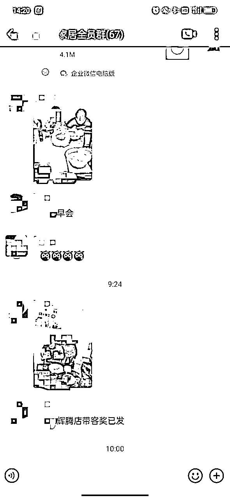

**3. 数据闭环**

*   执行小组：业务员两人一组，覆盖5-10家门店，每周上门2次联络感情，收集有效客户。
*   鉴别水客：设计师接待后做谈客复盘，客户只是走马观花、连小区都说不清、明确无装修意向的，不计奖励。
*   数据同步：日/周/月数据汇总后同步给中介门店及部门负责人，让进展可视化。

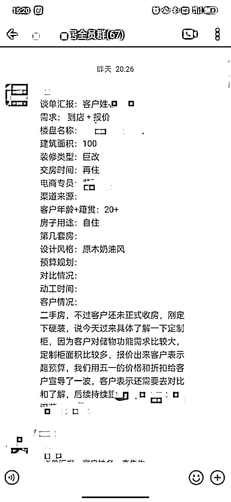

### 案例二：小县城撬动全域中介资源

门店画像：山东某县城基装+全屋定制店，销售2人、设计师3人。帮扶周期：25天。中介渠道产出：报名收卡105户，成交转化28户，装修总额160万。

县城人手有限，做不过一对一对接，于是改成“集中策动”。先办两场中介宣讲会，把全县中介聚齐，再带队把所有门店跑一遍，把沉睡资源全部挖出来。

**1. 激励设计**

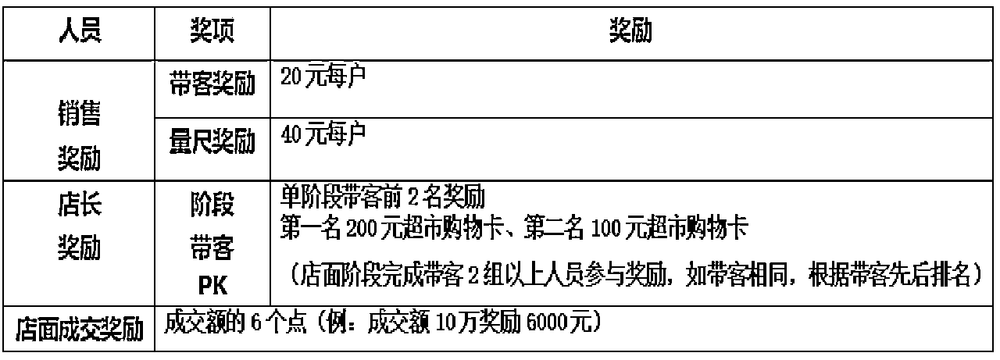

**2. 信息流转**

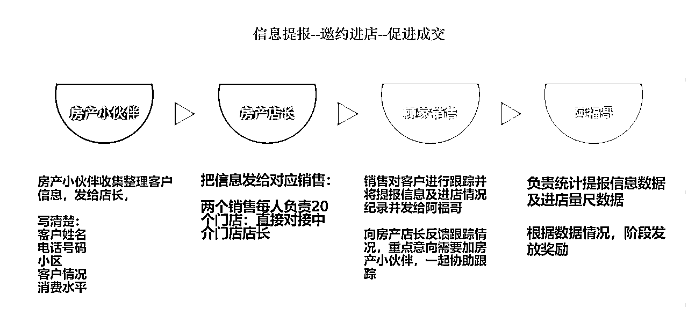

活动中期恰逢中介月度例会，我们争取到30分钟现场时间，统一集中售卡，当场售出50户，最终累计收卡105户。活动现场流程和卡券机制此处不展开。

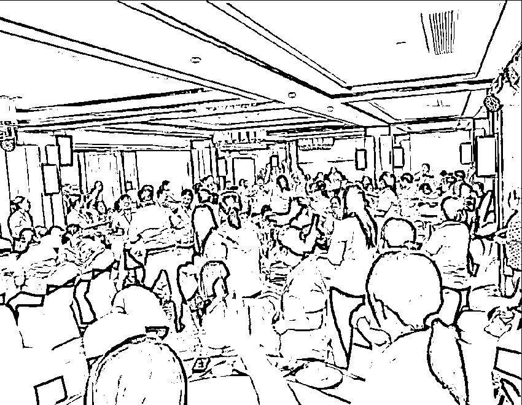

房产中介现场售卡

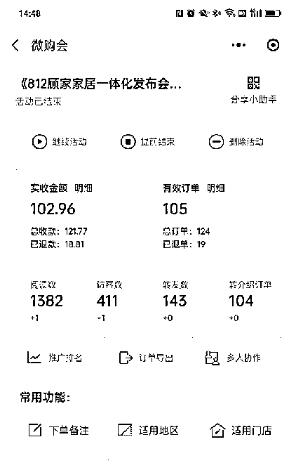

**3. 集中爆破成交**

销售人手不足，采用酒店集中交付。活动前先对收卡客户做集中回访，并给有邀约的中介做签单话术培训。现场成交环节主要由中介完成，毕竟他们与业主关系更近，我们的销售和设计师只负责解答疑难和对未签客户做二次讲解。

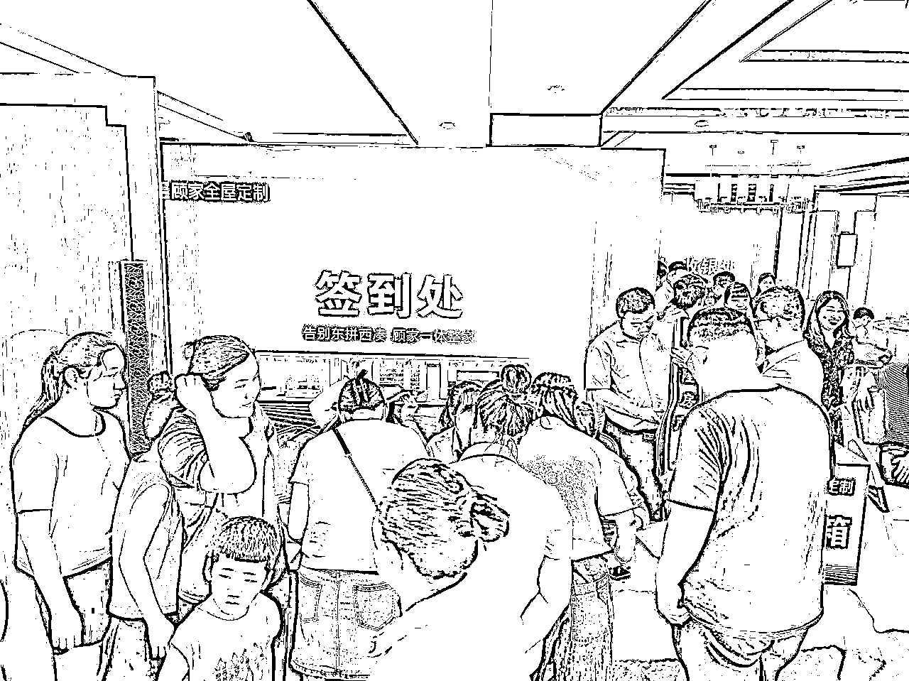

最终到场业主56组、共150人，现场签约23户，后续补签5户，远超预期。

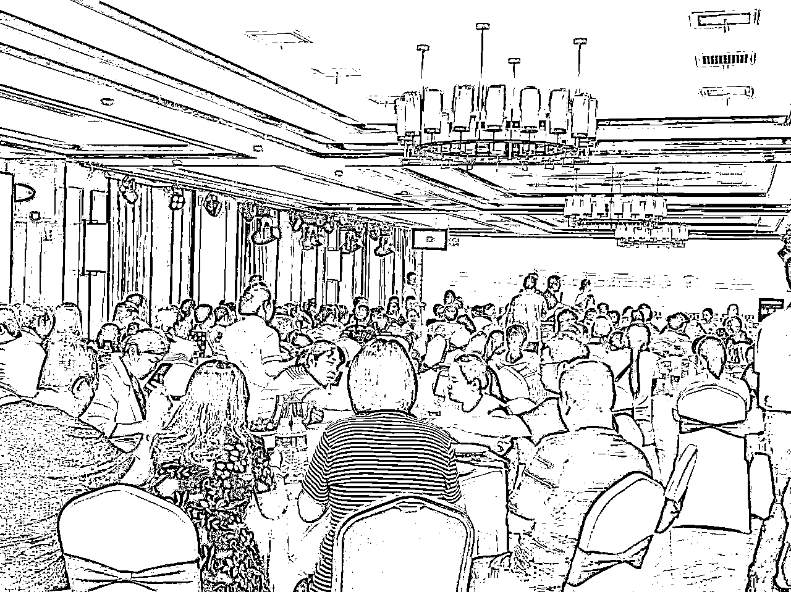

活动收尾后，通过日常维护和微信群运营，至今每月仍能稳定带来5-7户成交。

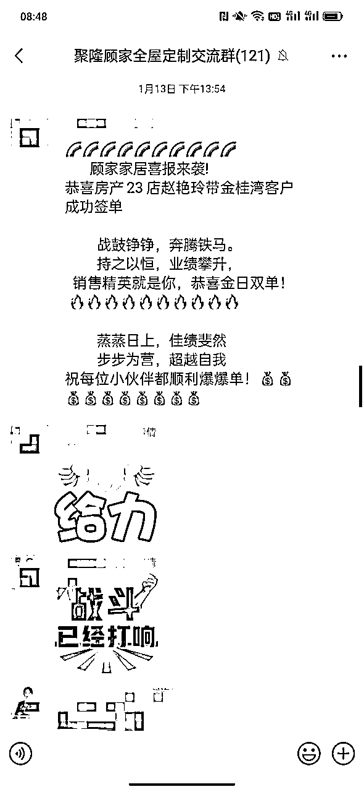

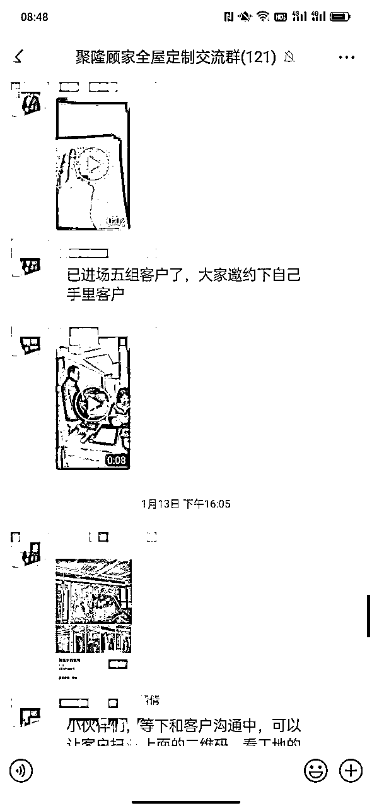

一个是一线城市的精细化连锁打法，一个是小县城的集中裂变打法，本质都是在房产下行周期里，把中介从“不愿合作”变成“主动求合作”。更多落地细节可以进一步交流。