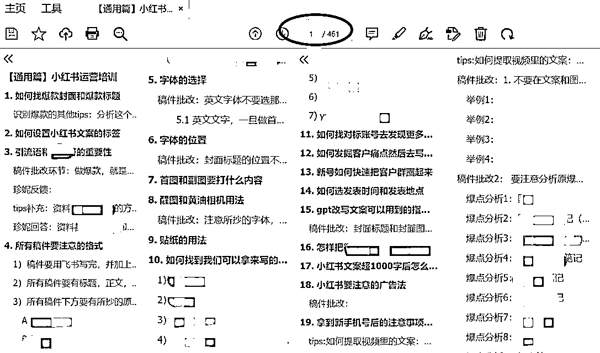
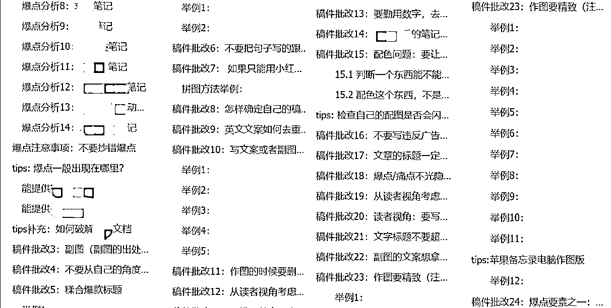
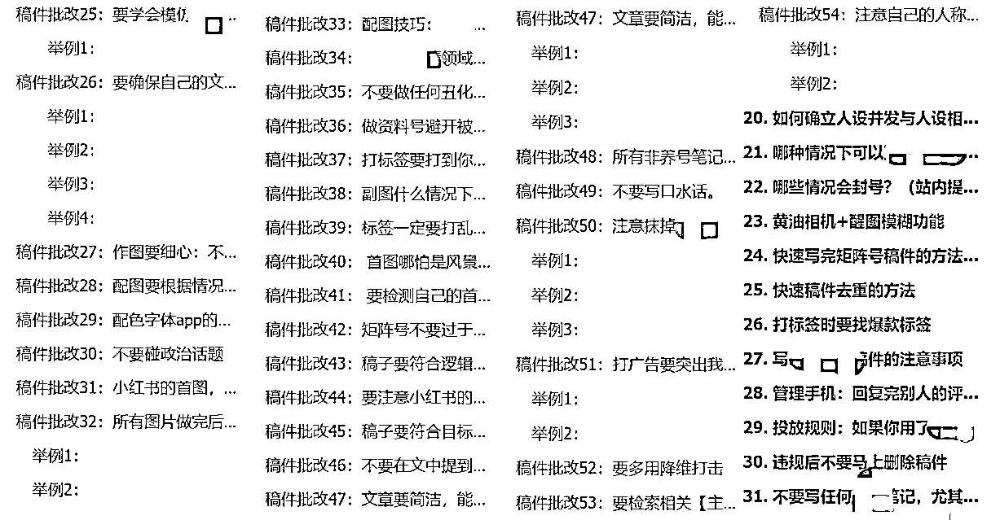
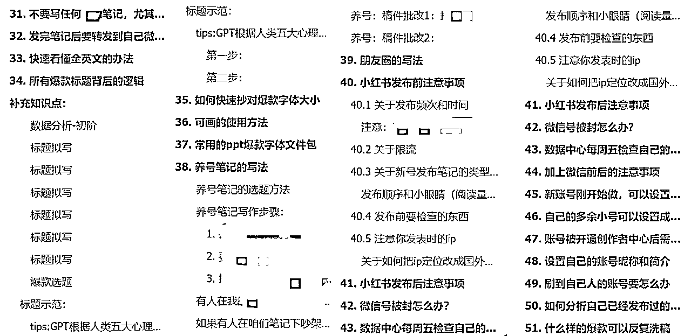
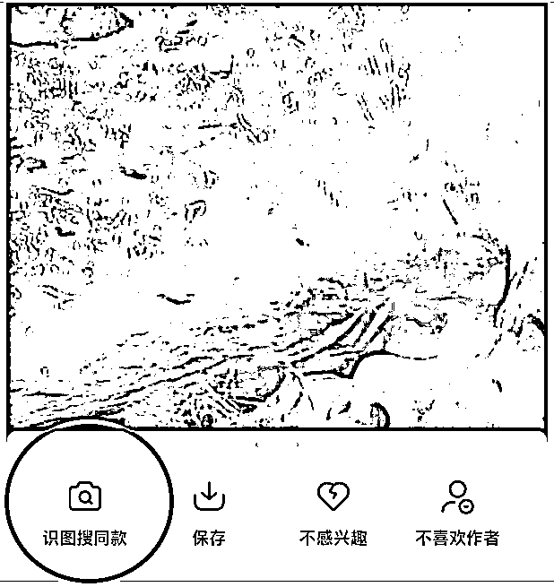
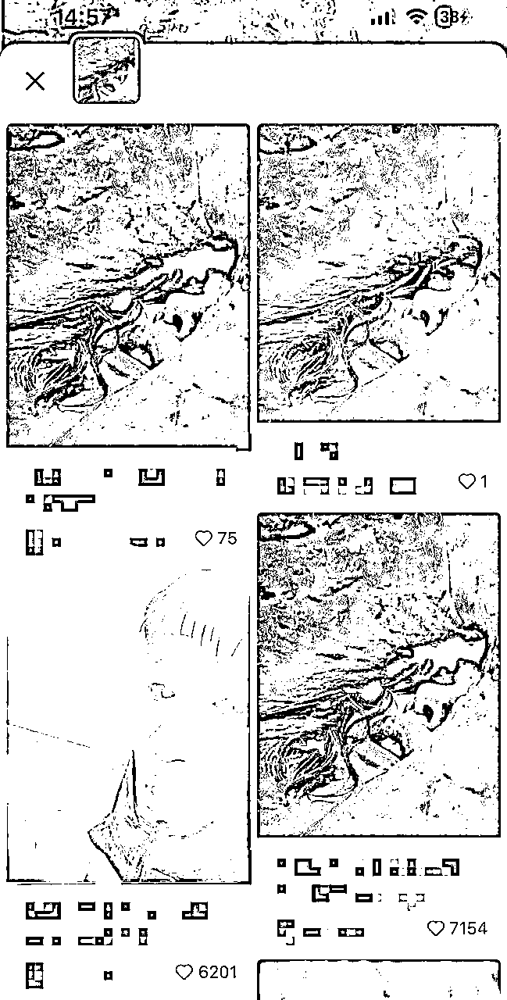
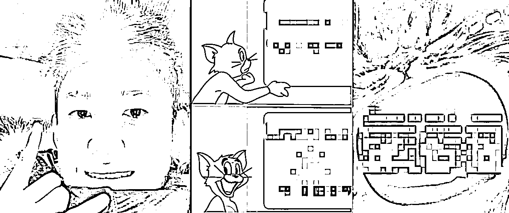
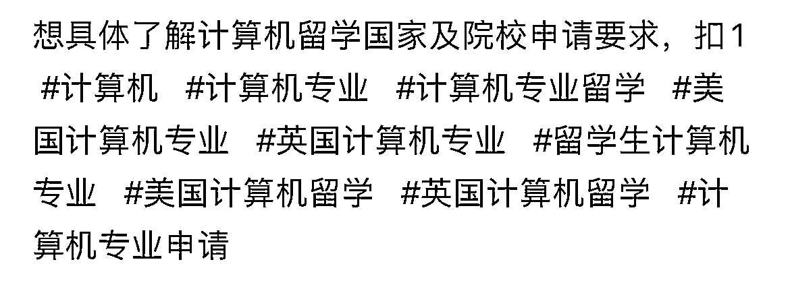
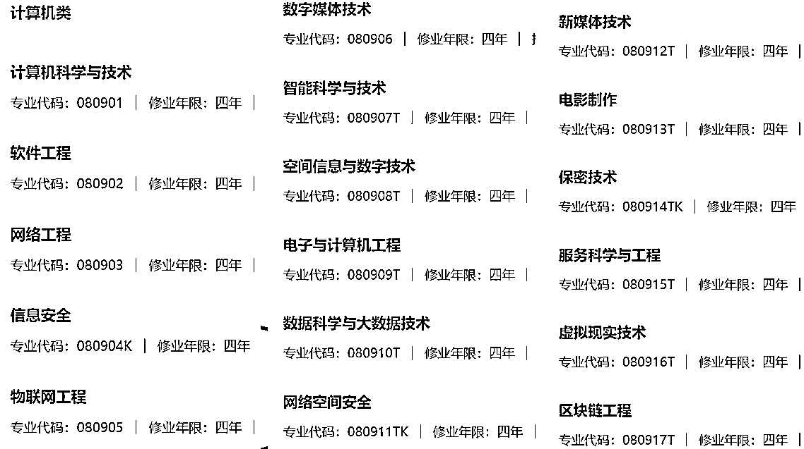

# 老板避雷指南｜从年营收1100万的实战里，聊聊怎么筛掉不合适的人、商与搭档
作者：龙哥

2023年对我和Ivy来说是动荡的一年。两人先后大病，我躺了两个月，她拖了半年，核心同事又意外怀孕，只能紧急补人手并带教。

客户群体需求叠加，我们开始尝试外拓合作，结果踩坑无数。账面上没亏大钱，却被琐事耗掉几十万的隐性成本。

下面两篇是我们之前的复盘笔记，有兴趣可点开。

复盘1：https://t.zsxq.com/16tvEOFgZ 「粉丝3000月营收20万，📕低粉高变现的蓝海攻略分享」

复盘2：https://t.zsxq.com/16RnIxsp7「📕教育赛道GMV1600万/年，小团队创业心法」

恰逢📕强制矩阵蓝V并推聚光，我们依然做到了年营收1100万。

这篇给在位老板和正在复盘团队问题的操盘者。希望帮大家少被割、少踩雷、少招错人，2024年更稳健地做大做强。

下方是「姐妹相继生病，产后创业被坑-真人故事版」的前言，可跳过故事直接看高亮的「太长不看版」：

1. 「13个角度」辨识运营的真假能力
2. 「7个角度」辨识合作商是否靠谱
3. 「4个角度」辨识合伙人是否匹配

# 前言

2023年1月，孩子出生当天我一边在产房给Ivy文字直播体验，一边生产完一小时后就拿手机回工作消息。顺产轻度撕裂，下地即走。除去中间40分钟疼到无法持机，其余时间都在群里感受爆单的快感，身体却阵痛不断。家人赶在生产前一天傍晚出差签约。

半夜痛醒，自行查证可能早产，一个人拨120，把待产包塞进棉袄，还塞了点零食在家等车。那时产房里不少人刚阳或在阳，大家都在喊疼，我也疼，但想着家人要到早上八九点，便忍着不喊，留力生产，也怕转剖后耽误消息交接，赶紧核对未交接事项。

医生按压问我“不疼吗”，我回“疼，你按的那刻可能没那么疼”。

原本约好的月嫂也阳了，只能自带。赶上二月闹，消息只能堆到下午晚上处理。竞争对手那段时间频繁举报我方矩阵号，源头始终查不清。

产后恢复期的Ivy怕耽误我坐月子，独自扛下压力，三四月时病倒，躺下心跳加速，睡眠极差。

三月后我恢复白班，部分业务下滑，公司经历离职、核心人员怀孕。📕此时要求全员蓝V并开聚光。我在招人、选人、带人的过程中也病了两个月，医生见我都说“怎么又是你”。

随后因用户需求多元化，我开始对外合作。过去一直由Ivy对接对外，我几乎没经验，一下子踩了不少坑。当时Ivy劝我“别合作”，我觉得她病中信息有限，判断有偏差。她拗不过我让我试，最后确实折损了资源，虽无直接亏损，但时间精力成本极高。撞墙后我拥抱她说“你是对的”。此后战略决策我都会先征求她，她质疑且我无法说服时，我会听她的。

全年公司有人员流动，我和Ivy在生病和利益分配上也产生过矛盾。我们一起经历背叛、被坑，最终仍把营收做到年1100万，并把遗留问题处理完毕继续前行。

本文分三块，对应运营人员、外部合作方、内部合伙人。若能帮老板避坑，便是最大的价值。

# 【太长不看版】

# 「13个角度」辨别运营的真伪

想赚钱离不开运营的获客能力。我从零搭建9人团队，年GMV超1600万。招人带人踩过无数坑，后整理出461页、51章的通用赛道运营培训指南。

现挑核心章节分享：

「13个角度：辨别运营能力的真伪」

这是从未公开的识人干货。无论级别或赛道，用此法基本能判断是否合用。懂此逻辑的老板大多闷声发财。

以下数据仅针对矩阵号，不适用于个人IP。

## 从历史数据看赛道红蓝

### 1）先判断项目所处红海或蓝海

红海赛道：2023年6月起📕要求商家持证注册蓝V，7-9月猛推聚光，要求投放后才给联系方式。自然流量被大幅压缩。

因此红海产品若在2023年9月后仍能靠硬广获50人以上私聊，或干货获赞藏过百，可算相对优秀。

多数红海项目在23年9月后，硬广咨询仅3-20人，干货雷同，小眼睛多在500以下，部分账号除水军外几乎无互动。

蓝海赛道则不同，无论是否过23年9月，只要硬广下方仍有上百人礼貌询价，即说明运营合格。

若对方晒的亮眼业绩集中在23年6月前，之后无持续高光，多是吃时代红利，而非能力。

### 2）看模板复用与互动数据

看到爆款首图后长按找同款，统计该模板在赛道的复用量，并对比互动。

教育赛道表情包首图从K12到考研留学、语言考试、证书考证、学科竞赛都在用。若面试者主页清一色此类模板，需检索同款表现。

若赛道在23年9月至今即便同款也能保持高数据，说明赛道仍蓝海，平台送量，难证个人能力，还需下一步验证。若赛道已红海，却出现个别笔记数据异常突出，则说明运营有真本事。若整体低迷而面试者仍沿用雷同图，说明缺乏原创思维。

### 3）标签打法的精准度

好标签围绕目标人群搜索习惯打，而非围绕笔记内容堆词。

以留学为例，很多人打“留学”“英国留学”。做计算机留学的会把标签设成“计算机留学”。但实际上“计算机留学”会被推送给计算机大类全部人群，涵盖软件工程、信息安全等。

如检索“计算机相关专业包括哪些专业”，结果包含众多细分。

因此打标签前应问销售：“近期申请计算机硕士的同学，本科专业分布如何？”据此埋入具体专业名，而非自我感动式堆砌“计算机留学”等词。

### 4）笔记阅读增长形态

别只看总阅读。以搜索为主的笔记，初期曝光平淡，但阅读会随时间持续爬升；以首页推荐为主的笔记，发布7天内会爆发，后续仍会带来评论。若两条流量都弱，往往发布当天达峰后迅速衰减。

优秀运营的笔记曲线应是持续上扬。面试时别被“人均几百上千阅读”迷惑，要调出单篇阅读曲线来看。

### 5）现场改标题

现场改标题能看即兴能力：是否会埋搜索关键词、关键词是否贴合用户习惯、能否用标题封面提升推荐概率。

举例：让应聘者参考三条对标文案：
大一大二同学现在只干一件事：投低年级项目（赞117，藏90，评55）
美国大一 | 通过低年级项目拿到了投行fast（赞103，藏83，评46）
除了高盛！🇺🇸开了这么多大一大二prog（赞5，评论收藏0）

他最后给出的文字标题是：
US大一大二留子！就投低年级项目❗
首图选常见国外建筑风景。

问题：第一，他照搬数据最差那条的“US”，但用户搜索更习惯“美国”。第二，“就投低年级项目”冲击力远不如“现在只干一件事”。

更优写法：
美国实习！大一大二都给我只干这一件事！
图片叠字：低年级实习项目，没病的别来！
小标题加上“美区留子”

“美国实习”贴合搜索，“大一大二”锁定人群，“都、只、一件”起到强调。“低年级项目”不必出现在文字标题，因图片已呈现，且用户会优先搜“美国实习”而非“低年级项目”。文字标题像谜面，关键词埋在里面即可，谜底由正文揭晓。

图片标题仅强调“低年级实习”，并用“没病的别来”制造反差，吸引犹豫中的潜在用户点开。

关于标题封面如何提升投放精准度，后续会继续分享方法。

### 6）笔记价值类型

我通常把笔记分为三类：

#### A. 提供情绪价值
如帅哥美女图、吃喝玩乐攻略、搞笑段子。纯看这类内容，阅读量上千很正常，几百反而异常。因为用户是用点赞收藏换取情绪满足。

#### B. 提供实用价值
如保姆级攻略、实操指南。阅读量随赛道红蓝波动，几百到数万不等。极红海赛道可能不足300。

#### C. 向用户索取情绪价值
无投放的硬广机器。红海赛道阅读多在200以下，写得好会调动情绪并附带实用价值，无投放也能破万。完全不提供价值却要求用户三连，本质是索取情绪价值。

从涨粉权重看：提供情绪价值 > 干货价值 > 索取情绪价值。
从变现利润看：情绪+实用价值的硬广 > 仅情绪价值的硬广 > 仅干货价值的硬广 > 零价值硬广。

纯情绪或纯干货内容，若不接广告或引流私域变现，靠📕本身很难产生利润。面试者展示的作品若多为纯情绪/纯干货且无带货记录，说明其对企业利润贡献有限，也要警惕业绩是否由他人完成。

### 7）是否触达精准客户

举例：雅思赛道曾出现标题“脑子一热去学了雅思，没想到被财神爷看中了…”。原文已删，当时我保存部分。内容大致为非英语专业、基础一般，考出8.0，列举雅思好处如可做家教、进外企敲门砖，最后赠送备考资料。

该笔记两天涨粉4000，评论区很热。但点开评论区用户主页，画像多为中年宝妈，想靠雅思做兼职家教。这类人群很难转化成高客单雅思培训，最多报线上大班，一对一500-1000/小时难以承受，后续留学转化也几乎无可能。

但标题思路可迁移。如做MBTI或盖洛普赛道，可将概念与收益挂钩。我和Ivy就是通过盖洛普测评发现性格互补才创业成功的。类似标题可改为：
脑子一热去学了盖洛普，没想到被财神爷看中了...
脑子一热去学了盖洛普，我的业绩狂涨10万！

不写“我是谁”是为了同时覆盖个体和老板两类人群。写成“我司”会锁定老板，写成“我”更偏个体。不写“薪资”是因为定位不确定，若面向职场人可写工资，若面向老板可写利润。

不过“盖洛普”本身认知度不高，标题里出现只能触达已有认知的人群。若真想打开市场，需从其他关键词切入。此处暂不展开。

### 8）识别水军痕迹

用灰豚按评论数排序看爆款，有概率遇到刷量。某笔记显示发布/编辑时间2023年1月22日，评论集中在22-23日，24日后完全空白，多为水军，可点进评论区账号主页验证。真实爆款评论是断断续续、持续增长的，不会集中在几天内戛止。若应聘者把此类数据当代表作，说明尚未入门。

### 9）选题是否对准付费人群

曾刷到盖洛普软广，标题类似“和内卷男朋友谈恋爱，觉得自己是个废物”。点进去才开始推盖洛普优势。这种选题很难转化出付费客户。核心问题是运营者没搞清：买单的人究竟在什么场景下被盖洛普吸引。

我和Ivy当初购买盖洛普，是因Ivy在刘润星球被安利，后来她获叶叶训练营第一名奖励，把盖洛普推荐给我和朋友，我再推荐给老公及其他人。最终真正付费的只有我、Ivy和一位朋友，其余人种草失败。

成功种草的人有共同特征：渴望创业/副业已跑通/极度渴望晋升/想在管理层做出成绩/本身已是老板。而副业未成、不想创业、对晋升无强烈诉求、不在管理层的人，基本无兴趣，顶多领免费版。

我对Ivy说过，若我有情感困扰，我会找情感博主，绝不会去搜“和内卷男友谈恋爱觉得自己是废物怎么办”。哪怕首页推送，我也不会因此被盖洛普种草，因为与需求无关。

运营者之所以写出这类标题，往往只站在自身角度思考，未曾询问商家：付费用户的画像是什么？通过什么渠道了解到产品？一个选题就能暴露专业度。

---

除此之外，还可从4个维度进一步评估运营的真实能力。我计划在2-3月推出完整版老板识人手册PDF《13个维度辨别一个人的真假运营能力》，并完善矩阵号运营手册，内容包括：

1. 养号初期如何判断账号已死，再养无用？
2. 是否必须养号才能拿到好数据？
3. 哪些爆款可抄，哪些不可碰？
4. 如何融合多个爆款做原创，既避嫌又出圈？
5. 零门槛学会国内外素材快速拆解方法。

如果你也在招人、带队、选合作的路上感到迷茫，希望这份内容能帮你避开弯路。

# 合作商靠不靠谱？合伙人合不合适？这篇“避雷+选人”手册请收好

创业这几年，最大的感受就是：路上遇见的人，一半是贵人，一半是“贵人”坑。我把自己和Ivy被坑过、踩过、摔过之后总结出来的经验，整理成了一份“避雷手册”，分上下两册，今天先讲上册——怎么看合作商、怎么挑合伙人。

## 一、判断一个合作商值不值得深交，先看这7件事

**1）主动找上门的人，先查查他手里这个项目，到底是不是真需求**

别急着聊分账、谈利润。先去📕搜一圈，看看相关笔记底下评论里问价的人多不多，是真人还是水军。再翻翻爆款笔记的数量，判断这个赛道是挤满了人还是还有空位。需求大不大、竞争紧不紧，一目了然。

**2）不熟悉的业务，一定多打听，别被高利润迷了眼**

有些项目看着赚钱，合作方话术漂亮、分钱大方，但你去问问懂行的，人家会直接告诉你：这玩意儿就是在割学生的韭菜，迟早爆雷，甚至可能毁掉孩子的未来。Ivy在这点上特别谨慎，每次发现有消耗学生信任的风险，都会立刻喊停。做亏心事这件事，千万别抱侥幸心理，你今天种的因，总有一天会结出果，砸向你自己或者你在乎的人。我听过一个商业故事，有人坏事做绝，结果孩子生下来智力有问题。你说这是不是报应？不好说，但谁敢赌呢？

**3）就算是自己熟的业务，也别当甩手掌柜，交付的过程必须亲自盯**

这条我栽过大跟头。当时线下见过面，觉得对方人真诚、没坏心思，利润也够，就放心合作了。结果真到交付环节才发现——这人根本不懂交付，他手底下管交付的负责人也撑不住场面，最后烂摊子还得我来收，还赔上了客户对我的信任。真诚的人适合做销售，不代表他能搞定交付，这是两码事。

**4）第一次合作，记得混进他的销售群里，看他们怎么跟客户说话**

有些合作方，销售回复客户的消息又慢又冷，话术也不专业，但出了问题他们不会承认是自己签不下来，只会甩锅说“客户没意向”。你只有在群里泡着，才能看清真相——到底是客户的问题、他们的问题，还是你的引流思路不对。发现问题就提出来，除非你不想再赚这笔钱了；该调整引流策略就赶紧调，除非你打算放弃这条收入。

**5）看他们有没有把你的需求放心上**

有的话绝对不能在有员工的群里说，有的话绝对不能对着客户讲。但有的合作方，说错了就在那儿找借口：“群太多了，记混了。”甚至反过来怪客户“太难搞”，把自己摘得一干二净。你私聊提醒过，他下回照样犯。这种人趁早别合作。他连你的需求都记不住，连客户都不尊重，那坑起你来，也是连眼睛都不眨的。

**6）运营、销售、交付，是三件事，不是一个人能扛的**

自媒体生意的完整链条是：运营负责引流，销售负责成交，交付负责售后。懂运营的人不见得能签单，懂销售的人不见得能控交付，懂交付的人让他去做对外沟通，反而容易惹毛客户。真诚又会聊天的人，能把单子签下来，但背后要是没有靠谱的交付团队撑着，客诉一来，那张“真诚牌”就烂在手里了。运营再厉害，没有销售接住流量，也变不了现；销售拿不到运营端的反馈，下一轮投放也没法优化。什么都会的人才不是没有，但那个价格，大概率是你付不起的。所以合作之前，看清楚对方团队里的人是不是各归各位：管运营的安心做运营，管销售的专心盯群，管交付的认真做服务。如果运营的人天天在对外社交，销售的人跑来学运营，交付的人嚷嚷着要做自媒体——这团队迟早散，你也别陪跑了。

一般来说，这三类人的画像是这样的：干运营的，心思都在数据和客户需求上，不爱社交应酬；干销售的，盯紧销售群的进度，擅长打交道，但受不了交付的琐碎；干交付的，心思全在服务质量上，时不时发客户好评给你看，但让他们写引流文案，大概率吸引不来精准用户。

**7）找家庭稳、情绪稳的人合作**

家庭一团乱、感情不稳定的人，可能今天心情不好，明天就撂挑子，剩你一个人收拾残局。情绪上来就口不择言、说不干就不干的人，合作起来就是给自己埋雷。而且，一个人只要撂过一次摊子，就会有无数次。真正靠谱的人，是一路都靠谱。成绩忽上忽下的人，不是能力问题，是稳定性的问题。第一次他甩手的时候，你就该果断止损。

## 二、合伙人的“4大匹配标准”，少一个都难长久

我和Ivy，性格一个天南一个地北，当年她结婚我去当伴娘，她婆婆都纳闷：你们是怎么玩到一块儿的？但合伙人这件事，恰恰就是要互补。

**1）懂战略的和懂执行的，得锁死**

21年初我们还没正式合伙的时候测过盖洛普，我的报告里完全没有“战略”这一项，Ivy四个维度全齐。最后我俩的分工就是：她当军师，坐镇大局；我做具体执行。她擅长从大方向布局、跟合作商谈判、算清每一笔账，我从来不需要担心亏本的问题——因为一旦ROI不对劲，她脑子里那个“自动账单检测系统”就响了。而我负责的，是稿件审核这些具体动作。员工的稿子总会有细节出错，只要是人写的文章，就不可能每次完美。但这事儿Ivy看了会头疼，她无法理解“为什么这么简单的事有人做不好”。而我的心态是：从学习到落地，犯错才是常态，所以我来盯这一环，效率更高。

**2）你看世界的角度，和他看世界的角度，可能完全不同——但没关系，说出来就行**

我们吵得最凶的一次，是在Ivy生完病之后。她说：“我不知道赚钱有什么意义，钱无法带给我快乐，公司没有我也在正常运转。”那段时间刚好业绩下滑，员工私下来找我倾诉，我心里不是滋味，却一直没说破，浑身散发负能量，Ivy也难受。后来摊开聊才知道，我俩对“老板”这个身份的理解根本不在一个频道上。她觉得：我拼命当上老板，就是为了“不想工作就可以不工作”的自由，业绩不好，员工该自己去市场上找钱，而不是朝老板伸手。我觉得：你站上了这个位置，就该扛起责任，你不快乐就停工，等于让员工和合伙人为你的情绪买单。两个从高中就一起逃课的闺蜜，合伙创业两年多，才第一次发现对方眼里的世界竟然这么不一样。后来她好了，找到了新的意义——工作是能带来成就感的，于是我们又开开心心搞钱去了。说到底，哪一种想法更对？没有标准答案。前者过得更轻松，也不欠任何人；后者更有责任感，却容易把自己绑架。但只要公司能往前走、大家日子越过越好、不做伤天害理的事，所谓“三观不合”，其实根本不算事。很多合伙人之间的矛盾，本质只是“不知道对方怎么想”。后来我们就养成了一个习惯：有矛盾，先把各自的视角摊开，再去理解对方的角度。

**3）知道对方的雷区，且坚决不踩**

Ivy的雷区是隐私，谁泄露她的个人信息，谁就是踩雷。我的雷区是工作态度和交付质量：态度差但交付好，不能合作；态度好但交付差，永不合作；两样都不好，连朋友都没得做。我们连发朋友圈都会有分歧。我觉得转账截图拍了就发，多真实；她觉得打个码都已经到了忍耐极限。我晒一次，她和家人就劝我删一次——后来我们达成了一个共识：发之前先给对方过目，对方同意才发，不同意就不发。

**4）把合适的人，放在合适的位置**

Ivy生病那段时间，我被迫一个人对外谈合作。我一个做运营的，被推到销售的位置上，运营和交付的杂事不断涌来，再叠上销售的压力，我半夜头痛到蹲在墙角，拿脑袋撞墙，我老公差点被我吓死。后来Ivy痊愈，重新坐回对外和销售的位置，我回到运营岗，头痛就好了。我跟她说实话：“没有你，这创业我一天都干不下去，谁爱创谁创，我宁愿回去打工。”创业风光的时候一切好说，低谷的时候没人陪着，那种黑暗和孤独是真的会把人吞掉的。不是所有人都适合当老大。孤独感满分100分，Ivy能扛90甚至120，我只能扛40。如果你有能力、想赚钱，但扛不住孤独，那就安心做那个“二哥”，跟对大哥一样有钱赚。真正能当“大哥”的人，是像Ivy这样，既能赚钱，又扛得住孤独的人。大哥是高处的风，不是谁都能吹的。这是我23年领悟最深的道理。我们公司员工一直分不清谁是老板，我说：“你就理解成Ivy是大老板，我是二老板。”员工听完记住了：“Ivy是爸爸，珍妮是叔叔。”Ivy说：“我俩都是老板，不分大小。”但我说：“如果真不分大小，将来有分歧听谁的？决策的时候，我希望以你的意见为主。”

于是就有了我们这对“姐妹花”，生着病、踩着坑、被合作商坑过，却硬是把公司做到了年营收1100w+的故事。

最后再说几句掏心窝的话：有时候我回消息慢，是因为团队在招新人，真的忙不过来。我们就是个小公司，22年才正式起步，业务负责人熬到24年1月才算带出来。去年文章发完之后，我甚至不敢留联系方式，因为怕加了我也没时间回复。今年总算能喘口气了，之前如果有怠慢，请多包涵。你愿意来链接我，就是对我的认可。有些圈友加了我又不知道说什么，其实不用纠结——我也是那种不知道说什么就不敢加别人的人。i人朋友们，欢迎来抱团。

避雷手册第2册已更新，需要的自取。

感谢Ivy，知道我的困境后，重新设计了公司的运转模型，把我从杂事里捞出来，让我看见更大的世界，把精力花在真正有价值的事情上。感谢芷蓝姐，每次我和Ivy卡住的时候，找她聊两句，总能拨云见日。感谢靠谱，总是一针见血指出我稿件的问题，让我学着从更高的维度落笔。感谢拱卒，24年加入创峰会之后，天天泡在群里看大佬发言，又看了他推荐的老板必读清单，我这种从来不懂战略的人，竟然也开始有了新认知。感谢花爷，21年那期IP初阶训练营，帮我搭建了对IP的初级理解，也让我攒下了靠A业务起家的第一桶金。最后，感谢龙哥盟——这真的是我见过全国能人密度最高的圈子。赚钱，太牛了。

做自媒体这条路上，很多人一开始都有同样的困惑：学这个有什么用？我也学了这么久了，怎么还没发财？但请相信，你积累的每一样东西，都在那里，一个都跑不掉，它们只是在等一个时机，等你把它们整合起来，然后一次性变成财富，作为奖励，送到你手上。