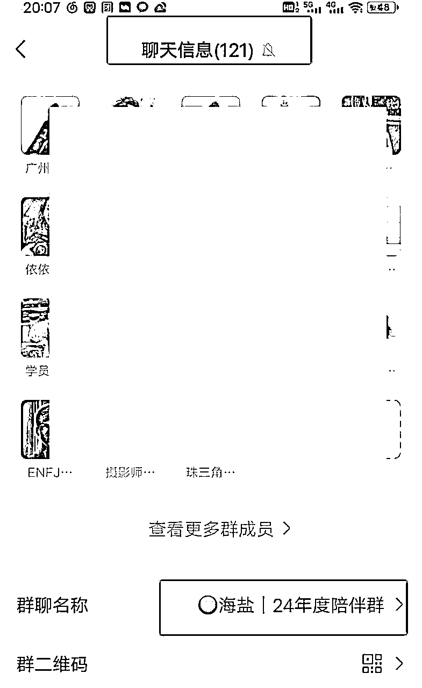
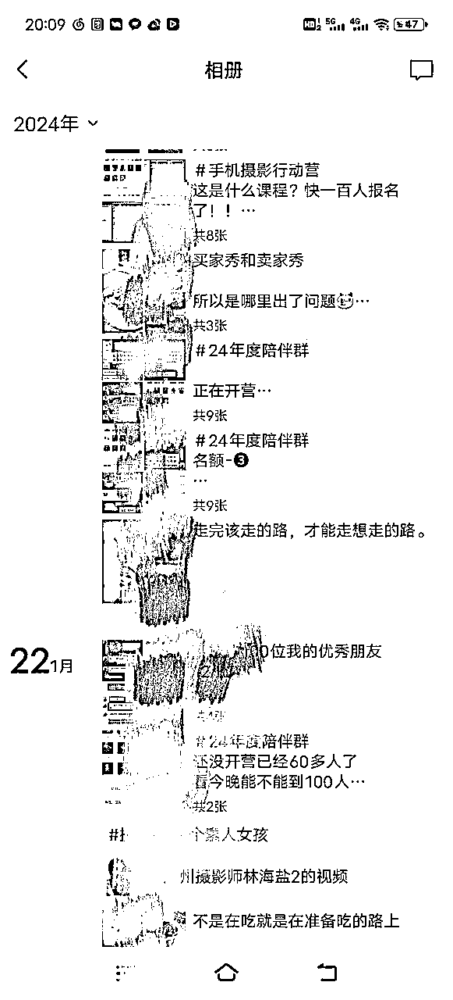
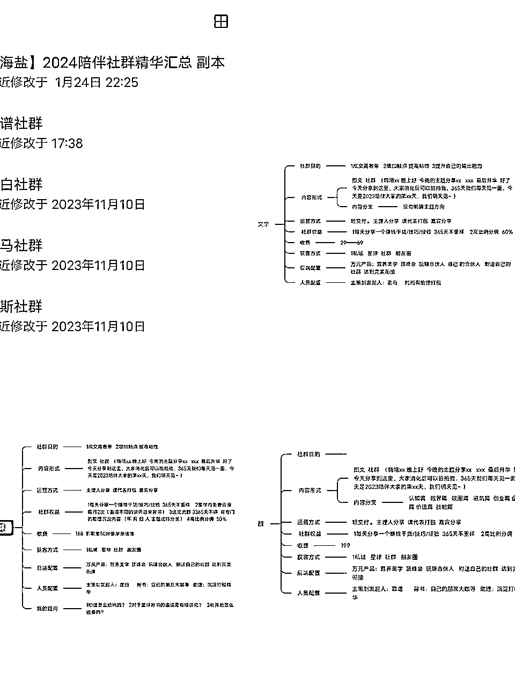
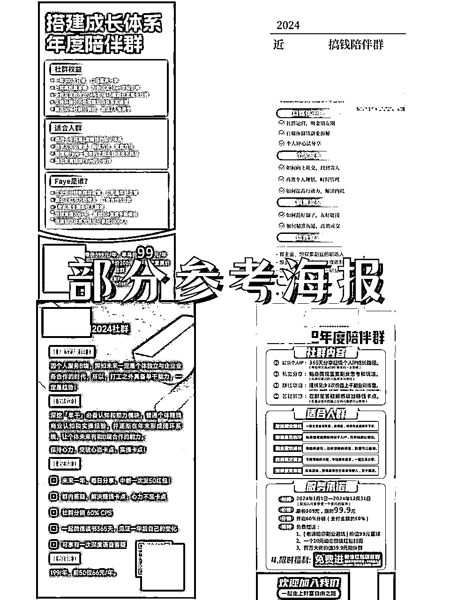
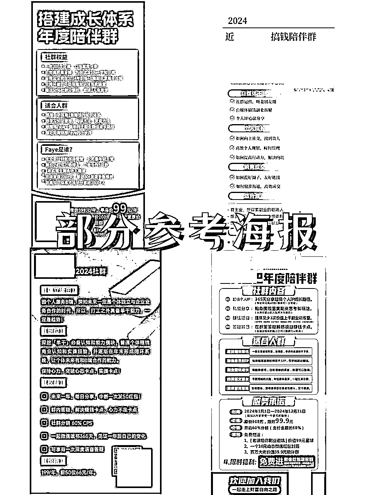
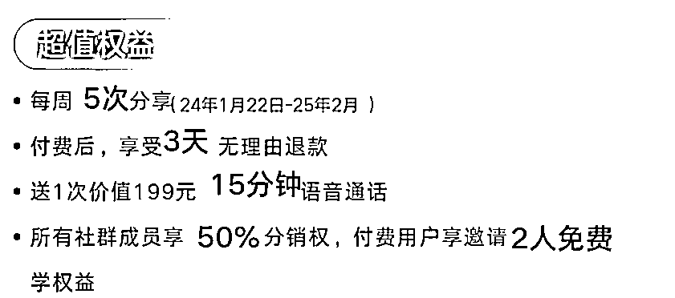
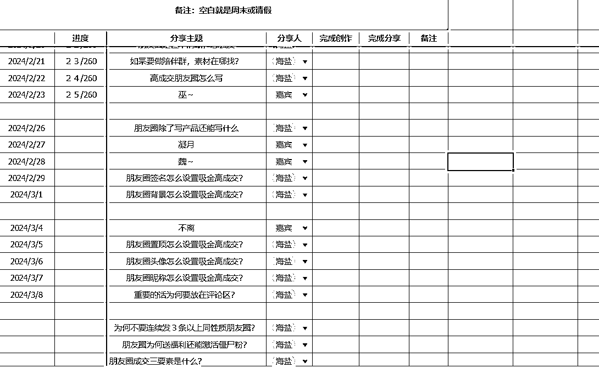

十天前我咬着牙把一个搁置了大半年的想法落地了——开一个收费的陪跑营。到今天，它的成绩超出了我的预期：121人加入，其中81位是主动购票进来的，40位通过免费渠道入群，累计收入已经破万。

这篇复盘会从四个方向展开：为什么要做、怎么做起来的、适合谁、以及新手最容易卡住的三个点。

一、是什么让我决定动手

促使我启动的原因有四个，缺一个我可能都还在观望。

第一，我需要给更贵的服务搭一座桥。我对自己的能力边界很清楚：卖东西算我的强项，但亲自打磨一个高利润产品，我的交付底子还不够。所以我换了一条路——去付费加入一些高端圈子，挑出里面口碑好的产品，用我善于卖货的特长去推广。这样一来我能赚到利润分成，还能攒下自己的名气。

第二，我想一直在用户面前刷存在感。我加过不少社群，可那些很少更新的群，我基本都折叠了。只有保持高频输出的群，我才愿意一直盯着。陪跑营正好承担这个任务：它不需要一次爆发，而是靠“每天见一面”的方式慢慢渗透。时间久了，原本沉默的老朋友也会重新注意到你，一个兴致来了，直接就转账了。

第三，输出这件事需要有人推着走。人总有懒的时候，我也一样。回顾过去两年，我发了4300多条短内容，单看质量不算多么亮眼，但数量让我保持了手感。现在每周固定几场分享，相当于给自己装了一个打卡机，想偷懒都难。

第四，让自己被更多人“看见”。我的主业是约拍，社交好友有九千多人，可能真正为镜头付费的只占很小一部分。如果我只卖高价服务，那大部分人都不会靠近我。而陪跑营门槛不高，给了大家一个低成本认识我的理由。很多合作机会，恰恰是从这种联结中长出来的。

二、从0到1，这条路我是这样走的

很多朋友想开社群，又觉得没方向、没经验。我的建议是：先别想太多，就找一个人跟着学。

找一个你欣赏的、和你段位差不多的人，观察他在做什么、用什么方式做，然后照着他的框架推演一遍。不要一开始就去模仿那些巨牛的人，彼此差距太大，你执行起来会非常吃力，反而早早放弃。

那去哪找学习对象呢？我自己的办法很笨：花钱敲门。只要有同类社群，我就买票进去感受一下，先后进了好多家。从中挑了三五家口碑靠前的仔细研究，其余的随便逛逛，感受一下氛围。

进入到内部之后，我建议按下面这张“解剖检查表”来研究：
1. 这个群给谁开的？
2. 内容以什么形式为主？话题偏杂还是偏深？
3. 海报上写了什么？想传达什么？
4. 是低成本人工，还是重配套团队？
5. 成员能换来什么具体好处？
6. 门票定在什么区间？
7. 用户从哪些渠道进来？
8. 后面拿什么产品来承接？
9. 几个人在运营？
10. 内容如何持续供给？
11. 发售前后公开状态怎么铺排？
12. 换成我，下一步该做哪三件事？

拿着这张检查表，我搭好了自己的第一版方案。

关于群的主题：我没有把话题锁死，而是做了一个相对综合的场——聊内容创业、个人品牌、私域转化、个人成长复盘之类的话题。这样做既方便筛选，也能兼容更多潜在需求。

至于内容形式，我选了图文。视觉内容成本太高，图文对我来说刚好够用，也更容坚持。

接着是海报。我把市面上能找到的五六张同类海报翻出来做横向对比，发现它们的信息结构其实大差不差：

最上面是大标题，通常叫“XX年度陪伴计划”，听起来像一份送给自己的奖赏。

接下来是我自己拍板的一句话定位：把热爱做成事业，同时把日子过得宽裕。这一句传达出来的画面感，就是“爱好和面包，两个都要”。

价格怎么写？常见的做法是摆一个常规价，再放一个限时优惠价，用前者衬托后者的划算。我最初的设定是常规价365，限时价99，限时放30个名额，之后每多进20人就上调50元。等跑起来以后，规则也跟着实际情况做了调整，没有再死守原来的框架。

内容板块的设计原则是：只写我能持续做出来的。海报上承诺的东西，必须是自己扛得住的，不能轻易透支。

为什么让大家现在下单？我的方法是用当时的进展和成就说话，让人看到你这个人靠谱，他自然就愿意为信任买单。

整套海报的配色我选了黄色打底、蓝色点缀，视觉上足够醒目。如果你对排版和配色没有把握，建议找一个专业的人帮你把把关，省时又省力。

运营方式上，我走的是轻模式：平时我来做主题分享，偶尔请嘉宾来客串，不需要养一支团队。人员方面，起步阶段没必要找搭档或助手，我自己当初也动过找搭档的念头，找了挺久没找到合适的，反而把节奏拖慢了。后期如果实在忙不过来，再考虑加人。

社群权益我给了四样：
1. 每周安排5场专题分享；
2. 三天内不满意可无理由离场（目前没有人用过）；
3. 附赠一次价值199元的语音咨询；
4. 推荐朋友进群可得一半费用分成，同时还能带两位有需求的朋友0元加入。

这样设计的好处是：老用户有分享的动力，新用户没有压力，而我的服务成本并没有显著增加。

价格上的心得：这是一个低门槛链接型产品，票价不能定得太高，否则会把大多数人挡在门外。个人建议在39到200元之间，按进群人数分梯度调整，比如每满50人微调一次，幅度不用太大。

流量来源，我把它拆成两条线：自己这条线，一边是认可我的老粉丝，另一边是请来分享的嘉宾，他们本身也会带来新鲜面孔；用户这条线，靠老会员推荐新的朋友进来，形成自然扩散。

关于后面的承接，这一点我特别想提醒大家：如果只做社群，后面没有可承接的产品，前面攒起来的信任就浪费了。我去年就吃过这个亏。今年我先把几款优质的高价产品选好，再借自己的销售优势去推广，赚到收益，也沉淀名望。目前挂在社群后面的，是一个平台联创计划和会员制的商业资讯圈子。

更新的频率，我定的是每周5场，没有选择日更。原因很简单：日更对我不现实，质量容易拉胯，我也没精力去拓展嘉宾资源。每周留出两天专心对接外部嘉宾，内容、流量、名气都能兼顾到。

内容从哪里来？我主要在专栏App上按主题搜集素材。先把大的框架定下来，再去填充每个分支的细节。同时我会提前把下一周要发的内容排好版，而不是等到当天再临时想。

发售期的宣传怎么做？说白了，就是把卖得好的同类社群在推广阶段的文案和配图全部扒下来，研究它们的表达框架，然后把自己的信息填进去。这不是让你照抄，而是用别人验证过的结构，减少试错成本。

三、哪种人适合来做这件事

如果你符合下面几类，基本上可以考虑入场。

第一类：觉得自己表达能力不行，急需练手的人。
越是不知道怎么讲，越要找个场子高频地练。收费就是最好的筛选，它会让用户认真对待你的内容。相比之下，0元群往往没人珍惜，运营者还容易被各种琐事消耗。我早前也做过几个不收费的群，比如打卡群、共读群，发个消息基本没人互动，做着做着就没信心了。后来我转变了思路——省下运营免费群的时间，全部拿去打磨内容。内容扎实了，转化只是时间问题。

第二类：手上还有其他产品可以卖的人。
陪伴是最容易建立信任的方式，信任建立之后，后面的产品才会好卖。如果你有高利润产品或者知识服务，那这个群就更值得做了。

第三类：需要练胆量、敢谈钱的人。
如果你平时不好意思报价，害怕谈钱，那就从这个低客单的社群开始吧。每一次有人付费，都会多一分底气；做的次数多了，收钱也就越来越自然。

四、新手最容易卡住的三个问题

第一个问题：新产品出来了，私域里却卖不动，怎么办？
很多人在卖货这件事上有个误解，以为发售当天的动作决定了成败。其实真正的胜负手，是平时有没有持续经营用户。如果一个号平时从不更新，某天突然冒出来发广告，用户凭什么买单？交易建立在信任之上，而信任感是靠日常运行的。保持稳定的更新，比什么都重要。

第二个问题：群开着开着就冷了，怎么维持活跃度？
有两个方法我试下来比较有效。第一个是内部激活：多留意群里发言积极的人，私下和他们聊，请他围绕某话题做一次分享，结束后再把他推荐给更多人。面子给足了，他就会愿意持续冒泡。第二个是外部输血：定期邀请有成绩的嘉宾来群里讲一场，让大家看见“这条路可以走到什么位置”，有了盼头，群自然就活了。

第三个问题：总觉得自己内容拿不出手，不敢开始？
所有看起来轻松的表达，背后都是反复练出来的。我写文案这件事，从提笔卡壳到随手就能写出一段，整整磨合了三年。最开始那一年，我连一百字的短状态都凑不满；现在，一条状态也能带来可观的单量。别指望第一天就完美，先允许自己有一个笨拙期，熬过去就好了。

这就是我十天跑下来的全过程。希望这版复盘能给你一些启发，也欢迎在评论区聊聊你在做社群时遇到的问题，我看到都会回复。