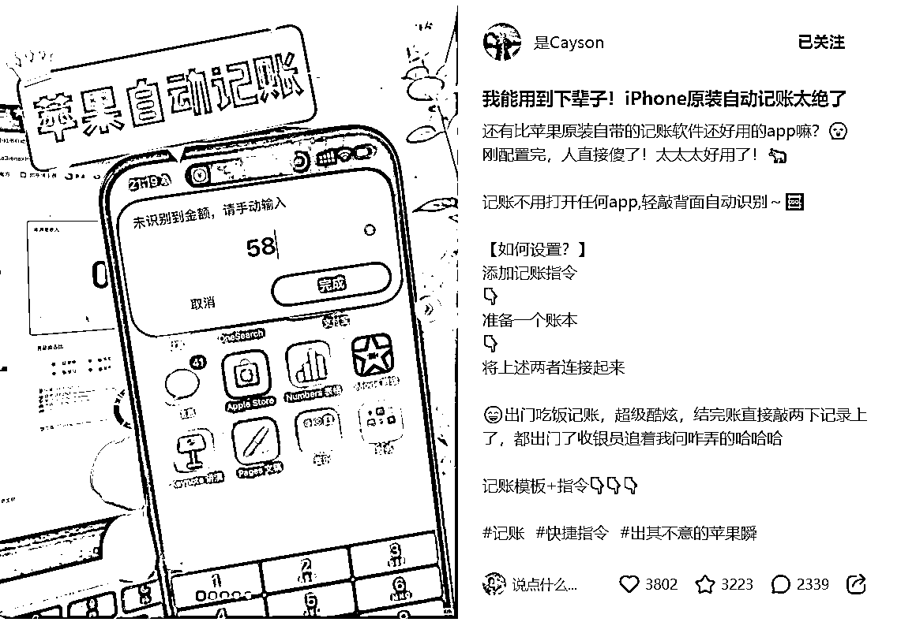
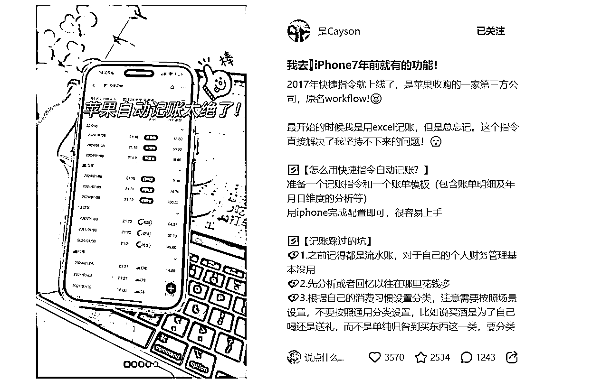
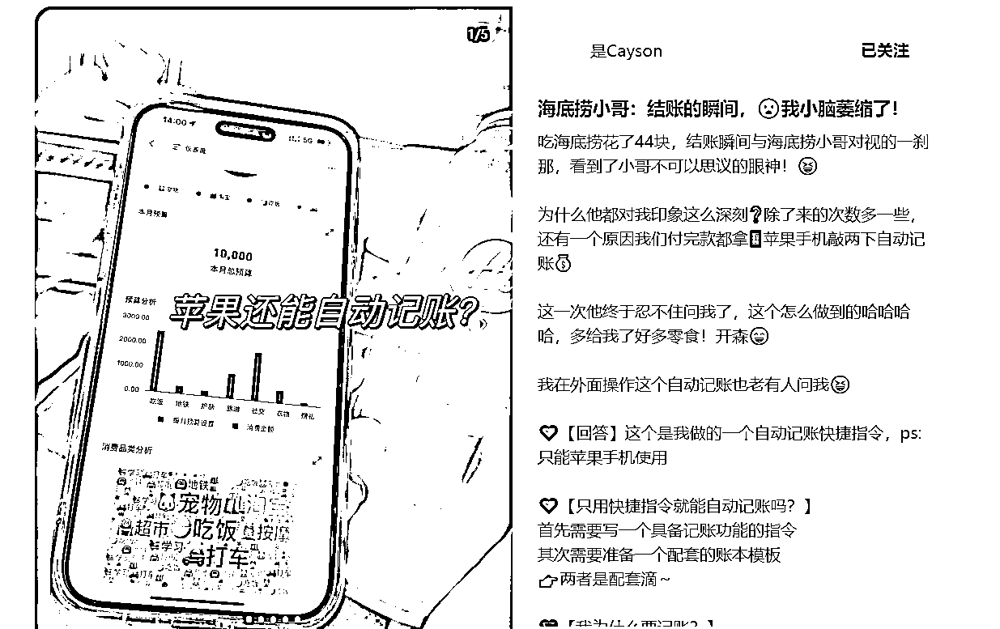
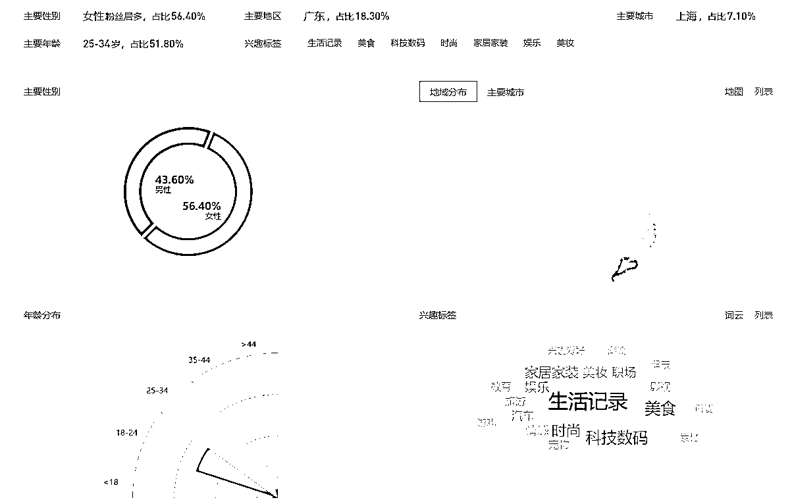
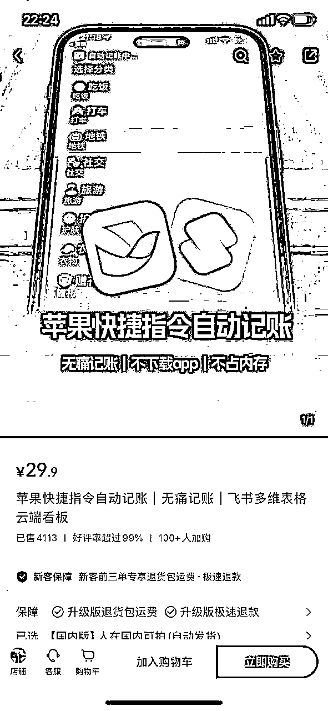
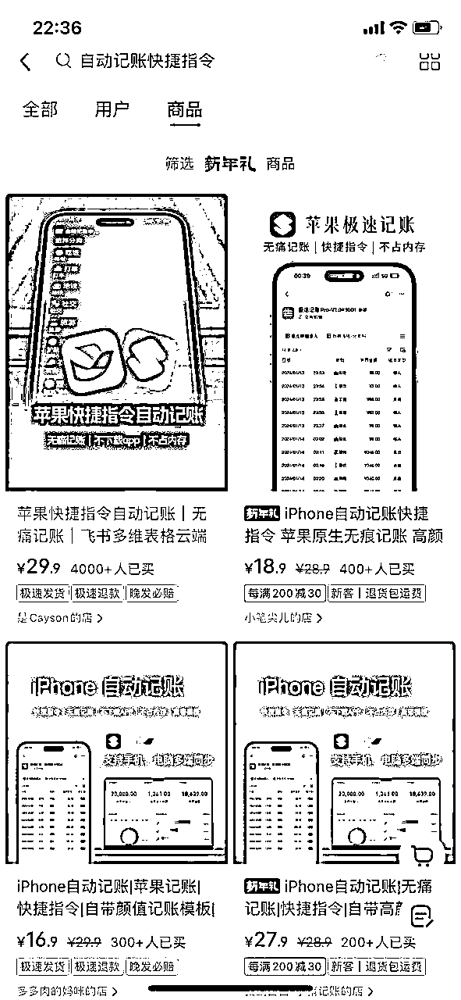
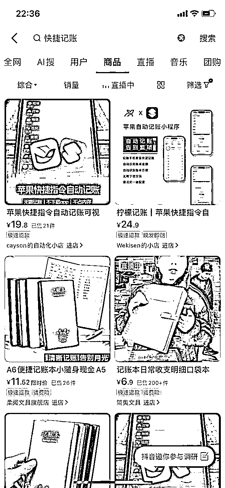
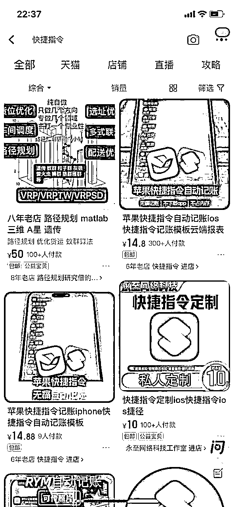

# 🔥风向标项目复盘 | 躺平也能变现？一份苹果自动记账快捷指令卖出12万的底层逻辑

拆解任何一个能赚钱的账号，都绕不开这四件事：

✅ 流量从哪来，怎么养？
✅ 产品怎么拿，成本几何？
✅ 赚头怎么算，是否可持续？
✅ 怎么复刻，怎么放大？

# 案例：是Cayson

**赛道定位：** 苹果自动记账快捷指令
**成交路径：** 图文+视频冷启动引爆，之后挂小红书店铺直接收割，日常以图文带车为主

**为何值得看：**
* 在卖记账快捷指令的账号里，他的销量是天花板
* 全部靠图文起盘，操作门槛极低
* 一条数字指令卖出12万份，近乎零边际成本，回报极高

## 1. 流量怎么来

先厘清流量结构，免费与付费是两条路。

* 免费流量：图文、短视频、直播、搜索。需要看内容形态、更新节奏、关键词布局、起号方式、去重逻辑、账号体质、发文频次、爆款概率、违规处理等。
* 付费流量：看投放渠道和ROI能否回本，还能通过三方数据反推feed占比和投放痕迹，看是否联动达人投放。

以是Cayson为例，三方数据明确显示该号纯靠免费流量，没有投放。

1）近30天内容表现

* 图文15篇，视频2篇，其中12篇挂车笔记，直接导购
* 频率约一周5更，避开周四周末发力，周三是主发日，时段集中在20-24点。5篇里2篇成爆款，48小时互动破3000
* 视觉风格：手机记账界面截屏+艺术字提问式标题如“苹果手机记账”，文案多用小故事或场景切入，讲清功能与省心感，加表情增强年轻调性

2）受众画像

需求侧看，经济水平高的城市更集中，核心人群25-34岁，正值事业上升期，消费能力强且对记账管理有明确痛点

3）内容与商品呈现

4）小结

* 流量手段：图文挂车导流；暖调图文+轻快文案拿捏年轻人
* 货品呈现：介绍清晰、留白感强，画面偏科幻质感，传递可靠好用的信任感

## 2. 产品怎么解决

先判断需不需要囤货生产。

* 需要自产：要算生产成本、资金垫付、工厂对接
* 无需自产：找稳定供应链，或直接做无货源赚差价

电商类基本靠选品。优先走平台精选联盟带货分佣，售后平台兜底。若无对应品类或佣金低，就去1688、拼多多对接商家，自处理物流售后。

是Cayson的供应链拆解：

完全可以走无货源模式。市面上同类教程很多，闲鱼、淘宝能买到现成指令，B站抖音也有教学，自己学完封装成教程起个专业名就能卖。

1）成本与定价

制作成本基本为0到10元以内

## 3. 利润怎么算

核心公式很简单：利润 = 收益 - 成本

* 收益：用第三方数据估算，或看店铺销量反推GMV
* 利润率：看联盟佣金或平台差价
* 成本：开店保证金、平台抽成、退货率、人工、物流、售后等，算得越细越准

是Cayson的财务画像：

1）成本项
* 小红书开店：保证金1000元+营业执照600元+开发100元，合计约1700元
* 虚拟商品不退不换
* 月销<1000元平台不抽成

2）利润测算
* 当前累计销量4000+，单价29.9元，扣除1700元基础成本
* 粗略利润约11万元

## 4. 怎么落地与放大

复盘完要能给出自己的执行路径。

核心玩法梳理：图文怼量起号，流量起来后开店转化。

* 产品获取：走优选联盟开橱窗解决千粉门槛，或自建店铺对接供应链缴保证金
* 流量获取：图文起号节奏、直播转化方式
* 放大：矩阵玩法与投放节奏

#### 1）复刻步骤

* 他怎么做：首篇不是直接卖记账，而是发一条生活纪念做铺垫，第二篇发快捷指令演示视频，直接拿到1889赞爆了。随后用“点赞+评论想要”送指令引互动，热度起来后进入周更5条的稳定期，开店种草
* 我们怎么做：
  1. 选一个低复购、低成本的知识型风向标产品，用图文展示+互动养号
  2. 首次爆款后开店，图文种草导单；也可以先不放链接拉群，群内展示效果和用户反馈再发购买链接
  3. 保持图文持续输出维持热度

#### 2）放大打法
* 跨平台分发：小红书有效，复制到抖音、B站逻辑一样通吃
* 账号矩阵：多号运营摊薄风险，提升店铺承接量
* 直播教学：用旧版本免费教，尝到甜头后用户自购高阶版，也能孵化分销
* 带徒：教人做项目本身就是变现
* 付费投流：目前账号零投放，适当加投有望进一步放量

## 5. 结论

垂类图文+单点爆款的打法是成立的。项目利润在10万元级别，市场需求稳定，拼多多几乎空白，淘宝相关供给稀少，属人多店少的小众赛道。用户基数有限，运气成分存在。最优策略是小额付费投放抢声量+薄利走量，快速占领心智。