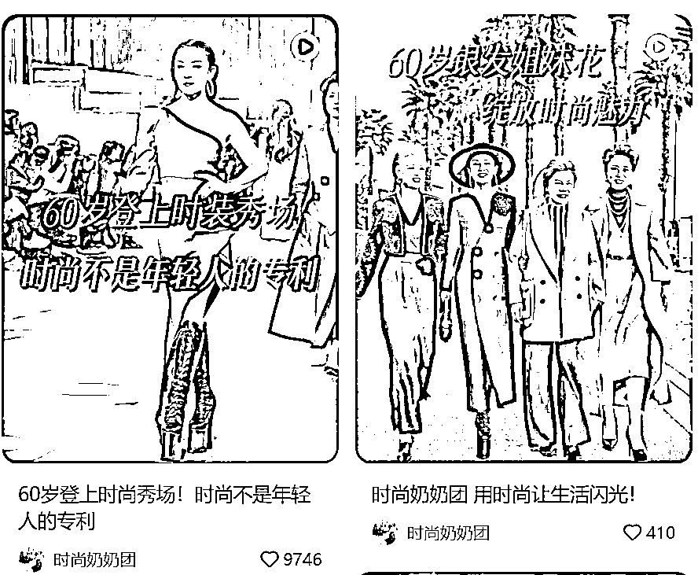
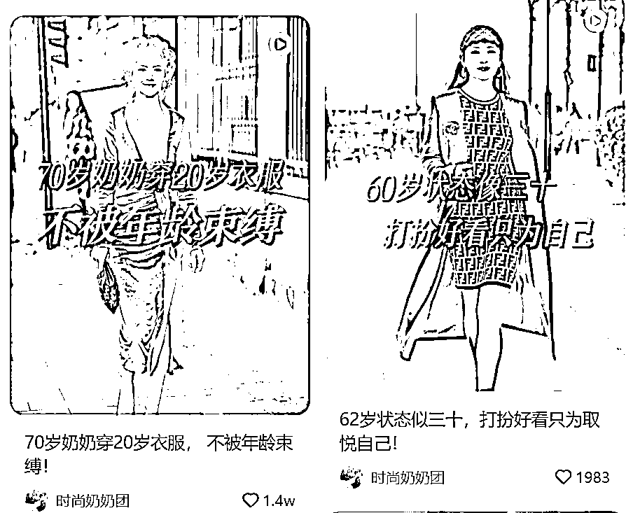
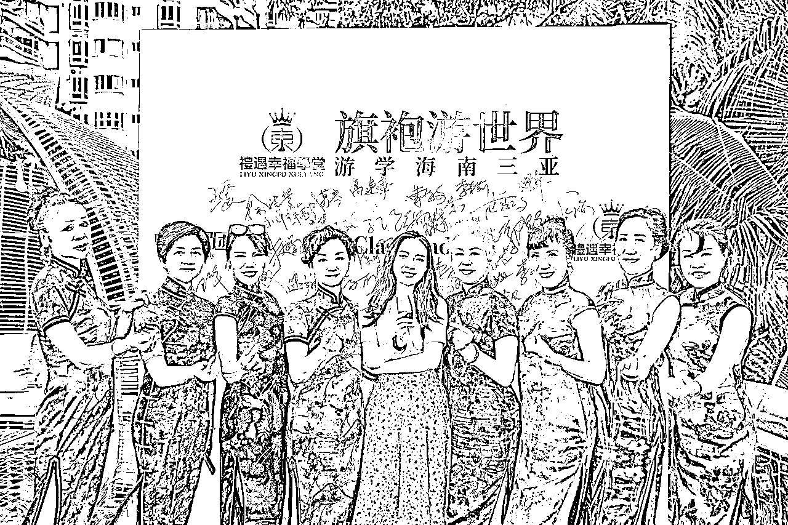
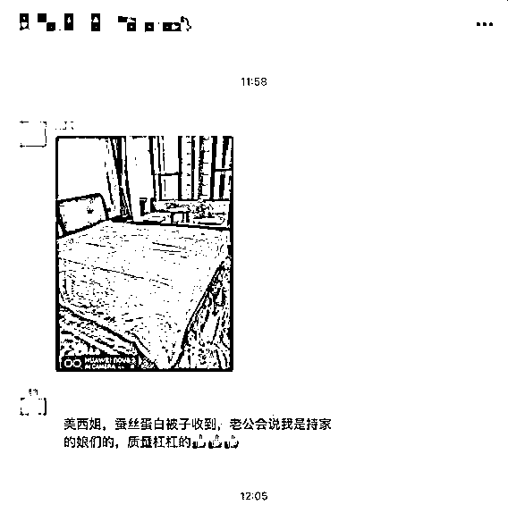
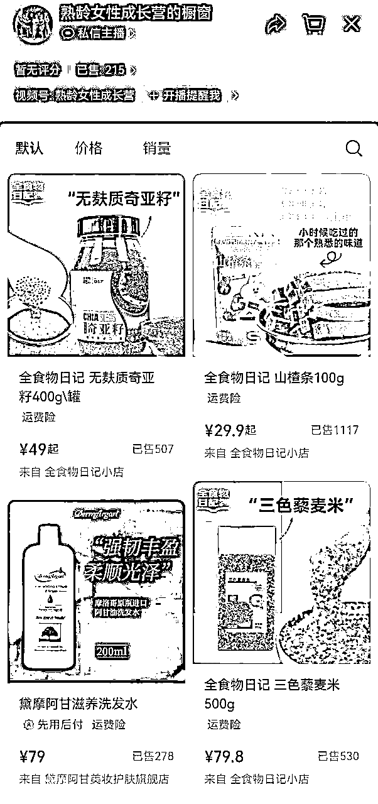
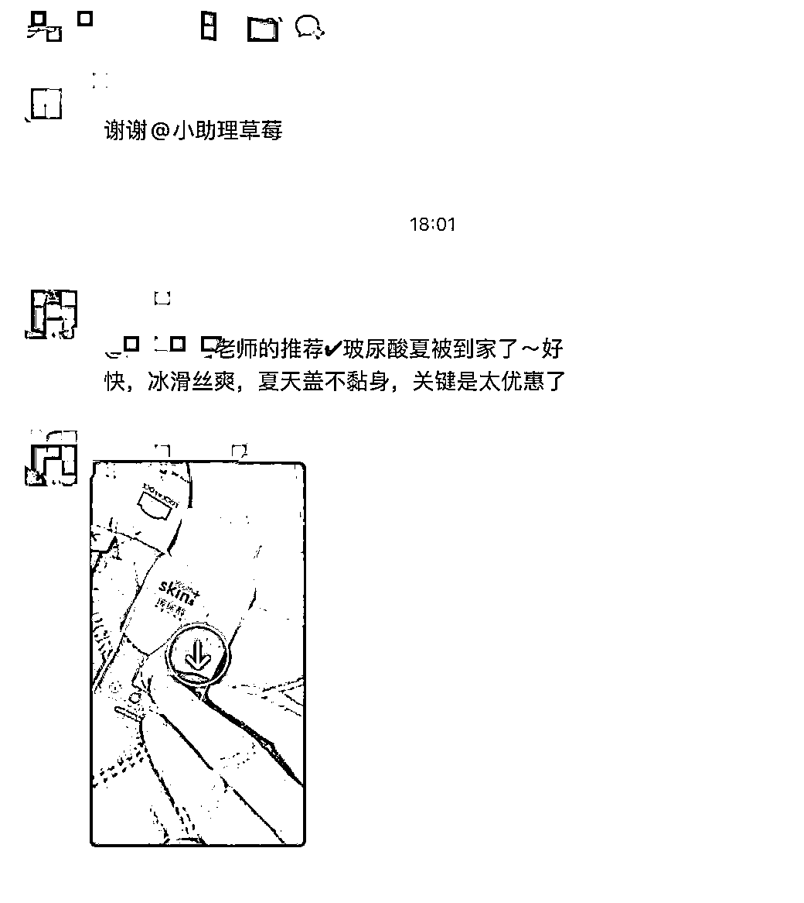
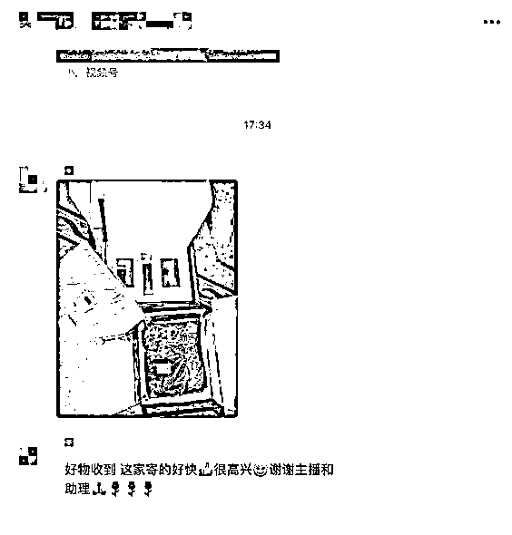
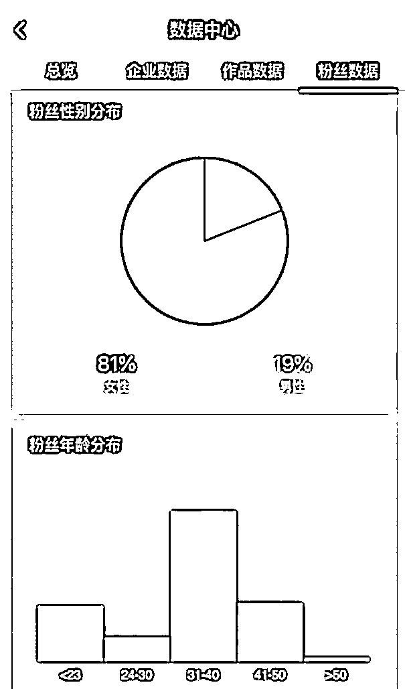

# 风向标拆解第3期：把爸妈带上巡演路，老年研学这块蛋糕怎么吃
作者：龙哥

最近在刷直播，弹幕里全是“学书法”“学唱歌”“学朗诵”“学走秀”。起得早一点你就能看到，成片的直播间正用这些内容填满退休人群的空闲时光。

以走秀为例，没人只是单纯教几步模特步。机构会给学员搭舞台、组专业团队巡演，把技能教学和情绪价值打包一起送到。这一届银发群体，兜里有闲钱、时间也充裕，由此裂变出的老年研学赛道远不止这些。

今天我们就聚焦一个典型切口：带着爸妈去巡演，老年研学需求到底怎么被满足？头部玩家是如何切进这个细分、做成高客单、把学员招进来？课程怎么设计、交付怎么做、一单能落多少？拆开看，或许能提炼出可复制的打法。

拆解方向很清晰：
✅ 流量是怎么被种下的？
✅ 产品是怎么把需求兑现的？
✅ 利润怎么算的？
✅ 这个项目怎么起盘、怎么放大？

## 案例拆解：中老年走秀的商业样本

### 为什么盯上它

银发人群在持续扩容，消费力也在同步上扬。60后、70后陆续进入退休期，他们既有支付能力，又具备“有钱有闲”的典型画像。旅游、网购、养生、社交之外，更在乎精神层面的满足，消费场景正被快速拓宽。

“新老人”要的是什么？
1. 追求新自我：退休后想走出家门，体验不一样的生活状态
2. 寻找新身份：用兴趣重建社交圈，认识志同道合的人
3. 不认老、不服老：消费心态更年轻，渴望被看见、被称赞，用新技能和新体验对冲年龄焦虑

在众多玩家里，时尚奶奶团是中老年活动组织里的头部代表，很值得复盘。

### 基本画像

账号：时尚奶奶团
赛道：中老年走秀
变现方式：以📕、抖音、视频号持续发片做内容，强化“老与新”的冲突感，最后通过直播卖课成交

### 对谁卖、卖什么需求

对标人群是40+的熟龄女性
核心痛点：想变美、想缓解年龄焦虑、想要一个能被展示的舞台、渴望获得荣誉感

### 流量怎么来的

* 主阵地是视频号直播，同时在📕店铺和抖音直播做矩阵补充。现在还把触角伸向美篇、糖豆等中老年渗透率更高的平台
* 内容以自然流量为主：持续输出老年人走秀的视频，打造明星奶奶人设，吸引同类用户
* 私域沉淀：通过粉丝群把公域用户拉到🛰️做长效运营

【内容打法】 deliberately打破对老年人的刻板印象，核心话术是“70岁年龄，30岁状态”，用强烈反差感抓人
【拍摄打法】真人出镜为主，画面就是T台走秀，标题统一围绕“不被年龄束缚”

### 产品体系怎么搭的

* 核心课程：训练营 365元/年？注：素材为365/年，含社群运营、两张写真照、80节课程覆盖形体、身心、化妆、护肤、摄影、直播、短视频，以及线下见面会
* 直播带货：以滋补品、服饰、美妆为主
* 衍生品尝试：时尚奶奶团珠宝，主打珍珠，2023年3月后停更
* 线下集训：3天线下集训营 999元/人，训练营会员可免费参加
* 游学产品：时尚奶奶团环游世界，卖的不仅是旅游，而是上台走秀、表演、签名等全套舞台体验，满足变美和展示荣誉感的需求

另外还有：
* 线下商演：模特团接商演表演
* 中老年MCN：签约艺人打造独立IP，如黛艺、周媚、于书等，形成个人号矩阵

* * *

### 项目是怎么起来的、怎么放大的

* 冷启动在主流平台吸粉，粉丝最初以年轻人为主，后期主动迁移到🛰️视频号、美篇、糖豆等中老年高频平台，粉丝结构随之优化

* 线上吸粉-线下转化：线上多账号矩阵招募会员，线下靠用户裂变形成口碑
* 会员招募靠明星奶奶站台，在见面会上现场邀请签约，疑似还有合伙人分润机制
* 联名破圈：与旗袍、非遗等文化项目联动做推广，同时承接商演放大影响力
* 社群内嵌好物分享，持续撬动中老年消费复购

结论很明确：老年研学不是单纯卖课，而是卖舞台、卖身份、卖被看见的情绪价值。带爸妈去巡演，本质上是把“学点东西”升级为“被全世界看见”。谁能把教学、演出、社交、游学串成闭环，谁就能在这个高客单的银发赛道里吃到第一桶金。