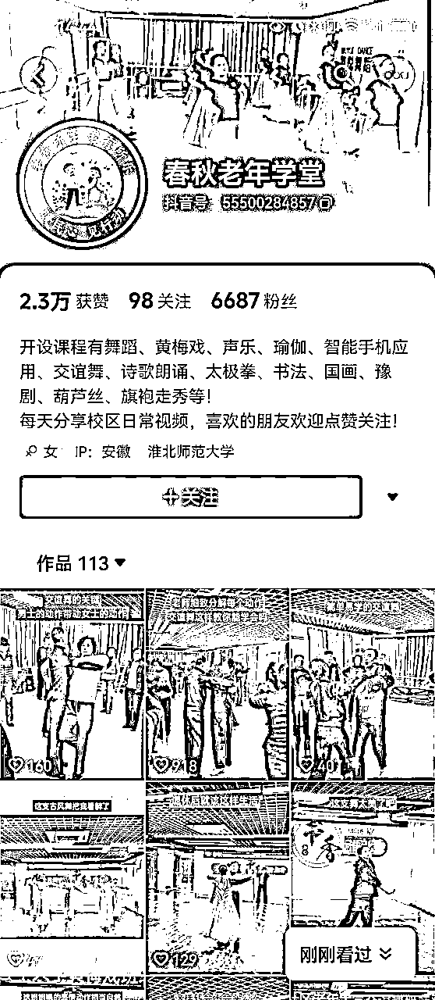
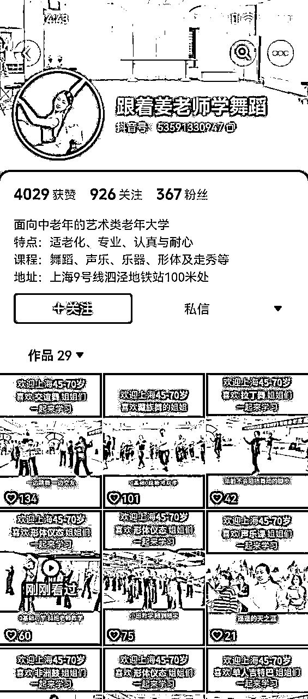
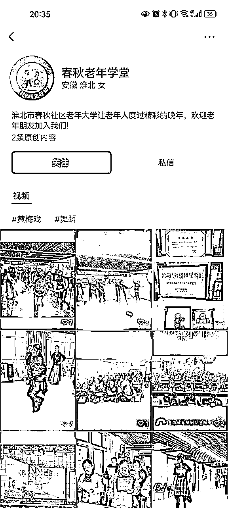
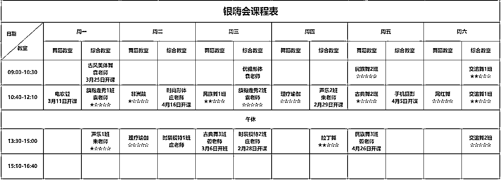
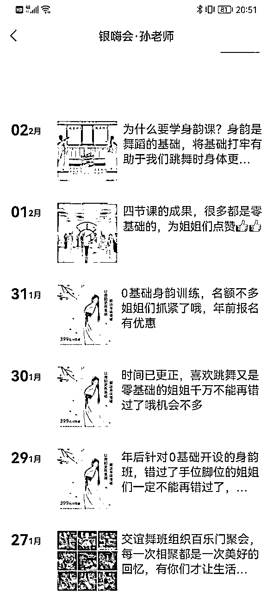
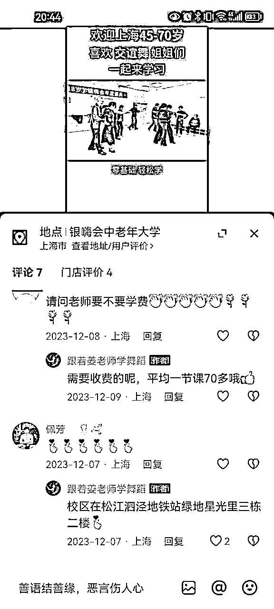
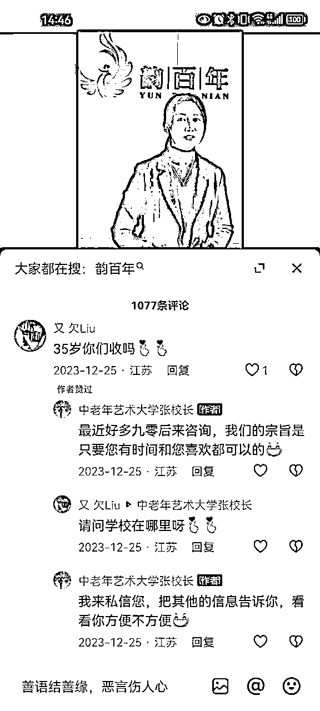

# 风向标拆解第3期 - 老年研学需求被满足的机会如何 - Daemon

这套拆解框架的目的是帮你透彻看懂一个项目的底层逻辑。

拆解项目的方式有很多，但归根到底离不开两件事：获客和交付。

只要把用户从哪里来、服务如何兑现这两个问题理清了，项目的轮廓就清晰了；再把成本和收益算清楚，就能判断值不值得入局；最后再研究落地的路径和规模化的打法，就能判断自己能不能做、能做到多大。

拆解一个项目，核心要回答清楚下面四件事：

✅ 流量怎么玩转？
✅ 产品怎么承接？
✅ 利润怎么算？
✅ 项目怎么落地 & 放大？

# 本次拆解账号

本次聚焦老年研学的“课后”场景，把目光放在老年人闲暇生活上。在抖音上用“老年唱歌”、“老年跳舞”等词搜索，能看到一波围绕老年人歌舞内容的账号。

这次拆解聚焦下面2个账号进行分析。

# 一、流量从哪来？

从运营手法来看，获客主要依赖公域平台的自然流量。内容形态很统一，都是“学生演出画面”配一个吸睛标题，具备批量复制的条件。

1、春秋老年课堂：抖音和视频号都能搜到同名账号，内容是同步分发的；
2、跟着姜老师学舞蹈：在视频号等平台暂未检索到同名账号，基本是抖音单一平台在跑流量；

# 二、产品怎么解决？

1、从主页简介判断，其商业闭环依托于老年大学生态，主要提供舞蹈、声乐、乐器、形体等品类的课程。师资来源分两种：一种是外聘专业讲师授课，一种是创作者本身就是老师，通过账号放大个人IP；

2、评论区透露出一个关键信息：舞、形体、声乐这类课程更适合做本地线下交付。用户咨询多集中在“上课地点在哪”，老年人普遍遵循就近原则；

3、实测添加老师🛰️后，朋友圈主要在做课程预热和介绍。引流路径是先加🛰️，再邀约免费体验课，体验结束后完成付费转化；

# 三、利润如何核算？

由于未实际参与体验课，暂无官方价目表可查。结合评论区透露的信息，单节课费用在70元左右。成本端主要由场地租金和教师课时费构成。最终的盈利空间取决于招生规模，现有信息不足以做精确测算，暂留空。

# 四、项目如何放大？

项目具备两种放大的思路：

方式一：做大本地招生体量，吸引更多学员报名。招生以本地生活为主，可以探索与周边本地生活服务机构联动，扩大获客面；
方式二：在评论区观察到一个值得注意的现象，不少90后也开始参与这类课程的学习。放大时可以适当放宽人群标签，打破“仅限老年人”的定位。

