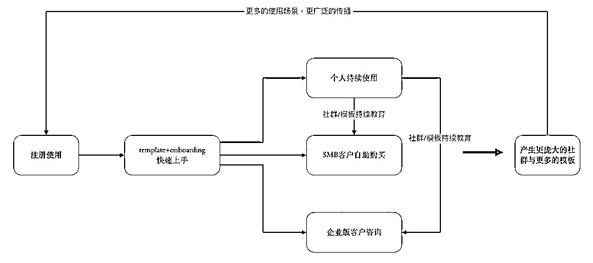
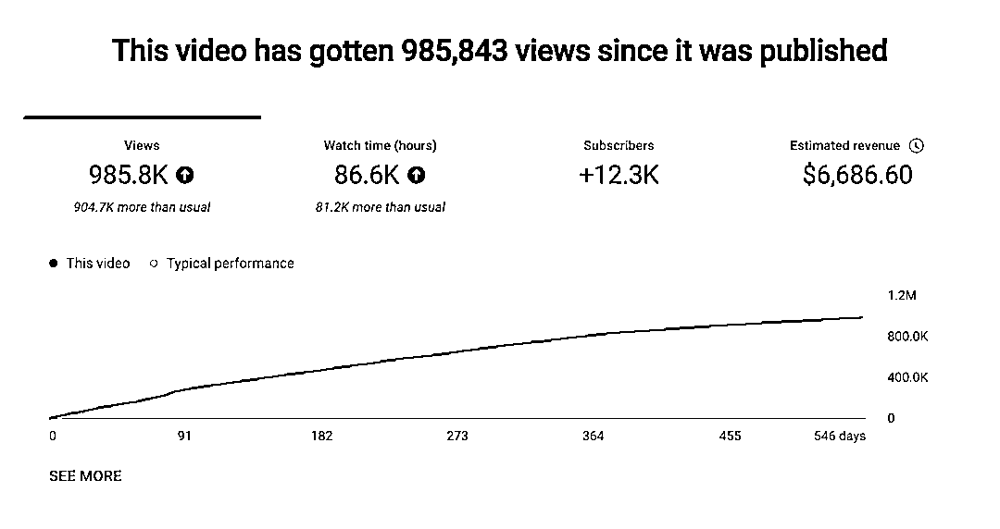
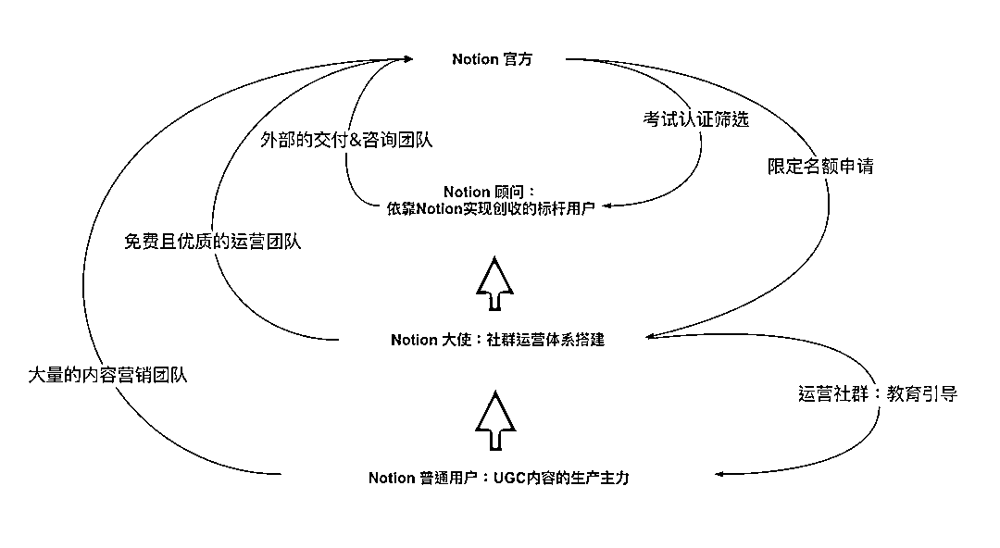
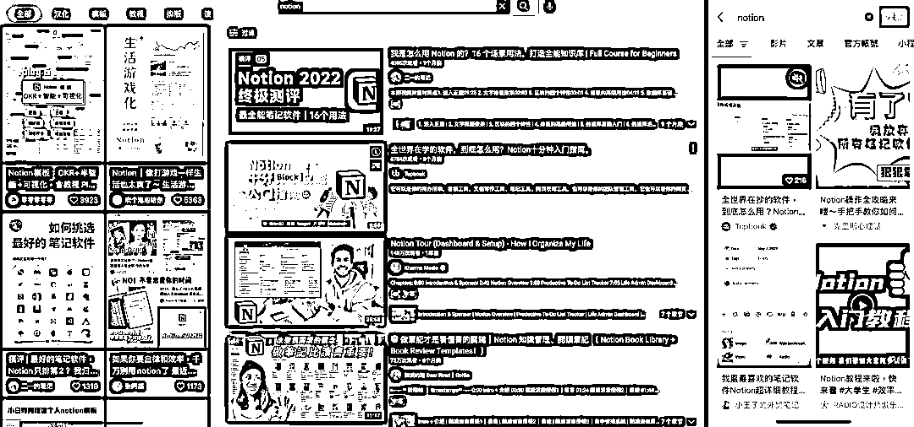
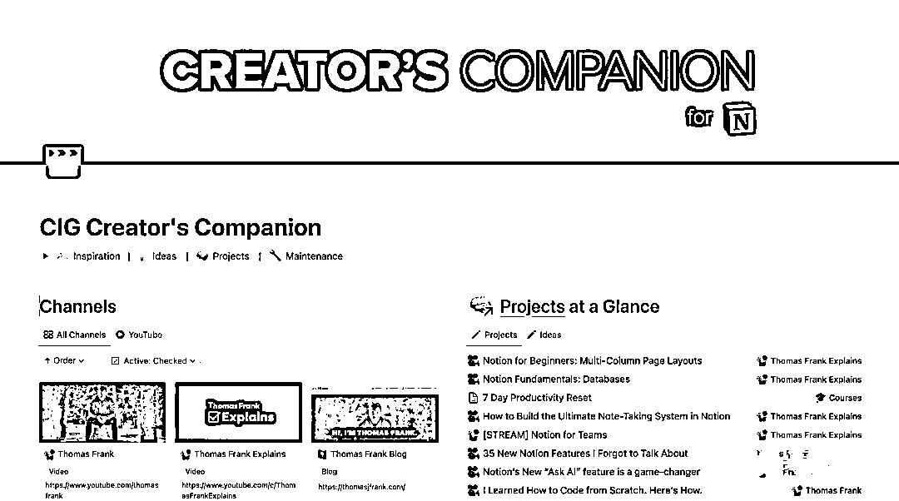
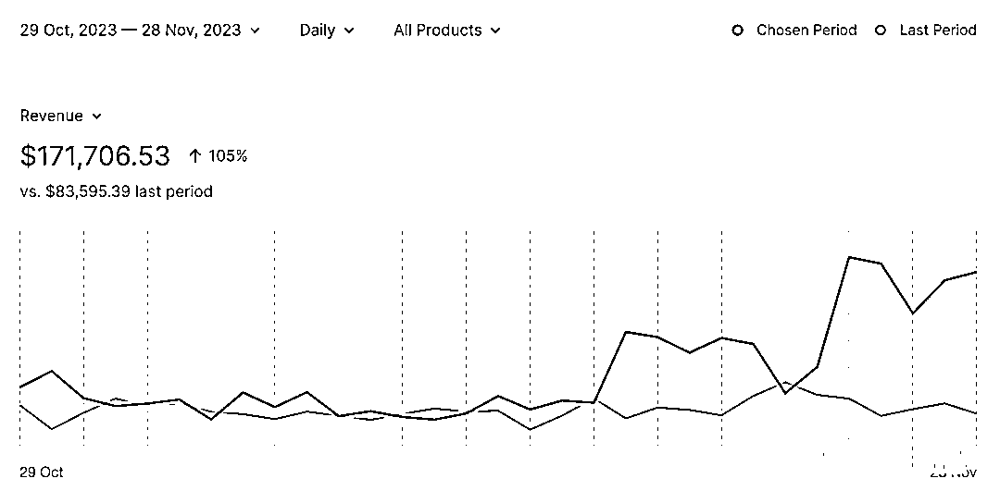
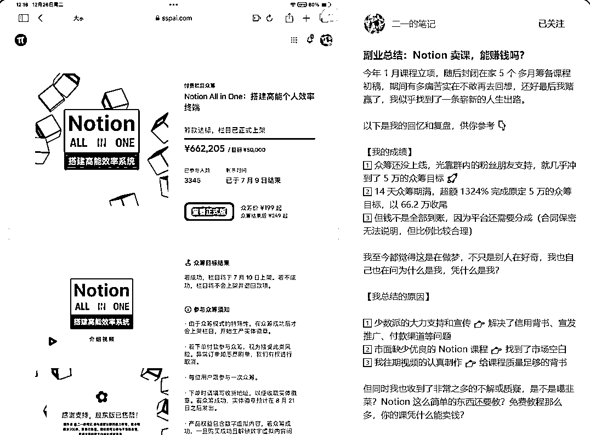

# 风向标拆解第3期｜靠卖 Notion 模板一年入百万美金，资料整理变现到底怎么玩 - 韧而远行
作者：龙哥

大家好，我是龙哥，赚钱的萌新一枚。今天从一个小白视角，来复盘一个很有意思的案例。

在接触赚钱之前，我根本没听过 Notion 这玩意儿。为什么偏偏挑这个来拆？纯粹是被标题勾住了：模板、100 万美元、整理资料也能赚钱。

尤其最后一点最戳我：资料整理也能变现。现在哪个互联网从业者不会整理资料？所以我就想挖一挖，这里面到底藏着什么逻辑。

一搜吓一跳，还真有个实锤案例。有人靠做 Notion 模板，2年卖了210万美元。主角就是托马斯·弗兰克。

下面是我基于 Hedy 大佬拆解框架整理出来的笔记，直接照搬了她的方法论：

✅ 赛道大盘怎么看
✅ 怎么起号，YouTube 起号
✅ 流量怎么来，YouTube 引流
✅ 产品是什么形态
✅ 变现怎么算
✅ 利润如何核算
✅ 普通人怎么复刻并放大

# 1、赛道前景概述

这次拆解的主角就是《托马斯·弗兰克靠卖 Notion 模板两年赚210万美元》。

先给新人补课一下，Notion 到底是什么。老玩家可以跳过。

Notion 本质是一款在线协作笔记工具，把笔记、待办、知识库三合一，做成一个高度可定制的个人工作台。

官网给个人场景列了6个核心用法：记笔记、一体化记录、任务管理、写作、目标管理、建个人网站。

就这两点就很离谱了：一体化记录和自建网站。以前要做这个，得组个3-5人的开发团队，或者自己啃一堆建站技术。更扎心的是，学完了你搭出来的站，还可能不如一个技术小白在 Notion 上点点拧拧出来的。

Notion 的核心打法是 All-in-one，把信息处理全收拢到一个平台。

###### 下面是一些公开资料的补充说明，感兴趣再看：

一、应用概览
Notion 是一款新兴的在线笔记协作应用，提供一个集中整理、分享、协作信息的平台。兼具传统笔记功能和现代协作工具特征，覆盖个人、学生和企业团队。

二、功能特点
1.  多格式编辑器：支持文字、图片、视频、音频、代码块等，可在一个页面里混搭。
2.  灵活组织：无限层级文件夹、标签、链接，随心搭建知识体系。
3.  实时同步与分享：多设备同步，支持实时协作。
4.  模板与扩展：自带项目管理、读书笔记等模板，支持第三方扩展。
5.  搜索与发现：强搜索+智能推荐。

三、优势
1.  高度可定制。
2.  协作强，实时编辑、评论、@ 都有。
3.  跨平台，Win/Mac/iOS/Android 都能用。
4.  扩展性强，可集成其他服务。

四、短板
1.  学习曲线陡，新手上手慢。
2.  内容量大了会卡。
3.  中文本地化一般。
4.  收费偏高，个人专业版约4美元/月，免费版日常够用。

乍一看，Notion 不就是飞书、腾讯文档、Keynote 那类产品吗？如果真是这样，模板也不值钱了。关键就在于下面的区别。

## 赛道定义

Notion 模板项目到底算什么赛道？

1.  生产力工具：用模板帮用户更快组织信息，提升个人和团队效率。包括笔记、任务管理等工具。
2.  协作工具：支持多人实时协作，和 Slack、Trello 一类。
3.  知识管理：数据库功能强大，可自建知识库，比 Confluence 等更灵活。

综合来看，Notion 是一个能提升个人、企业创造价值效率的平台。自由度高意味着可玩性强，也衍生出了各种玩法。

但自由度的另一面是使用门槛高。新手根本无从下手，学习成本高。于是就催生了一个细分赛道：Notion 工具培训。也就是知识分享赛道。

我个人把 Notion 模板项目归在 Notion 工具培训/知识分享赛道里。

## 赛道前景

要看前景，先看用户是谁，盘子有多大。

### 受众是谁

C端个人用户
Notion 理论上面向所有能写字的人。但不是所有人都有动力记录，所以核心是两类人：
*   大学生
*   互联网、自媒体等知识工作者，有效率焦虑、想自我成长的人

B端企业用户
主要是中小企业，和大企业里的中小团队。Notion 在企业端定位是内容协作一体化平台，靠无代码能力提供知识库、项目管理、文档协作、自动化流程等服务。

和个人工具一样，企业端也是 all in one，用更少的软件实现更高效协作。

### 基本盘

账号：托马斯·弗兰克卖 Notion 模板赚210万美元
类目：Notion 模板
带货方式：YouTube 内容输出

我选他拆解的理由很简单：他真赚钱了，而且是持续的。
*   模板销售额月均约12万美元
*   联盟营销+YouTube 广告月均约1.5万美元

他是怎么赚到的？
1.  精准匹配需求：抓住了用户在组织、规划、生产力上的痛点
2.  内容打底：用教程、文章、视频建立信任和粉丝池
3.  收入多元：模板销售+联盟+广告
4.  持续迭代：不断优化产品，保持竞争力

### 市场规模

Notion 能覆盖的场景=个人内容管理+企业协同。企业协同才是主要盈利来源。

Gartner 数据：协同办公全球市场规模预计2024年达到481亿美元，年增速约10%，国内更猛，约23%。

国内已有飞书、蓝湖等，但用过 Notion 就会发现层级不一样。飞书更像工具，Notion 更像积木，天花板更高。

尽管如此，国内协同办公投资从2020年82亿涨到2021年243亿，蓝湖等独角兽也已出现。

## 赛道总结

大赛道溯源是 SaaS 和无代码。

### Notion 的优势
核心是无代码带来的极致灵活，形成 all-in-one 协作平台。

具体两点：
1.  多场景覆盖：文档协作之外，还能搭 CRM、HRM、项目看板等垂直工具。对大企业吸引力一般，但对小企业、团队来说，买一套 CRM 的成本就能让它倒闭，Notion 解决了这个问题。
2.  数据互通：Notion 里搭的销售、采购、库存管理等工具可以任意引用数据，不需要额外做接口，省去开发和实施成本。

### Notion 的劣势
成也萧何败萧何，灵活就是门槛。
*   复杂业务场景支撑不足
*   交付咨询能力弱，企业个性化需求需要用户自己深挖

## 普通人怎么借 Notion 赚钱？

核心点就一个：利用【交付咨询能力差】这个短板。

正是门槛高，才有大量博主能靠一套模板或一套课程赚钱。

# 2、如何起号

托马斯起号路径很清晰：教人用 Notion + 卖 Notion 模板，YouTube 做生产力频道。两大王牌模板 Ultimate Brain 和 Creator's Companion，约两年卖了210万美元。

他怎么做到的？

## 1）先发现需求
托马斯最初不是做模板的，是个普通视频博主。2018年开始用 Notion 提升自媒体效率，最初只当 TODO 用。

2020年把 Notion 引入团队协作，这才发现：很多人根本不知道 Notion，更不懂怎么用。

他早已积累了一套模板，分享就能让别人快速上手，但当时他的技能和模板都还很粗糙。

从2020年起，他开始系统学习并优化模板，瞄准生产力问题做。

## 2）起号动作
1.  做入门视频：发现很多人连基础操作都不会，就录了个入门教学。原本没在意，没想到火了。
2.  顺手放免费模板：把正在用的第一版模板链接放在视频下方免费领。视频爆了，首月广告收入就破2000美元。

商机就这么来了。

## 3）小结
起号其实很朴素：做一期使用分享，附送免费模板链接。现在很多平台不能这么直白引流，但逻辑一样成立。

# 3、如何引流

本质还是免费。产品大佬把这套模式总结为 PLG 增长策略。

## 1）PLG 增长策略
定义：
通过免费体验+用户生态运营，靠产品力实现由终端用户自下而上推动企业采购的 B 端增长模式。

托马斯用一支45分钟的深度视频，把 Ultimate Brain 模板每个功能讲透，直接拿下第一批用户：

## 2）增长飞轮
大佬梳理的 Notion 增长模型大致是：
1.  在 YouTube/Twitter/抖音/📕看到 Notion，注册
2.  被引导和模板教育认识到价值，开始用
3.  用着发现更多好模板
4.  成活跃用户，进社群
5.  尝试带团队用，付费团队版/企业版
6.  长期留存并主动分享方法与模板
7.  朋友看到分享，注册...

飞轮就这么转起来。

## 3）成功的关键是定位
PLG 能跑通，核心是定位适配：
*   覆盖个人和团队：个人场景和工作场景重合度高，容易从生活人过渡到工作人，自然升级团队版
*   用户能影响采购：互联网小团队采购决策权下放，基层也能推动付费
*   社群+模板生态：面向 C 端运营，用户自发生产模板，模板带来用户，用户带来模板，形成网络效应。据统计，2022年7月 Notion 官网月访问量超1亿，90%为自然流量。

## 4）总结
Notion 更像一个有社交属性的 SaaS 低代码开发平台。用户在上面做 UGC 内容生产，就像📕、抖音的舞台。

# 4、产品形式

## 1）Notion 本质是内容生产平台
一张图说清：

官方提供低代码工具平台，普通用户获得 UGC 生产能力。平台搭舞台，用户来生产。

## 2）Notion 的产品=Notion 模板
每个团队、企业需求不同，但有很多共通点。有人把模板做成标准化产品，就能适配大量用户。

这和短视频平台的逻辑很像：

回到托马斯，他的商业闭环就是：内容建立信任，免费模板获客，付费模板变现。

你有没有想过，一套Notion模板能卖出月入十几万美金？Thomas就是这么做到的。严格来说，他不是平台官方，只是Notion生态里的一位“内容博主”。他最初做模板，纯粹是为了解决自己的任务堆积和规划混乱。等模板做好后，他突然意识到：既然这套东西能治好我的痛点，那是不是也能治好别人的同类困扰？

于是，一个极其朴素的商业闭环诞生了：用模板帮用户搞定组织、规划和生产力难题。

其中，名为“Ultimate Brain”的模板，相当于把Notion变成一套个人生产力系统，任务管理、笔记、项目协作、目标追踪全都能在一个地方完成，刚好切中“一站式”需求。另一款“Creator's Companion”则专门服务内容创作者，让他们直接在Notion里完成多平台社交媒体的内容规划与制作，工作效率明显提升。更重要的是，这两款模板大幅压低了新手使用Notion的门槛，用户不用再从零摸索，学习成本降下来，生产效率自然上去了。

那么，这种模板生意的钱是怎么赚的？主要有三条路。

第一，卖模板。个人创作者在Notion生态里最常见的变现方式，就是做一套付费模板分享出去，使用人数越多，收入水涨船高。Thomas两年只打磨两款产品，一套是Ultimate Brain，一套是Creator's Companion，单是这两套模板，月均销售额就达到约12万美金。

第二，卖课程。这一块没什么特别，跟社交平台上常见的知识付费一个逻辑，圈子里很多大佬们已经讲透了，这里就不展开说。

第三，靠咨询和售后赚钱。Notion官方的主要精力放在B端客户身上，大家可以回想一下官方产品形态的设定，这导致大量小团队和个人用户得不到及时的服务响应。如果你足够熟悉Notion，就可以为这些人提供付费咨询、答疑以及模板的售后更新升级。

说到利润，得先看清收入结构。Thomas的模板销售月均约12万美金，其他收入来源，比如联盟营销、YouTube广告，月均大概1.5万美金。他晒出的2023年11月收入报表显示，单月进账17万美金。

至于利润核算的精确公式，我这次实在没来得及算透。毕竟时间紧，这篇拆解本身就是赶出来的作业，逻辑或许有点乱，还请大家轻拍。后面有空，我再回来补深度分析。

那接下来，这个项目怎么继续做、怎么放大？Thomas的几个动作很清晰。他正在开发类似Flylighter这样的工具，帮Notion用户更高效地捕获和管理网络内容，用工具为模板销售引流，进一步增强生产力场景。同时，他不断尝试新的营销渠道和合作资源，想尽办法扩展受众，让销售额再上一个台阶。产品侧，他打算持续优化现有的模板，同时开发新产品线，去承接更多不同用户的需求。

国内其实也有很敢想的人。📕上就有一位博主，用众筹模式，什么资源都没有的情况下，14天众筹到66.2万元，这操作对普通搞钱小白来说，真的像天方夜谭。

好了，其他教程类资料网上遍地都是，这篇文章就当是我自己的学习记录吧。若有错漏，欢迎指正，但请轻点拍砖。谢谢大家！