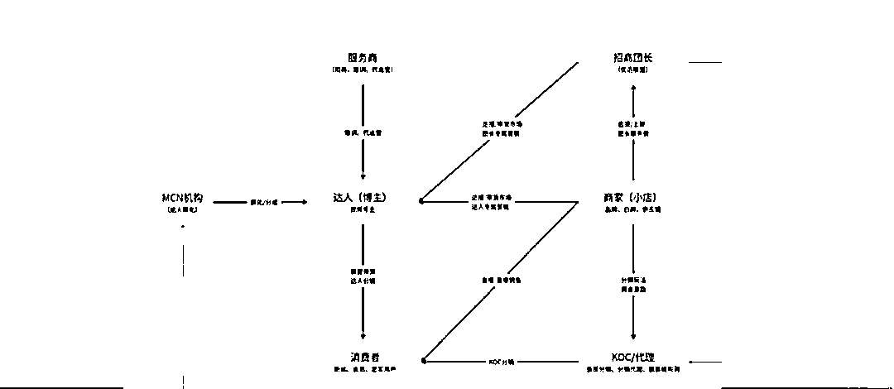
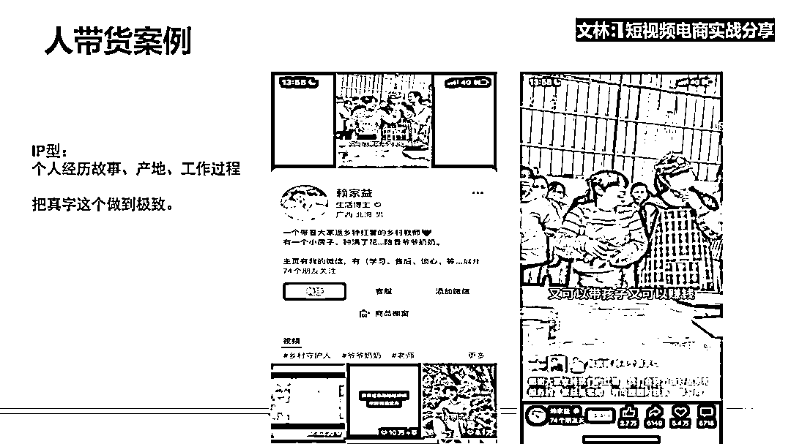
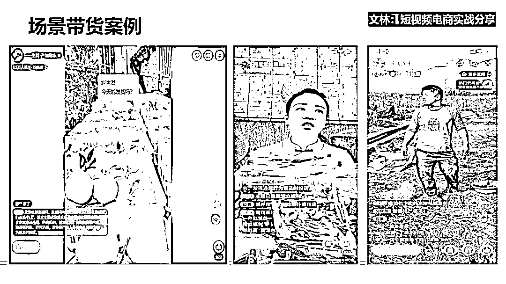
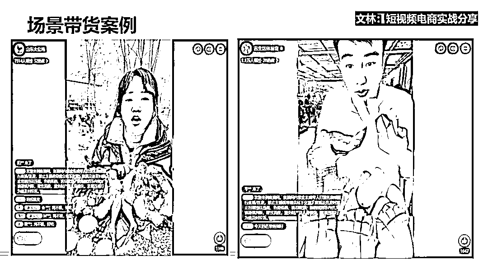
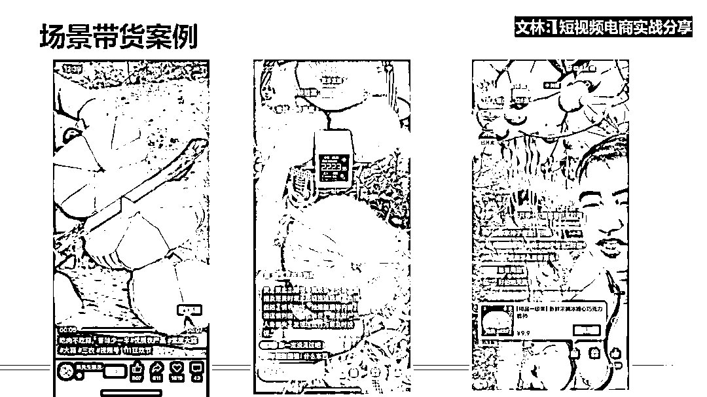
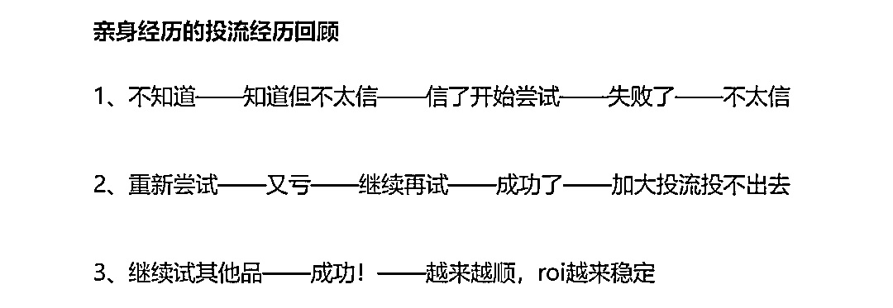
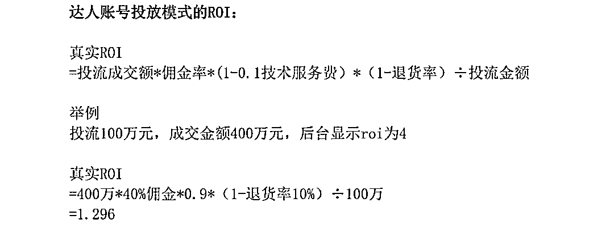

2024 年做短内容卖货，到底把宝押在哪个平台？我自己把抖系、微信视频号、小红书都跑了一遍，今天用亲测经验给你一份避坑参考。

先简单交代背景：我是文林，赚钱圈子里三年的老成员，做过抖音带货项目领队，也以特邀讲师身份参与过微信视频号培训。这三年我一直在电商第一线，带团队在抖系和微信生态里卖出过亿的货。下面讲的都是自己踩过的坑、验证过的方向。

## 一、三个平台的底牌：体量、用户、流量趋势

先看数据。抖音一年的电商成交规模差不多是 2 万亿的数量级；视频号在 2000 到 3000 亿之间，去年刚过千亿，今年直接翻倍；小红书则是刚刚起步，目前只有百亿上下的盘子，不过今年是它认真做电商的第一个完整年份，红利肉眼可见。

体量差距背后，其实是发展阶段不一样。抖系是短内容电商里最早吃到螃蟹的平台，现在还在加码货架式销售，例如“商品卡”，这一入口藏在视频内容下沿，靠关键词搜索和创作者挂链来转化订单，和传统电商平台的搜索路径不完全一样。他们还花大气力做同城生活服务，又抢了一大波流量。

用户群体的差异也很大。微信视频号的核心用户偏成熟，前年平均年龄还在 50 岁，去年降到 45 岁，未来大概率继续走低；小红书以 90 后女性为主，90 后占比达到 72%；抖音月活接近 9 亿，人群最杂，但真正掏钱下单的仍然以年轻用户为多。

我个人的直观感受是：白来的播放量在明显缩水，尤其在抖系和微信视频号，自然曝光下降，花钱买量的占比不断攀升。再死守白嫖流量，迟早会被淘汰。我们公司就是从零付费起步，一步一步切换到付费投放的。

## 二、哪个平台更容易赚？新人老人答案不同

如果手里筹码不多，最容易跑出来的是小红书，视频号其次，抖音最硬核。抖系虽然蛋糕最大，可抢食的人也最多，白手起家很难冒头；另两个平台相对早期，窗口还在。

但如果是成熟团队，赚钱效率就反过来了：视频号最高，抖音居中，小红书暂时垫底。原因很简单：视频号体量已经到两千多亿，对手却远少于抖音，投入产出比漂亮很多；小红书虽然适合新手试水，但盘子还小、规则变动频繁，大玩家通常会等它的年 GMV 超过千亿再重仓进场，那时候的回报效率才会最大化。

三平台的卷度，按从低到高排是：小红书 < 视频号 < 抖音。

各自的优势也很清晰：

- 小红书：入场玩家相对稀疏，却撑得起单品几千元的高价，尤其是女性向、生活方式类商品，买家的价格承受力更强，也愿意沉淀进品牌的私域池。
- 视频号：体量可观，竞争压力居中，年龄偏大的用户集中，适合健康、食品、面向熟龄群体的产品。
- 抖音：规模最大，推荐模型最成熟，适合有内容能力和投放实力的团队正面硬刚。

## 三、主流玩法：货主侧和创作者侧

要理解玩法，先看参与方：货主、内容创作者、买家。此外还有衍生的角色，比如招商团长、KOC 分佣、MCN 组织、代投放代运营的服务团队等等。

但买家只是被广告触达的终端，真正推动交易的是货和内容两端。

作为货主，打法无非几种：找大量创作者帮忙分销；通过招商团长或 MCN 组织来放大渠道谈判能力；自己做内容直接转化；在抖系则可以利用商品卡片位，让视频内容直接带来订单。

创作者这边，最常见的是开直播卖货，直播又分免费流量和付费投流；但很多人忽略的是短视频内容卖货——它比直播更稳定，主播状态有波动，素材却没有，一条跑出数据的视频可以持续成交。

图文内容卖货前阵子也很火。抖系今年年初才真正开放图文带货，期间有将近半年的大自然流量窗口，我们 3 月测试、4 月放量，一路做到 9 月。由于制作成本极低，很多机构带动大量宝妈、大学生进场，自然流量很快被摊薄。我们自己的账号复盘也发现：当图文帖占据八到九成内容时，收益反而下滑；把视频内容拉回七到八成，收入立刻好看很多。所以图文可以穿插利用，但主力还得是视频。

创作者带货还有三种路数值得细说。

第一种靠个人 IP：把日常、经历、工作片段拍进去，把“真实感”做穿。视频号上有一位农耕博主叫赖家益，借着这波东风成了全国人大代表；疯狂小杨哥的崛起也是同一套逻辑，用户先信这个人，才愿意买他推荐的东西。

第二种靠货品本身。货要有视觉冲击力，能自己说话。比如童装、汉服，用户看到图就能想象孩子穿上的画面。这类模式最容易出单的是食品和服饰，因为效果一看就懂；有时候一张照片的转化比视频还高，比如一只橙子挤出汁水的瞬间，比很多口播都管用。

第三种靠场景。核心是营造一个可信的消费现场。比如在养鸡场卖散养鸡，主播强调现杀、散养，观众看到真实环境，信任感自然上升。视频号的熟龄用户尤其吃这一套，平台上也能看到不少精心布置的类似场景。

但也正因为人群偏好，视频号里真人真景的农村、库房画面更多，用户停留时间长，转化率也更高。

这份信任感还可以来自过程体验：比如主播亲自上山采菌子、在院子里干活，这些细节都在帮助提高转化。

之前我参观过一些直播间，表面是果园，实际是在办公室里用道具搭出来的。

除此之外，招商团长也有不错的利润空间，抖音上大概 3% 到 10%，视频号在 3% 到 5%；还有 MCN 孵化和 IP 授权再创作，都是可以参考的赚钱方式。

## 四、投放避坑：五个认知误区

关于广告投放，我是从零开始一路踩过来的。最早做抖系完全不投钱，白来的流量确实够吃；但白流量只适合新手期，想放量就必须接受付费买量。现在再让我从零起步，我会直接以付费投放为主要方式，小红书上则可以按类目选择，不少细分赛道还在吃自然曝光。

另外一个误区是觉得投放门槛极高。其实现在一百块也能下单，平台算法已经相当智能，没有专职投手也能跑起来。

头三个月我一直在亏钱，最大原因是把宝押在单一账号、单条视频上；后来一位做抖系很出色的朋友点醒我：别单点打，要布矩阵。我照做之后才慢慢跑顺。

再说一个具体案例：我第一笔投放来自美妆，很快见到回报，可越加到后面越亏。这个类目的成交回报率已经被压到 1:0.8，品牌方仍然在烧预算，因为他们吃的是复购和品牌沉淀，甚至靠外部融资续命。我果断换到其他类目，利润才稳住。

还有，千万别只看后台显示的 ROI，那个数是虚标的。真实 ROI 应该这样算：成交金额 × 佣金比例 ×（1 - 服务费率）×（1 - 退货率）÷ 投放金额。服饰类尤其要小心，很多人后台跑到 5、6，退货率一半以上，最后算账是亏；女装跑到 3 看着不错，退货率接近六成，一算就崩。买量工具方面，抖系主要用千川，视频号放量则常见 ADQ。

## 五、给普通人入局的三个方向

短内容卖货确实卷起来了，但横向比，依然是普通人少有的窗口。按我这三年的教训，最值得盯的是三件事。

第一，选蓝海平台。抖系最拥挤，第二梯队的机会更大，尤其是小红书，近期我身边突然跑出成绩的新手，基本都扎堆在这个社区。

第二，选蓝海玩法。平台对搬运式混剪内容已经审美疲劳，稳定流量要靠实拍原创。我自己也验证过这条路，去年彻底转向自拍素材后，效果明显。新手怕难，可以先用混剪测款，数据不错再补实拍，过程苦但值得。

第三，选蓝海类目。大的方向上，先挑一个你有把握打赢的细分战场，把资源聚过去。我当年把二十个一级类目继续拆到三级，最后锁定五金工具，做出成绩后才有底气冲大赛道。具体操作上，直接找参照账号去抄作业，我到现在还保持每天拆解别人爆款的习惯，很多同行就是这样被甩开的。

起步阶段也不一定要硬刚视频。先从图文测评这类轻内容练手，再逐步叠加视频混剪，最后过渡到实拍。我们的进化顺序就是如此，如今实拍为主，图文只做补充。这套路径可以直接复制。

最后说一点赚钱心态上的体会。我大学时以为开冷饮店能赚钱，结果亏得很惨；后来经历多次失败才明白：创业就像打仗，不能想当然地打，要确保赢面足够大才动手。具体行动上，想赚哪个赛道的钱，就先系统研究那个赛道里赚钱的人和事，把信息流摸透再入场。2024 年，别盲从“哪个平台最好”的口水话，看清自己的产品和人群，选对战场就赢了一半。

你知道吗？在互联网上找赚钱门路，最坑的不是没信息，而是信息本身就是假的。有些人自己压根没实操过，纯靠编内容吸引眼球、兜售课程；还有些人为了防同行抄作业，故意放出错误信号。你能看到的“风口”，往往是别人设计好的鱼饵。

那怎么在真假混杂的消息里捞出真金？我一般就靠三个土办法。

第一个办法是筛选源头。尽量去看那些有实战记录的人分享的内容，别信只讲理论不动手的人。像我自己经常刷“赚钱”这类圈子，就是因为里面的内容大多是跑过一遍、验证过才发出来的。另外，靠谱的人比靠谱的话更重要——人对了，信息八九不离十。

第二个办法是找一手资料。真正内部的消息普通人很难拿到，但我有一个笨但有效的招：盯紧优秀的同行。比如我做短视频带货，最早就是扒那些带货成绩亮眼的账号。他们跑出来的结果就摆在明面上，这就是最直接、最诚实的“财富地图”——不是秘密，却比秘密更有价值。

拿到消息之后，关键一步是判断“适不适合我”。薇娅、李佳琦一年赚几个亿，但那是超级头部的位置，普通人硬去模仿，只会被现实蹂躏。看一看、想一想，哪些能复制，哪些只能当故事听，这比盲目跟风重要得多。

最后，别停在“研究”里。想破脑袋不如干一仗。真正开始动手，你才会遇到具体的坑、具体的卡点，这时候拼的不是聪明，是耐力。方向选对了，但坚持不到挖到矿的那一步，照样等于零。

送大家一句话：想，全是困难；干，才有答案。希望你在抖音、视频号、小红书上少走弯路，多赚点实在钱。2024，祝你财富自由，精神也自由。也感谢赚钱和有干货的伙伴们一路同行，咱们山顶见。

对了，如果你觉得这篇内容对你有启发，记得在评论区告诉我你的感受，或者点个赞支持一下。我会持续分享真正跑通过的实战经验，而不是空谈道理。