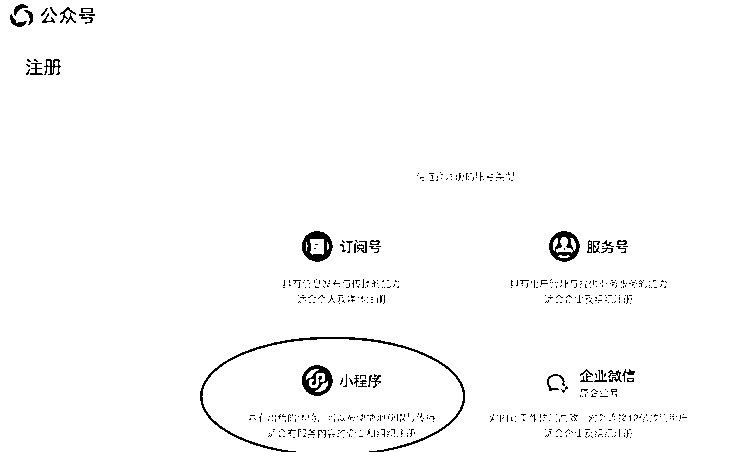
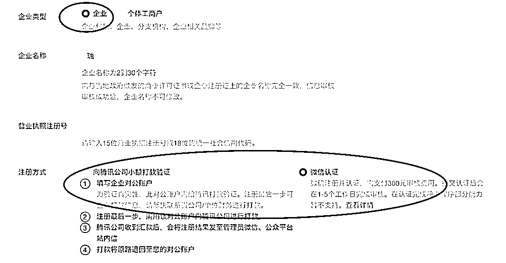
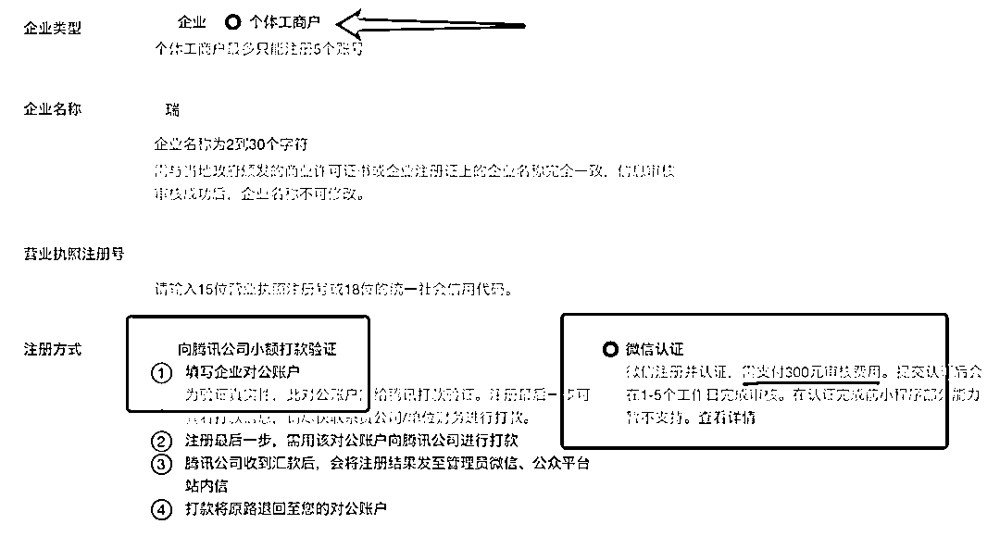
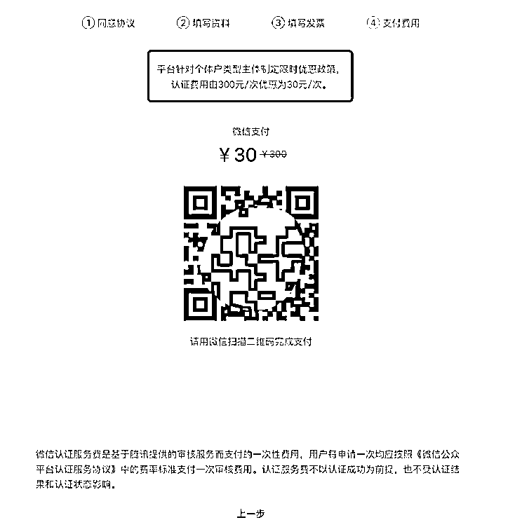
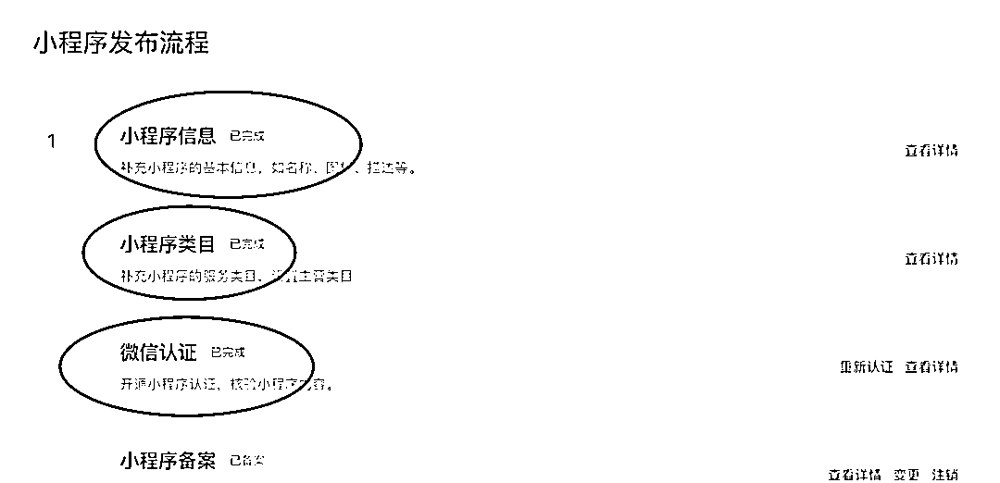
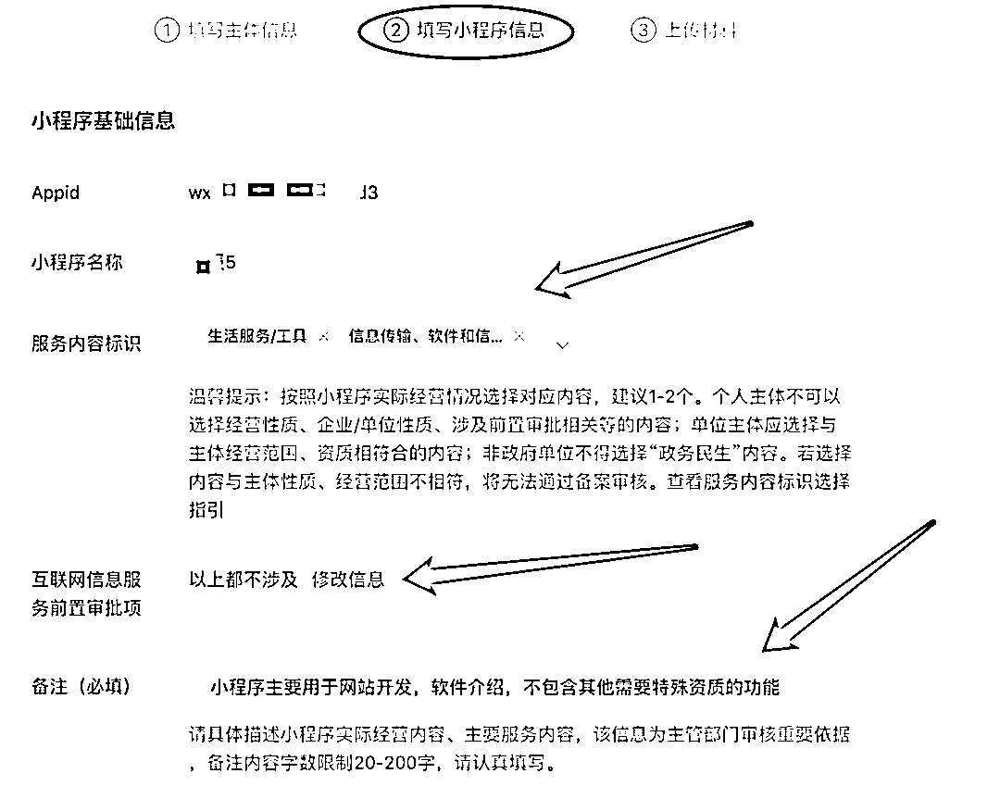
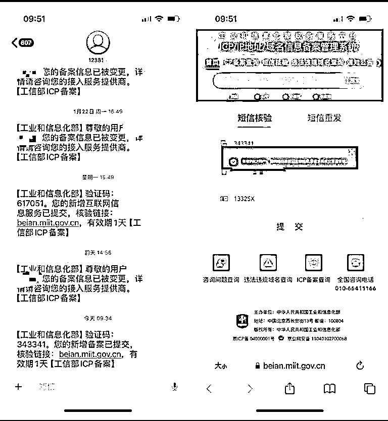
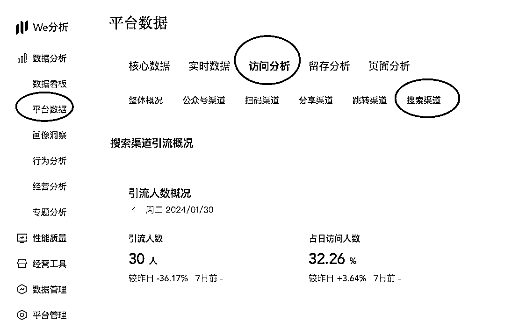

# 2024年 微信小程序从零到上线 备案实操全梳理

> 原文：[`www.yuque.com/for_lazy/thfiu8/vi4w2tylqo3pku13`](https://www.yuque.com/for_lazy/thfiu8/vi4w2tylqo3pku13)

## 2024 微信小程序注册-认证-备案-上线等相关流程与疑问解答

作者： 桔子@小桔圈

日期：2024-02-01

一，微信小程序如何注册

二，小程序认证需要 300，太贵了，怎么可以便宜呢？

三，小程序怎么认证呢？

四，小程序怎么备案呢？不知道怎么填

五，个人小程序现在还有用吗？和企业（个体/公司）小程序有啥区别？

面向刚入场的新手，这些常见卡点下面一次性讲清。

**前言：**

我是桔子🍊，原本是健身教练，后来转到互联网做公众号搜一搜 SEO，累计开过 2000+ 公众号。去年开始研究小程序 SEO，已累计发布 400+ 个，单日被动搜索点击最高破 2 万。备案政策落地后，手上走完备案的小程序已近千个，今天把当下的实战情况做个汇总。

**一，微信小程序如何注册**

官方入口是 [`mp.weixin.qq.com/`](https://mp.weixin.qq.com)

个人主体可以在官网直接开户，不过目前个人号的可用场景受限很大。接下来重点讲企业主体，即个体工商户与有限公司的小程序，个人与企业在认证备案的步骤上基本一致。

个体或公司开小程序，现行规则要么走对公账户核验，要么就需要先缴 300 元认证费，成本不低。

绝大多数个体经营者并无对公账户，若按官方直连流程，就只能先交 300 元认证，这性价比并不理想。

**二，小程序认证需要 300，太贵了，怎么可以便宜呢？**

不少人记得以前公众号认证后可赠送一个认证小程序的通道，随着备案要求上线，该通道已关闭。如今以公司主体申请小程序，必须先支付 300 元认证费才能进入备案与发布环节，官方没有折扣。

个体是有降本空间的。走特殊路径，个体小程序的认证支出可以从 300 压到 30，一折水平。以前该入口还能做到零认证，现在全量收费后，最低可做到 30 元。个体小程序注册免 300 只需 30 认证费按照教程即可自己注册

**三，小程序怎么认证呢？**

新账号登录后会先看到基础信息填写页，前三项需要留意。

**小程序基础信息，**名称、头像、简介可以先随意填写，后续认证通过后系统会自动覆盖，认证后再改即可。

**小程序类目，**先填一个过渡的类目，或按后续要上传的代码类型预填，后期可调整。

**微信认证，**按指引逐步操作，关键点是认证名建议贴近营业执照全称，不要写最终想用的品牌名。举例，我的执照是“小桔圈网络工作室”，认证时我会写成“小桔圈1”或“小桔圈网络1”。部分名称认证时能通过，部分会被驳回。先拿到认证资格，上线前小程序免费改名两次的机会可以用上，这是近千次备案实操的经验总结。

**四，小程序怎么备案呢？不知道怎么填**

备案里最容易被卡的是**第二步填写小程序信息**，其余基本按提示走即可。

**服务内容标识：**首项通常选 **生活服务-工具**，次项参照营业执照经营范围选择。如执照含软件开发，就选软件开发；含零售就选零售相关。不确定时可私聊咨询。

**互联网信息服务前置审批项：**进入修改信息后选择“以上都不涉及”。普通用户备案一般不需要额外资质。

**备注栏必填：**描述要保守，围绕执照经营范围说明用途，而非写将要搭建的最终功能。切勿写“要做小游戏”“要做电商商城”这类执照未涵盖的内容，容易被拒。备案通过后，上传代码的自由度会大很多。

提交后要注意两点：其一，可能有人工电话核验，一定要接听，错过则视为失败，同一主体多次备案后电话可能不再拨打。其二，通过后工信部会发送短信通知。

**五，个人小程序现在还有用吗？和企业（个体/公司）小程序有啥区别？**

个人小程序在权限上受限较多，涉及资质的模块如支付、图片库等多数不可用。

不同人用途不同，我的核心需求是小程序 SEO，需要看后台的搜索词与点击数据。

从数据能力看，个人小程序与企业小程序都能查看搜索词，所以只要代码能通过审核上线，数据获取层面差异不大。

需要注意的是，搜索词查询现已收费，只能免费查询 200 天，且从上线日起算，一般上线后 3-4 天可开通体验期。此前是全免费，现在所有类型小程序一致。

以上就是新手阶段关于微信小程序注册-认证-备案-上线的完整路径与常见疑问的整理。

2024 年，新的周期，新的机会，准备启航 龙哥盟~

我是桔子，《小桔圈》社群创始人，专注 Cps 项目与微信小程序 SEO 被动流量+自动化变现，+微 请备注来意**10038140**

* * *

评论区：

单引 : 小程序有更便宜的方案哟

郭大 : 求大佬指教[握手][握手]

桔子@小桔圈 : 个体小程序注册认证免 300 只需 30 方法教程与链接渠道 圈友免费使用。

* * *