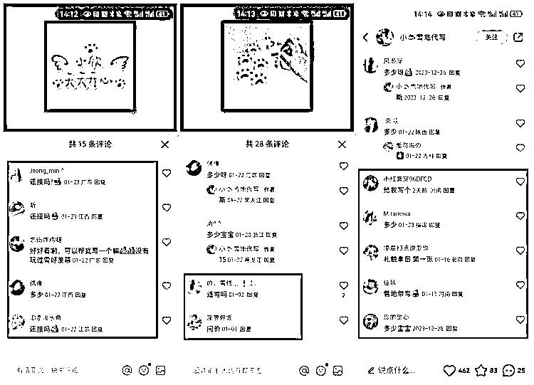

# ('如何挖掘并验证风向标“雪地代写”？', (2, 19))

北方城市一场大雪过后，朋友圈突然冒出一批“雪地代写”服务，几个字收费几块到几十不等，有人当玩，有人却从中嗅到了生意。

你可能想不到，这个看似不起眼的小点子，是一位风向标老手花了九个月才真正“做完”的项目。他在龙哥盟泡了九个月，前前后后写了数百条风向标，有不少还被评为中标，手气好时一天能中三条。可尴尬的是，不管是他自己提的还是别人发的，他从来没有真正落到项目里去，一分钱没赚到。用他的话说，这成了他一直想搞明白的坎。

直到一周前，他偶然撞见赚钱航海里的「挖掘风向标」实战活动，翻开资料那一刻，他感觉自己找到了组织。于是老老实实跟着作业走：先写风向标，再验证风向标。最终，在写了整整20条风向标之后，他完成了第一次完整验证，选中的项目就是“雪地代写”。

整个过程浓缩成三步，特别值得琢磨：需求怎么发现？市场怎么调研？需求怎么验证？简单说，就是从下雪天里普通人的小调侃里看出潜在付费意愿，然后去各平台看同类服务的热度和定价，再自己亲自接单跑一遍流程，确认这事真的有人买、能落地。

他把这套验证过程完整记录了下来，包含更多细节和可复用的操作思路。想看的可以直接移步他的语雀文档：[`www.yuque.com/maoxiaodd/operation/bgwt5fx2c54dwii6`](https://www.yuque.com/maoxiaodd/operation/bgwt5fx2c54dwii6)

有意思的是，评论区里大家也议论纷纷。有人感叹“这也能行”，有人懊恼自己老家下了六天大雪却没想起这茬，还有人看出了延伸玩法：用免费代写来引流，后续做其他变现；甚至有人反应过来，可以在代写平台接单，再去电商平台下单外包，做个中间商赚差价。思维层级一下子拉开了。

说到底，风向标只是信号，真正拉开差距的是后续的行动与验证。哪怕再小的点子，只要跑通了流程，就能变成自己的经验资产。