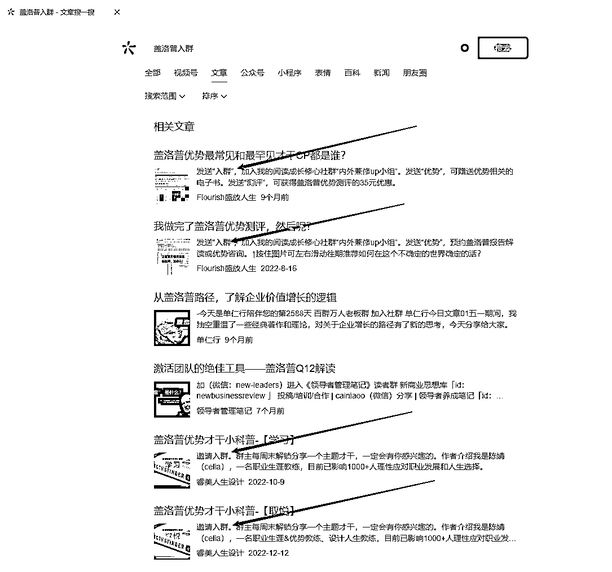

# 普通人做私域引流，别死磕公域，这3个打法更有效

> 原文：[`www.yuque.com/for_lazy/thfiu8/ogk71wlibma5a702`](https://www.yuque.com/for_lazy/thfiu8/ogk71wlibma5a702)

## 做私域引流的秘诀,总结成了 3 招

作者： 玉勇｜优势教练

日期：2024-02-19

很多人想把公域的流量沉淀到私域，却卡在内容难产和日更坚持不下来上。

那对普通人来说，最快实现涨粉的通道到底在哪？

## 第一招、主动下池子

所谓主动下池子，就是去别人的地盘、别人的圈子，尤其是那些高质量且活跃的社群里持续输出价值，让人主动注意到你，然后来加你。

在社群里涨粉的效率，远比单干一个公域账号高上百倍甚至上千倍。关键是，社群里的成员本身就具备付费习惯，愿意为知识付费的人，大概率也愿意为你付费，所以成交的阻力会小很多。

核心问题在于，你手里的优质社群基数够不够大。

怎么去找这些优质社群？

### 1、善用微信自带的搜索

直接在微信搜索框里输入你的行业关键词，再加上“入群”两个字。

举例你做盖洛普优势，就搜“盖洛普 入群”，把行业里所有相关的词都组合一遍。搜索结果下方有视频、文章、公众号、小程序等筛选栏，点进文章，就能批量扒出同行给精准客户准备的各种入群入口。

以下是盖洛普入群这几个关键字搜出来的文章内容。

### 2、顺着老客户找同类社群

物以类聚，人以群分。一个愿意为你买单的用户身边，通常还围着两三個品味相近的潜在客户。

搞清楚你现有付费用户平时活跃在哪些圈子，你就能顺藤摸瓜找到隐藏的流量池。

比如我会定期回访老客户，问一句“你平时还在哪些平台学习？”得到的答案可能是樊登读书、十点读书。我的目标客户就是爱读书的人，那我只要进入这些读书类社群去寻找就够了。

### 3、用付费课买入圈子

现在几乎所有付费课程都会建一个专属社群。你只需要在千聊、小红书、喜马拉雅、知乎、B站等平台，挑出目标客户可能感兴趣的付费课程，直接买课进去拿下社群名额即可。

比如你做儿童阅读，目标用户是家长。那就别只盯儿童阅读群了，清华好爸妈养成营、儿童财商课等任何家长愿意为孩子付费的课程，其背后的社群成员都是你的精准用户。

进了群之后，怎么让别人主动来加你？千万别刚进群就疯狂加人、发广告、甩链接，那种做法只会让人反感。

## 第二招、把自己活成社群里的高光人物

核心就是成为这个圈子里让人信服的魅力人物。

IP的本质是个人魅力，是你价值感强、能量高，自动让人被你吸引，而不是你到处去追人。

怎么做到？

1、**亮眼的入群自我介绍**

进群的瞬间就是你最被关注的瞬间，也是最好的自我展示时机。别让人猜你是谁，你的专业、头衔、成果直接摆出来。

我见过有人进群就发三张真人照+一篇公众号个人故事+一篇十年成长经历合集，成就不算顶尖，但这份用心和专业度直接把人镇住了，大家第一印象就是靠谱。

2、**高能量报喜而不是自卖自夸**

不要一进来就说“我是做盖洛普优势的，有问题找我”。别人只会觉得你是来拉人的。

换个说法更好：“今天一个学员反馈，上完课后个人思考和行为模式明显改善，行动力提升很快，特来感谢我。”把用户的好评截图发到群里，配个小红包，说分享一件开心的事。

再顺势说，这其实就是我总结的几个提效方法，整理成资料了，群里有需要的朋友私信我发给你。这样大家只会想靠近你、加你。

3、**先感恩群主，再谈价值**

你要清楚，进群你是客人。每天在主人家说自己多牛，主人只会反感。

多说说你在社群里收获了什么、学到了什么，把引流变成双向赋能。

有人被社群欢迎，有人被社群嫌弃，区别就在懂不懂感恩。

4、**主动争取分享机会**

主动申请分享，比被动等群主邀请更能凸显你的个人势能。

群主本身也在为社群运营和内容输出发愁，只要你的分享主题契合社群方向，他通常都很欢迎。关键是你要开口。

## 第三招、用标签把私域管起来

所有通过引流加来的用户，都要做好来源记录，便于后续管理。

私域标签体系听起来复杂，起步阶段不用搞那么细，先在微信备注里统一规范即可。用 a、b、c、d 开头做意向分层：

1. a 代表高潜用户，很可能成交
2. b 代表信任不足，还需继续培养
3. c 代表暂时不是目标客户
4. d 代表已成交客户

后面再加上添加日期、昵称和来源社群，例如 A 210901 张帅@龙哥盟，就表示张帅是高潜用户，2021年9月1日通过龙哥盟社群加我。

标签是动态的，随着用户意向变化，ABCD 会随时调整。

* * *
评论区：

暂无评论

* * *