# 别盯着“营养师”这个职业，盯着“人群”更赚钱
我用 7 年时间，服务海外留学生群体，把私人营养咨询做成了月入 3 万的稳定生意

> 原文：[`www.yuque.com/for_lazy/thfiu8/gckygplkst4u2pi8`](https://www.yuque.com/for_lazy/thfiu8/gckygplkst4u2pi8)

说到营养师，外界第一反应往往是证书培训的广告轰炸。

现实远没有宣传页那么光鲜，就像任何一份工作，都得扛门槛、做积累。

我入行私人营养咨询已经整整 7 年，现在的状态是时间自由、地点自由，月收入稳定在 3 万以上。

我不做社群，也不接单次咨询。前者我玩不转，后者基本无效。在这个前提下，我的营收来源 90% 集中在 1 对 1 私人咨询，月指导费 2450 元，全程我一个人扛，没有团队。

客源主要来自小红书和我的播客。我会定期发科普和日常生活的真实内容做深度种草，来的客户气场相合，信任感建立得很快。

我最想提醒想入行的人：你服务的客群，最好跟你自己的生活半径重合。我是留学背景，熟悉“白人饭”，能做全英文食谱，所以我的核心用户是 18 到 35 岁的留学生或有海外生活经历的人，沟通顺畅，甚至能成为朋友。

下面是我在这条路上的实操复盘，供参考。

大家好，我是 Jingle，美国注册营养师。做私人营养咨询第七年，月入保底 3 万。和你聊聊这份工作的真实样子，帮你判断适不适合入局。

私人营养师能带来时间与空间的自由，特别适合自由职业者、数字游民，也能作为一份高附加值的副业。

当然，任何工作都有门槛与积累。

我把入行要点拆成几块：入行资质要求、私人服务产品设计与定价、服务流程与形态、推广方式、触达目标客群、服务优化，以及避坑建议。按部就班准备好，收入自然会进来。

## 一、门槛与建议

**资质**
私人营养服务属于专业咨询，必须有专业受训背景作为底座。行业认可的证书或匹配的专业学位，是结果的体现。

真正的专业营养师是时间堆出来的，不是刷社交媒体就能教人的。网上流传的很多饮食说法都是错的，比如健身必须喝蛋白粉、不吃晚饭就能瘦、靠运动就能减脂、早餐必须吃、增重是为了提高基础代谢……错误信息太多。

在社交媒体上学习或买课就去服务客户，既不负责也撑不过时间的淘汰。

1. **在留学：**美加的注册营养师资质最难拿，训练流程非常硬核。澳洲和日本的注册营养师门槛也高。拿到海外的注册营养师资格，大多回国后可以直接对接国内注册营养师证书。
2. **国内学习/转行：**国内营养师体系多样，有公共营养师、注册营养师等。我已有美国注册营养师和美国专家认证，就没有深挖国内证书类型。感兴趣的话可以在其他渠道了解，信息很好找。

资质准备好，才能谈后面的商业化。

## 二、2023 年个人营收结构

先想清楚收款方式，客户付钱方便，你记账也正规。

我 2023 年 7 月注册了个人独资公司——杭州金钩营养服务有限公司，8 月起所有服务费都走公司公户，平均月入 3 万以上。

从个人收款转成公司收款，是为了收入管理更清晰，服务也显得更正规，从小作坊走向正规市场。

2023 年下半年营收情况如下。

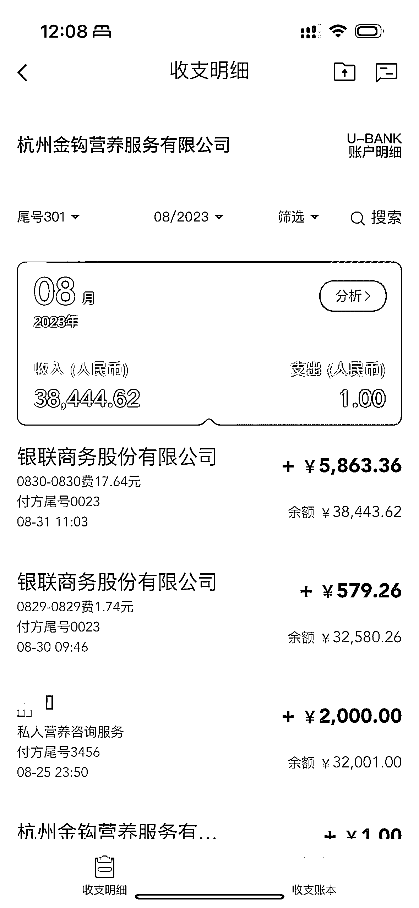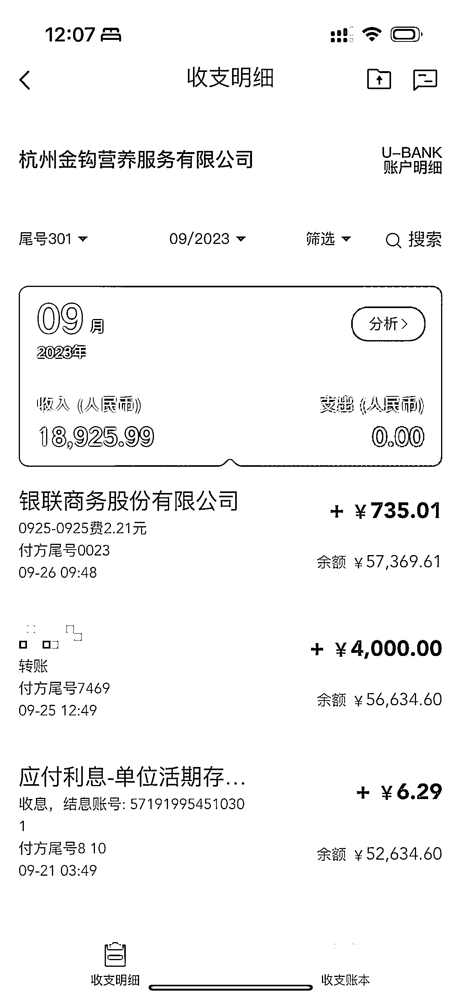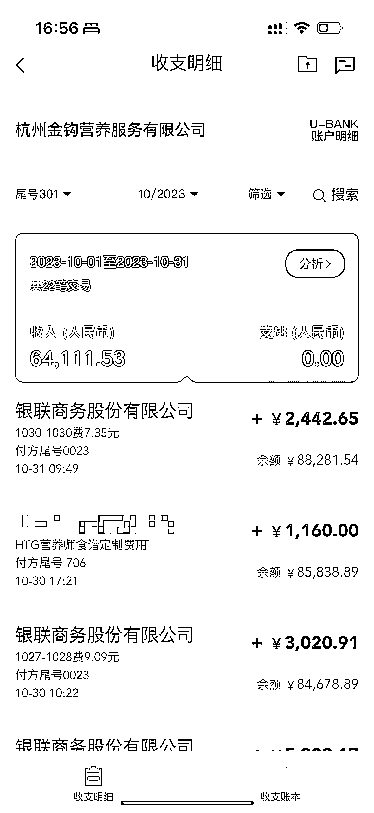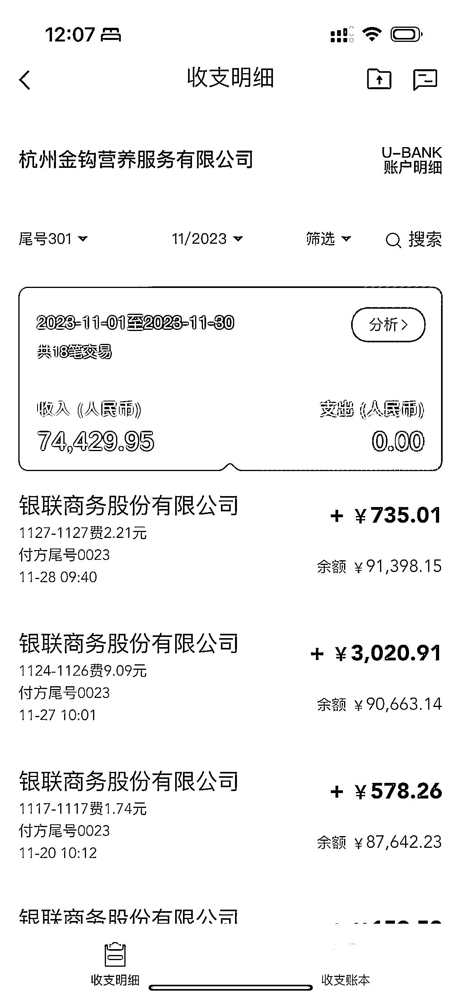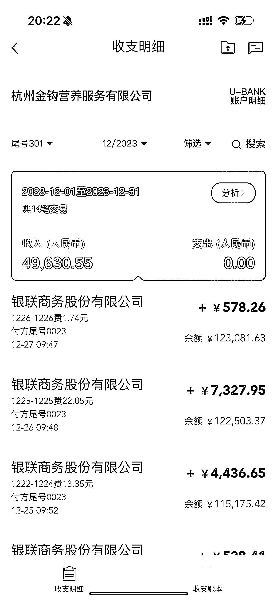

客户习惯微信、支付宝付款，但公户没有收款码。我通过第三方收款合作，银联商务给我做了关联公户的收款码。客户扫码用微信或支付宝支付，我的公司账户次日到账。

中间会损失一点手续费，但早点把流程跑通，比等客户量上来再折腾要好得多。我也在持续寻找更优的结算方式。

**收入构成：**
私人营养服务 90% > 课程培训费 10%

私人营养本质是知识付费，是最大收入来源。偶尔会和机构或品牌合作做内部营养培训课。

每个人的收入和产品设计强相关。接下来就是如何设计产品。

## 三、变现路径

**1. 设计产品，提高单位时间价值**
私人营养服务变现无非两种：高客单做精做少，或低客单走量。

结合自身优势，我不适合走量，主要也不擅长社群运营或卖课。

服务形态很多：付费社群、单次咨询、定期回访、每日跟踪、私人食谱定制、营养科普课、家庭烹饪营养师、讲师等。

我最终只保留了两类：

**不做单次咨询。**
单次咨询很难真正解决问题，需要结构化方案和食谱，也需要像教练一样在饮食问题发生时陪伴。客户拿到微信后容易无限追问，时间难以把控。40 分钟到 1 小时的通话/视频，对一个人来说是服务天花板。

**也不做社群。**
知识付费的社群咨询边界模糊，回答社群问题会削弱 1 对 1 付费意愿。营养很私密，个体差异大，社群给建议容易变成“大杂烩”。让客户互相认识也并非好事。当然，如果你能运营好社群，另说。

定期回访跟踪的流失率也高，我直接 pass。

目前我主推两种服务：**每日跟踪指导的私人营养师**和**私人食谱定制**。

每日跟踪指导是线上进行，没有地点限制。我可以同时服务多人，不把整段时间捆绑给一人，容纳量更大。客户分布在不同时区，打卡集中在三餐时间，不会某一时段过载。

私人食谱定制是完成营养评估后，用闲暇时间交付 30 天定制方案，单次交付，无后续客服负担。

课程方面：偶尔接品牌内部专业培训，一小时 1500 元，有时能到 2000 元。

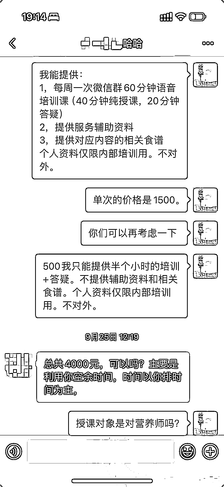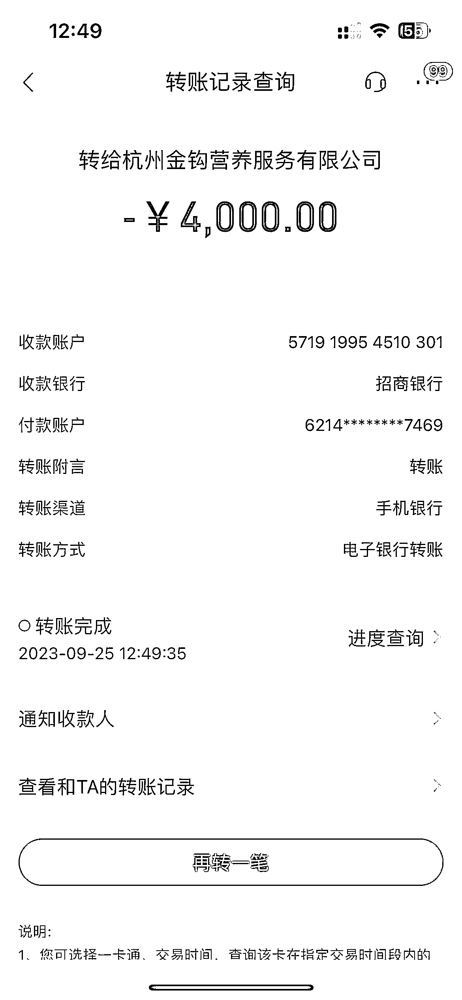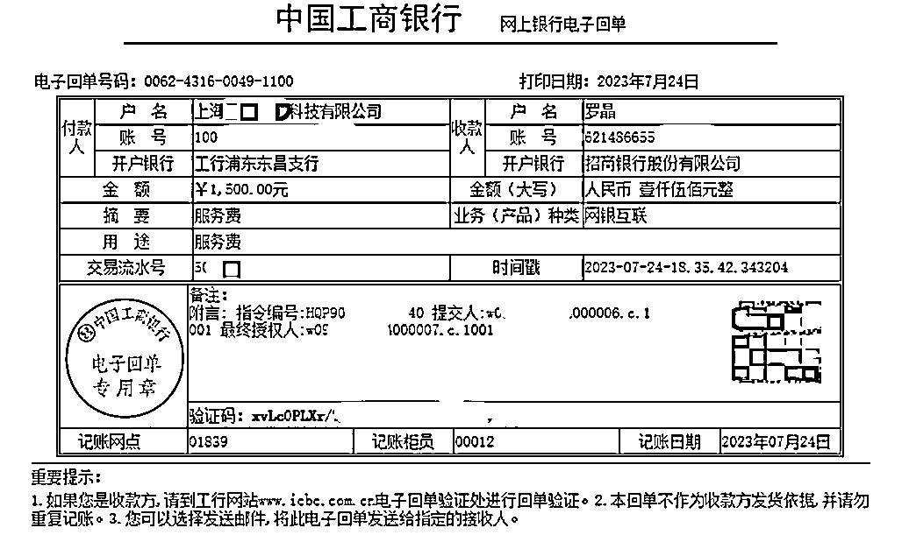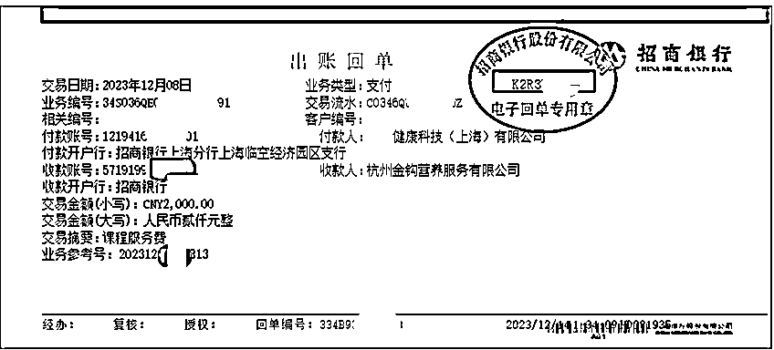

通过不断筛选服务形态，我找到了最适合自己的产品组合，在有限时间内服务更多客户，保持较高客单价，收入也就稳定了。

**2. 我的服务说明**

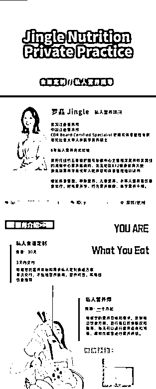

私人食谱定制会根据你的需求定制 30 天食谱，可循环使用。付款后我会发信息收集问卷，内容很全，也可留言补充。问卷回收后开始定制，不含咨询问答和每日跟踪。价格 580 元。

私人营养师是 30 天长期跟踪服务，包含每日饮食方案定制、每日膳食跟踪指导、随时营养咨询问答、定期营养评估报告。月价 2450 元。

此前我提供过 14 天食谱定制，360 元，现在已只做 30 天版 580 元。

我目前不卖产品，因未遇到合适的食品合作。偶尔帮客户代购西梅汁，公司有食品经营许可证，后续若有合适的产品会考虑加入。

**3. 折扣策略**
老客户续约有折扣，续约越多折扣越大。新客户一次性约 3 个月以上也有优惠。我不做促销打折，因为投入的时间精力固定。旺季如万圣节、春节前会排队，不接受临时插队。

私人营养服务价格只会随经验和深造而上涨，越做越值钱。

**4. 定价参考**
先找 2-3 个资质相近的同行，对比情况再定价。经验、客户量、服务深度等都会影响价格，是综合考量。价格不是固定的，随着经验累积合理上涨。

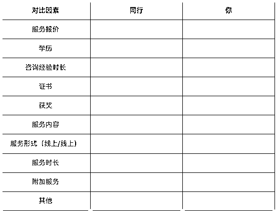

圈子很小，请尊重同行时间，不要假扮客户去打探。

服务设计和价格确定后，接下来就是工具与流程。

## 四、服务形态与工具

我试过国内外各种服务平台，最后觉得微信就够了。

咨询沟通用微信，服务报告用飞书，定制食谱用 Excel。成本低，完全够用。

服务流程：提前全款支付 → 发送信息收集问卷并沟通 → 定制方案 → 进入服务。

客户在哪？曝光自己，主动宣传。

## 五、宣传渠道

我主要在两处发力：

小红书：美国注册营养师 Jingle
播客：《营养不营养》

大部分客户来自小红书，因导流操作明显被平台禁言过两次，后来通过赚钱有术的小红书航海课程学会更安全的导流方式。

小红书更新不频繁，主要发科普和资质展示。客户多是通过搜索服务介绍和资质介绍找到我。

播客更适合我，能讲得更深，给潜在客户做深度种草。我不仅聊营养，也分享生活，让听众了解我是怎样的人。互相的磁场过滤很重要，客户信任你，你也需要信任客户。

视频号、抖音、微博都可以，关键是选你最擅长的平台。

## 六、我的客群画像

我的核心客群是 18-35 岁的留学生或有海外生活经历的人。

这与我的背景高度重合。我从高中开始在美国读书，研究生毕业后在纽约工作。大一就读食品与营养专业，美国教育看重实践，我高中起就接触健康食品相关工作，大学做营养研究与积累，申请实习和研究生，培养了对营养信息的敏感度。

美国注册营养师最难的是至少 1200 小时受训实习，通过率约 50%，申请像高考填志愿一样双向匹配。完成近一年实习才能考证。

2018 年我拿到美国注册营养师 RDN，2019 年获哥伦比亚大学医学院中心硕士学位 MS，2023 年成为中国首位通过美国跨学科肥胖与体重管理专家 CSOWM 认证。

签名是：Jingle Luo，MS，RDN，CSOWM。这些字母便于客户和医疗专业人士识别资质。

相似背景吸引了相似客户。我更懂“白人饭”需求，熟悉海外生活，能做英文食谱，也有资质把客户转介给心理咨询师、言语治疗师、物理康复师、糖尿病管理专家等。

首批客户是我刚拿证时在朋友圈曝光，都是留学生背景，口碑相传。疫情期间 2019 年底，美国留学生互助群活跃，有人需要营养咨询，我在群里介绍服务，客户量迅速打开。

**给你的建议：**锁定和你生活条件相似的人群。我不建议服务费过高、对你负担过重的人，沟通困难，效率低，也易产生心理压力。

比如培养饱腹感、学会 8 分饱停下，如果客户为省钱硬吃完剩菜，行为改变就很难。

这就像买贵妇精华，说明书说一天 3 泵才有效，你舍不得只用 1 泵，最后浪费整瓶。客户要匹配你，你也要匹配客户。

圈子里有人说营养师是服务富人的行业，这是不切实际的。如果你生活与客户差距太大，很难站在相似思维上给出合适方案。

我的定价是我自己支付也不会影响生活质量的水平，所以能吸引生活水平相当的客户，沟通顺畅，信任度高，甚至能成为朋友。

## 七、如何让客户满意

我最擅长体重管理，大部分客户也为此而来。

服务开始前我会预估效果，按客户能做到 80% 方案来计算一个月减重目标，并用曲线图呈现每日体重变化参考。

90% 以上的客户能达到目标，因为价格不低，进入服务的客户都有改变的决心。

每日跟踪中，客户需每天打卡饮食沟通，外食、加班没时间吃饭、应酬、家庭聚餐、情绪性进食等情况都可以随时沟通，我会给出即时指导和体重补救方案，帮助客户回到计划轨道。

生活里总会有变数，我的工作，就是根据每一位客户的生活变化去帮他们想办法。可能很多人好奇，私人营养师到底在做什么？我做了快七年，想把这个职业的真相，一点一点讲给你听。

先说我的服务方式。生活从来不是一成不变的，我的工作正是依据客户的生活变化来调整营养策略。因此，我不可能给出一份“万年不变”的餐单。我的私人营养服务按月起算，至少每周我会更新一次饮食方案，并且做一次营养服务评估。我会记录客户的最新体重，再用这个数字重新计算基础代谢，以及每日需要的减重能量，然后调整出新一版方案。接下来一周怎么做，取决于这一周客户适应得如何。说实话，这种动态调整的效果，比我另一项“一次性定制30天私人饮食方案”的服务要好不少。

有趣的是，每天和我打卡沟通的过程，也让客户学会了面对生活中的种种变数。他们慢慢懂得如何调整饮食，重新连接身体的感觉，也对体重和健康有了更多掌控感。所谓掌控力，无非就是今天吃多了，后面怎么健康地调整；不得不外食时，怎么管理食物选择和食量。

当然，不是每个客户都能顺利达标。正因如此，我要求客户每天做饮食打卡。如果ta吃了计划外的东西，会被记录；如果多吃之后没有执行调整方案，也会被记录。这些记录，既是营养师服务的一种“保险”，也是给客户自己的反馈——让他清楚自己付出了多少、依从性如何、有没有真的做出改变。认真记录，既是对客户负责，也是保护我自己。

**从副业起步，再考虑全职**

我直到2023年8月，这个私人营养服务都还只算一份副业。那时候我有一份正式的本职工作。所以我特别想提醒你：最好不要一上来就辞职，把私人营养师变成唯一收入来源，因为最初客户少，收入大概率不稳定。我的做法是，在主业的空余时间里，一点一点积累客户。等到主业时间内你不得不拿出至少20%来回复客户消息或做方案时，再考虑全职也不迟。

我第一份工作是临床营养师，上班时间是早上7:30到下午3:30。下班后还有大半个下午，精力又足，便开始提供营养咨询。如果你也有一份下班后还能保留精力的主业，很适合从这种模式开始。当时我的收入等于工资加私人营养服务费。

在2023年8月前，我一直用微信收款，偶尔支付宝，因为服务就在微信里完成。后来全职做，收入也慢慢有了回报。这行投入多少就回报多少，前期难，后面越做越容易。

我的几份工作都没离开营养：第一份在纽约一家犹太人开的私立医院做临床营养师；第二份回国做健康教育；第三份在一家创业公司做营养咨询平台。我还和深圳三甲医院营养科主任关系不错，大学时每年暑假都会去医院实习帮忙，只是后来没选择进医院，这是个人选择；如果你想聊这里面的门道，也欢迎来找我。

但我想强调的是：不是非得有医院背景，才能做私人营养师。我在做所有“本职”的同时，一直没停过私人营养服务，如今第6年快结束，马上迈入第7年。2023年7月，我离开了原来的公司，彻底单干。

下面是我8月前，私人营养服务作为副业时的收入记录：

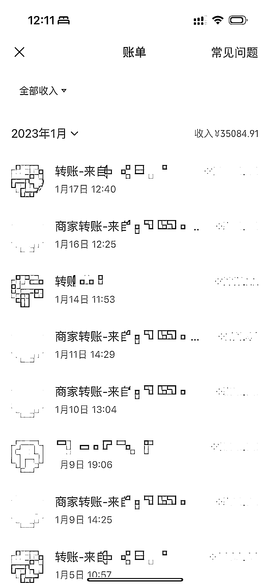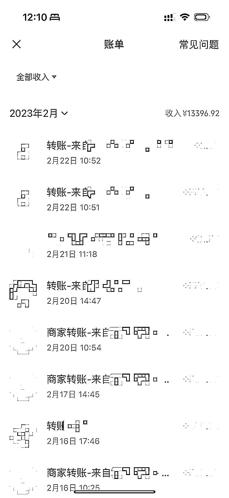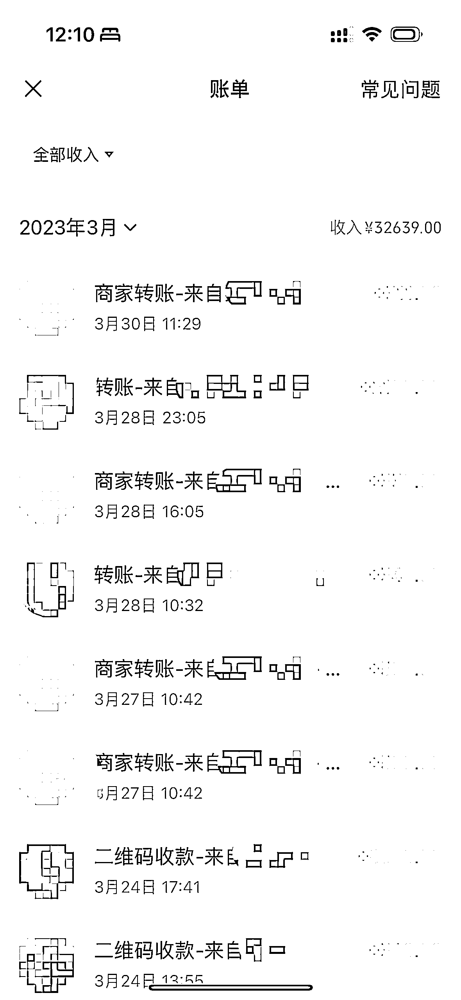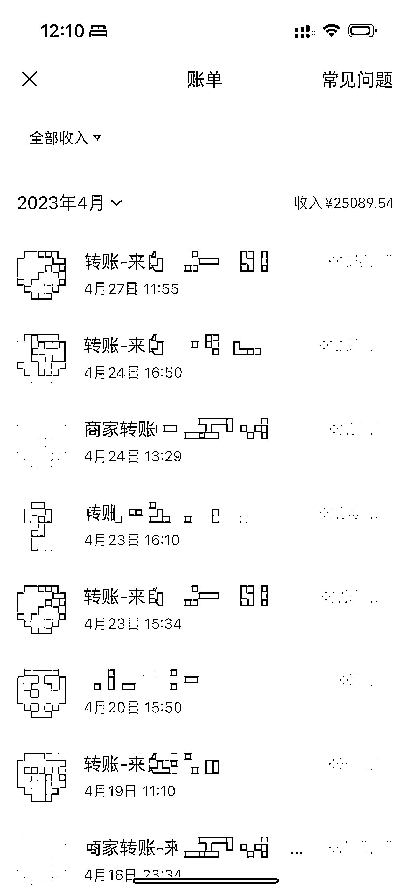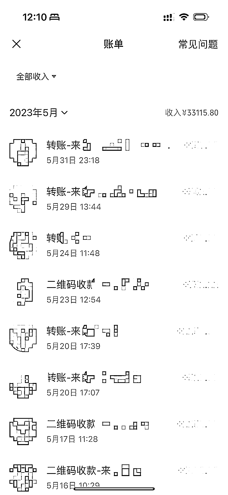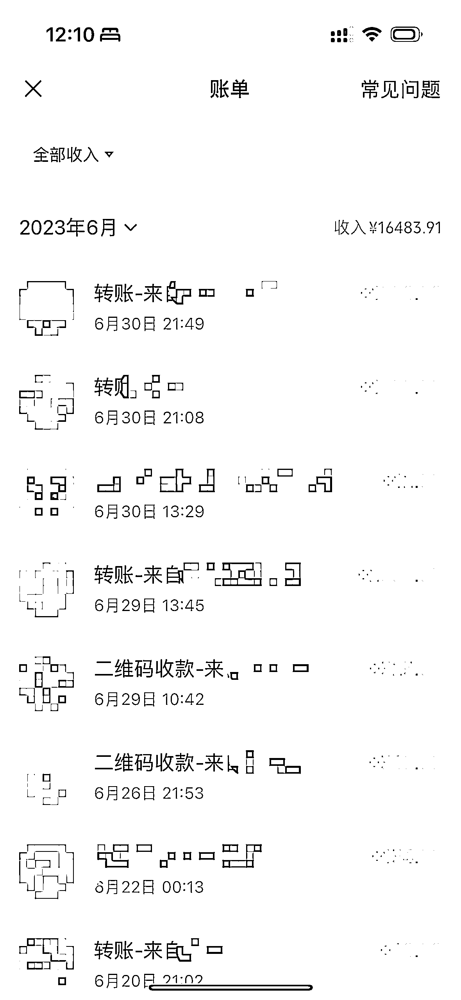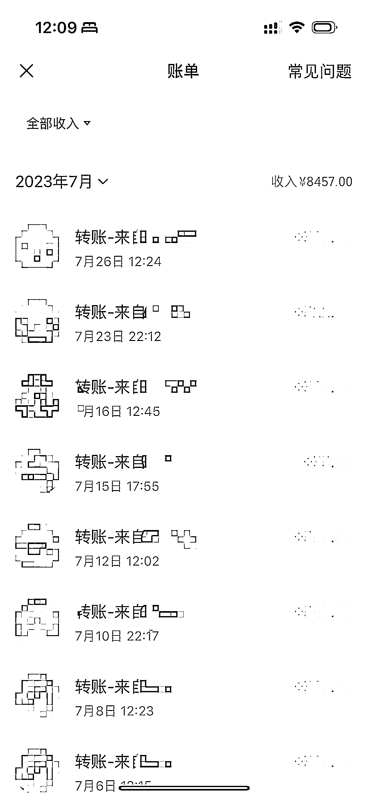

（因为上一份工作是和团队一起做营养咨询平台，我也用自己的私人客户做过平台流程测试，所以账目里有很多“商家转账”。）

**它为什么吸引我**

做了7年，我最大的感受是：这个工作几乎零成本。没有场地租金，没有员工工资，也没有物料成本，可以算“0成本”做生意。如果非要说成本，那就是以前花的教育和受训费用——可哪个行业不需要学习投入呢？

除了学历教育，我的营养师执照需要每年继续学习教育才能更新。我们受美国注册营养师协会监管，五年一查，需积累75个学习学分。好在很多免费课程也能攒学分。

现在美国有不少营养师开自己的工作室，国内这种趋势也渐渐出现了，这是好现象。不过我也见过一些医生和营养师，自己独立执业一段时间后，又回到循规蹈矩的工作里。所以，独立做私人营养服务有利有弊，适不适合做全职、值不值得创业，要认真掂量。

**先说“香”的地方**

1. 自我管理：你可以独立经营，利润全都归自己。如果你想创业，这可能是最容易启动的项目之一，规则由你定，决策由你来，怎么做都你说了算。
2. 永远新鲜：你能遇到不同类型的客户，每天和不同的人交流。工作室一开，业务也可能不再只是营养咨询，你可以给总裁当贴身营养师，也可以跟早教中心合作设计食谱，做家长课堂讲师、社群营养师、直播，可能性非常多。
3. 保持热情：如果你真的热爱营养，这里就是让你发光发热的地方，你能实现价值，也收获满足。
4. 时间灵活：时长和日程自己定，没有地域限制。只要不怕倒时差，你的客户可以分布在世界各地，我现在就还有不少在美国生活的华人客户。很多人说的“数字游民”，恰好就是那些线上接单的营养师。你可以在海岛冲浪的同时工作，把生活和事业揉成想要的样子。

**但也要冷静看看“不太香”的部分**

1. 前期收入不稳：客户数量不稳定，收入就会波动。你最好有经济上的后备支撑，否则很难在这条路上坚持久。
2. 需要清醒的自我反思：做这个工作像坐过山车，你要清楚自己在哪一阶段，该承担什么责任。总会听到同行抱怨“大众没有营养意识”“市场还没准备好”“平台不给推荐”。如果你也这么想，那可能不合适。市场真准备好时，你脱颖而出做出影响力的机会反而小了。有挑战才有机会。生意不好，先问问自己：有没有做好宣传？有没有经营潜在客户社群？有没有用新媒体？是不是咨询经验还不够？从自身找原因，才能走在别人前面，遇到更多客户，也赚得更多。
3. 需要随机应变：客户想要的可能和你原本设定的服务不一样。比如他想要一份食谱，而你原来的服务里没有，那你就要灵活调整，尽量满足。初期用户口碑最重要。你也许多花几个小时，看起来有点吃亏，但你多了一个食谱产品，还可能赢得这位客户背后的一群潜在客户。
4. 身兼多职：CEO、CFO、CTO、营养师、市场专员、行政助理、业务经理、销售经理，这些角色一开始都得自己干。所以你要会算账，会做公众号，会做短视频号……还好现在各种工具有很多。
5. 必须会销售：前期要主动宣传。别觉得酒香不怕巷子深，那套早就过时了。平时多向人展示你的专业，比如朋友聊减肥，你就讲讲间歇性进食、正念饮食是什么。让别人记住“有这么一个营养师朋友”，需要时才会想到你。如果只拿一张证出来，而不展示能力，说服力太弱。做营养师也要逼自己一把，走出舒适区。我常用的展示平台是小红书和播客。

**别太早合作，也别急着入驻平台**

私人营养服务完全可以自己一个人做。我在这件事上吃过两次大亏。

第一次：我入行早，有些同行在读书时就叫我mentor，后来他们成了注册营养师，自然加入了“我的团队”，我就把部分客户交给他们。结果发现每个人对待客户的方式不同，我努力培养的客户，慢慢流失了。客户体量还不大时，过早搭“营养师团队”没用，因为客户真正需要的是“一个与自己合拍的营养师”。

第二次：在上一份工作里，我和团队搭过营养咨询平台。我把私人客户带去测试平台功能，想获得更多流量。结果平台不成熟，客户体量也不大，我没能拿到多少新客户。就算有，平台客户也很难变成我的长期客户。这些客户是“平台的”，不是“我的”，信任基础薄弱，沟通也困难。把自己的客户带上去，反而可能导致他们去平台找别的营养师，流失得更快。

私人营养师起步慢，需要时间培养，其他职业也一样。不要因为自己还不成熟，就急着抱团取暖，那反而会阻碍个人业务发展。等你有了竞争力，再和别人合作，才可能碰撞出火花。

**竞品与我有什么不同**

可能的竞品有：健康管理师、签约减重机构、减重药、医院营养科、营养咨询平台，甚至还有更多。

我的私人营养服务有几个特点：

- 只提供营养相关的服务。健康管理师涵盖体重、慢性病、运动、心理、睡眠、皮肤、压力等方面，而我拿什么资质就提供什么服务，这样更聚焦、更深入。作为美国注册营养师，我的服务范围天然限定在营养；另外我又考了肥胖和体重管理专家资质，所以成人、儿童、孕产期体重管理，以及相关的运动管理、代谢手术管理、减重药物、体重心理等，都包含在服务范围内。
- 服务基于科学和健康，强调双方配合。我没有“签约减重”这种承诺，因为营养师无法对客户的个人选择和行为负责。
- 服务里不仅包括减重药物评估、用药指导、药物营养搭配，还有营养咨询、食谱定制、饮食行为指导、饮食心理学等。
- 与医院营养科不同，我不做单次咨询，我的方案是私人的、贴日常的，客户随时可以沟通；而医院通常依赖系统里的固定资料，实用性有限。
- 与平台模式也不同：选我，意味着和我这个人建立信任连接；而平台客户信任的是平台，与营养师本人的联系较弱，依从性自然差，达到目标的效果也不会理想。

**写在最后：它可能不会让你大富大贵**

做专业咨询服务的人有个英文昵称叫 HENRY：High Earners, Not Rich Yet——收入高，但还没到富有。

我的咨询费并不低，但生活中维持水平的开销也不小，所以目前它没让我“富起来”。在服务过程中，我也一直在寻找新思路、新机会，并且注册了公司，让流程一开始就正规化，以便未来抓住机会。

私人营养师不是我唯一的收入来源。正因为有后备支撑，即使某个月客户少，或者我想休假几个月，生活也不受太大影响。这也是我能坚持到现在的原因。

这确实是一类能兼顾生活与工作的职业。我目前的时间分配是50%工作、50%生活。如果你愿意多放一些精力在业务上，收入自然也会更高，而我选择了这样的状态。如果你也觉得这样的比例很舒服，那私人营养师是能带来满足感和幸福感的。

给对这行感兴趣的朋友一句实在话：这个工作可以让你一个月轻松赚几万块，但想靠它致富，真的很难——工作是这种性质。如果你能从中找到突破机会，我会很开心，还要崇拜你并向你学习。

**成为私人营养师**

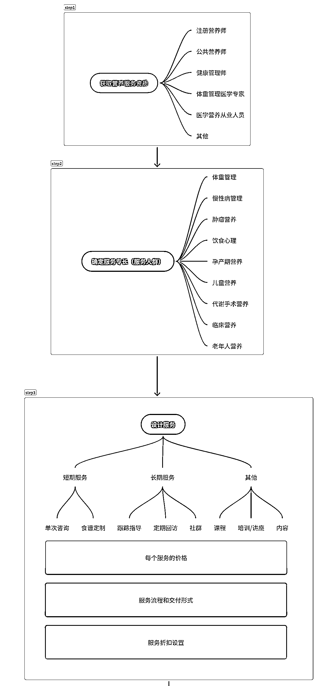

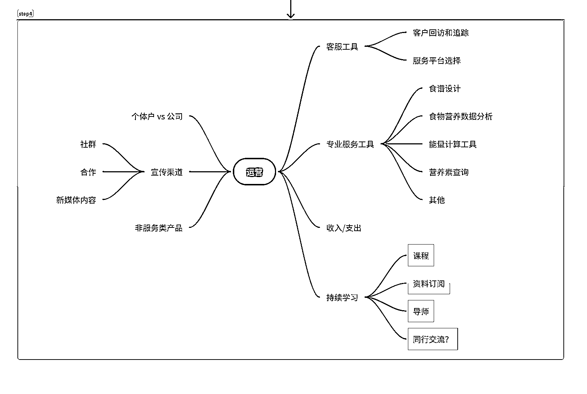

* * *

评论区：

蔡小菜：我现在在医院营养科上班，说实话，你这种状态算是营养师很理想的样子了。

美国 RDJingle：对，慢慢做喜欢的事，一切都由自己决定，那种快乐很真实。

^O 汝则吾：在这么浮躁的时代，还能一步步踏实分享自己的副业心得，这个小姐姐的节奏感很好，也注定走得更远。

美国 RDJingle：喜欢的事情一直做，结果自然会出现。

阿钦：谢谢分享，给了我很多启发。

