# 数据流写爆文：我把公众号创作拆成了自动化流水线

大家好，我是RIO。一个捣鼓RPA工具的人，专门做能换钱的自动化脚本，也爱分享背后的操盘思路。

今天这篇，想聊公众号爆文。

去年12月，我头一回参加公众号爆文写作的航海，倒数第二天才开出第一单。金额实在不好意思报，但意义不小：从零到一，跑通了。当时的感觉是，方法课听了不少，真的动手全是坑：不知道选哪个领域，不知道抄谁，不知道写什么，不知道热点在哪儿，不知道为啥辛辛苦苦写的文没人看。

后来我干脆不听课了，把这事当成一个数据处理项目来做，把所有困惑写进代码，做出了一堆RPA脚本。这几个月下来，也算整理了套自己的思路。

公众号出爆文，我理解就四步：定方向、选话题、写内容、做推广。每一步都需要对应的信息工具支撑，整个闭环才能转起来。

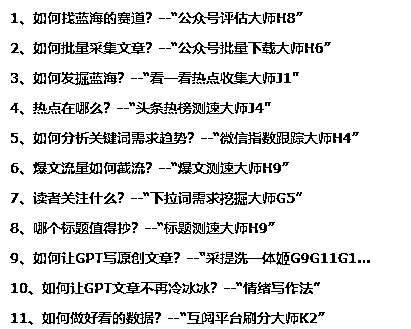

下面按这个框架逐个拆解，顺便展示几个我比较满意的工具。代码细节不聊，只讲用途和设计逻辑。

## 一、选赛道：“公众号评估大师H8”

开始之前，得先确认目标领域有没有空间。老手有个说法：新号随便发发就能出爆款，说明这地方人少鱼多。反过来说，如果谁进来都扑街，那多半是红海。

我的做法是找同类账号做“体检”。于是写了这个评估脚本，你给它一个公众号，它能把该号发过的文章全部挖出来，梳理出标题、发布时间、浏览量、点赞数。然后自动算爆文占比、平均浏览、更新节奏，再按每千次阅读量1.8元的价格粗估收益，最后输出一份完整的诊断报告放到桌面。

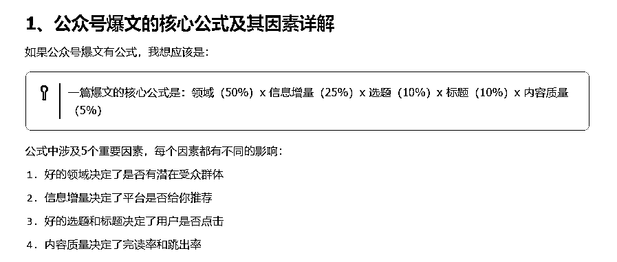

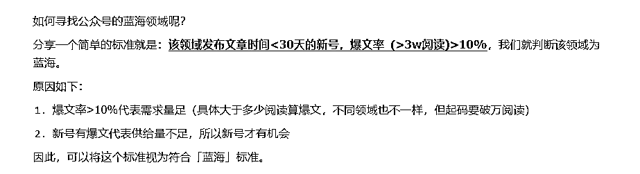

实际操作很简单：网页上打开公众号，自己下拉到想要的位置，启动脚本等待片刻就行。下面是我用它对“赚钱”做的检查：这个号主要是粉丝在读，点赞不低，但单篇阅读大多在六千到七千，没有特别出圈的爆款。按保守估计，一个月能有大几百块收入。再往下看，还有文章清单，日期、阅读、点赞、标题都在，可以直接拿来当写作参考。多测几个号，横向一对比，哪个赛道能赚、哪个赛道是坑，心里就有数了。

说实话，光这份赛道情报，拿去卖点小钱都不过分。

更重要的是，它能让心态稳下来。看到别人从零起号的全过程——哪天出爆款、哪天流量掉、坚持多久又起来——你就不会因为一时没阅读而焦虑。同时，对收入预期也有底，不会动不动相信“月入过万”的口号。

一位前辈说得好：一个号天花板太低，多开几个号才是正解。数据就在那里，不用争。

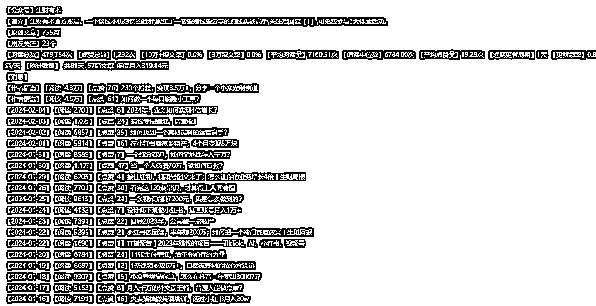

附：“赚钱有术”2月5日完整诊断报告。

## 二、囤素材：“公众号批量下载大师H6”

写之前要有素材库。常规操作是批量下载对标账号的爆文，拆解它们的写法。

可微信文章的排版五花八门：有纯文字的、有带图的、图片和文字穿插的，还有整段整段图片分享。普通自动化工具很难抓到统一的规则，经常卡在元素定位上。我绕了个弯，做成“标题定位+正文抓取”：脚本先找出页面里的标题，点击进入文章，再复制版面和链接，循环执行。最后把一个号的全部文章存进一张Excel表，还能把多个表合并起来，按阅读量排序筛选。

在电脑上打开公众号，下滑加载到目标深度，跑脚本，其他交给它。一个公众号一份表格，素材库就这么建起来了。

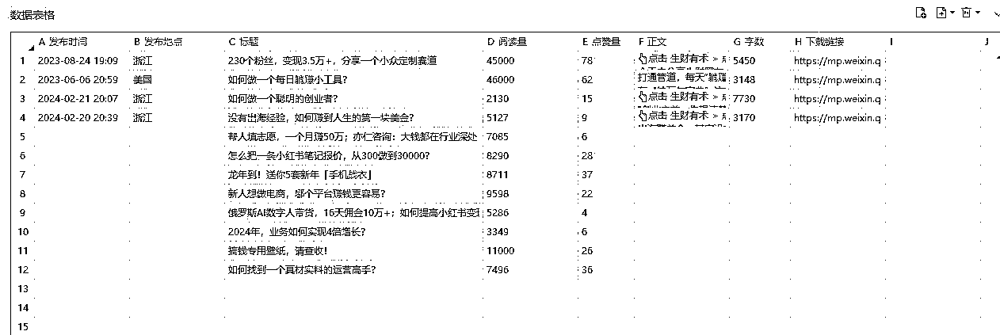

演示视频：https://www.bilibili.com/video/BV1qz421d7W5/

附件：采集赚钱有术公众号文章的效果。

## 三、挖蓝海：“看一看热点收集大师J1”

公开教案里给的赛道基本都被玩烂了，越晚进场越卷。想找机会，得学会自己探路。

谁最了解读者？微信。它每天用“看一看”通道告诉你答案。你在“看一看”里见过带“热点资讯”标签的文章吧？好多都是10万+，这些就是平台算法帮你筛出来的“大众兴趣点”。我的这个工具，能在后台默默刷新“看一看”页面，记录下所有带标签的文章标题和对应的公众号。等你忙完了，翻翻这份记录，找到潜在方向，再用前两个工具去评估，值不值得入场，数据说了算。

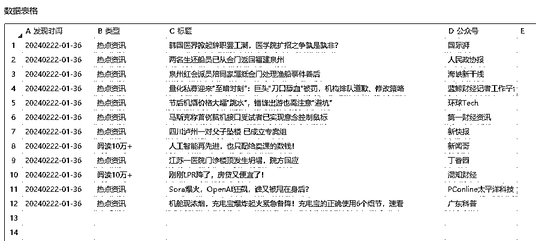

演示视频：https://www.bilibili.com/video/BV1qz421d7W5/

## 四、抓热点：“头条热榜测速大师J4”

热点要蹭，但不能瞎蹭。传统方法是看新榜、易撰这些榜单，可榜单只给排名，不给速度。我发现真正有爆发力的热点，不是排名最靠前的，而是传播速度最快的。

今日头条的榜单比公众号要早露出苗头，差不多领先半天。通常六小时之后，公众号这边才会热闹起来——你没刷到，只是因为平台没推给你。这个工具就是针对头条的：它按榜单顺序打开每一条热榜事件，获取总阅读量，找到最早发布的那一条，然后用“总阅读量÷（当前时间－最早发布时间）”算出流速。最终导出一张Excel，我习惯用流速排序，直接挑结果。

我就靠这个猜中了“谷歌杀妻案”和“梅西事件”的走红。

最近弄了个小群，每天定时同步热点情报，有兴趣的可以来找我。

演示视频：https://www.bilibili.com/video/BV1t1421Z771/

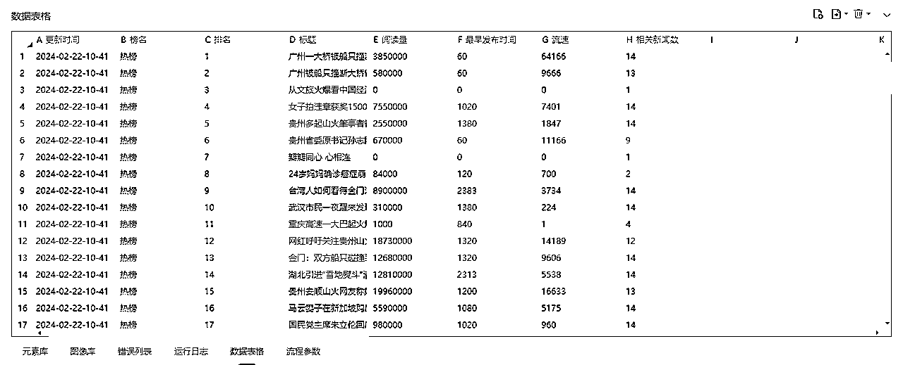

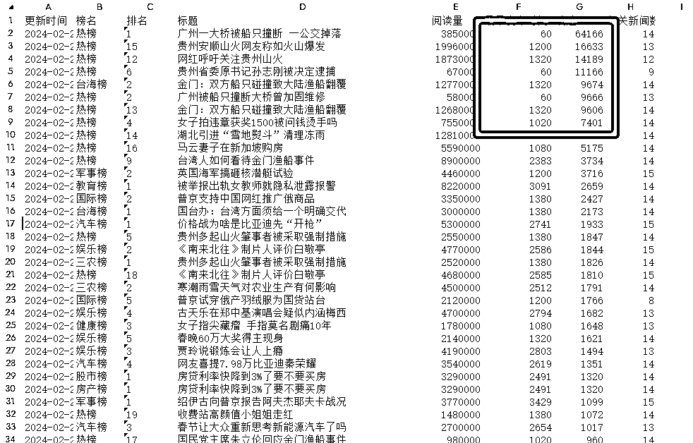

附：2月22日10:58头条热点采集数据表。

## 五、看趋势：“微信指数跟踪大师H4”

微信指数这个官方小程序，能看到关键词的热度走势，相当于读者需求的温度计。数据每天中午更新，反映的是前一天的情况。

我的脚本会读取表格里的关键词，自动查询并保存指数，生成文件放桌面。你可以把它当“昨日赛马”看，哪个词在冲高、哪个词在下跌，一目了然。不过这个指数更多受视频号影响，对公众号只能当大盘参考。要是你在做视频号，它的参考价值会更高。

演示视频：https://www.bilibili.com/video/BV1Jz421R73E/

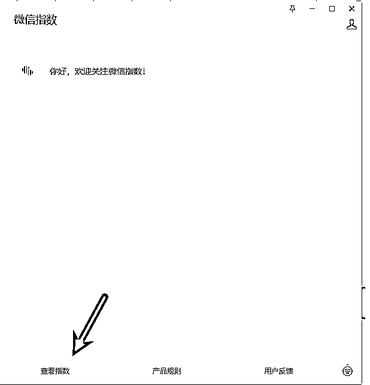

附：跟踪结果文件。

## 六、截爆款：“爆文测速大师H9”

每天最烧脑的就是选题。蹭热点能带来短时爆发，但可遇不可求。选定一个垂直领域稳扎稳打，又考验持续输出能力，一般人撑不过两星期。

那些让你“洗老爆文”的招数，听着像捷径，实际上那批文章早被翻来覆去抄过几百遍了。想再榨出点新东西，成本太高，命中率太低。

我的办法是：盯住同赛道的三五个对标账号，每天采集他们的新文章，计算流速。一旦发现某篇增速异常，那就是新爆款的苗子。之后的事，不用我说了吧。

这个工具会按照你给的账号名单，自动查询发文记录并统计流速，最后把结果做成Excel放到桌面。所以，别随便公开自己的号或文章——你不知道黑暗森林里有多少猎手正在盯你的数据。

说句得罪人的话，我还真拿三个公众号做了测试，结果如图。

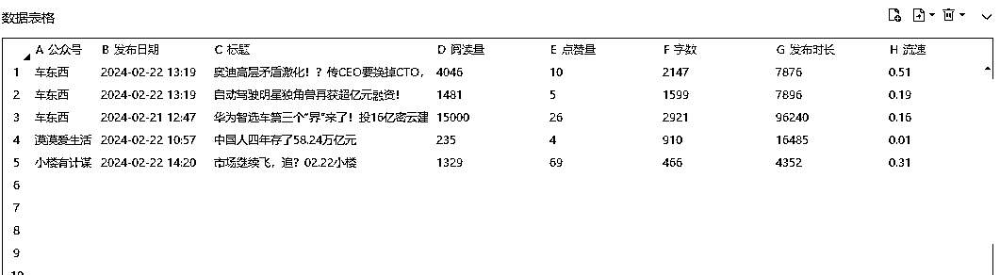

流速到底多少算及格？看赛道，看多了你自然有直觉。

附：最终测试结果文件。

## 七、挖需求：“下拉词需求挖掘大师G5”

题材定了，还得知道读者到底关心什么。最简单的办法就是看搜索框下方的下拉提示词——那些词是平台根据真实用户搜索行为聚合出来的，每个词背后都是一个关注点。

这个工具能把一级、二级下拉词都抓下来。你不需要全部写，挑前几个高相关词去展开内容就行。微信里搜出来的词，反映的就是公众号读者群体。想更稳妥，就扎根在微信生态里找答案。抖音、小红书也能这么做，但得先确认受众画像是不是同一拨人。

拿“沥心沙大桥”举例，围绕用户高频搜索的那些点来写，自然能吃到搜索流量。

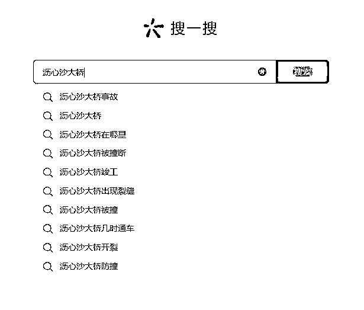

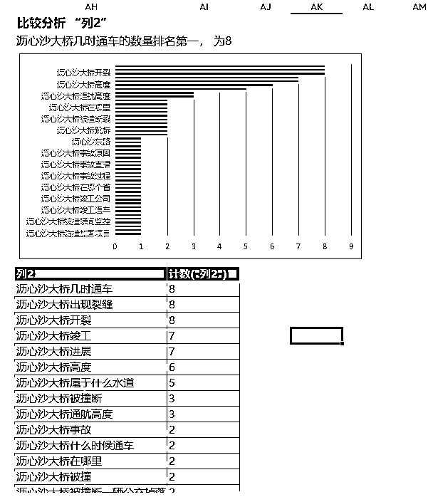

## 八、选标题：“标题测速大师H9”

内容不错还要有个好标题，否则没人点进来。大号随便起个名就能爆，咱们这种小号起不好直接沉底。

标题从哪来？从当天同类话题的热门文章里找。用这个脚本，打开微信搜索结果页，它会自动列出每篇的标题和阅读增速。同样是1万阅读，有的只用1小时，有的花了一整天——前者明显更能打。按增速降序排，再把大号滤掉，留下的就是低粉靠标题实力的“胚胎”。

老话说，每分钟涨200阅读就可以算小爆款。拿到这些胚胎，再用“开门见山+情绪钩子”的方式改一版，爆款标题手到擒来。

拿“沥心沙大桥”做了一次演示，下面就是跑出来的榜单。顺便说一句，那几个号都是得罪了，有怪莫怪。

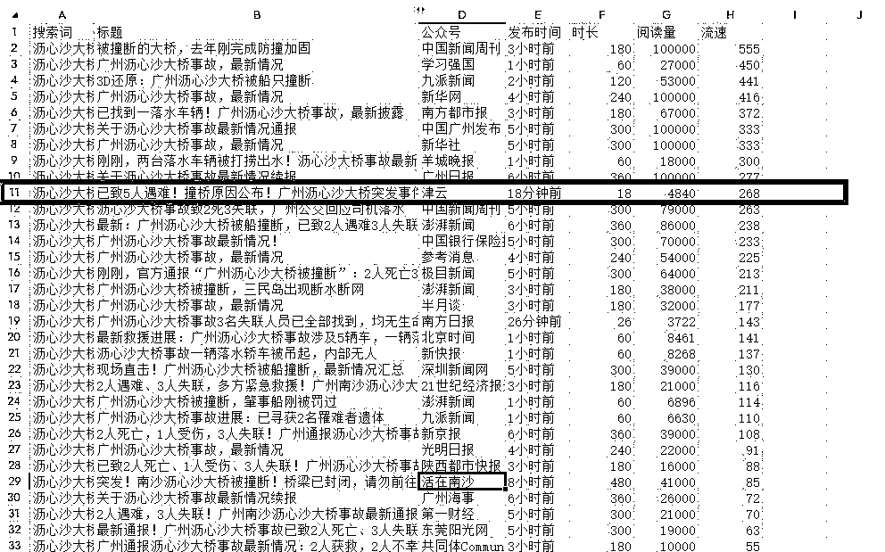

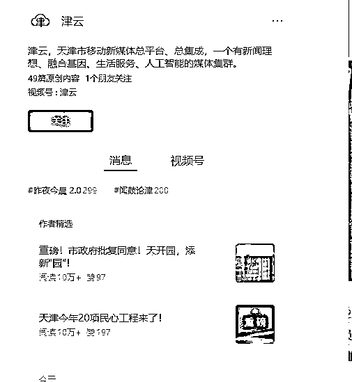

## 九、让GPT帮你原创：“采提洗一体姬G9G11G12”

很多人问：怎么提高原创度？圈里有个“拼接法”：拿两篇以上同话题的文章，找出它们相同的核心论点A，但各自有不同的论据B和C。把B+C喂给GPT，让它围绕A重新写。写到一半还能调整逻辑顺序，比如原文先因后果，那就改成先果后因。这一通操作下来，基本就是你的原创了。

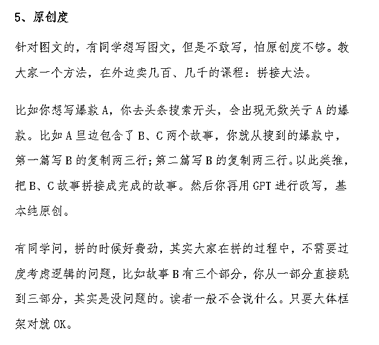

再说“深度”。深度说白了就是信息增量：别人写到1，你写到2。比如某篇稿子说某明星心梗去世，你顺手补上防心梗的注意事项；或者你找到他父亲也有心脏病史，这就是增量。能给出别人没有的观点更好。

基于这个思路，我把“采、提、洗”做成了三条流水线：

采：先去多端搜同话题文章。现在支持微信电脑端、今日头条网页/App、小红书网页端，也可以自定义采集源。这一步除了抓标题和正文，还能去水印、做基础去重。还记得前面那个下拉词工具吗？先拿它确定“值得写”的切入点。

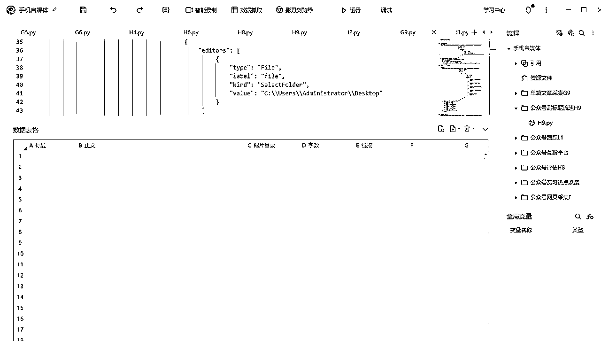

提：用GPT把文章做拆解。我会给它明确指令：分段总结中心论点、列出支撑每个论点的论据、保留人名、时间、金额、职位、对话和具体数字等关键细节。这里有个小窍门：监听GPT网页版时，发送按钮在生成期间是灰色，写完后是黑色。用这个状态变化判断“写完了”，比傻等固定时间要稳定得多。有了它，就能全自动批量跑完所有拆解。

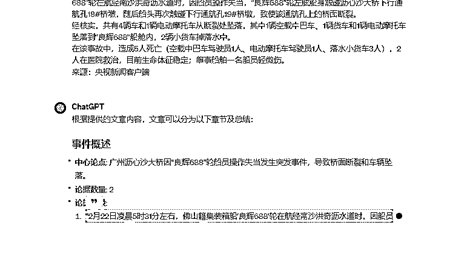

洗：把拆出来的论点和论据丢给写作机器人，分段重新表达，再合并成一篇文章。然后丢到5118过一遍敏感词，再用公众号排版工具生成样式。整个创作流程到这里就完整了。

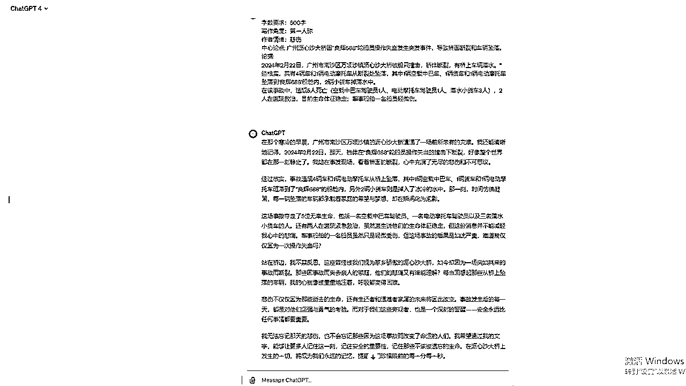

## 十、让GPT有温度：“情绪写作法”

调prompt像炼丹，得一遍遍喂、修正、再喂、再修正。没有最好，只有更好。我这边有一套“情绪输出”提示词，能让GPT写出有温度、有态度的文字，而不是冷冰冰的说明文。具体内容可以在交流时分享。

## 十一、做基础数据：“互阅平台刷分大师K2”

新人最怕零阅读。我试过最笨的办法——自己到处转发，根本没用。后来发现有一种互阅组织，说是上万运营者互相帮忙：你读别人的文赚积分，再用积分请别人读你的文。你不帮我，我不帮你，就没有人帮你。

这类平台确实能把数据做起来。有积分就能换阅读量，还能花积分请人点“在看”。一旦“在看”多了，平台就会把文章推荐给更多可能感兴趣的人，滚雪球。

问题是积分也要靠“认真阅读”来赚：要读满10秒，拉到底，还得把当前阅读量回填给平台。人哪有这闲工夫。这个工具就是替你干这些事的：自动打开文章、计时、回填、领积分，挂机就能刷。积分自由以后，你想给自己做什么数据都行。

演示视频：https://www.bilibili.com/video/BV1um411Q7J1/

## 写在最后

以上这些，就是我去航海一个月攒下的成果。公众号写作我会继续搞下去，还会继续挖更深的东西。

对我来说，运营公众号不是算命。它是可量化的数据，是一个个能落地的动作。每一个决定都不靠感觉，而是报表告诉我该走哪条路。爆文靠的不是运气，是数据流。

另外，平台开始打击AI洗稿，我举双手赞成。我不希望RPA变成洗稿工具，它应该有更大的想象空间，也应该有人去教更深层的玩法。

对这套公众号打法感兴趣，或者想学影刀RPA开发，都可以来找我。

另外，我想找一位小红书导师，带徒赚钱的那种。咱们可以一起开发新工具、共享成果，比如下面这个：

## 彩蛋：“小红书评论采集器I2”

曾在赚钱圈子里看到有人呼吁做评论采集，说是能从评论区里挖出用户需求。可市面上的成品极少，大家只能人肉复制，网页端还有折叠和异步加载的难关。在手机上做反而更简单。工具我写好了，但还缺运营高手来用它。真想找个懂行的人一起玩。

最后，感谢毛韩教练和徐言随谈两位前辈的文章，也感谢这次航海的教练和领队。

来聊：rio0235