# 风向标拆解第 3 期--传统制造业如何通过抖音矩阵化＋SEO优化获客--大路边的西瓜

> 来源：[https://j7z5rfbqyp.feishu.cn/docx/DY0qdpnfdomTBXxPzEIcu3vMnRg](https://j7z5rfbqyp.feishu.cn/docx/DY0qdpnfdomTBXxPzEIcu3vMnRg)

大家好，我是大路边的西瓜

# 前言

1. 很荣幸能入选风向标第三期的拆解名单，本期我选择的案例是：传统制造业借助抖音矩阵化运营结合SEO优化实现客户获取。
1. 近期我盯上了一个抖音带货号，做的品类很垂直很小众，但利润非常漂亮，三年多时间变现已经突破500万+

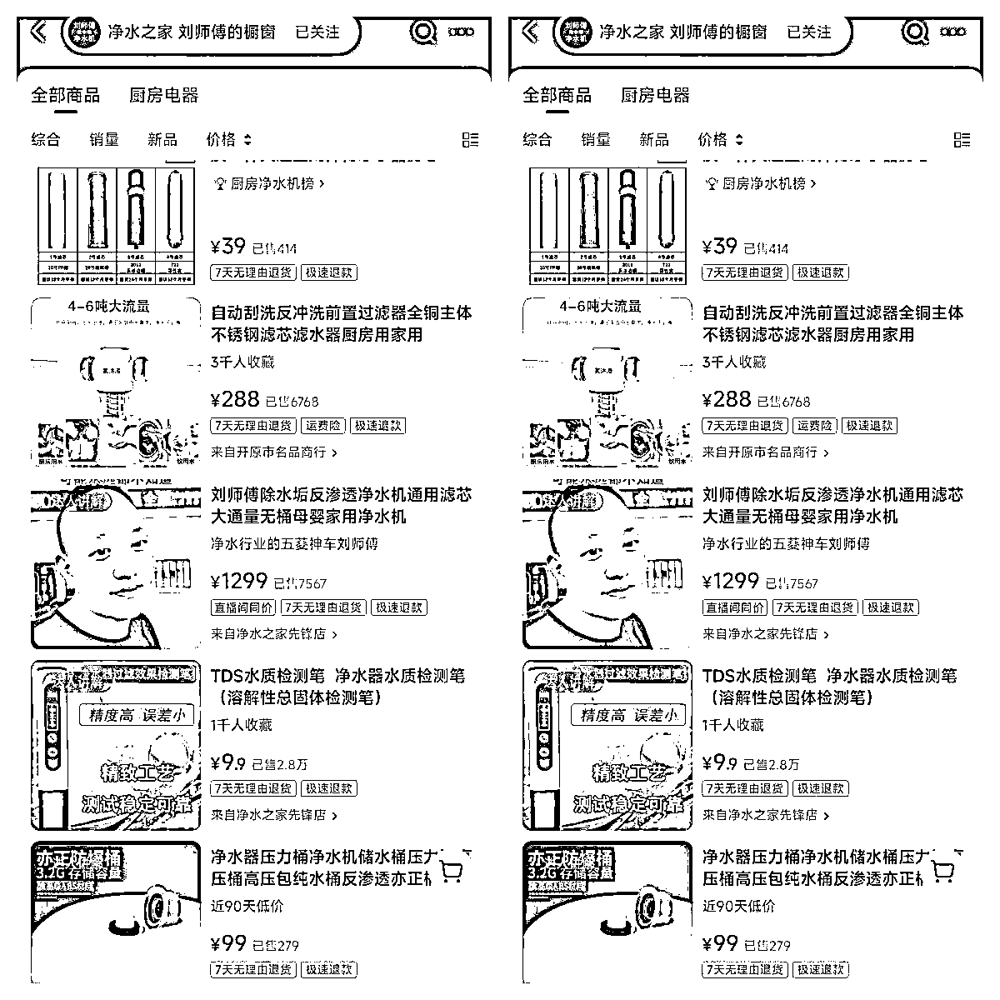

1. 这个账号从起号到现在时间不到四年

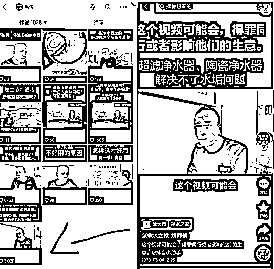

# 1 ：项目前景分析

【据尚普咨询集团数据显示】2023年全年全球净水器市场规模将达到1400亿美元，中国净水器市场规模将达到300亿元。目前，净水器行业竞争激烈，技术创新和品牌建设是企业的核心竞争力。未来，净水器行业将面临更高的环保标准和消费者需求，同时也将迎来更多的市场机遇和发展空间。（项目本身属于比较小众，很多大佬看不上）

*   制造业小众项目的特点：

*   竞争压力小，利润空间可观

*   内容创作容易出现审美疲劳的程度较低

*   痛点1：需要靠直播来成交，直播转化率高，但要懂点净水器知识，

*   痛点2：售后环节需要花心思处理（可以外包给第三方，后续会讲）

# 2：如何在抖音起号获取流量

研究下来，这个号的核心打法就是紧扣大众痛点做录播文案，持续输出，不论表达是否完美，每周稳定上传3-5条短视频，同时开启直播，每周3-5场，状态好的时候甚至每天播。这个号20W+粉丝，我观察他快一年了，直播频率很高。

本人出镜负责拍摄和直播

### 录播：内容怎么做,以下是对标账号

*   揭秘进水器行业的秘密

*   净水器的坑你知道吗？

*   千万别乱买净水器浪费钱

*   超滤机解决不了水垢问题

*   我复盘了他大量作品，核心素材就十几个来回用，最多就是微调一下文案再拍一遍“说白了就是重复做内容”坚持就是胜利

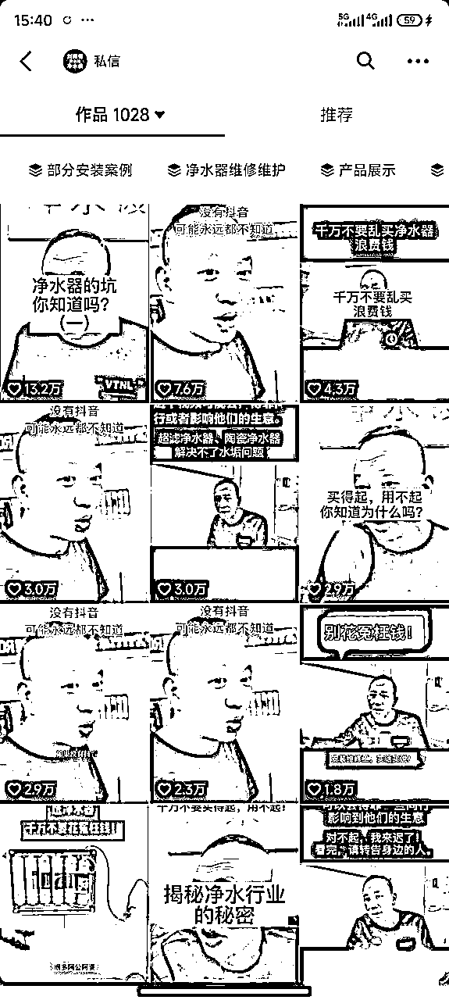

#### 如果你是个门外汉怎么挖掘客户痛点做标题和内容？

1：直接抄同行爆款视频的文案做二次创作，自己改改再重复拍

2：当然也可以用当下最火的AI来助力，给指令它就帮你生成

3：下面是我让AI生成的10个标题供你挑选使用，没让它一次性把内容写完，因为先出标题再补内容的效果往往不理想，还需要优化指令。

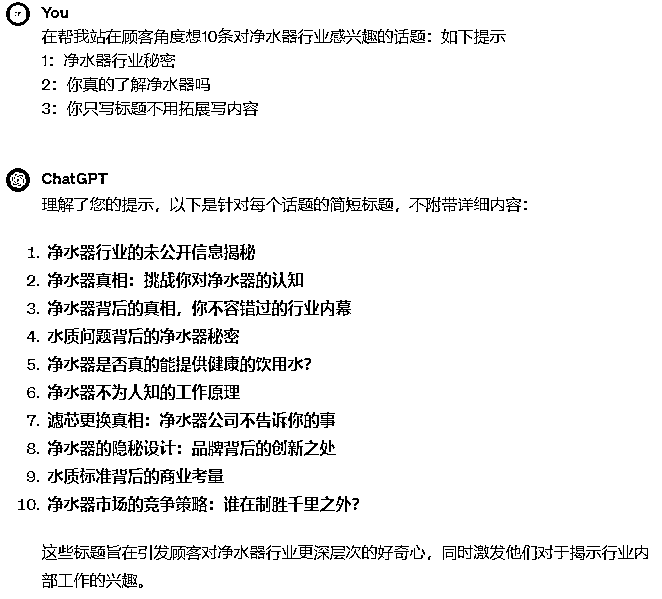

4：用AI生成标题后不断优化指令，内容质量就上来了

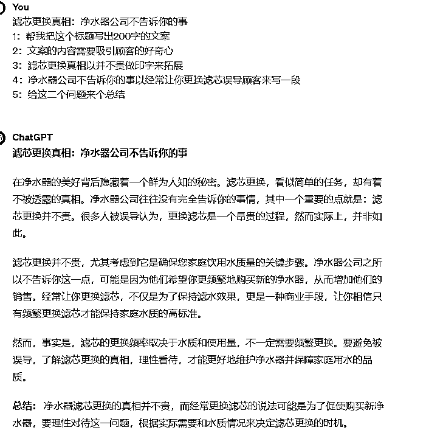

### 直播：

1：需要的基础专业知识其实很有限，无非就是视频标题里出现的那几个常见问题，直接把他的视频当成FAQ清单抄下来边拍视频边直播边学习就够了。我记得他刚发第一个视频时说得磕磕巴巴，底气也不足，隔了好几天才继续，后来他的视频给我的感觉就是“底气十足，说话很笃定”，这样很能推动用户下单。

2：直播只要多练就行了，（我自己也没播过）

# 3：构建产品壁垒

1.  贴标之后他的产品就有了独特性

1.  分析：据我了解刘师傅的净水器是贴牌OEM产品，也就是找常规净水器厂家代工，

1.  唯一的区别是机器上定制了他的品牌名“刘师傅”，这个玩法你也可以复制😂，

1.  看图，机器本质一样，只是多加了几个字。

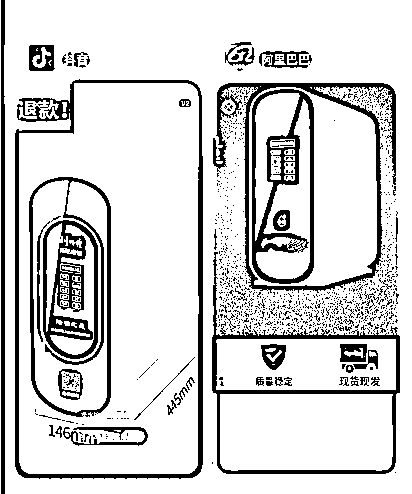

## 商标要注册吗

*   目前还没查到刘师傅商标被注册，我就不展开了“自己脑补一下”

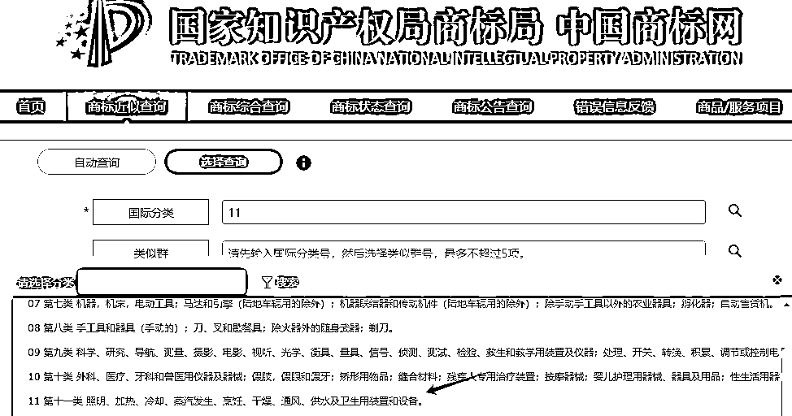

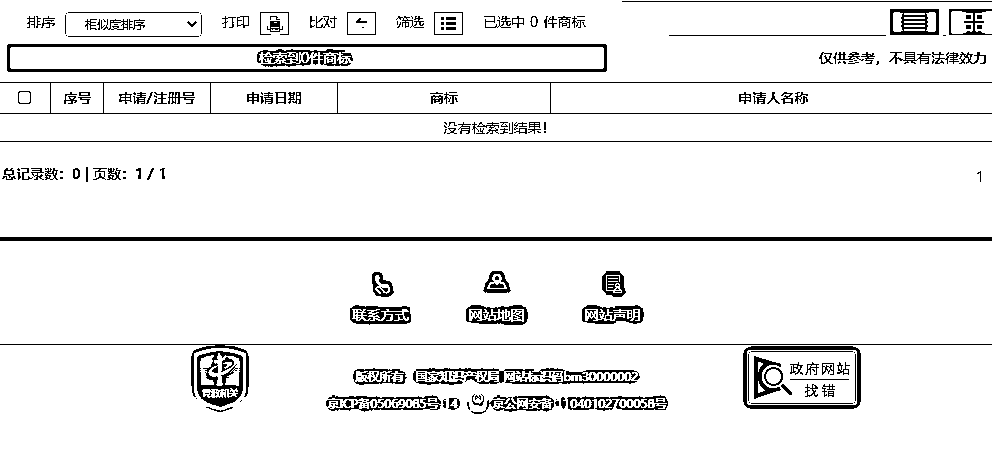

## 该怎么做

*   直接去阿里巴巴找厂家，询盘问能不能定制或者帮忙贴牌，抛出你的想法给对方发挥空间，大部分厂家都愿意合作，其实不用画大饼，有需求厂家就乐意接单

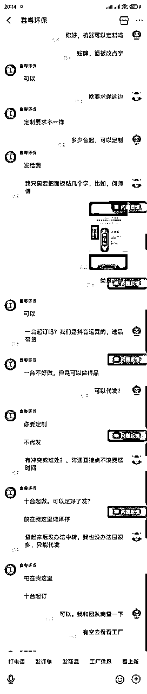

# 4：变现分析

*   总共围绕净水器做了5个变现品，买了净水器后每年或半年就要更换滤芯，自带长尾收益。

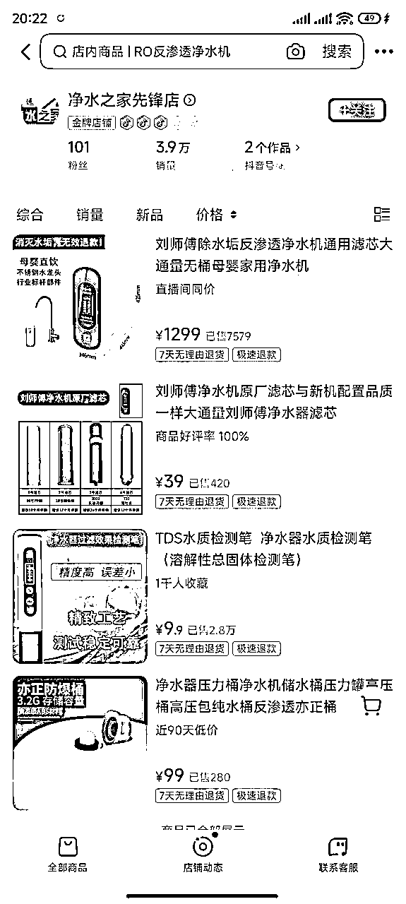

*   流量结构

主要靠粉丝和自然流量，几乎没有投放广告

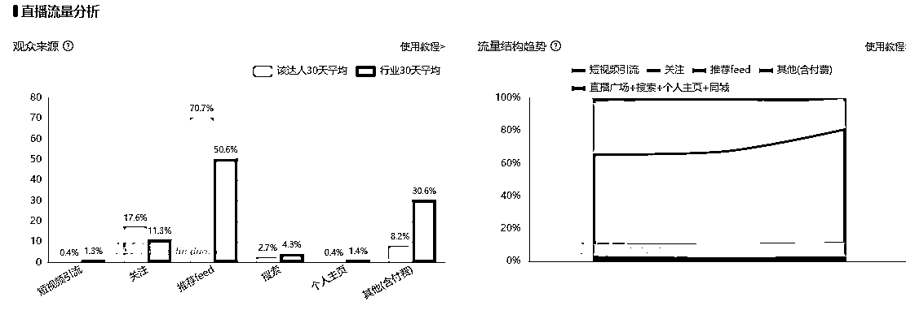

## 品1：刘师傅净水器利润分析

*   用户自装发货价1299

*   师傅上门安装发货价1399（贵100块就能享受上门安装，很划算）

*   按阿里巴巴采购价算，一台机器拿货约570元，运费50，量大还能议价

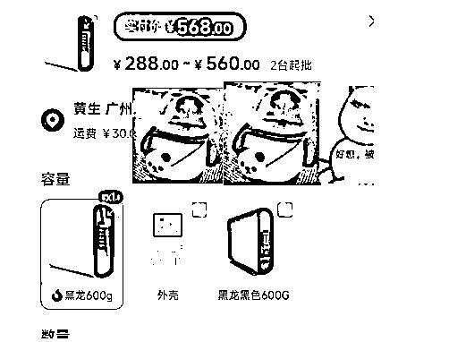

*   按保守估算1299裸机邮寄，1299-570-50＝679*7579=5146141

## 品2：刘师傅净水器原装滤芯

*   原装滤芯套装

*   1，2，4，号滤芯售价79（成本40包邮，性价比很高）

*   3，号600G RO滤芯售价199（成本120包邮，一线品牌水准）

*   整套售价269（成本160元包邮）

*   这里按单品毛利100元估算，420*100＝42000

## 品3：TDS水质监测笔

*   这个是9.9的引流款，单只拿货4.5元不包邮，6只起包邮

*   9.9包邮基本是打平引流

## 品5：净水器压力桶

*   这个是增压压力桶，拼多多43包邮拿货，利润56

*   利润580*56＝32480

# 5：间接接单赚钱的机会

不少企业主看完他的视频会主动找他上门定制办公室直饮水、工厂直饮水，这类订单并不少，利润比零售净水器更高，从他视频里就能看到他上门定制的案例，售后维修、滤芯更换等等都是增收点。

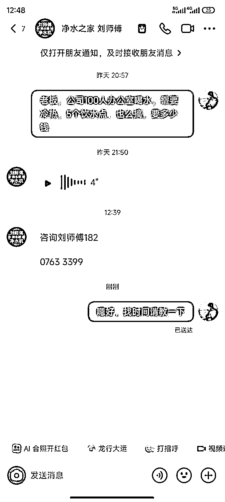

# 6：机器安装怎么解决

*   做这个项目大概率需要上门安装，客户遍布全国甚至港澳台

*   很简单对接第三方服务平台比如“骑兵到家，师傅来了”等平台

*   百度搜索“净水器安装平台”即可，订单量上去后对方会给你配备专属客服，完全不用自己操心

# 7:做这个项目需要几个人？

*   复盘他的账号基本是一人运营，再配一个客服对接发货厂家和第三方售后平台，

*   目前主号在持续更新，另外两个小号已经陆续停更

*   8:我是去年四月加入赚钱的，目前兼职做了几个项目，变现大概2W左右，现在在试水公众号爆文，同时学习AI工具和RPA，有空就去赚钱打卡，确实学到了很多东西，提升了认知，拓宽了视野。第一次写这么长的拆解，逻辑可能不够清晰请多包涵，感谢赚钱，感谢圈友。