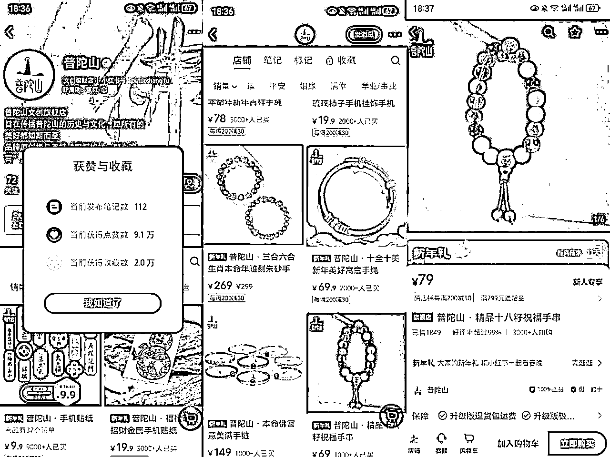
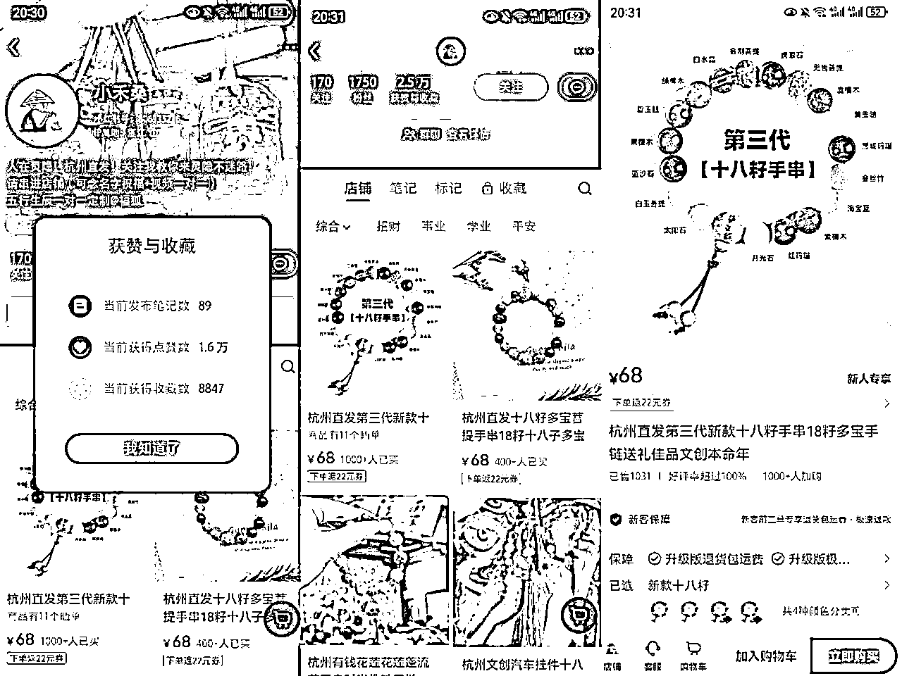
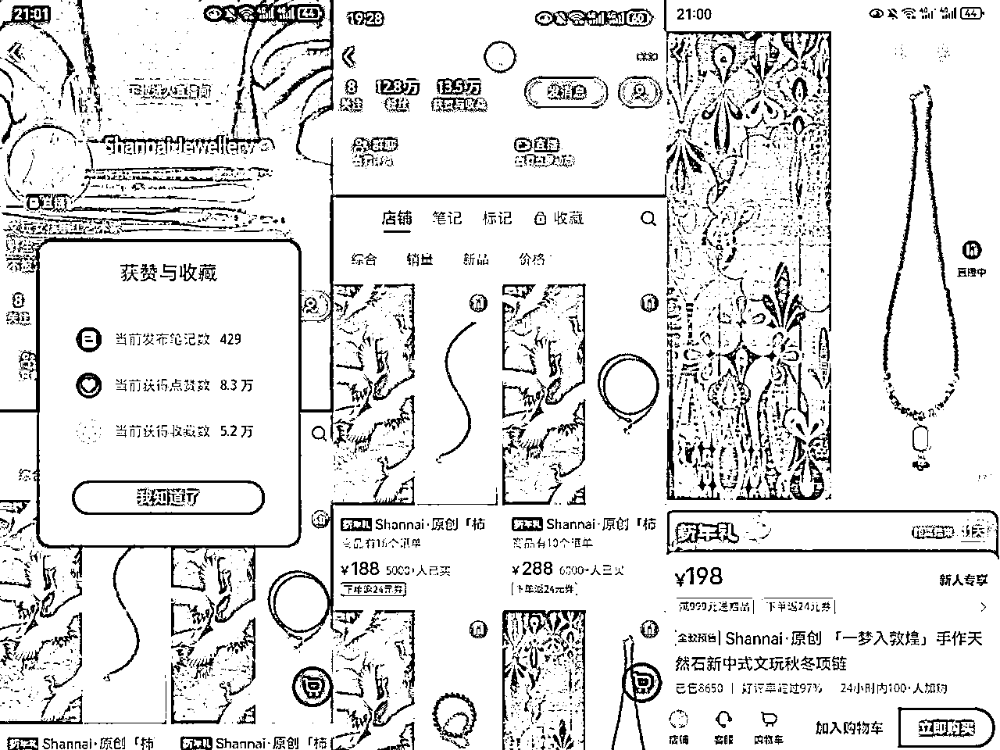
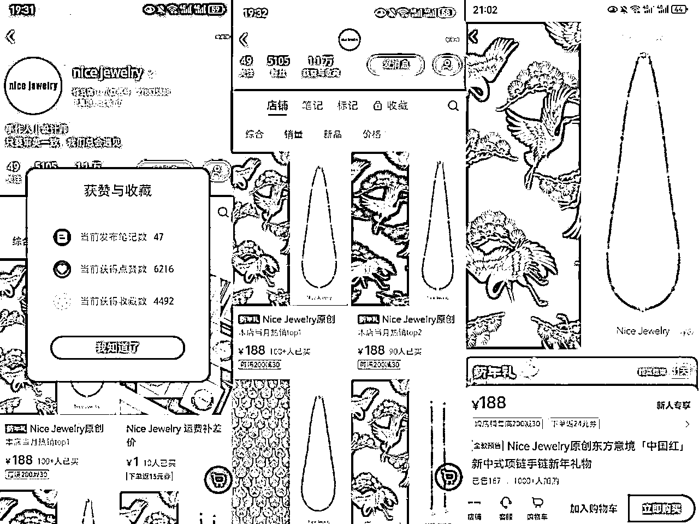
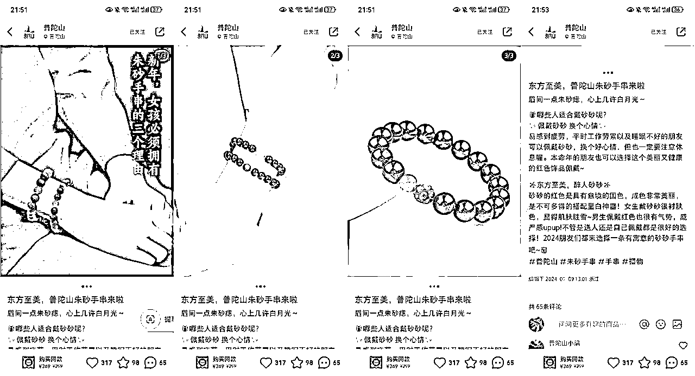
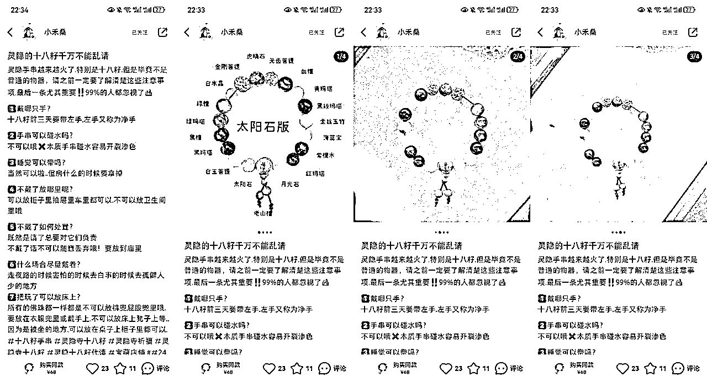
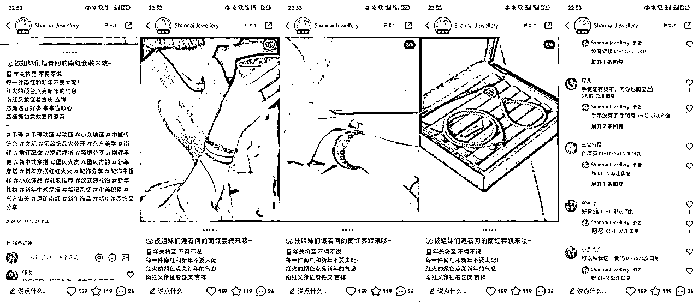
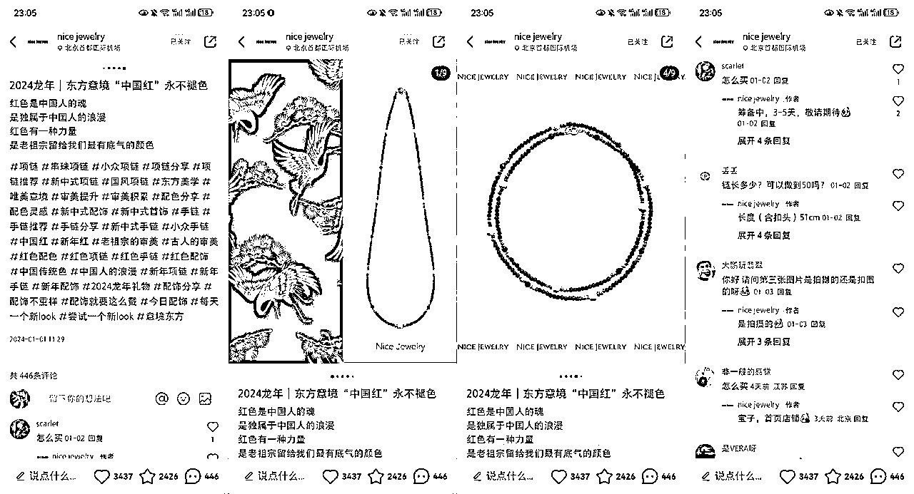
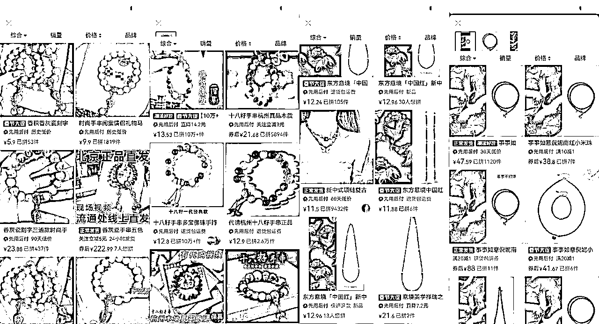
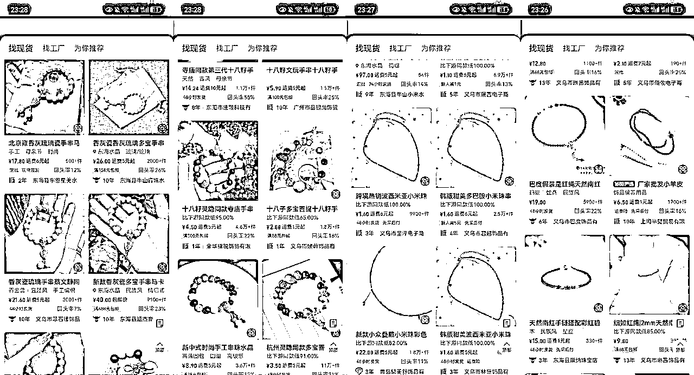

# ('风向标拆解第 3 期--雍和宫手串、灵隐十八子，小红书高销售量手作饰品都是怎样的运转逻辑', (2, 46))

小红书高卖的手串饰品到底怎么玩？风向标拆解第3期

最近收到一个有意思的选题：雍和宫手串、灵隐十八籽这类自带“玄学滤镜”的产品，和纯手作饰品放在一起聊。但其实它们并不完全是一回事，运营打法有些相似，可底层卖点完全不同。前者卖的是精神寄托和信仰安慰，用户买的是一份“被庇佑”的踏实感；后者卖的是独一无二的审美和个性，用户要的是“不撞款”的底气。所以这次拆解我特意把两类分开讲，方便大家对比着看。

先看几个典型账号。

走玄学路线的有两个：

普陀山，企业号，2023年8月开始起号。初期靠50条手串抽奖积累人气，配合分享普陀山拜观音的攻略，慢慢过渡到十八籽带货。销售链路是图文/视频笔记挂车+直播，属于比较完整的打法。

小禾桑，个人号，2023年5月启动。没有复杂的引流动作，直接站在“送礼”的角度发图文挂车，简单直接。

手作饰品阵营也有两个：

Shannai Jewellery，企业号，2023年7月启动。靠手作饰品的美图笔记直接带货，同时搭配直播承接转化。

nice jewelry，企业号，2023年12月才起步。同样是靠手作饰品笔记直接带货，目前只用纯图文挂车，两个月不到也卖出了350多单，利润空间相当可观。

为什么选这四个？一来它们都是近半年左右新做起来的账号；二来企业号和个人号、日更堆量vs精耕细作、纯图文vs图文+直播，维度都覆盖到了；三来爆款套路简单，普通人照着学也能上手。

流量运营上，各自有各自的门道。

普陀山的笔记内容基本围绕普陀山文化、礼佛规矩、参拜路线、手串佩戴讲究展开；更新节奏看似每天都发，其实不固定，数据不佳的笔记会被悄悄删掉。发布时间同样没有章法，早10点到晚10点都可能出现。笔记结构是：先来一段讲解文字，再配上3到4张图，前两张展示上手效果，最后一张给特写。直播一般固定在晚上7点或8点开播，近3个月累计做了60场，把“佛系流量”接得很稳。

小禾桑是把科普做成了壁垒。笔记内容涵盖手串的构成、功效、真假辨别、佩戴保存方法和禁忌；三天更新一次，发布时间也随意。笔记结构是“文字+4张图”，第一张把每颗珠子的名称标出来，后面三张都是特写。另外还会发20秒左右的视频，专门对比真假十八籽，帮助大家避坑。

Shannai走的是“轻文案+重颜值”路线，内容只有简洁的手串解读、搭配场景和一点鸡汤；每天更新两篇，发布时间看心情。笔记结构是祝福文案配上5到7张图，既有上手图，也有套装图。直播基本在上午11点或下午3点开播，近3个月播了91场，一场能播9到13小时，真的非常拼。

nice更极致，文案只有手串寓意，一句多余的话都没有。更新频率1到2天一篇，发布时间不固定。笔记结构是祝福文案加5到9张图，首图很有辨识度，左边一幅画+手串拼图，后面全是手串特写。

产品端怎么解决？无非三条路：平台合作中心选品、自有供应链、无货源。上面的案例都开了自己的小红书店铺，多半是自有供应链或无货源。对普通人来说，无货源门槛最低：去拼多多或1688搜同款，和供货商把拿货价、快递、售后、素材都谈妥，然后在小红书开店上架就行。

价格差是这门生意的灵魂。同样一串雍和宫手串，拼多多10块上下，1688也才20上下，小红书能卖到300左右；十八籽拼多多13左右，1688只需10左右，小红书卖70到200；手作饰品拼多多12到40，1688只要2到20，小红书直接定到188到500。

算一笔利润账：普陀山定价49到2188，销量3.8万+，按销量较多的中位数88估算，销售额334万+，利润率约240%，整体利润约240万+；小禾桑定价38到238，销量1500+，按中位数68估算，销售额约10.2万，利润率250%左右，利润约7.5万；Shannai定价128到818，销量4.5万+，按中位数198估算，销售额900万+，利润率约900%，利润约810万+；nice定价88到368，销量350+，按中位数188估算，销售额约6.58万，利润率约900%，利润约5.6万。数字只是粗略估算，但量级足够说明问题。

项目具体怎么做？先把品选好，用图文笔记打出爆款，然后选择分销、开店铺或直播带货；接着搭建矩阵账号，多号协同放大流量；最后再配合聚光投流，把收益天花板进一步抬高。投流细节赚钱有术里已经有很多大佬拆解过，直接搜索就能找到。

最后聊聊结论。

第一，这几个账号都是半年内从零起步，粉丝过千就能跑出成绩，说明手串饰品赛道目前还有机会，门槛不算高。

第二，纯靠图文/视频带货，和直播带货的差距可以说是天壤之别。普陀山的GMV是小禾桑的31倍，Shannai则是nice的143倍，这种倍数关系夸张到让人无法忽视。所以，有条件的话，一定要把直播用起来。

第三，产品包装要花心思。多参考头部爆款的视觉风格，做出统一的品牌调性，这样才能从一堆无货源产品里跳出来，转化率也会明显提升。

以上，祝圈友们赚钱有术！