# 七日五万加：海外数字人从翻车到回血的实操复盘

> 来源：[https://pe3zzbrwvl.feishu.cn/docx/FaQGdRHSBoMgH0xhwTEcXcSHnEh](https://pe3zzbrwvl.feishu.cn/docx/FaQGdRHSBoMgH0xhwTEcXcSHnEh)

大家好，我是Pony。去年加入赚钱后基本就是潜水状态，一年多几乎没有存在感。这次鼓起勇气，把过去七天跌宕起伏的实操全盘摊开。

我性格比较内敛，不擅长张扬，习惯躲在角落默默做事。朋友圈很小，思路也容易受限，之前想突破却找不到抓手。进入赚钱后视野被打开，机会像潮水一样涌来，却因大佬众多、玩法繁杂一度迷失。参加过不少航海，小项目能回本，大结果一直没出来，自信心被反复打击。曹大的直播是我精神续航，曹大曾讲过，国外有位大哥财务自由前试了上百次才命中几次。连前辈都要经历大量试错，我这种普通人又有什么好怕的？于是我给自己定下百次试错的容错空间，哪怕只中一次也足够改变轨迹。

说干就干。我像泡自习室一样泡在赚钱里，梳理精华帖、中标案例和航海回放，做笔记后锁定了俄罗斯美女数字人这条赛道。选它有三点考量：

1. 数字人制作流程上手快，自己能独立完成；
2. 我学的是英语，长期接触境外人群，对外国人在国内生活的心理有一定体感；
3. 之前做过几年代购，赚钱里流传的俄罗斯美女带货变现路径正好契合我的经验。

我的初始打法是这样的：
人设：塑造一位热爱中国文化的俄罗斯数字美女，触达中老年群体的爱国情绪，输出情绪价值后再引导转化。
商品：俄罗斯进口零食与日用品，糖果、巧克力、饼干、蜂蜜、奶粉、火腿等。
呈现：不做AI换脸以避开法律风险；真人手工发布，不露脸，只做商品讲解。

这个思路来自圈友的分享，逻辑清晰、落地性强，我就开干了。

先备了两台二手红米，总价五百块搞定，再注册两组微信号。其一按视频号带货航海手册把视频号建好，完善资料后开始备内容。话术很容易搜集，视频号、抖音、快手上随处可见，赚钱帖子里也有整理，我先备了十篇。

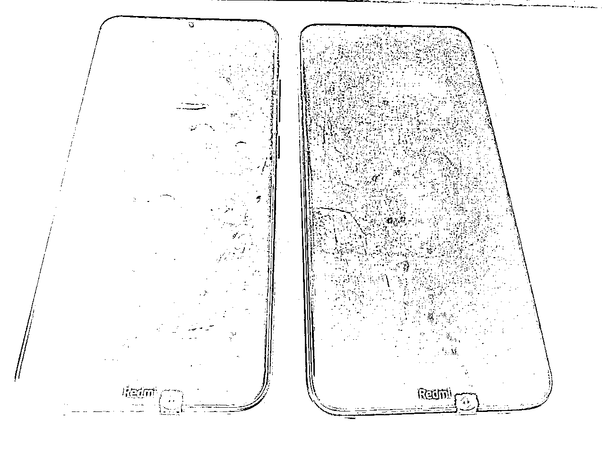

话术有了，下一步是人物素材。圈友建议去油管、TikTok、VK找。我全跑了一遍，TikTok模型多但大多带字幕和剪切；VK网速不佳，收获有限；最后落到油管。油管内容量庞大，锁定英语学习和真实访谈两类，英语学习类更易复用。最终挑了两个可用片段，用圈友推荐的AI人脸替换工具和wav2lipV11做了初步模板。

工具清单：
AI人脸替换工具：百度网盘链接：https://pan.baidu.com/s/1t9lS3JJx9J01uVrft5m7mA?pwd=lq2l 提取码：lq2l
wav2lipV11：夸克网盘链接：https://pan.quark.cn/s/1b71a99ab4e5 提取码：ABAx

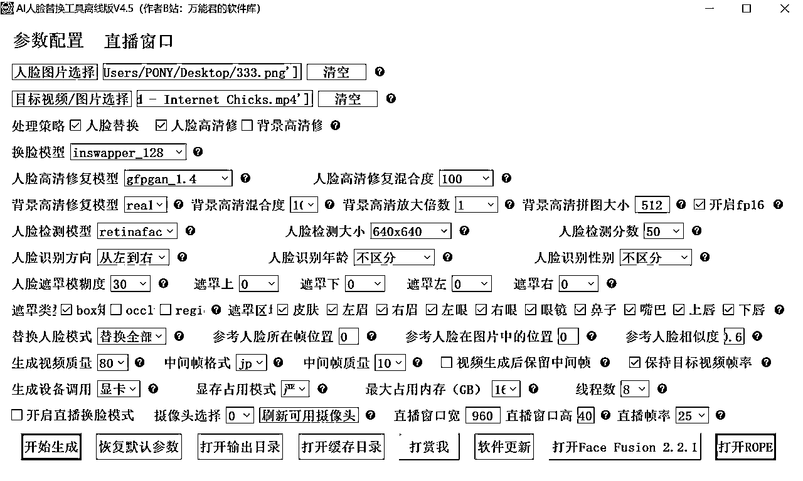

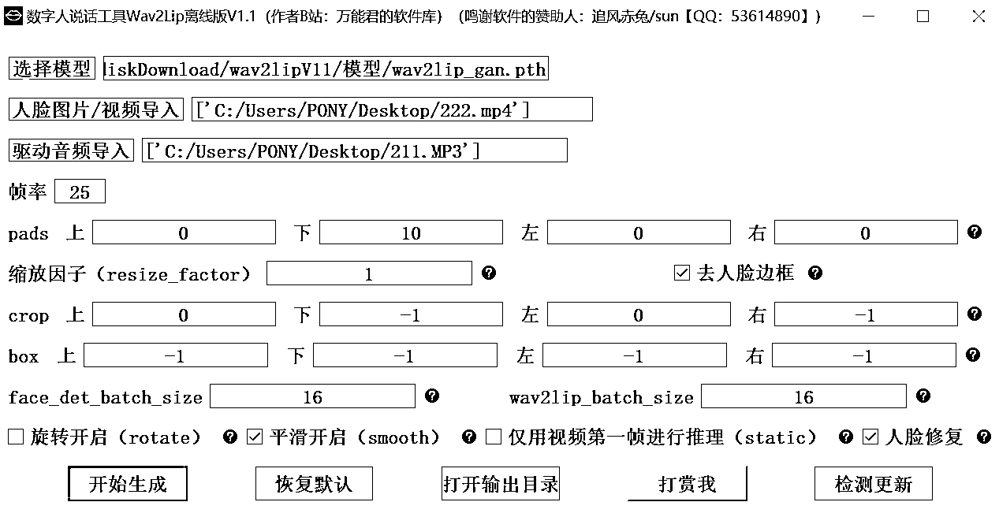

最难的是数字人合成。Heygen以前可多邮箱白嫖，现在限流严格了。用WebRTC Control插件加Outlook邮箱才完成注册，可定制数字人仍需付费，官网价格偏高，淘宝也有十五分钟一百二十块的服务，对流程未跑通的我来说太贵。于是继续找平替，试过腾讯智影、DID和一堆海外平台，效果都不理想。最后找到一个可完全替代Heygen的平台——Anylang，但注册门槛极高，反复尝试后才跑通。可以看到市场有多热，抖音、快手、视频号、小红书全是海外美女数字人带货，因平台反薅机制严，账号和定制成本不低，倒卖账号本身也成了风口。

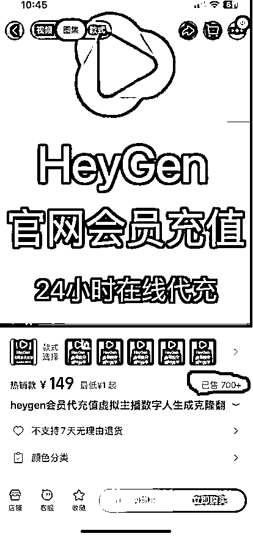

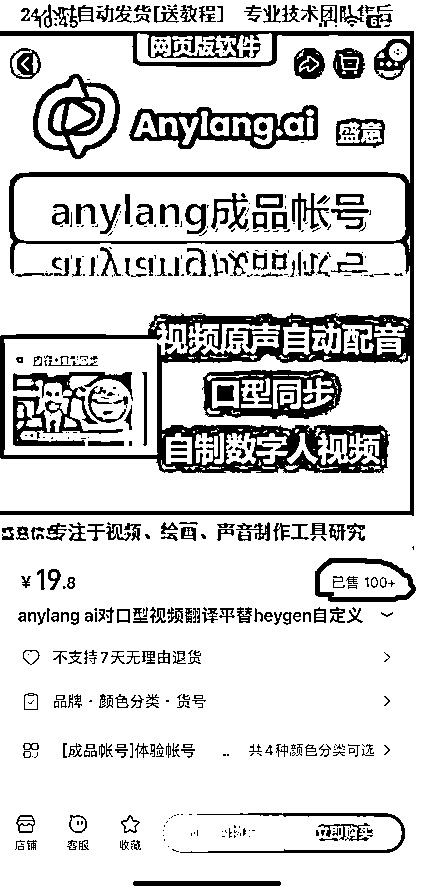

下面把Anylang的实操整理出来，市面标价一千九百九十九，这里只在赚钱分享：

1. 打开官网登录页：https://app.anylang.ai/login，选择sign up with email
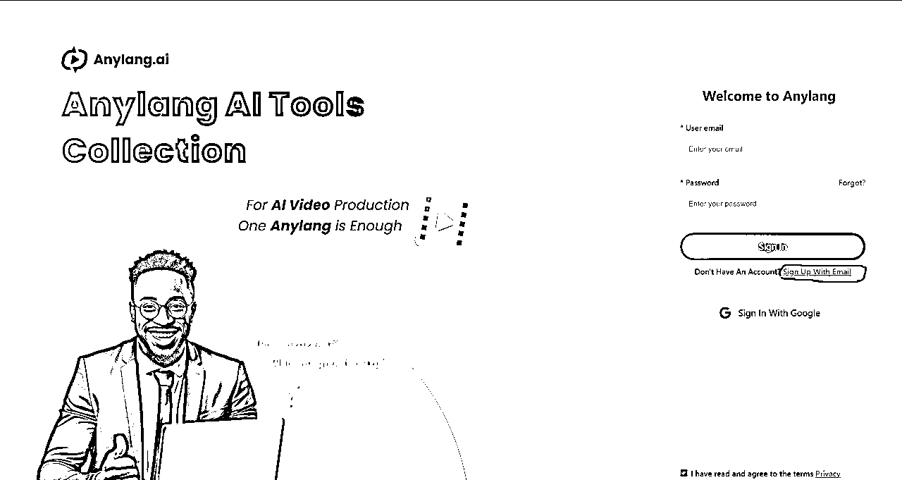

2. 进入注册页后不要直接填邮箱，临时邮箱、Gmail、微软邮箱都会提示不支持，这是平台的反薅风控。
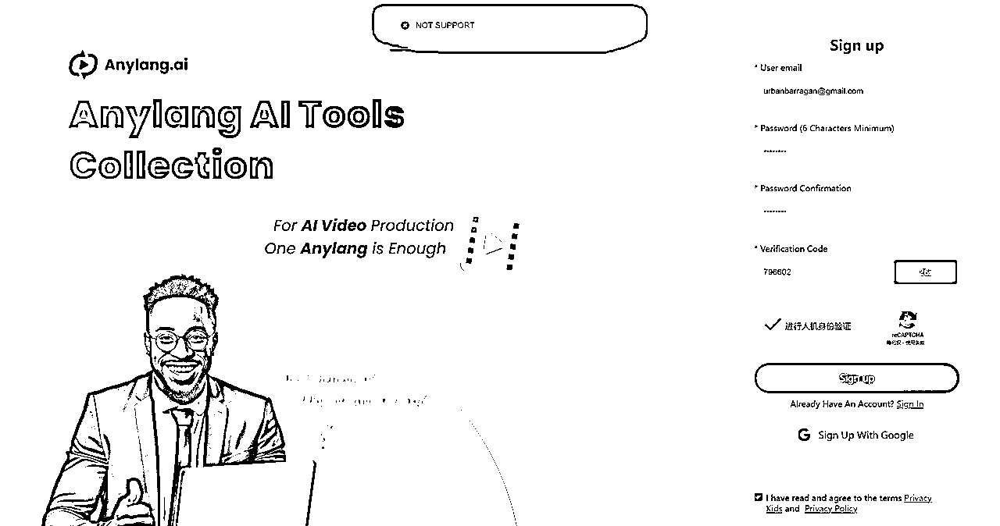

3. 只能点下方的sign up with google，用谷歌账号登录，前提是能正常访问谷歌，就能自动注册成功。
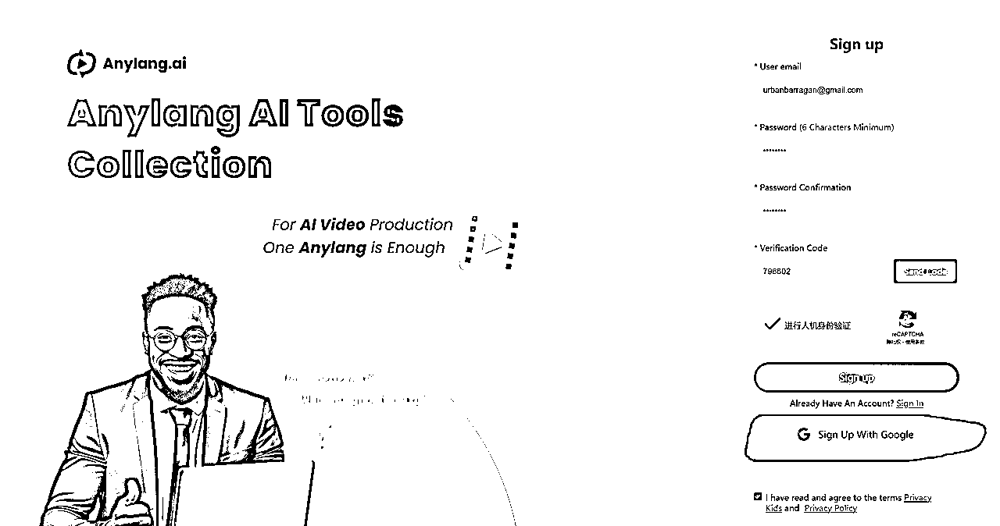

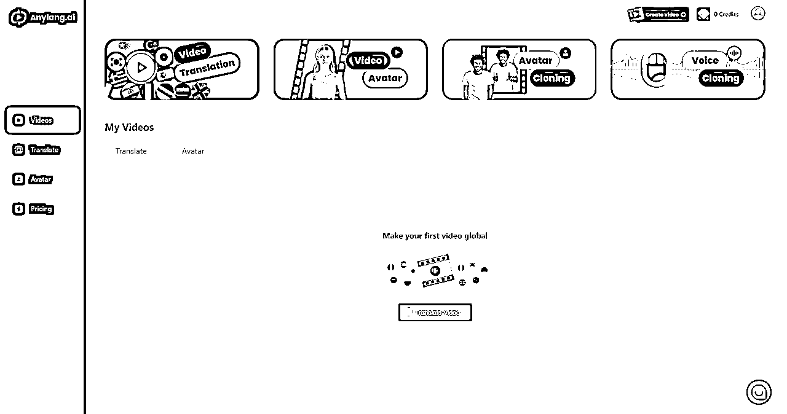

4. 登录后点右上角头像，credits会显示1，相当于一分钟视频额度，也可拆成两个三十秒以内的小视频。说明一下，这平台的成本本质上就是获取谷歌邮箱的成本，具体渠道大家自行搜索。
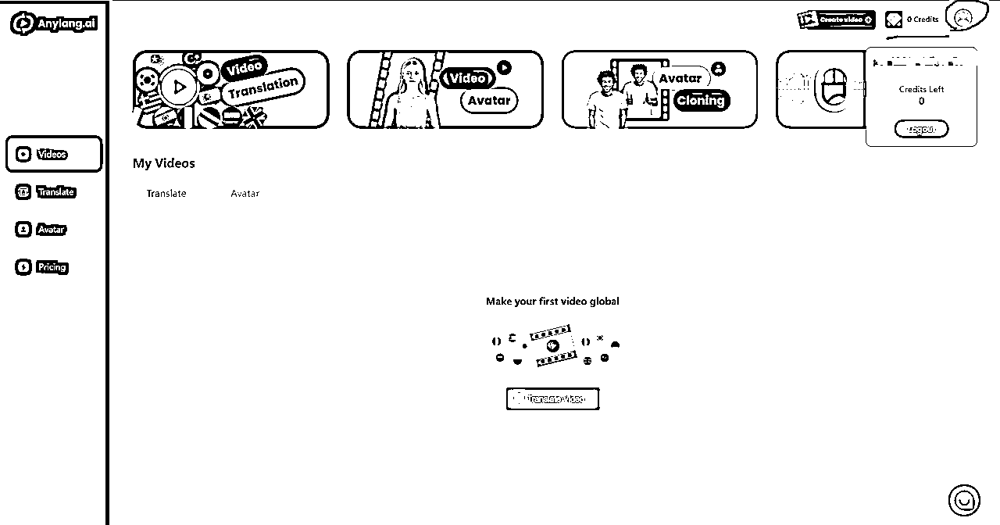

5. 获取积分后点页面下方的Avatar，把之前做好的数字人模板拖进去，几分钟后处理完成。值得一提的是，该平台对版权审核很松，甚至直接扔原视频进去也能过，身份认证也能做，简直宝藏。
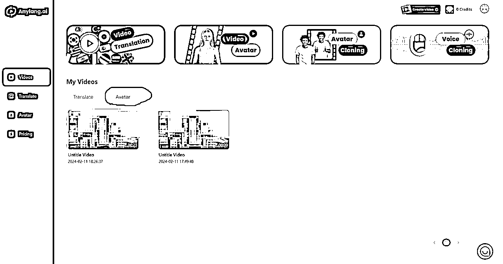

6. 处理完进入编辑页，只需输入文字稿，选一个喜欢的语音。Anylang语音支持多语种，中文、英文或其他语言混用都能出音，外国人说中文的口音也很自然。
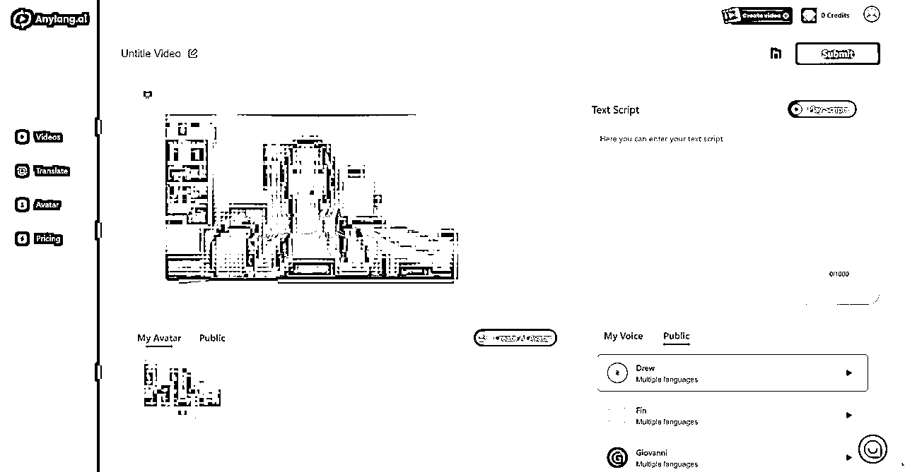

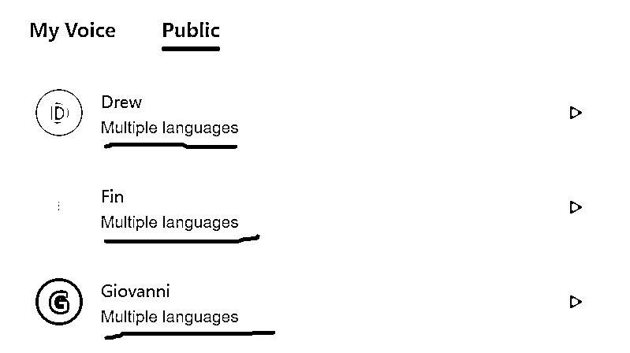

7. 选好音色后点右上角submit，显示扣费点确认，几分钟就能出片，和Heygen比快很多。
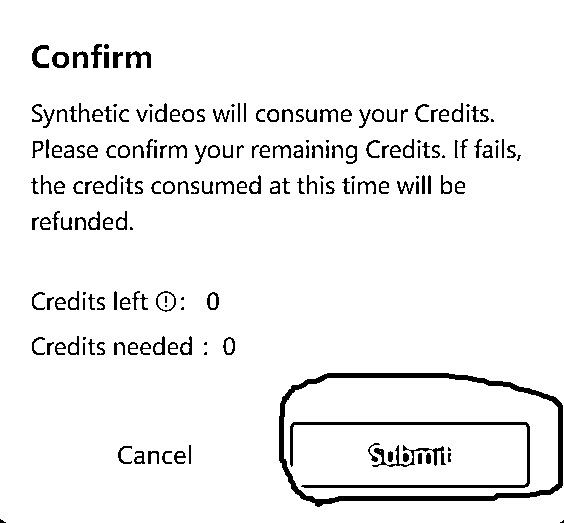

8. 成片在Videos里显示，鼠标悬停点下载即可。
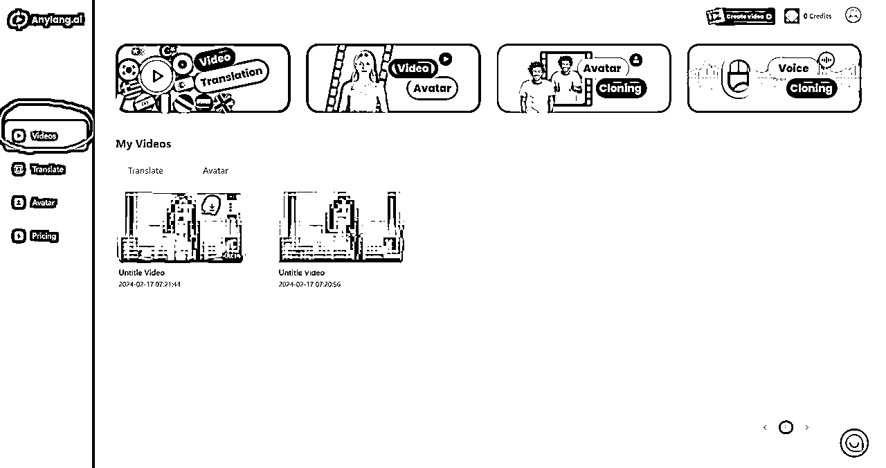

9. 最后用剪映切成三比四或九比十六，加点音乐做个收尾，数字人视频就算完成。

人设、话术、工具链齐了，就开始投视频号。选视频号是因为航海手册提到，主力是三四线中老年人，好建立信任，退货率也低。

第一条视频发出去等了五分钟才冒出点赞爱心，焦虑缓解一点。十分钟后互动开始增多，半小时平均每分钟一百多个红色提醒，心里就一个念头：有戏。当天按手册发了三条，第二天播放破几万，第一次感受到爆流的感觉。没自嗨，继续发了三条，流量一直往上走。

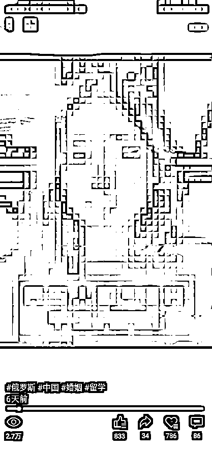

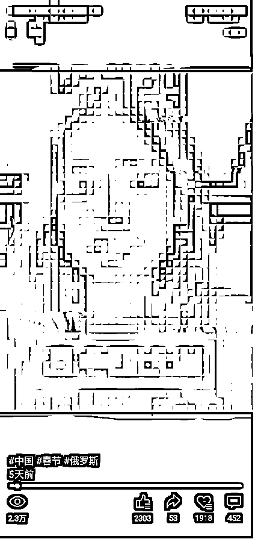

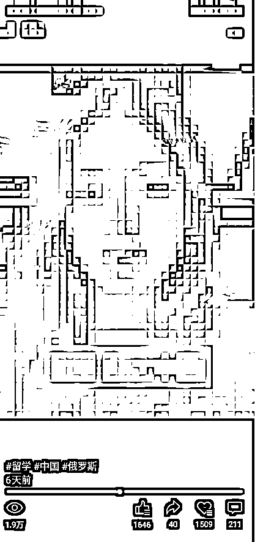

但问题马上来了，平台弹出出镜人身份验证。我在赚钱里搜到一条解决帖，发现自己号还没实名。先实名，再用数字人平台录一段验证话术，第二天就通过了，首页会提示该形象由AI技术制作，也就中老年用户可能注意不到。

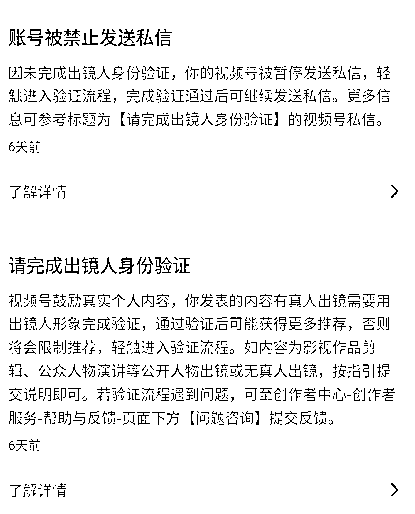

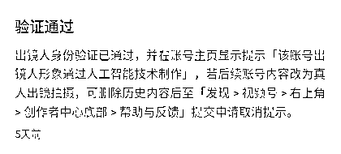

身份验证搞定，粉丝很快破千，我去开通挂车，交了一百保证金却提示内容违规，挂车没开成。更糟的是不久后账号被暂停推荐，原因是违规或敏感内容。赚钱里没找到解法，网上也无，干脆把情况和提示全丢给ChatGPT 4.0，让它写申诉信。抱着试试的心态提交，第二天竟然通过了，第一次觉得AI真的救命。

变现思路当时很简单：卖俄罗斯产品。没法挂车，只能在视频、评论区引导用户去主页橱窗。

正发第一条带货视频，噩耗又来：再次被暂停推荐三十天，理由是多次刻意编造不实信息，打造虚假人设，煽动性强。我当时直接抑郁了，比西天取经还难。按上次做法又让ChatGPT写申诉，这次没中，申诉失败。按航海手册判断，这个号基本废了。

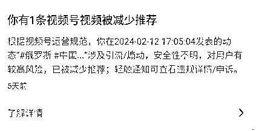

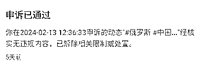

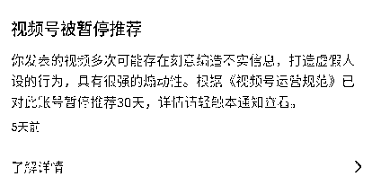

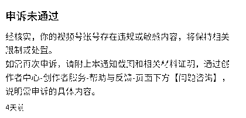

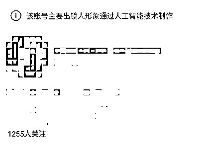

第一个号最终数据：1255粉，零成交。

复盘两天后我得出结论：俄罗斯美女数字人流量非常大，能变现，但提到跨国婚恋相关内容容易被风控。第二个号要彻底避开这个话题。

当晚就启用第二个微信，开启第二号。先实名，再按老套路发脚本，严格避开婚恋。结果出奇顺利，最高播放近十五万，出镜人验证很快解决，粉丝破两千五。流量起来后，我琢磨怎么变现，觉得直播最快。当时账号每分钟两百多条私信，视频号对无人直播抓得严，数字人直播成本又高，我决定做个精美封面，用手机播放预录的数字人音频做直播，稿子让ChatGPT多版修改后才满意。

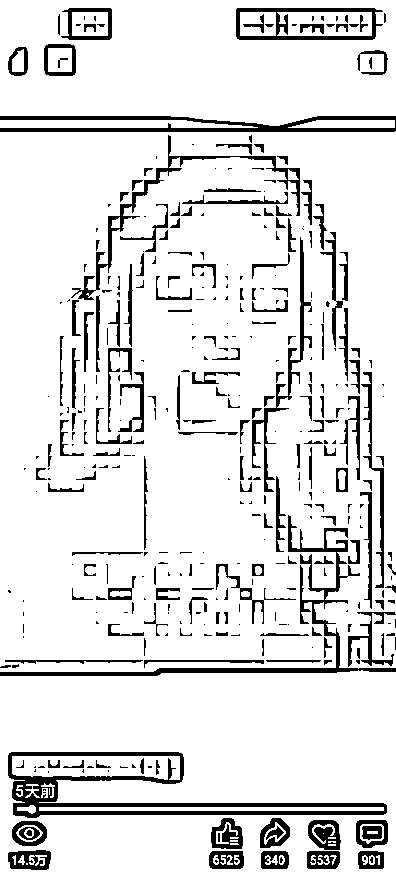

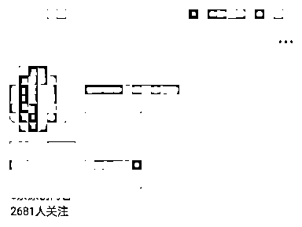

开始直播，准备了两台手机，一台直播一台放音，胶带挡住摄像头防翻车。开播前几分钟只有两人，我一度想关。随后人数暴涨到几百，页面显示多人下单，心情大起。音频录了半小时，本打算播两小时，单曲循环没问题。四十分钟时平台弹窗：直播中播放录制音频违规。处罚来了：禁播一天，橱窗停用一天，禁加商品一天。

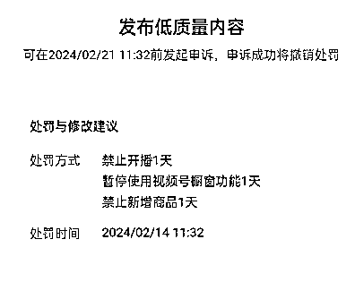

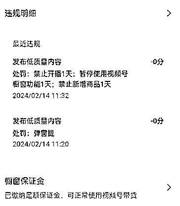

我以为到此为止，继续发视频引导去橱窗。没想到没多久又被暂停推荐三十天，理由和上次一样：虚假人设煽动性。我明明避开了婚恋，仍被判死刑。再次求助ChatGPT写申诉，第二天还是失败。

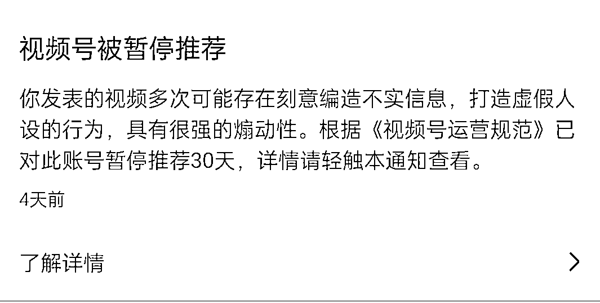

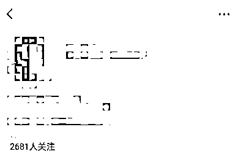

第二个号最终数据：2681粉，五单成交。

两个号都废后我开始深挖：即便避开婚恋，用数字人扮演外国人打感情牌这条路在视频号基本走不通。但我不甘心。于是启用第三部手机做第三号。观察到俄罗斯美女同质化严重，这次换巴基斯坦美女，视频里不提国籍，只在资料里放个巴基斯坦国旗。结果流量不到前两号的零头，最后仍被暂停推荐三十天。三个俄罗斯美女数字人账号在视频号全军覆没。

失败三连后我陷入焦虑，甚至怀疑这几天是不是白忙。冷静下来后把三个号的私信翻了个遍，发现不少人想加好友并留了微信。我意识到只要有流量就能导流。结合之前微商经验，先把人拉进私域再说。

我把三个微信重新包装，头像、年龄、资料、朋友圈都做了调整，朋友圈仅保留三天可见。挨个添加好友。聊天时保持简短汉字为主，其余用数字人平台生成的音频回复。人设是：国外普通家庭，十八岁后自力更生勤工俭学，热爱中国，喜欢交中国朋友，性格积极向上，朋友圈每天更新生活视频、照片、文字。效果比预期好，视频号中老年男性中不少愿意帮忙，我在1688拿货卖俄罗斯特产，总算有点收入，偶尔也有老色批直接无视。只是没有持续流量补充，私域收入杯水车薪，还没达到预期。

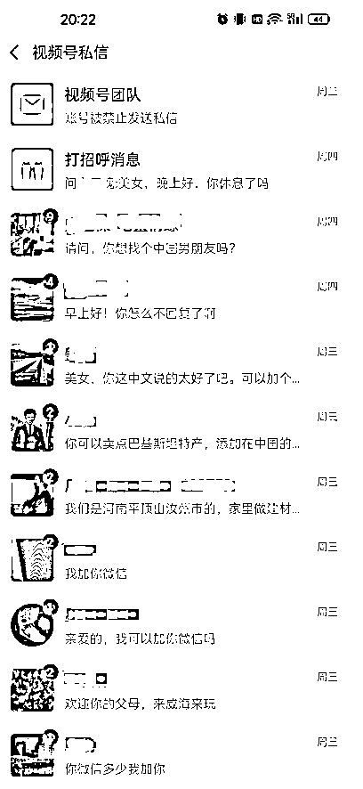

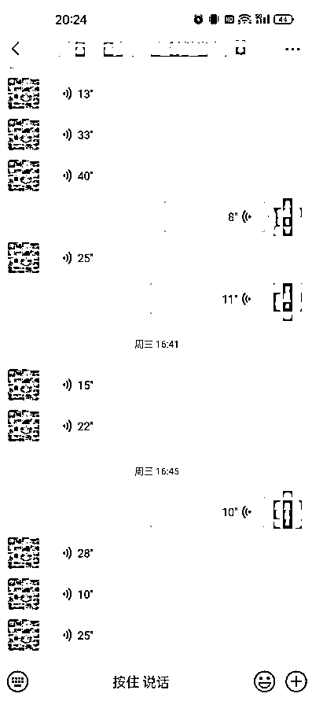

我一直琢磨一件事：哪个平台的用户以三四线中老年人居多，同时还能容得下“俄罗斯美女数字人”这类内容，不被限封？小红书整体是年轻女性的地盘，玩不转；抖音流量虽大，但用户年轻化、退货率高，卖货也容易压死在手里。在龙哥盟里泡了很久，也只翻到一些零散线索，但至少把方向定在了快手。我是南方人，平时对快手不算熟，可多少知道快手上北方用户不少，人群画像偏中老年，正好和我的想象对上了。

抱着试水的心态注册了快手，我没有急着发作品，而是先刷了一圈同类账号。当时就看到不少俄罗斯美女数字人号更新得很勤，热度也不差，说明这个平台不会像视频号那样对数字人内容卡得很紧。只是大家做得都差不多，硬挤进去没什么差异化优势。想来想去，还是决定从红海里找块蓝海：俄罗斯美女数字人既然能跑通，那我换个国家的美女数字人是不是也能跑？也给圈友提个醒——除了俄罗斯，还有哪些国家和中国关系友好、在中国人心里好感度也高？这个问题一旦想透，可能就找到了新路子。

于是，我搭了一个其他国家的美女数字人形象，随手发了两条视频，没抱啥期望，倒头就睡了。第二天中午拿起手机才想起这回事。点进去一看，居然又爆了。吸取教训，我这次没有急着放大，而是让文案尺度一点点增加，持续试探平台的容忍边界。测了几天，快手对数字人和跨国婚恋这类话题几乎不设限。我的粉丝很快突破了2000，视频播放量稳定在过万，甚至还跑出好几条爆款。随后开通快手达人权限，挂车带货。意外的是，快手对硬广相当友好，限流几乎不存在，中老年用户的购买力也不弱。虽说整体流量只有抖音半数，但放到个体身上，已经够我吃撑了。

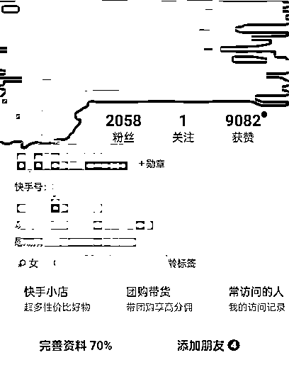

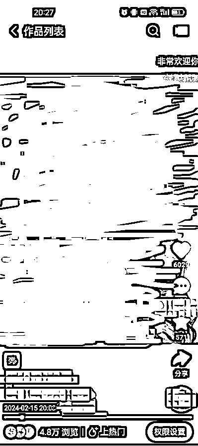

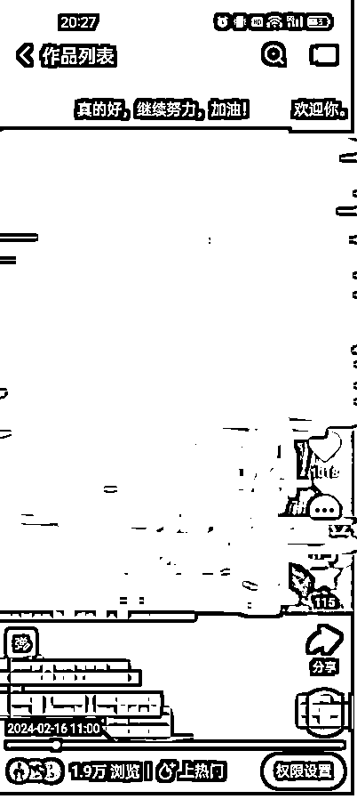

没过多久，我又注册了第二个号，复制同一个模式，只是不再申请快手达人，而是自己开快手小店，直接从1688进货，赚的差价更多。因为我发现快手官方选品市场上，很多商品本来就是从1688原封不动搬过来的。个人开店比达人只多了下单、发货和售后服务。目前来看，快手客户依然以中老年为主，退货率极低，偶尔遇到一两个也很快处理掉了。

现在我同时运营5个快手账号，做的全是海外美女数字人——特意避开俄罗斯美女，因为那边实在太卷。五个号加起来每天能出100到200单，收入还挺可观。对我来讲，这算第一次完整跑通项目，也算小有成绩。跟不少大佬比，这点成果确实毛毛雨，但对我这种性格内向、不太爱社交的男生来说，已经够满意了。希望这趟经历能给圈友带来点启发，少踩我踩过的坑。如果哪里没写明白，欢迎联系：jingdu2024。

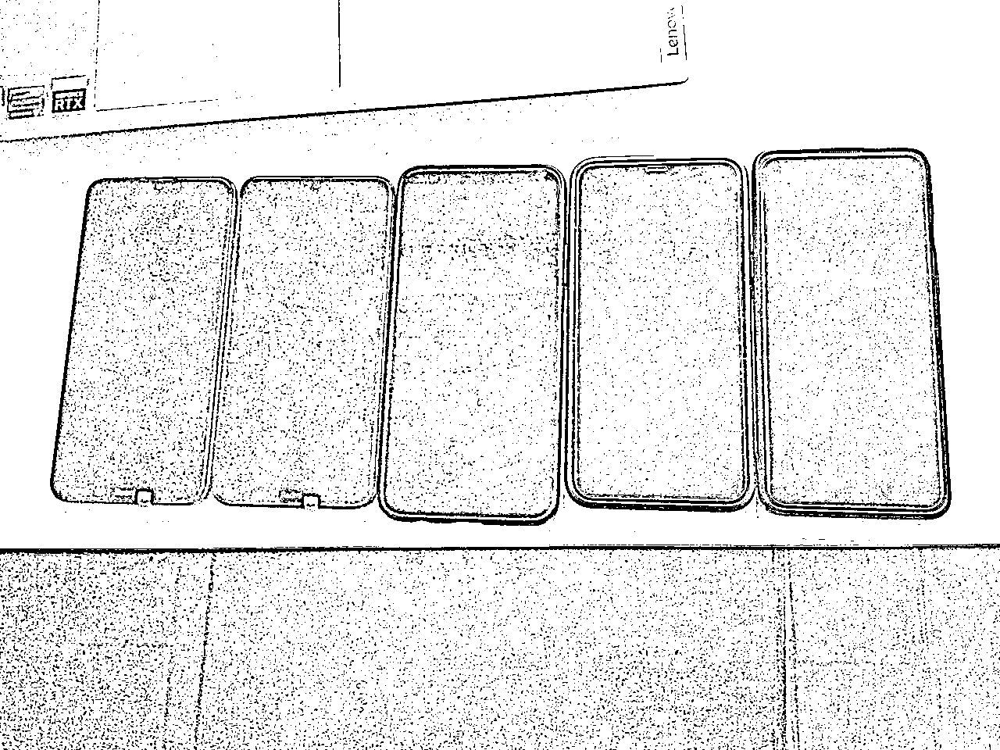