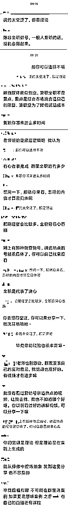
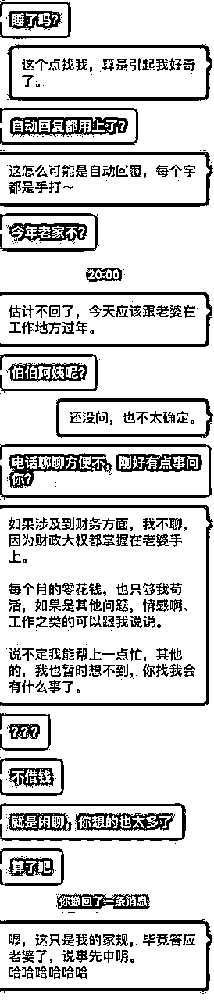
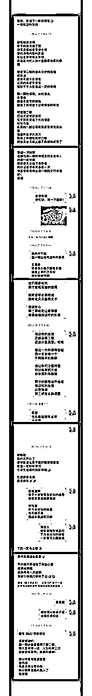

# 知识付费里真正难的，不是讲得多好，而是反对问题怎么接

来源：[https://oee5lr7gsk.feishu.cn/docx/HXjJd7c9VonHMox4UAYcxOPMnZe](https://oee5lr7gsk.feishu.cn/docx/HXjJd7c9VonHMox4UAYcxOPMnZe)

全文共：6288 字
预计阅读时间：12.314分钟

圈友们好，我是根源，先祝各位新年发财，龙年大运。

今天聊的主题，围绕知识付费和私域运营。

我一直觉得，知识付费玩到最后，产品交付能不能做好只是基本盘，真正的分水岭是交付过程中，你怎么处理学员的反对、质疑、吐槽。处理好了，粘性自然上来，复购也跟着来。

最近刚好碰到一个很典型的案例，我就借它来展开说说，在交付时遇到反对意见时，该怎么沟通才能把关系做扎实，把复购做起来。

赚钱的很多朋友都在知识付费这条路上，我把这个思路梳理清楚，也是希望能帮到还在摸索的人。

如果你也在做社群运营或知识付费，欢迎看完一起交流。

* * *

有一次在某个高价付费群里，一位小红书大神放了张聊天截图。

大概情况是，他手上有一个一百多人的付费群，群里某位成员直接在群里开怼：

说的太空泛了，都是理论。  
除非全职做号，一般人兼职的话，没机会做起来。

仔细看下面跟帖，会发现老师的口碑其实不差，多数留言都是在帮老师说话。

做了这么多年知识付费结合私域，我的判断是，这本质上还是服务业。

老师到底要服务什么？我想起韩愈《师说》里那句话：师者，所以传道授业解惑也。

传道、授业、解惑，这三件事就概括了知识付费讲师的核心服务边界。只要我们还在这个边界内做服务，那才叫服务。

* * *

# 01 把言论分层看，就会不一样

我把这段截图用颜色做了标注：红色是评判者，黄色是群主，蓝色是拥护者。

一眼就能看出，蓝色的拥护者占了绝大多数。

拥护者为什么会成为多数？无非几种可能：课上得确实不错、群里是续费的老学员居多、朋友熟人比较多。不管是哪种，都是正向循环。没事谁会主动帮你说话呢，肯定有原因。

反过来说，没事谁会主动挑刺呢，肯定也有道理。

### 我越来越相信，没有纯粹的事实问题，只有诠释的问题。

诠释对了，逆风也能翻盘；诠释错了，再小的事情也能把局搞崩。

以前我自己就吃过亏。一次反对意见处理得好，群气氛立马回暖；处理不好，群能直接散，人设也会跟着塌。

这其实和企业的公关危机一样，小错因为回应得好，粉丝不降反增；小错因为回应得差，几十万粉丝说没就没。

每次遇到学员客诉，我现在会先问自己一句：是不是我有没做好的地方？

问完这句，情绪就从对外指责转成了对内复盘，很快就能冷静下来。

# 02 评判者，未必是敌人

我的老师说过，真正的高手不是顺风顺水时做得好，而是逆风时还能翻盘。

用在上面这个案例里，群主的处理方式就是对的。

处理任何事前，我会停五秒问自己：有没有更好的解法？一个更好的解法，不只结果更好，还能把未来的隐患降到最低。

我对成功的定义也变了，不在于是不是做大了，而是未来的坑会不会变少。因为一件事情能不能成，往往不取决于好人能帮你多少，而取决于坏人能搅得多乱。

举个例子，我要开店，曾经帮过我的人都送了花，结果被一个小人带人来泼油漆，开业直接被搞砸。我当时就在想，为什么不早点把这种隐患堵住呢？

于是我给这些人分了类：善贵人，和恶贵人。

群里那位评判者，我反而觉得是善贵人。

如果一个群里全是正反馈，全是拥护者，我反而要担心。因为只有正反馈，事情很难真正成长。

### 真正能推动你进步的，往往是那些给负反馈的人。

既然他能给到更大的帮助，为什么要排斥他、躲着他呢？

# 03 换个姿势面对反对

如果是我遇到这种对话，我大概会用两种做法。

## ⭕️第一种，保持六十分的礼貌

对敢于提反对意见的人，至少保持六十分的礼貌。因为善意有很多种表达方式。

很多人因为成长环境、工作环境、表达习惯，会习惯用反话来表达关心。

比如我老婆常说：老公你不抱我，我讨厌你。听着是负面，其实是爱。

所以善意的外包装不一定是温柔的，有时候是黑盒子包着的。

## ⭕️第二种，用道歉先拆掉防御

我会先想，怎样说话能让对方不只不继续反对，还会心里夸一句：这个群主真大气？

第一步，我一定先道歉。

这个道歉不是承认"我做错了"，而是为了降低对方的心理防御。

沟通里最大的阻碍，就是潜意识里的防御系统。人一旦被防御罩住，再好的内容也递不进去。

### 建立信任的第一步，就是先把防御拆掉。

道歉能让剑拔弩张的情绪降下来，沟通才有空间。

# 04 求关注，也能用错方式

这个人提意见，会不会其实是想提问，但不知道怎么开口，于是用了一种比较生硬的方式来引起注意？

不是每个人都懂正确的表达能换来正确的关注，这本身就是一门技能。

对的表达：
这教学打得太好了，每个细节都很亮眼。但第三阶段的两个步骤我有点没看懂，能再详细讲讲吗？

错的表达：
这什么烂课件，尤其是第三阶段那两个步骤，这样写谁看得懂。

其实说的都是同一件事：我这里看不懂，请教我。

以前我也写过：不能因为对方不礼貌，就让自己也失了礼貌。修养是自己的，不会因为别人荒唐就跟着掉价。

# 05 如何减少恶贵人的产生

一个反对问题没处理好，原本支持你的学员可能心里会埋怨，某天在别的群里说你闲话，这种事是可以避免的。

延伸到一个学员私下的提问，也是关于反对问题的处理逻辑。

### 怎么用沟通的顺序，避免恶贵人出现。

这是学员来聊的一段对话，我把内容整理如下。

学员说：老师，我一个发小好几年没联系，昨晚突然找我。之前他也跟我借过钱，后续都不太好。我回他那句话感觉有点犯二，想听听你的建议。

我给他的回复是：你这样回并没有错，尤其是在事情要发生前先立规矩，这很好。但如果是我，我不会这么说。

我从两个立场拆开讲：

1. 借方的角度
这几年我也有过困难，也借过钱。开口借钱需要很大勇气，光是这份勇气就值得尊重。至少他还在想办法生活，办法不一定好，但态度是有的。

2. 被借方的角度
## ⭕️层面一：说话的顺序
你先用老婆挡在前面，这话是对的，但顺序可以调。我会先听他把话说完，再说明原因和立场。这是聆听上的尊重。被打断说话的人，心里都不舒服，别把这种不舒服搬给别人。

## ⭕️层面二：人情世故
小时候父母常说做人留一线。以前不懂，现在明白。有时候就是因为你回对了，这“一线”就留住了关系。谁的人生没有低谷？哪天你也需要开口时，这份留下的尊严，可能就是别人愿意帮你的理由。

## ⭕️层面三：善意的谎言
借的人更愿意听一个体面的理由，而不是硬邦邦的拒绝。说“对不起我现在真的没有，不然肯定帮你”，让他能体面地下台，这是一种高级的体面。

## ⭕️层面四：善念的复利
三十年河东三十年河西，有没有可能这人哪天就起飞了？语言上的尊重本身就是一种帮助。当你需要别人帮忙时，过去种下的善念种子就会开花结果。

## ⭕️层面五：关系的边界
你清楚他的记录不好，但对任何人保持六十分的礼貌，尤其是对可能成为小人的人都更重要。一旦因为一次果断的拒绝被记恨，他未来创业开店，带人来泼油漆、刷差评，你就成了恶贵人的制造者。

总结几个关键点：
修养在于自身，不在于别人。做人留一线。让人好下台。善念会复利。对任何人保持六十分的礼貌。

私域运营本质上就是大规模处理关系的场域，处理好皆大欢喜，处理不好会自己制造出一堆恶贵人。

# 06 嫌货人才是买货人

销售里有句话，嫌货人才是买货人。

会杀价、会挑毛病、会说产品有瑕疵的人，才是真正想买的人。

真正的销售高手和问题解决高手，就是把这些难搞的反对意见服务好，让对方心服口服。

如果是我来回那个群里的质疑，我大概会这样说：

很抱歉给你这种体验。你说的空泛，我写课的时候也有这种感觉，你点醒了我，我应该把课程拆得更细。

我能做到，不代表别人能做到。我能做到不代表别人一定做得到。如果只是我能做到别人做不到，说明步骤拆得不够细，或者我写课时太主观了。

非常感谢你的建议，让我有机会完善课程。能不能告诉我是哪一部分让你觉得不够具体？我会把这个问题发到群里，也私信你。

这个动作很重要，是对提问者的尊重。

# 07 道歉的三层用意

这种回应其实有三层含义。

## ⭕️第一层，让对方冷静
道歉能让对方放下攻击姿态，才愿意听你后面想说什么。

## ⭕️第二层，审视自己
被批判时，人本能是反击。道歉像一盆冷水，让自己先冷静下来。很多争执就是因为自己没控制住情绪才越演越烈。

## ⭕️第三层，大格局向下兼容
当着所有人的面把反对意见优雅地化解，支持你的人会感受到：这个群主不一样，花钱值。连这么棘手的问题都能解决，格局和能力都在线。

在交付过程中的随机应变，往往比课程本身的内容更能让老学员认同，也更能提高复购率。

# 08 逆势也能变优势

这是我第二期沟通课结束时，一位学员私下发给我的反馈，当时准备招生第三期。

看完我第一反应是：完了，第三期肯定不来报了。但因为我第一反应处理得还算稳，没有因为对方不满就失礼貌。

结果这名学员不仅报了第三期，那年一共上了我七期课，最后还报了我十万的年度终身教练。

最后送自己一句话：善意的提醒，有时是佛的模样，有时是魔的模样，用力敲你。无论佛还是魔，都要说声谢谢。

* * *

我是根源，也是第四期的赚钱圈友，2w+实战案例的心理咨询师，12年线下销售与团队管理经验，2022年开始做线上知识付费。

如果你觉得这篇文章有用，欢迎看我之前的分享。

2021年精华
1. 精华《直觉式萨克斯 透过社群成功变现146万》 https://t.zsxq.com/116B1bcYc
1. 《73项被动收入打造》 https://t.zsxq.com/11EHjTH0P
1. 《杭州夜话02场，夜话官复盘》 https://t.zsxq.com/19IkX4UMl
1. 《年入百万，团队从20人到4万人》 https://t.zsxq.com/19JYt77hL
1. 《主题：如何更有效的链接见面会认识的圈友》 https://t.zsxq.com/19VY2LWg4

2022年
1. 《互联网小白，第 1 次做线上产品，7 天赚回 10 倍门票》 https://t.zsxq.com/11ooZZbM7
1. 《把捣乱分子『逆势』转成爱用者的好方式》 https://t.zsxq.com/19lipLhJ5
1. 《 好的内容，是目前依旧没退旧流行的变现方式 》 https://t.zsxq.com/19BLMAYw1
1. 《明白老师的一个启发，让我从100天日耕的过程赚了30W+》 https://t.zsxq.com/19BgNoxfi

2023年精华
1. 《私域的意义不是管理，而是经营》 https://t.zsxq.com/19WEsfSq1
1. 精华《9年传统行业 1 年时间，从一无所有，到年入 200 万》 https://t.zsxq.com/10nmEr1cA
1. 精华《25个提高微信成交率的小技巧》 https://t.zsxq.com/11AgRW24F
1. 精华《35 个让私域收入翻 3 倍的技巧》 https://t.zsxq.com/11FmV2aqZ
1. 精华《续篇 - 25个提高微信成交率的小技巧（26 - 50）》 https://t.zsxq.com/13yRbmUwo
1. 《 私域话题：涨价之后，如何回复以及留住客户？》 https://t.zsxq.com/11UJk9HxQ

如果你也在摸索自由职业、私域成交或者产品升单这些方向，这里有几份特别实用的干货资源，分享给你：

1. 精华《成为自由职业者的20个必备特质》 https://t.zsxq.com/14XTxhh15
2. 《36个让私域成交率翻倍的实战指南！》 https://t.zsxq.com/17zSrYzvk
3. 精华《产品线有引流体系，如何通过沟通促成升单？》 https://t.zsxq.com/17ocUJEFA

说实话，自从加入赚钱有术，真的帮我避开了一堆坑，省下了不少摸索的时间。自己也慢慢沉淀出一些经验和思考，如果圈里的朋友想一起聊聊、互换心得，随时欢迎加我微信「 AF54094 」交流～

▲
也可以直接扫码找到我～