视频号知识付费高销量玩法，我拆了3个账号，发现这些秘密

各位好，我是Sevila夏薇拉。

借着第三期风向标拆解的机会，我专门研究了视频号里知识付费类账号为什么能卖出高销量。这篇内容是我拆解全程的记录，我会把账号定位、内容打法、变现节奏一五一十讲清楚，给想入局的朋友做个参考。

下面按四个部分讲：赛道前景 → 内容/定位 → 变现分析 → 注意要点。

## 一、为什么还盯着知识付费？

知识付费这词，在各大平台已经被说烂了。但我依然认为视频号里的知识付费值得做，原因有三：

- 第一，它适合爱学习、想低成本启动的人。启动资金几乎为零，时间也自由，赚多赚少完全看个人执行力和团队协作能力。
- 第二，它和个人IP强相关。做知识付费账号，与其说是在卖课，不如说是在养一个知识型IP，IP立住了，后面做什么都顺。
- 第三，视频号里的知识付费还处于蓝海阶段。我在视频号里搜“知识”“职业”等关键词，翻来翻去内容都很单一，爆款也不多。对想入局的人来说，这就是机会。

## 二、内容方向怎么定？好的案例长什么样？

知识付费的覆盖面非常广。所有在其他平台验证过能赚钱的知识内容，都值得在视频号里重新做一遍。

方向选择上，我从个人经验出发：不是看什么热门就做什么，而是先问自己——平时最愿意研究什么？什么内容能让我不自觉地花很多时间去看？这些答案基本就是你的定位方向。

定好方向后，再思考目标人群是谁，账号怎么才能快速冲出圈。对小白来说，最快的方式永远是找对标账号，把做得好的案例拆开看，先模仿再优化。

这里分享三个我实际拆解的案例。

### 案例一：恒哥聊教育

- 账号基础信息：名称“恒哥聊教育”
- 细分领域：亲子教育+亲子关系

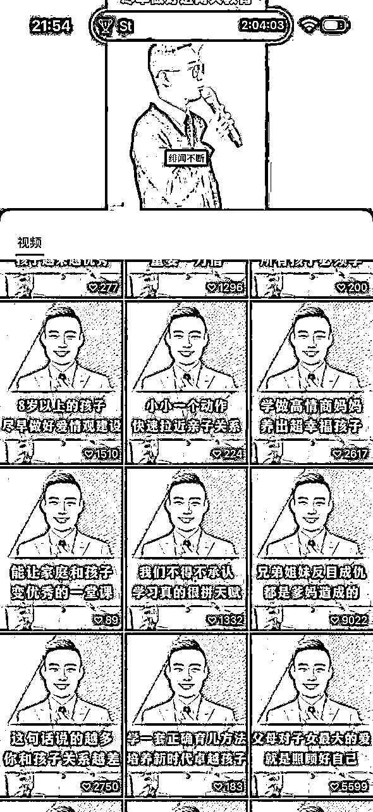

内容呈现方式：
主要是把线下授课视频进行剪辑和二次加工，教家长如何跟孩子正确沟通，如何处理亲子之间的矛盾等等。

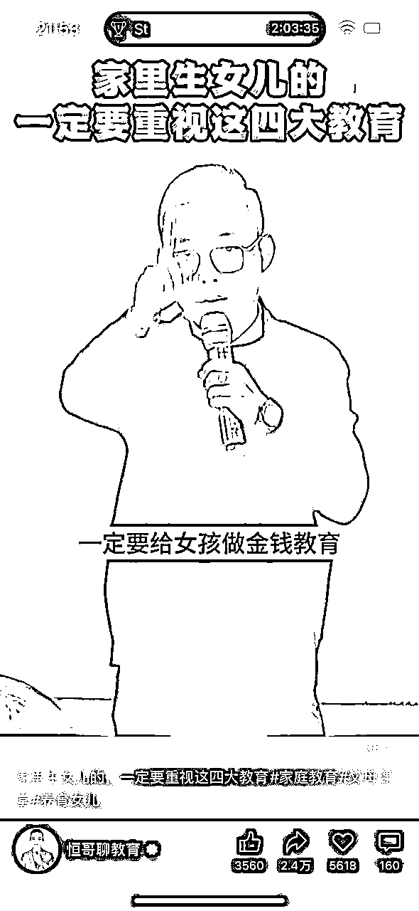
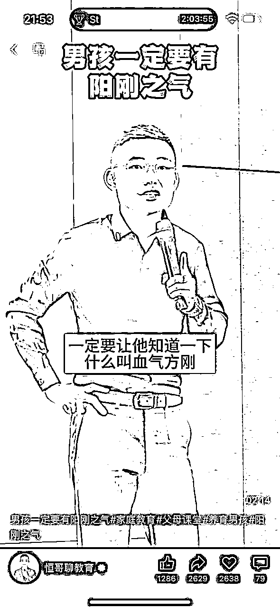

变现方式：
- 录播课程：目前共4个亲子教育视频课程，单价分别为199、365、499，四门课总销售额约670万。
- 社群训练营：售价1680，目前已售3629单，带来约610万收入。

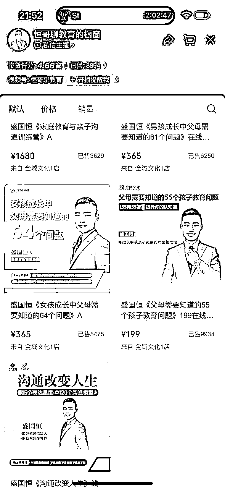
补充一点：我查到这个账号的带货记录，时间约一年零四个月。

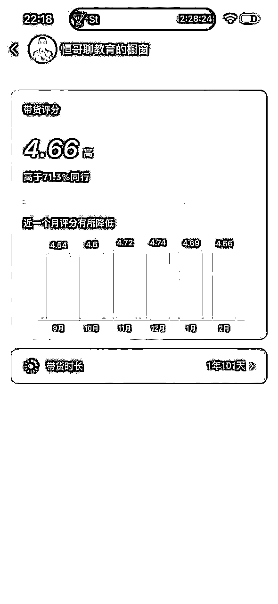

### 案例二：哈佛亮爸教育规划

- 账号基础信息：名称“哈佛亮爸教育规划”
- 细分领域：亲子教育+孩子的教育规划

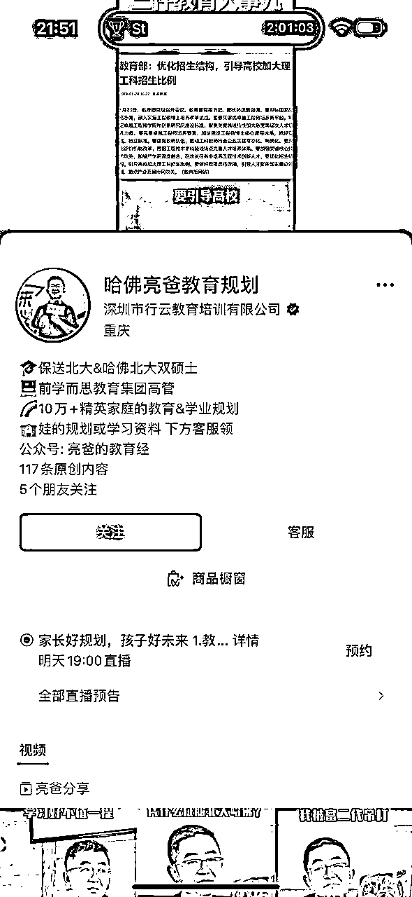

内容呈现方式：
人设直接用“保送北大+哈佛双硕士”立住，一看就很有说服力。视频以室内讲述为主，核心是引导家长为孩子制定合理的教育规划。

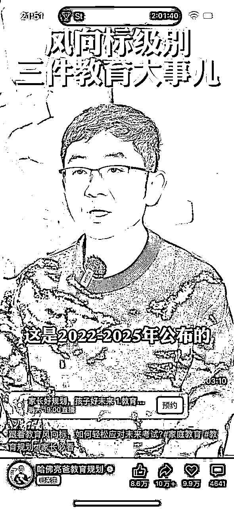

变现方式：
- 少儿书籍：主打双语内容，价格比当当和京东都低。目前在售4种年刊订阅，均价300左右，卖出了4128件，总带货金额约124万。
- 留学教育家长训练营：单价1588，已售4565，变现约220万。

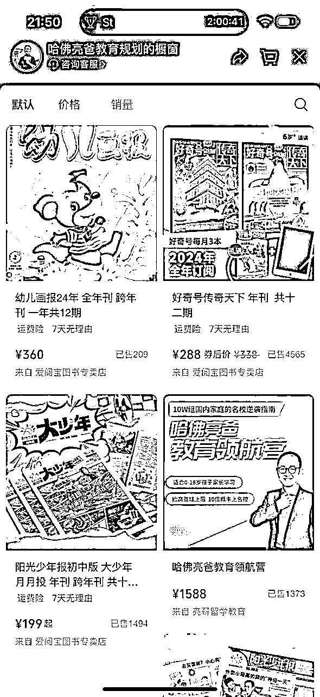
补充：带货时间273天。

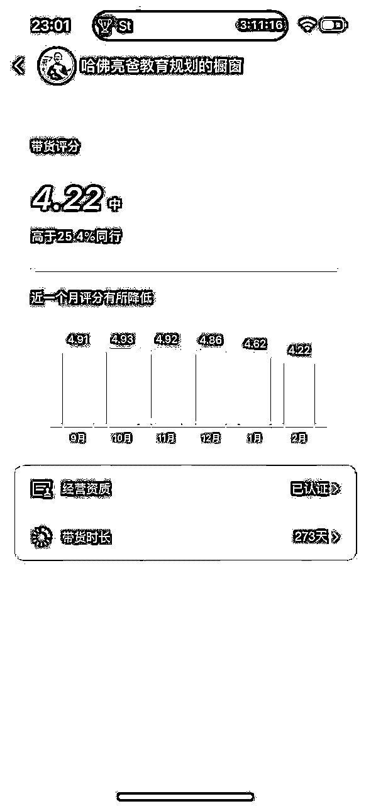

### 案例三：说情道理张醒之

- 账号基础信息：名称“说情道理张醒之”
- 细分领域：为人处世教育，覆盖成年后全年龄段，尤其是30岁至80岁以上人群。

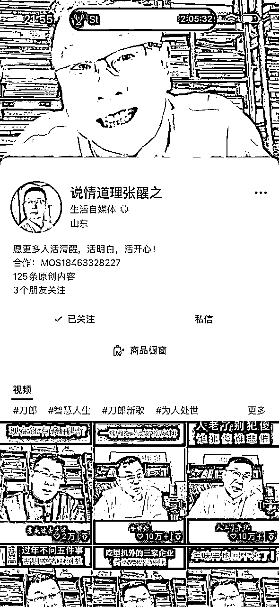

内容呈现方式：
视频里是一位中年人，穿中式服装，坐在书房里讲述道理。单条视频多数点赞破万，转发率也非常亮眼。

变现方式：
- 图书：在售约30本，均价30元左右。
- 百货：均价约30元。
- 两类商品加在一起卖了3.3万件，按均价估算，销售额约99万。

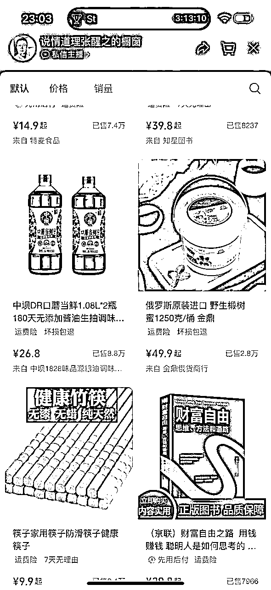
补充：带货时间174天。

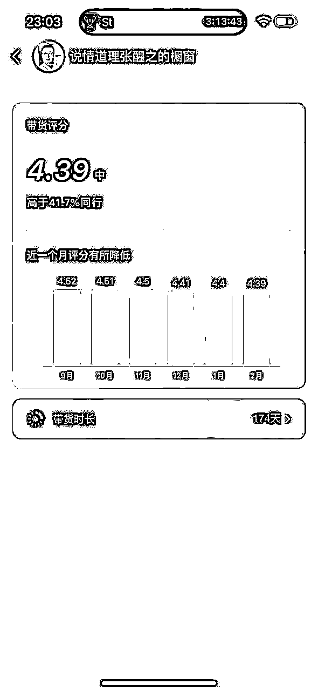

## 三、变现背后的通用逻辑

把三个案例放到一起，能明显看到一条变现主线：

1. 完成账号定位和包装，注册后立刻发第一条内容；
2. 持续围绕核心主题做输出，保持内容垂直；
3. 根据粉丝画像决定卖什么：如果粉丝普遍年轻，就专注课程产品，先用录播课试水，再上高客单训练营；如果粉丝50岁以上占多数，可以在卖课的同时搭配图书和百货，这类人群对这类带货反感度低；
4. 不断打磨内容和课程，靠持续放大个人影响力来实现收入增长。

## 四、想入局的人，这几个坑要留意

知识付费是一条需要长期经营的赛道，急功近利的人很难做好。除非像案例3那样，把定位、用户画像吃透，用内容做钩子，再配合直播完成转化。说到底，粉丝愿意付费的前提是信任，信任建立起来，成交只是水到渠成的事。

以上就是我这次拆解的全部内容。感谢你花时间看完。

2024，期待和大家一起赚钱有术！