# 还能玩跨境 COD 吗？这套半价引流的中东 COD 打法，干货+实操全放这

> 来源：[https://vvxlpvbvbp3.feishu.cn/docx/TE32dlXyUosRXIxE37wc1o6mnR4](https://vvxlpvbvbp3.feishu.cn/docx/TE32dlXyUosRXIxE37wc1o6mnR4)

各位老铁，我是 Albert

一个连着创业的玩家，热衷折腾，赚钱才是硬逻辑。

这篇内容我会用 中东 COD 的拆解视角，结合实操步骤，告诉想入场 COD 的朋友怎么用最少的 FB 投流成本跑通项目，并把利润拉到最大。

## 这一篇的核心抓手：FB 余额户

说白了，就是自带广告余额的 Facebook 个人号。

在跨境圈混久了，总能摸到一些偏门玩法，今天分享的就是其中一种。

账号来源就不展开，市场有需求自然有供给。之所以把余额户单独拎出来，是因为它的性价比极高，广告花费能打到 4 折。

举个例子：账户里显示有 300 美金，实际买单只要 120 美金，按现在汇率也就 855 元人民币左右。

用 4 折的成本去跑量，ROI 几乎不用太焦虑。以中东市场为例，只要出单基本就回本，后面细说。

声明：不卖号，不卖号，不卖号。

## 配套工具：单页 COD 系统 + 科学上网

单页系统在某宝搜关键词 + 服务器 + 部署 + 域名，500 元以内基本能搞定。价格主要看模板库的丰富程度。

新手没必要贪多，选一个单一国家模板就够用了。赚钱里搜 COD，就能找到在做单页系统业务的同行。

科学上网这块就跳过了，大家都懂。

声明：不卖系统，不卖系统，不卖系统

## 实操拆解：投放流程 + 懒人选品法则

准备工作齐了就开干，下面以中东-科威特为例演示。

先进入 FB 广告后台：

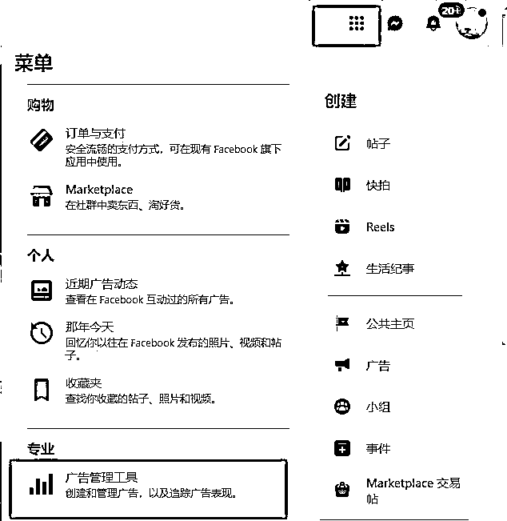

进到后台后，第一步点开 账单与支付 看余额是否已到账。以图中这个号为例，300 美元已经充值成功。

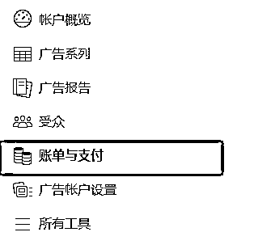

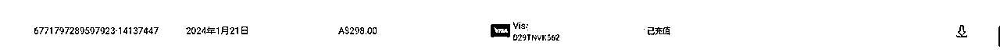

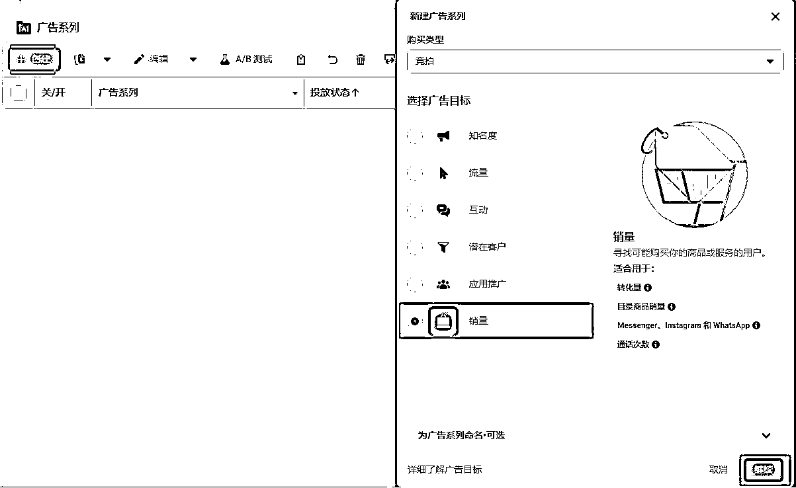

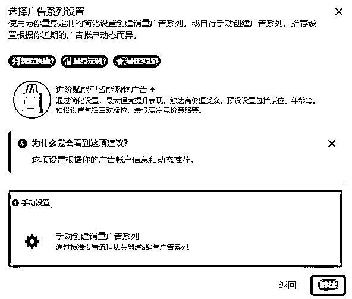

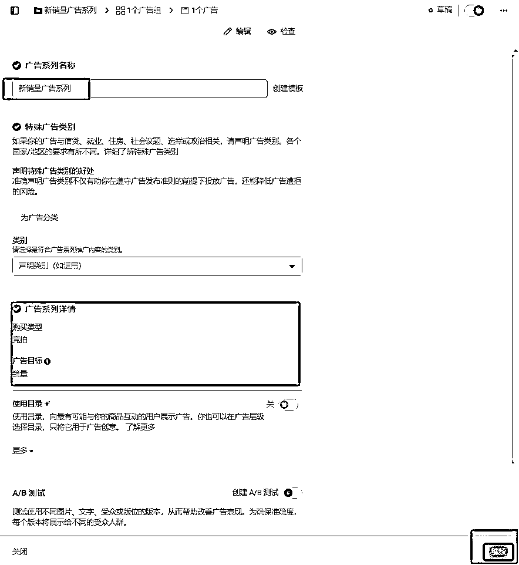

广告系列名、广告组名、广告名随便填，A/B 测试先不考虑，重点确认广告目标选对了。

下面是广告组设置，核心操作基本都在这里：

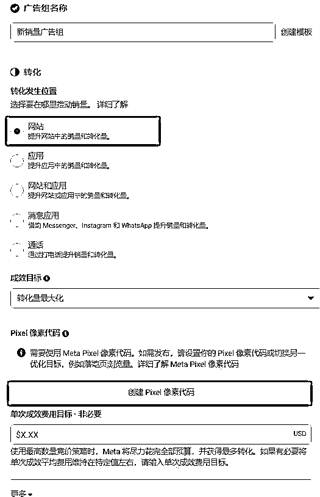

创建 Pixel 像素

用来追踪广告到网站的转化数据。

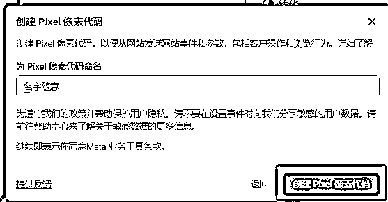

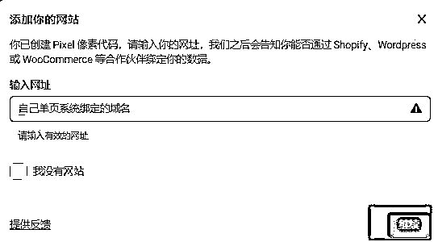

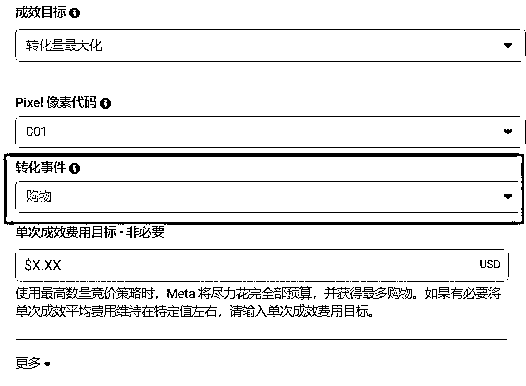

把像素代码贴到单页系统的后台，一般单页系统都支持直接粘贴，转化事件选 购买。

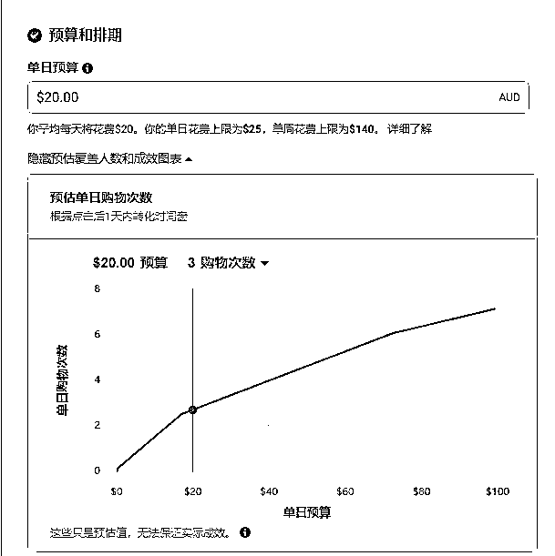

广告预算：我这边设了 20 美元，东南亚市场可以降到 10 美元，也不用太纠结，照跑 20 美元也没问题。

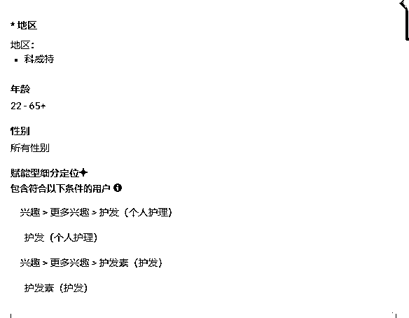

选品直接决定受众画像，年龄段默认 25-65，性别全选，再做细分兴趣。我投的是洗发水，兴趣就按图里这样细化。

分享一个懒人选品思路：

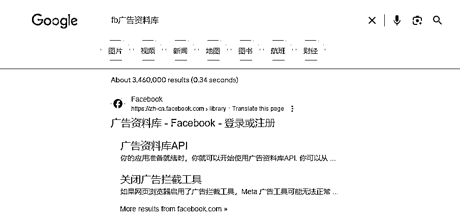

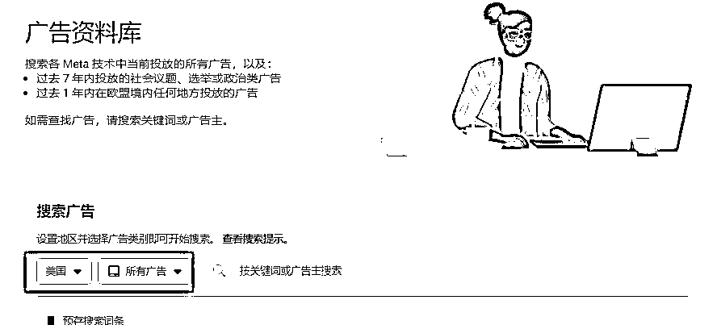

想投哪个国家就直接选那个国家。做 COD 主打中东和东南亚。关键词输入 cash on delivery，也可以换成 free shipping 等相关词，翻译成英文后回车搜索。

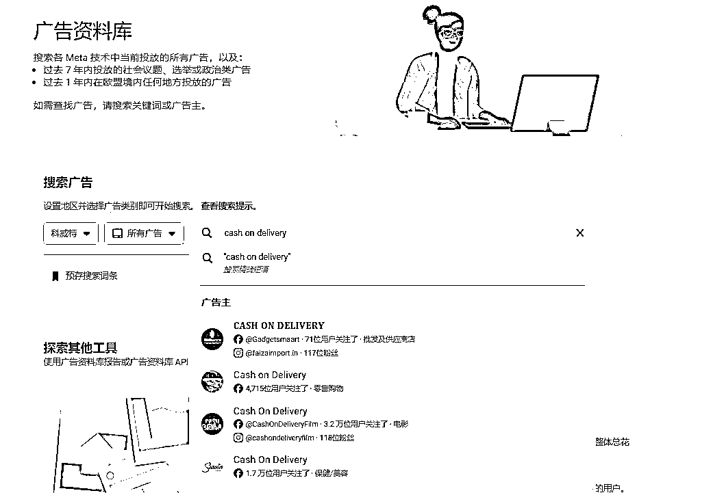

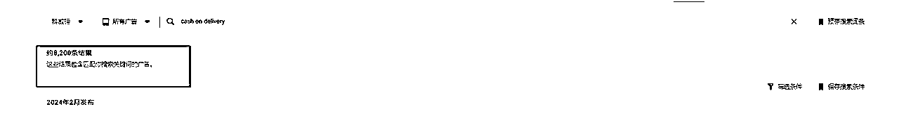

到这一步会看到不少正在投放的产品，但并非都能做。

比如 FP 类、JF 类、大型工具类、JR 类都不太合适。因为货到付款模式下，产品体积和重量越小，物流成本越低。比较对口的品类有 日常生活用品、教育类、小件数码、衣帽鞋包。可以参考运费表，各家货代报价差别不大。

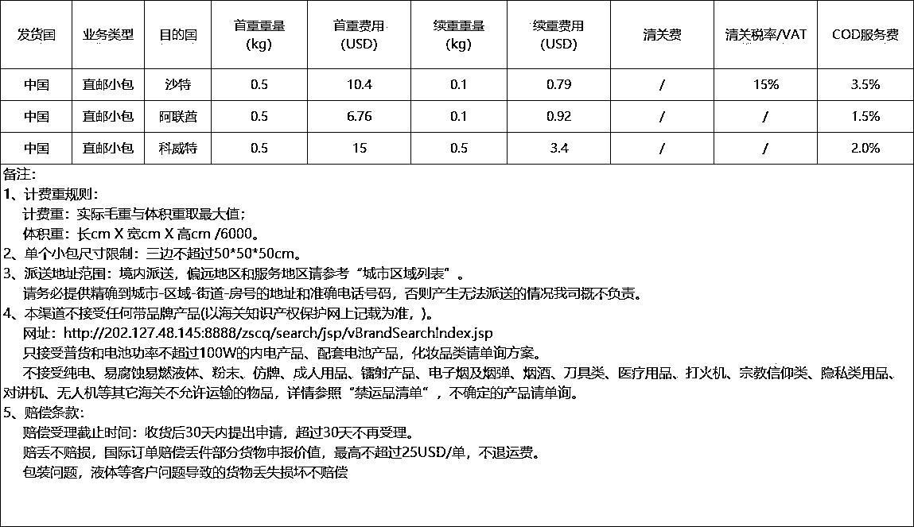

如果还是拿不定主意，还有一个更直接的方法。

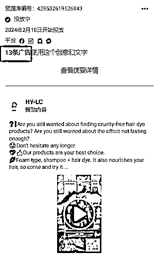

拿这款染发剂举例，首先体积重量符合要求。其次目前有 13 条广告在跑，广告量越大通常代表人家在出单，才会持续加投。投放时间如果是当天且数量稳定，跟着投出单概率也不低。我们成本是 4 折，最需要关注的只有一件：签收率。

这种跟投法的优点是出单快，缺点是生命周期短，很难长期稳定。想做长期副业，后面还是要做选品优化。

敲定产品后，就把同行的文案和产品详情页复制到自己的单页系统里，后台+前端都要同步。

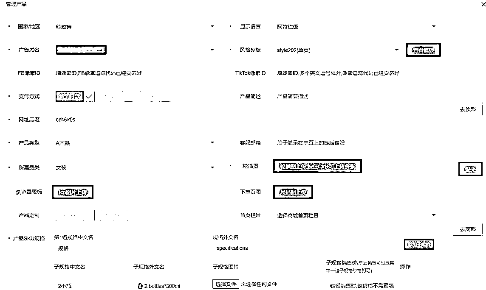

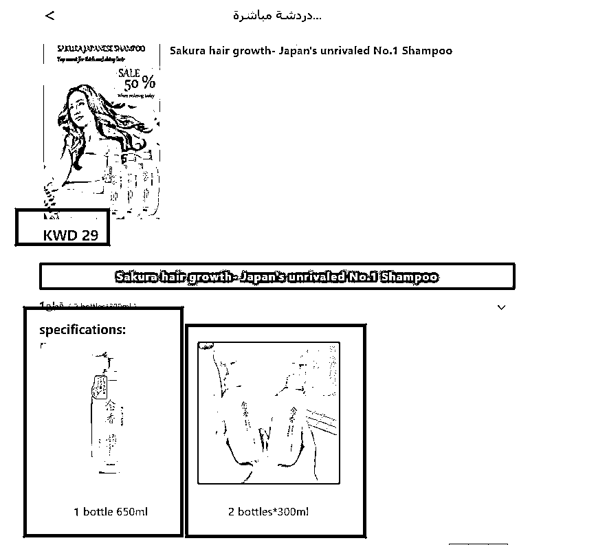

单页内容填完，再回到 FB 广告设置页，把别人的文案和素材搬过来。长期测试下来，COD 项目用视频素材比静态图更容易成交。

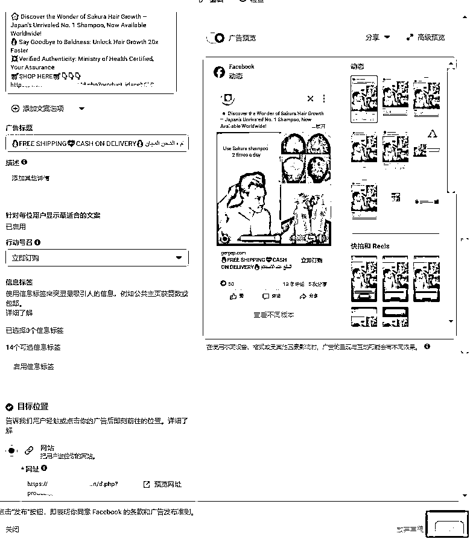

基本流程就到这里。可以多上几个产品，多建几个广告组测不同人群，然后坐等出单。

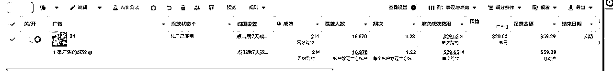

上图的案例总共花了 60 美元出了 2 单，产品售价 29 KWD，2 单合计 58 KWD，约合 189 美元，折合人民币大概 1350 元。当时选品时 2 单都已签收。结合 4 折广告费仔细算一下账，会发现利润空间明显。

如果按正常广告花费，这种数据早就亏了。

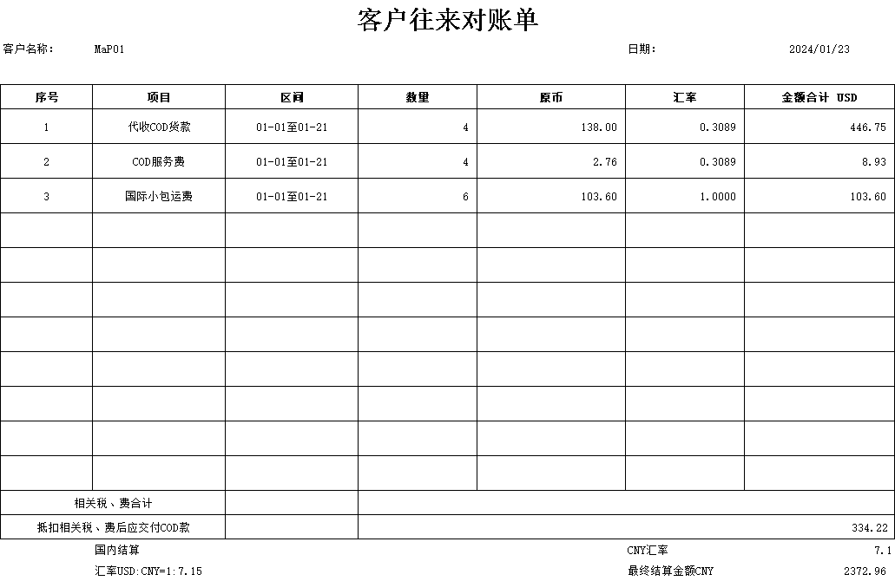

## 最后提醒：细节决定成败

出单后的采购和物流对接因篇幅限制不展开，有需要可以再开一贴。采购思路很简单，就是贸易逆差，正常签收后回款周期大概在 15 天左右。下面重点说下余额户使用时的注意事项。

余额户便宜是真便宜，但也有限制。每天消耗上限大概 50 美元，上传广告时最好一次性全提交，别一组通过了再补一组的，重复审核容易导致账号异常。

相比企业号，个人号的抗风险能力较弱。这类余额账号建议一周内把额度用完，并且保持科学上网节点稳定。

我个人并不建议用这种号做长期大规模投放，放大单量时风险会上去。把它当作副业赚点零花钱，或者给想入局跨境的小白做一次低成本试水是比较合适的。中东 COD 的生态已经很成熟，东南亚流量更便宜，也可以去测试。

最后祝赚钱的各位朋友和看到这里的同学都能在 2024 年达成目标，一起乘风破浪。

有问题的可以在站内私信我，时间允许的话会一一回复。感谢阅读🤞