# “如何掌握好业务流的 3 个端口，让业绩翻倍”
作者：龙哥

你有没有见过这样的怪圈：有的人明明很拼，却始终在盈亏线上挣扎；有的人看似云淡风轻，利润却悄然翻倍。秘密往往不在加班时长，而在那条贯穿公司所有环节的“经营链路”。

所谓经营链路，就是把目标拆成一系列动作，再像流水线一样跑起来。链路顺了，增长水到渠成；链路堵了，越使劲越容易翻车。

想真正看清这条链路，可以先掌握两个分析工具：一个是“波特的价值链条模型”，一个是“经营拆解公式”。

波特的价值链条模型告诉我们：公司里的所有活儿，其实就两大类——一类是“幕后支持型”的，比如制度、人力、采购、技术研发；另一类是“台前主干型”的，比如原料进库、生产加工、发货销售、售后服务。用这个框架去看自己的生意，再复杂也会一目了然。你甚至可以给自家业务画一张专属的价值链条图，下面这几张图可以先感受一下：

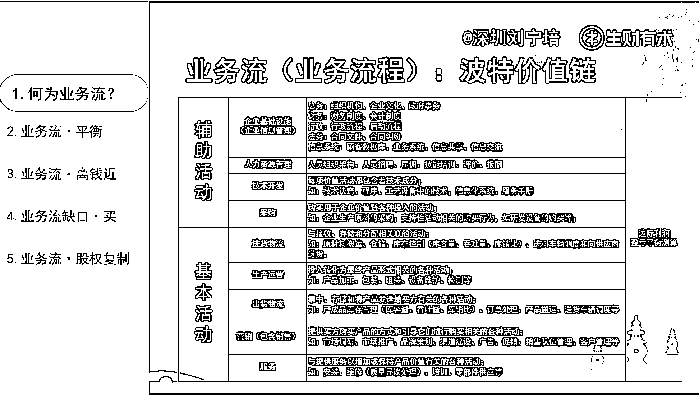
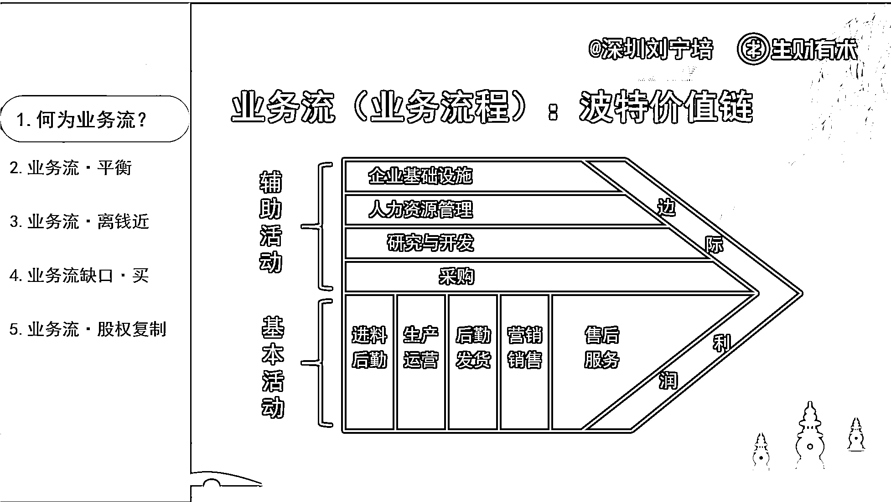
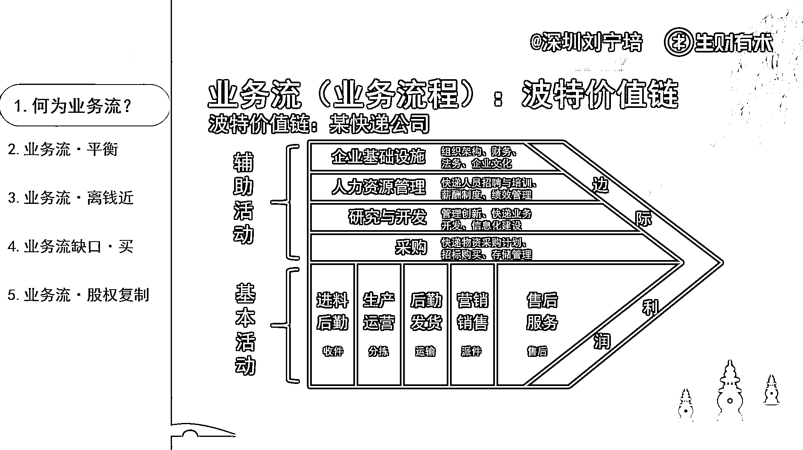
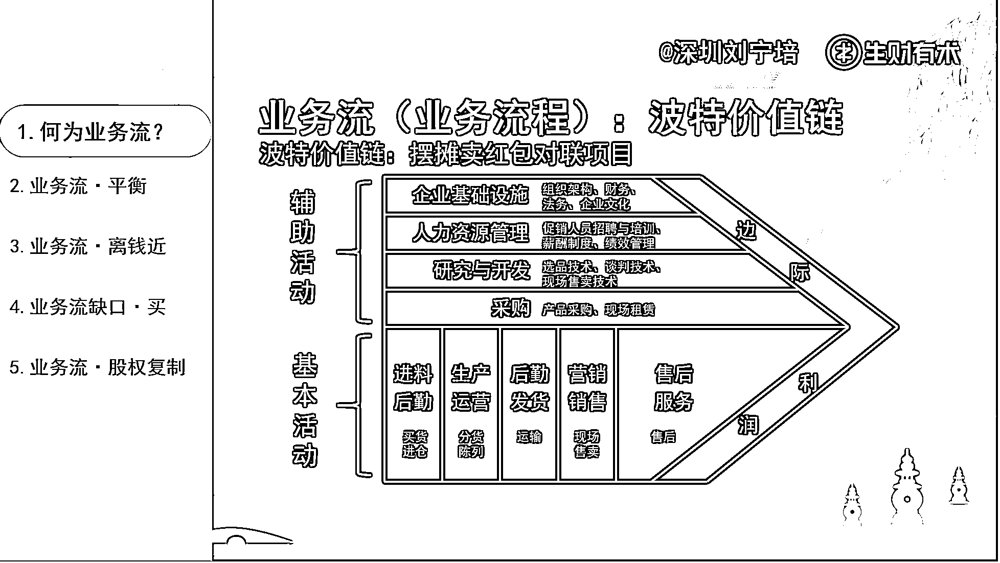

经营拆解公式则更直接：不管卖什么，最终收益都逃不过四个乘数——客源量、下单率、客单额、回头与老带新率。它们合在一起，就是企业的营收根基。做投放是为了冲客源数，做客户群运营是为了拉下单率和回头率，升级产品是为了抬高客单额。记住这个乘数关系：

收益 = 客源量 × 下单率 × 客单额 × 回头/老带新率

如果每个乘数都是1，结果是1；要是每个都能提到2，结果就是2×2×2×2=16。这就是为什么把细节优化好，增长能带来惊人的放大效应。

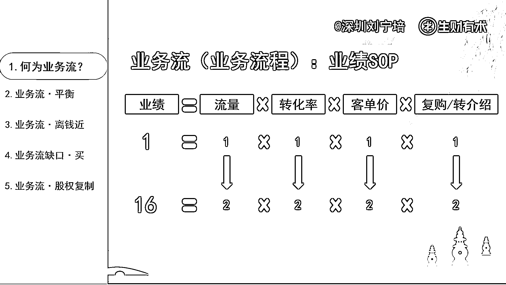

把价值链条模型和经营拆解公式叠在一起，就会得到公司的组织骨架：最顶上是指挥全局的CEO/总负责人，中间是四大板块——支持/成本部门、前端打单部门、后端履约部门、产品研发部门。支持/成本板块对应幕后支持型动作，其余三个板块对应台前主干动作，同时也把收益的四个乘数全装了进去。

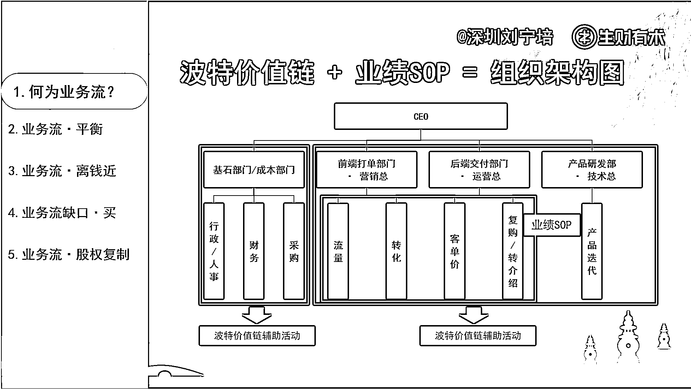

所以，真正要盯住的就是经营链路上的三个入口：获客口、成交口、履约口。

获客口看什么？曝光量、访客量、内容完读率、咨询率、加好友率、进群率、进店率……成交口看什么？点击成交比、咨询转单率、购物车放弃率、跳出率、平均停留时长……履约口看什么？好评率、回头率、投诉解决率、续约率、活跃度、留存率、互动率、LTV……

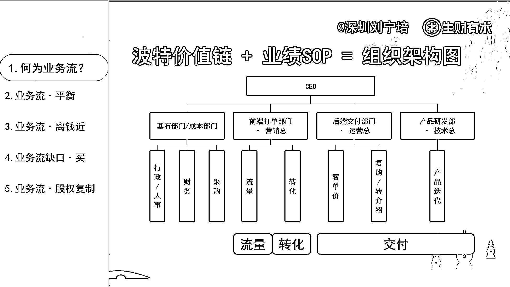

这三个口子不是孤岛，必须彼此配合。配合得好，资源不浪费、效率不滑坡；配合得差，再好的资源也会被消耗掉。想达到这种“动态默契”，至少要满足四个条件：

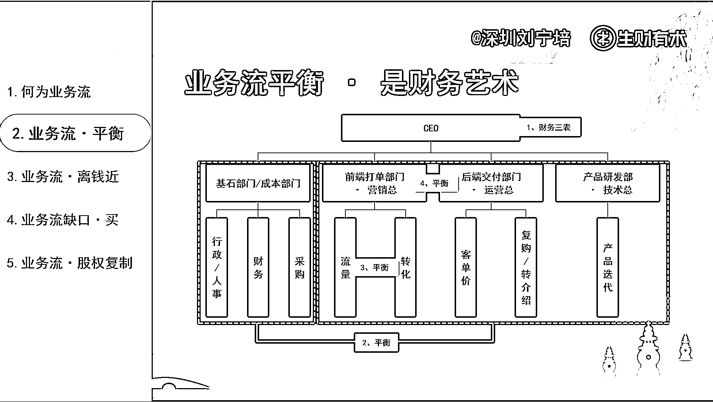

条件一：掌柜的要会看三张核心报表。资产负债、盈亏、现金进出这三张表，就是生意的体检报告。以前我也不懂，后来读了一本讲财务报表的入门书，才真正明白算账的重要性。

条件二：幕后支持与台前主干的配比要合理。起步阶段可以一人身兼多职，不必配满行政、人事、财务。但企业长大之后，该请的专业人员必须到位，否则年底收到税单的那一刻，才发现自己白白多交了一大堆冤枉钱。

条件三：获客和成交的速度要匹配。不能只顾着砸钱拉人进来，结果没人跟单；也不能客人涌过来了，成交团队人手不够，眼睁睁把最佳时机错过。

条件四：前端抢单和后端履约的力气要相当。前端卖得太猛，后端做不出来，口碑迟早要崩；后端养了一堆人，前端订单却寥寥无几，人力成本就会把利润吃光。

当然，做到绝对完美很难，轻微波动可以接受，员工偶尔放松一下也无妨。但如果失衡到近一半的程度，公司利润很可能连工资都覆盖不住，老板等于在给员工打工。

拿我的一个客户——精品烘焙工作室来举例。他们从内容种草平台吸引同城客户，再用🛰️报价聊天完成成交，下单率在30%-40%之间；后厨有五六位师傅做蛋糕，再由跑腿或专车送到顾客手中。合作前，那边的获客和成交始终保持稳定，我们把两者乘积记为1（为保护隐私做了脱敏），但后端履约能力满负荷可以跑到1.8。前面的口子只有1，后面却按1.8养人，显然存在浪费。

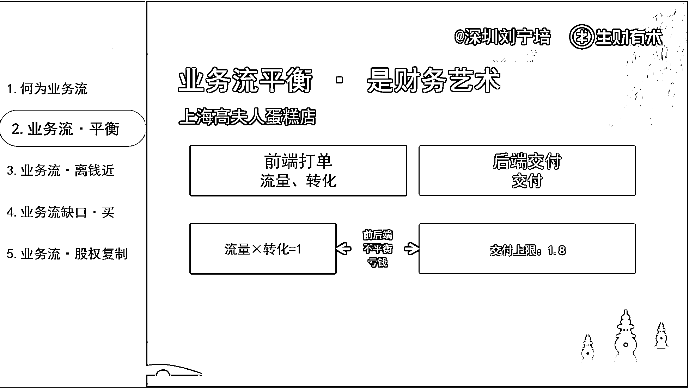

我当时给了两个选择：要么把获客和成交往前拉，让前端也够到1.8；要么裁掉部分后端人员，让履约能力掉到1。老板娘考虑后选了前者，因为师傅要培养很久。接着我们集中力量打前端，三个月后获客和成交冲到2.7，后端履约仍是1.8，于是倒过来开始补后端，重新招人、培训，慢慢把履约能力也提到2.7左右，前端和后端总算对齐。

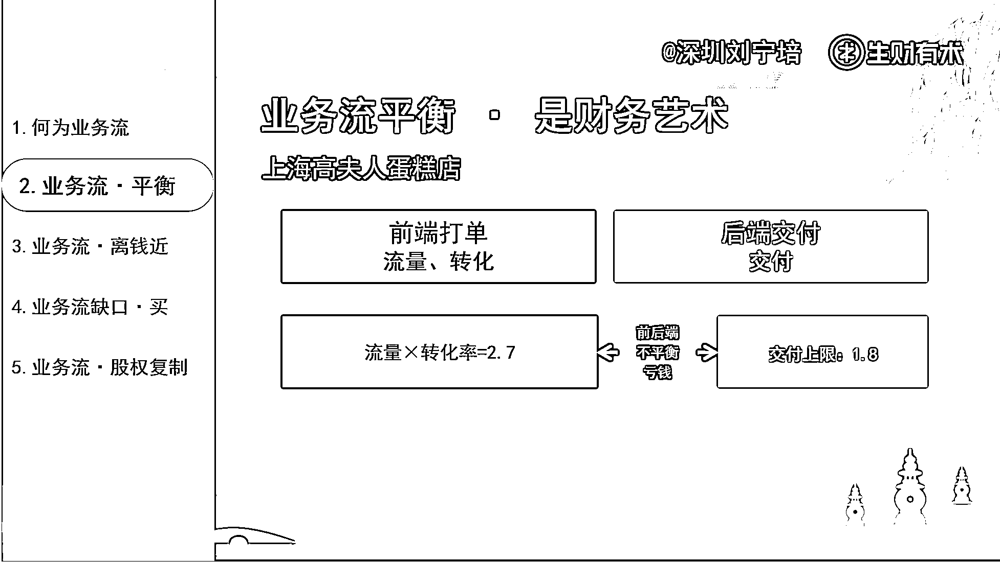
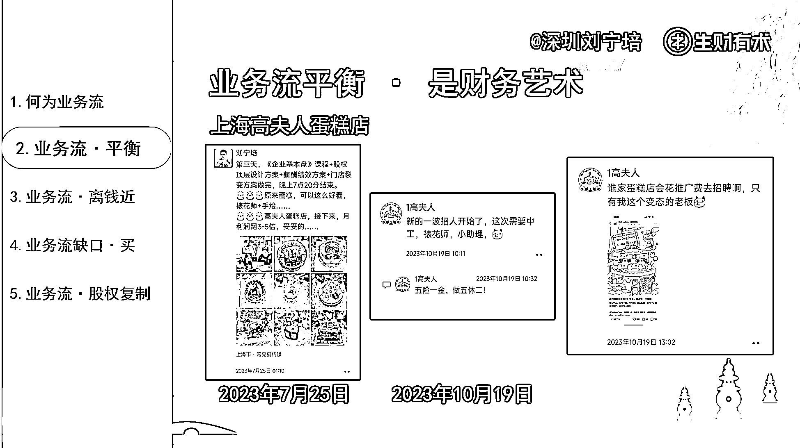

如果非要选一个口子余量多一点，我会毫不犹豫选获客口。手握充裕客源，哪怕自家的成交和履约暂时跟不上，也能把这些精准客户转介绍给同行，赚一笔佣金；而单纯成交强或履约强、却没有新客进来，那才叫真正的被动。

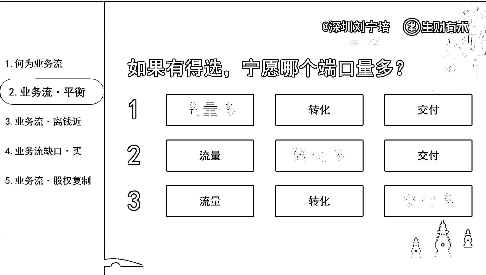

做个小结：掌柜的必须会算账，时刻关注三个口子的状态并动态调整；获客、成交、履约三个团队负责人，周会或月会上一定要同步彼此能扛住的最大承载量；否则，某个环节越卖力，另外两个环节的缺口反而被拉得越大，最后变成勤快反而赔钱。允许少量偏差存在，比如10%-20%，但如果差距过大，就需要立刻踩刹车。

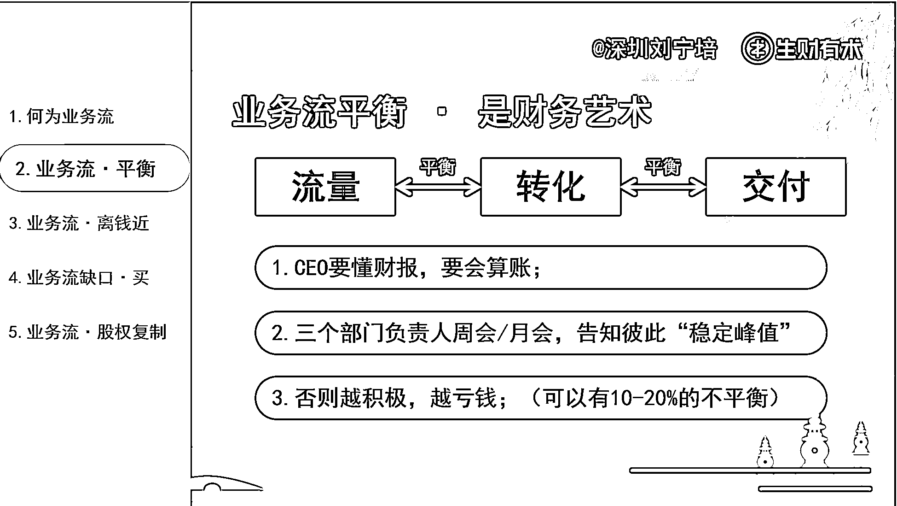

接下来说说离钱最近的东西。我做了五年企业顾问，见过很多创始人，发现不少老板身上有三种常见毛病：情绪起伏大、总觉得心里没底、凡事追求满分。最要命的就是第三条。有些人非要等获客、成交、履约都做到100分才肯推向市场，可等他们打磨完毕，黄花菜都凉了，资金链也早就断了。

还记得收益的乘数公式吗？四个乘数全做到2，收益能变16倍。可要让每个乘数都翻倍，所需要投入的时间、精力和金钱也是天文数字，现实中很难做到。所以我每到一家企业，第一件事就是盘点四个乘数中哪个在当前资源下最容易放大，然后挑出一两个重点打透。剩下几个暂时不动的，就让它维持现状，不强求。

比如做MCN的谢总，2023年的重心就放在客源量和成交率上，客单额与老带新暂时不发力；那位老板娘开的烘焙工作室，主攻的是客源和客单额；还有一个婚恋项目团队，同样把火力集中在客源和客单额上。

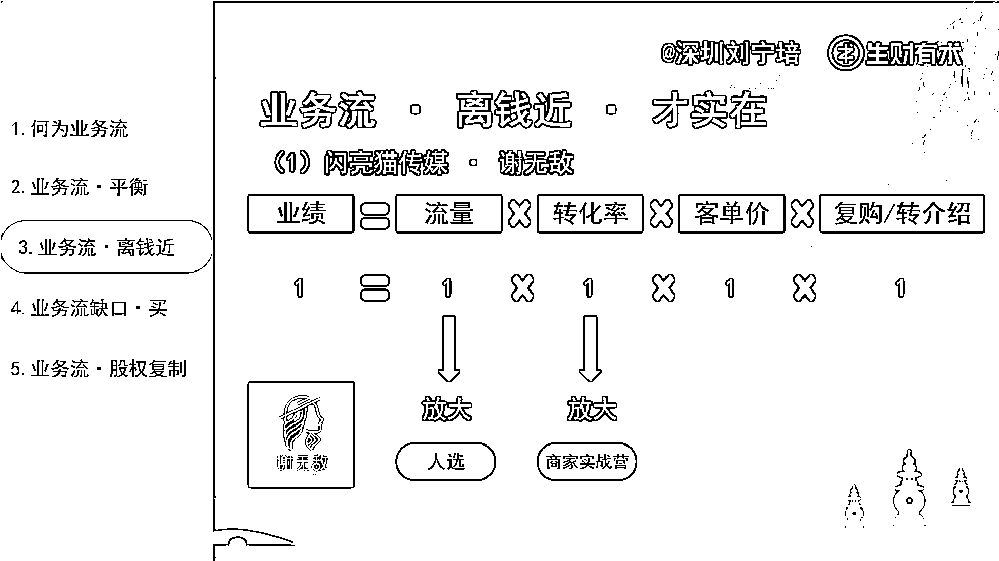
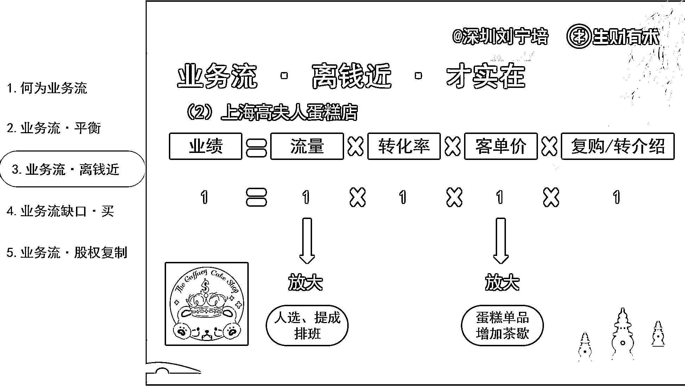
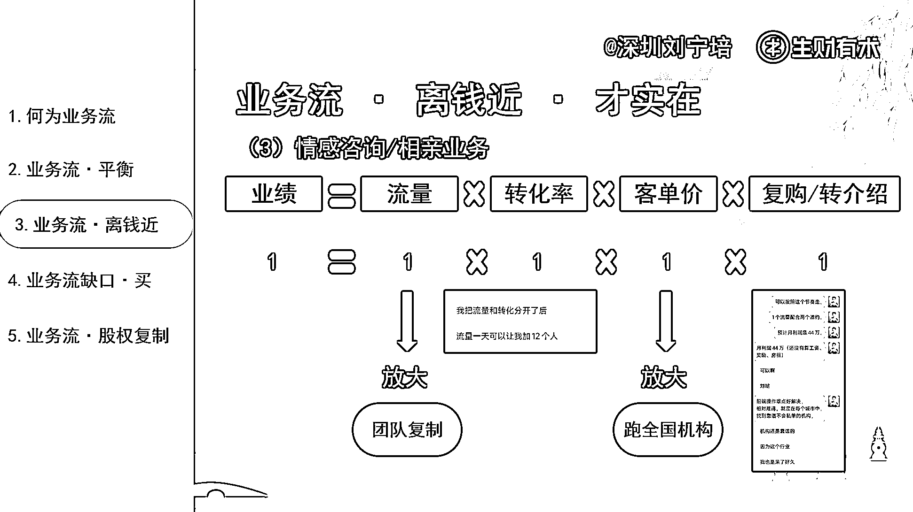

总结三句话：别等完美，否则资金链断给你看；先跑通完整流程，再慢慢完善；获客、成交、履约都能做到60分时，你已经跑赢了六成以上的同行。

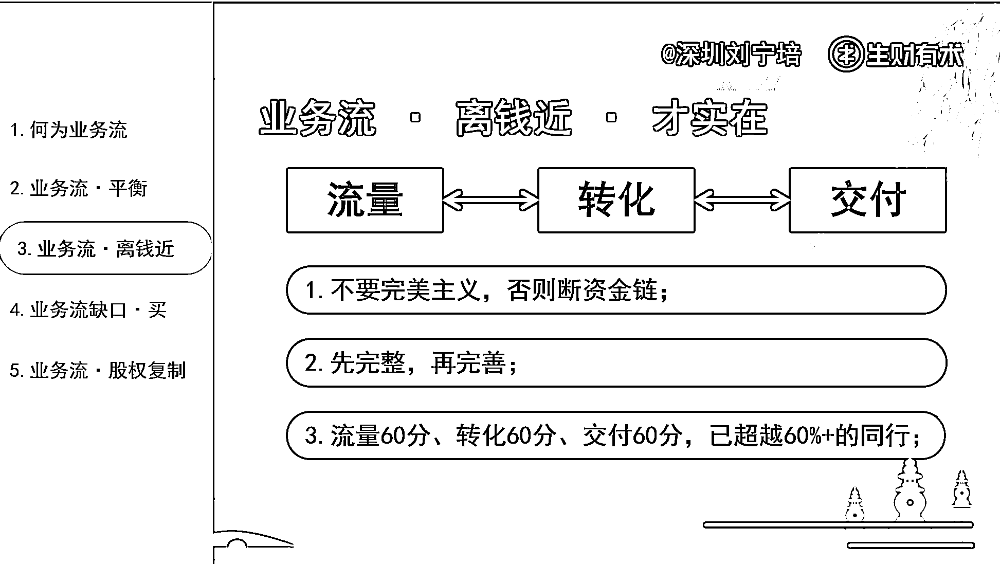

那么问题来了：如果自己公司恰好缺某个口子的能力，该怎么办？比如团队只会坐店卖货，不会线上获客；比如产品很好，但最终下单比例只有1%；再比如履约能力被对手按在地上摩擦。答案很简单：缺口是可以花钱、花股份买回来的。这里有两个思路：一是直接找外包或代运营，二是从股权层面引入股东搭档。后者更值得展开讲讲。

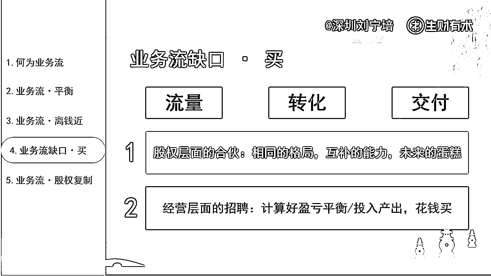

引入股东搭档，第一个基本条件就是格局同频。两个人眼界要差不多，不会为了1%、2%的股份反复拉锯。真正应该在意的，是年利润一百万时自己能分到多少，一千万时又能分到多少，而不是纠结自己多一个点少一个点那点小钱。一点小输赢不值得计较，小钱不计，才能赚到大钱。

当然，股权层面的联手不是拍脑袋就行的，控制权怎么设计、怎么进来、怎么分利益、怎么退出，这四步都有讲究，篇幅关系这里不展开，后续再专门聊。

把获客、成交、履约这三个口子看明白，再让它们动态配合，最后把短板用股东补上——收益翻倍，真的就是一套可以复制的方法论。

合伙创业，最怕的是看错人。除了大家常说的“格局一致”之外，还有两条硬杠杆也得满足。

首先，能力上要有差异化。合伙人之间最好各管一摊：一个擅长获客，一个精通成交，一个能把服务落地，这样谁也不用花几年去补别人的短板。要是大家的本事都差不多，你会的那套我也会，那还真没有绑在一起的必要。

其次，合伙要看未来能不能分到更大的蛋糕。假如单干时，你一年能做100万，我也能做100万，那么合在一起之后，第二年能不能冲到500万以上？如果能，同时视野、能力也都匹配，那就果断合伙。反过来，合起来仍只有200万，那就别勉强，不如保持商务合作，互相导流、互相抽成就够了。

---

下面聊“经营层面的招聘”。核心思路很简单：先把投入产出算明白，再花钱买人。这里要搞懂三个名词：费比、盈亏平衡点、盈利目标点。

**关于费比（费用比例）**

公司的年收入=年支出+年利润。年支出里，房租、水电、人员底薪属于固定开支；提成、奖金、产品成本属于浮动开支。年利润包括不能随意动的公积金，以及股东约定好的分红部分。把房租水电、底薪、提成、奖金、产品成本、分红比例这些数字，分别除以全年总销售额，就得出了各自的费用比例——这对应现金流量表里各业务板块的现金流出占比。

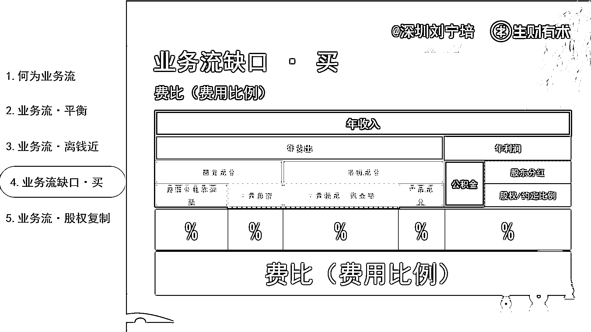

**关于保本点（不赚不赔的销售额）**

这一节建议各位老板认真看：如果连自家生意的盈亏线都摸不清，冲动创业很容易背上负债。

以开奶茶店为例：
- 固定成本：房租水电 1.5 万元
- 固定成本：5 个员工底薪+社保 2.5 万元
- 浮动成本：产品成本占销售额 40%
- 浮动成本：员工提成占销售额 20%

问：每个月做到多少营业额，刚好不亏不赚？你可以先不翻答案，自己动笔算一算。

假设月营业额为 Y，那么 Y = 4万 + 0.4Y + 0.2Y，解出来 Y = 10万。

也就是说，奶茶店每月要做到 10 万营业额，才能保住成本。

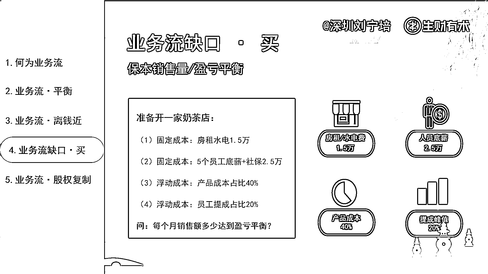
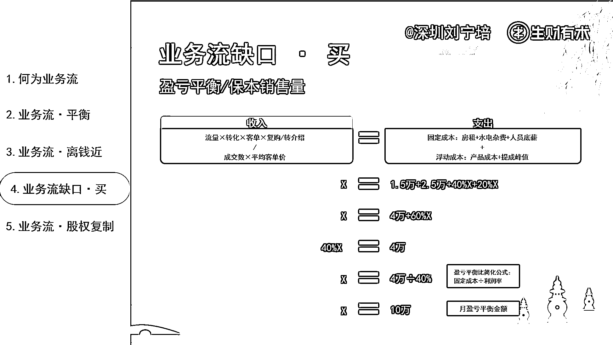

**关于盈利目标点（先看利润额）**

同样这家奶茶店，如果想每月净赚 6 万元利润，需要多少营业额？

设月营业额为 Z，则 Z = 6万 + 4万 + 0.2Z + 0.4Z，解出 Z = 25万。

所以，每月做到 25 万营业额，就能剩下 6 万利润。

**关于盈利目标点（再看利润率）**

再问：如果要求利润率做到 20%，每月又该做多少营业额？

公式可以这样写：（1-0.2）× 月营业额 = 4万 + 0.2×月营业额 + 0.4×月营业额，解出来是 20万。

也就是说，月营业额 20 万，利润率就能达到 20%。

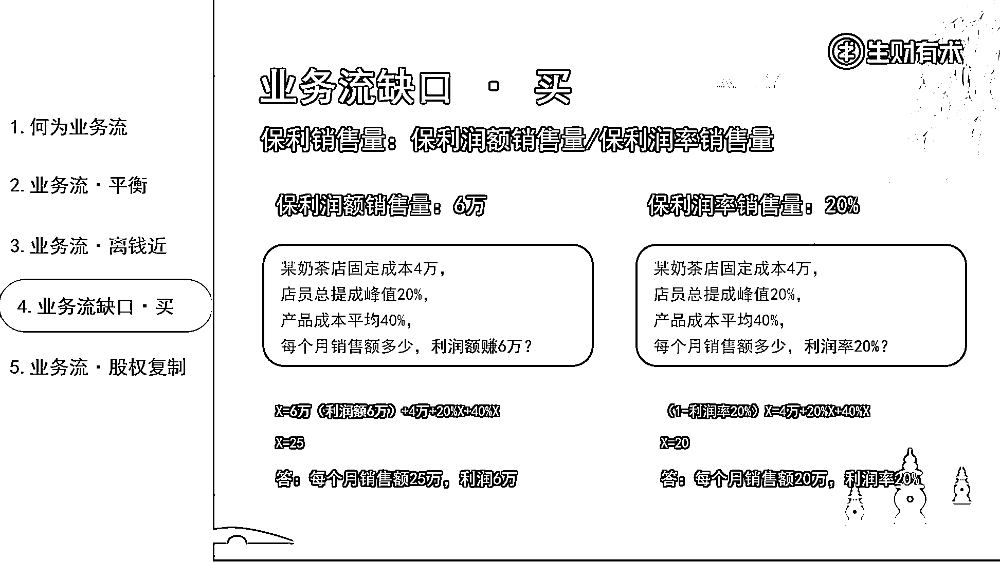
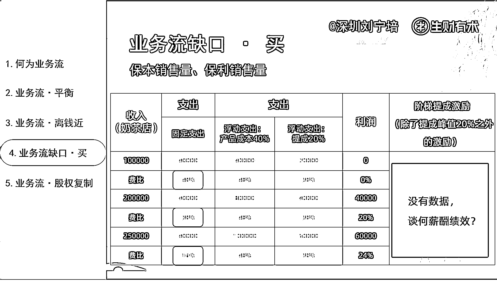

这里附上一张测算表，大家可以直接把公司的固定成本、浮动成本填进去，每月该做多少保本额、多少保利额，一填就知道。拿到结果后，再倒推营收公式：总营收=获客量×成交率×平均客单价×复购/转介绍系数。公司每月有多少新客户、成交率多高、客单价多少、老客户能带来多少新客户，全部乘起来，就能看出离保本线还有多远，会不会亏钱，又能赚多少钱。

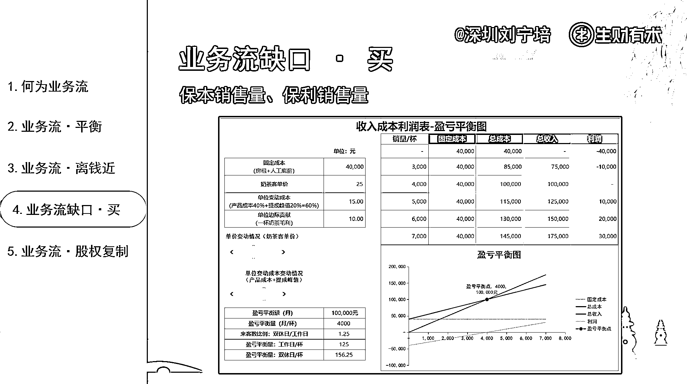

看到这儿，你也许会犯嘀咕：明明在讲招聘，怎么扯到奶茶店账本上了？先别急着往下翻，认真问问自己：这套保本、保利的算法，既然奶茶店能用，是不是任何一家公司都能用？是不是公司里的某个部门也能用？再进一步，是不是部门里的某个岗位也能用？

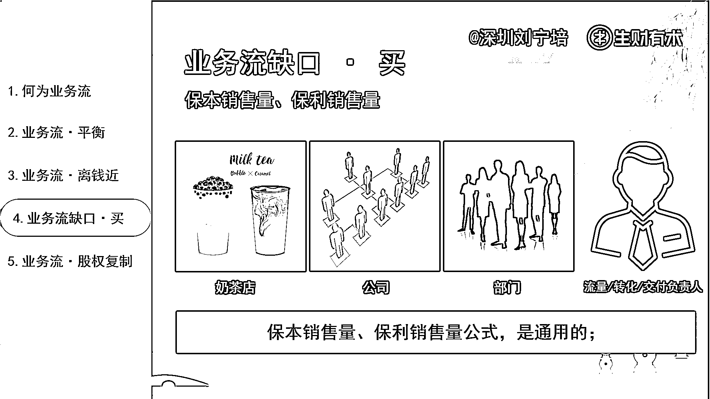

这套内容，我之前在陈雪老师组织的杭州赚钱年会上分享过，当时留了一道题。今天同样出一题，算出来的朋友欢迎在评论区留言。

题目背景：计划招一位流量部门主管。
固定成本：
- 房租/基石部门摊销 5000 元
- 底薪+社保 10000 元
浮动成本：
- 产品成本占 40%
- 主管提成占 10%

问题一：每月营业额达到多少，才能保本？
问题二：每月营业额达到多少，这位主管能创造 6 万利润？
问题三：每月营业额达到多少，这位主管创造的利润率是 20%？

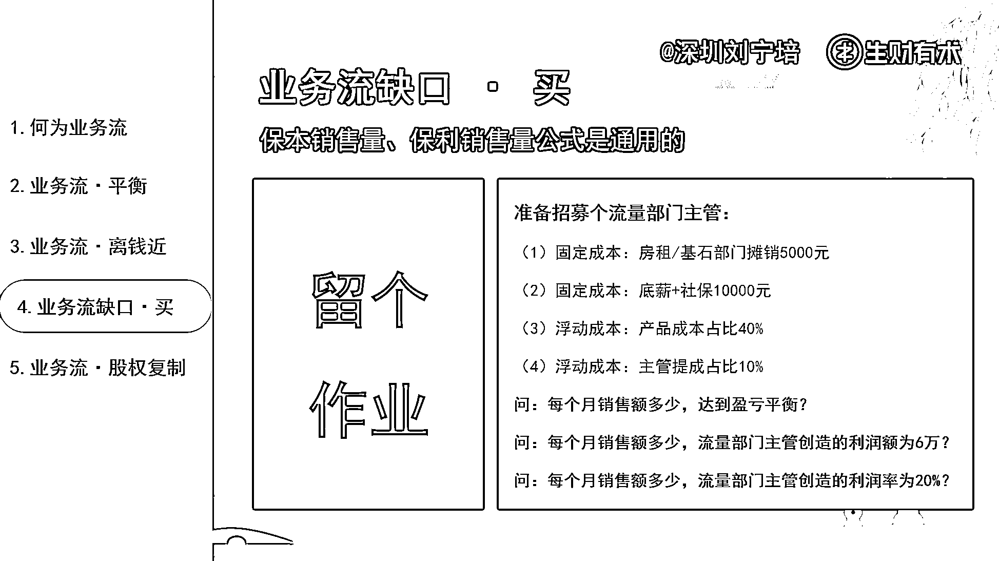

接下来，用三个真实案例，帮大家把保本、保利的算法落地。

**案例①：优剪理发店**

加入优剪之前，我参加过他们的招商会，拿到了基础的财务模型，然后自己推演过盈亏平衡点：单店月营收做到 3.6 万元（约 840 人次），日营收做到 1200 元（约 28 人），就能保本。为了验证，我还专门蹲守了家附近的一家优剪两天，一天选工作日、一天选周末。工作日进店 46 人，周末 75 人。这么一算，月营收差不多能到 6.9 万元（1612 人次），远远超过保本线，所以我当场决定加盟。

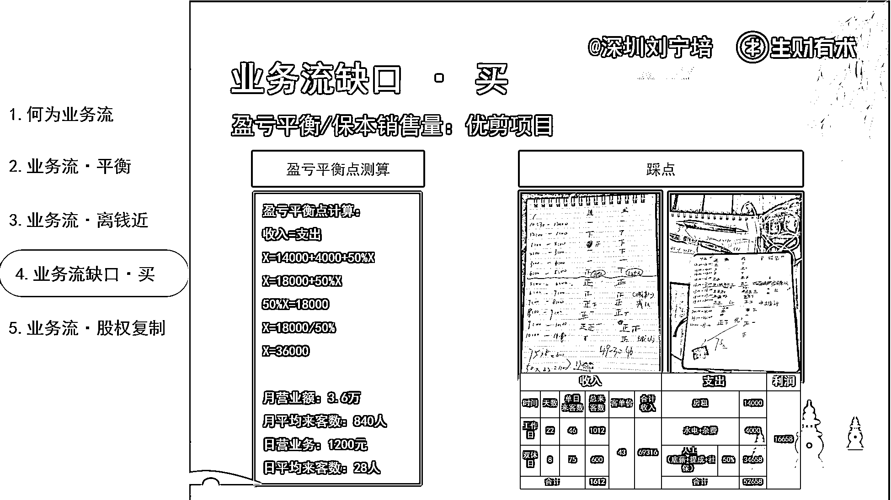

**案例②：某MCN机构**

这个项目的启动资金有几百万。对方问怎么打？我的看法是：几百万太好打了，真正怕的是那种账上没几个钱，却天天想整合上游、整合下游、还要搭平台、心气极高的老板。

打法其实很直接：先把业务流程彻底跑通，然后立刻招人。流量团、转化团、交付团各配 10 人，所有岗位都定好对应的盈利指标，也就是“保利销售额”，试用期三个月。

试用期结束后，达到指标的人就留下——因为他的产出不仅养活了自己，还能给公司带来利润。没达标的，一律请走。假设流量端剩 3 人、转化端剩 2 人、交付端剩 1 人，那就让这 6 个人组成一个最小业务闭环，确保每个人都能赚钱，接下来只要复制这个闭环就行。

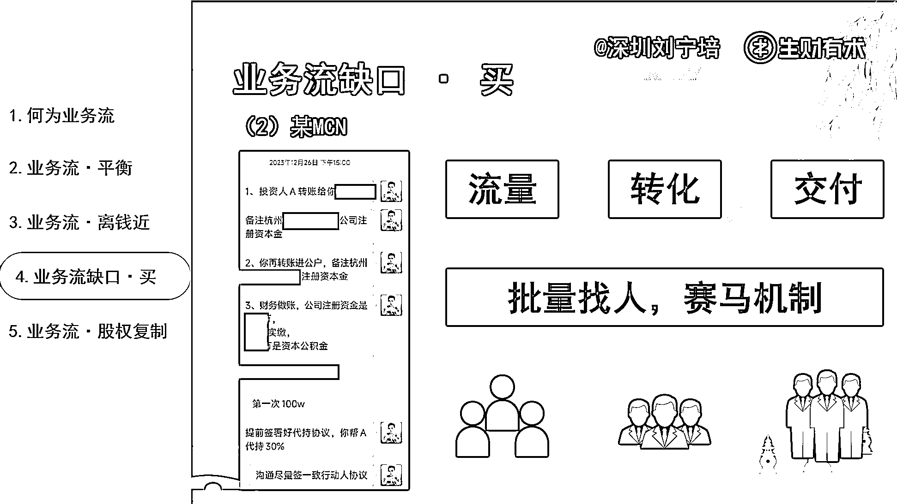

**案例③：加盟国医仲景**

这里要感谢龙哥盟，也感谢龙哥大哥。我在杭州遇到了两位靠谱的伙伴——刘驴和旭教练，我们仨一起开了一家国医仲景艾灸养生馆，走大健康赛道。

不少朋友好奇：你们几个既没做过中医、也没开过养生馆，凭什么觉得能赚？我的逻辑很简单：一家门店，说到底就是获客、成交、交付三件事。

获客端，总部提供抖音直播、线下开业支持、中医下店帮扶和美团渠道（6月上线）。成交端，总部负责项目设计、产品背书、中医下店和销售转化流程。交付端，总部给到产品、品牌、门店运营体系和线上工具。

我们三人的分工是：旭教练主外，做线下地推和现场成交；刘驴主私域；我来做财务模型、薪酬体系和股权方案。至于艾灸师和店长，就直接在市场上花钱招。这家店 1 月 3 日开业，第一个月就把保本线跑通了。至于能赚多少，等后续数据说话。

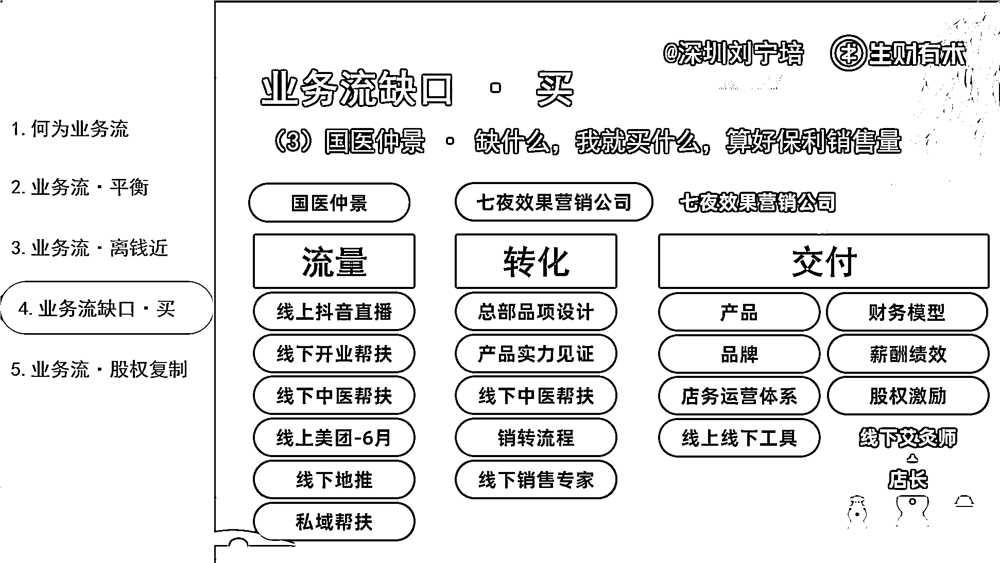

这里做个小结：
1. CEO 必须看得懂报表、算得清账、搞得定盈亏线；
2. 别一个人把获客、成交、服务全扛下来，那样做不大；
3. 要么找志同道合的人合伙分明天的钱，要么算清楚账、花钱买能力。

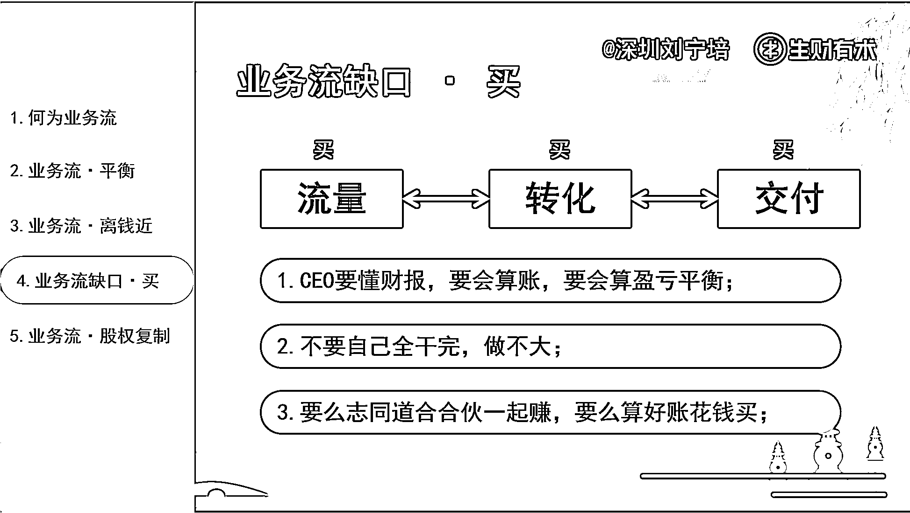

---

再说“业务流·股权复制”。

无论是互联网项目还是实体门店，坪效和人效总归有上限。既然天花板在那里，就要通过股权把资金和人才锁在一起，不停地复制、再复制。

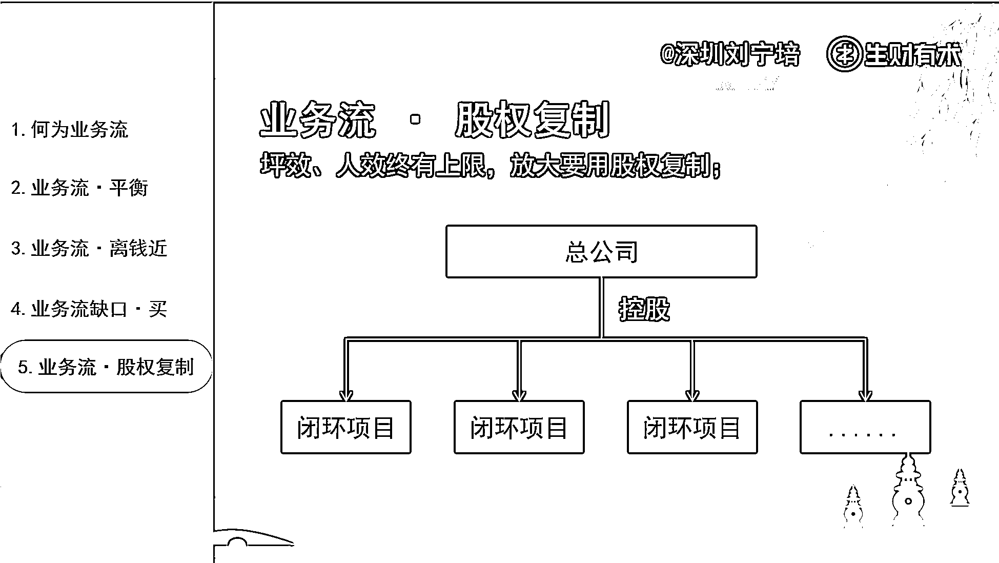

高夫人的陪跑服务，包含给内部高管、合伙人、合作渠道、投资人做落地宣讲，也可以由我代讲。她说有几位投资人想深入了解项目，我们就约在上海见面。2023 年 10 月 23 日，我和她的三位投资人聊了大概两个小时，经过一遍宣讲和一轮问答，其中两位当场决定在南京开二店，第二家店 11 月就开了。

我给高夫人定的路线是连锁化。每家店不用追求效率 100%，做到峰值的 80% 就行，这样能避免某个环节掉链子、利润率突然“断崖下跌”。门店稳定在 80% 这条线后，就一家一家往下开。上海别说开一百家两百家，开个十几家二十家，完全有可能。

具体安排是：高夫人单独成立一家餐饮咨询公司，由这家公司持股每一家店；每家店再给店长做股权激励，确保门店的坪效、人效稳定在峰值的 80%。模式讲完后，其中两位投资人马上表示，愿意各掏 10 万元，买这家还没注册的咨询公司 1% 的股份。

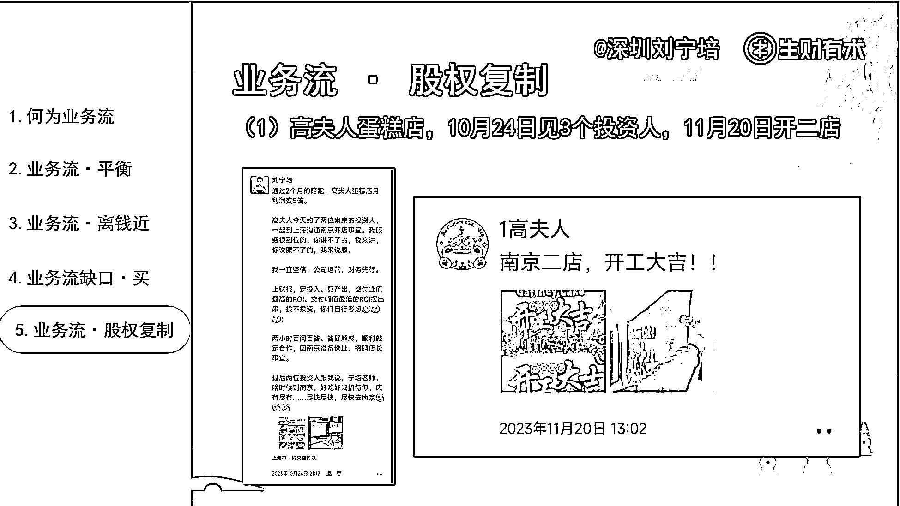

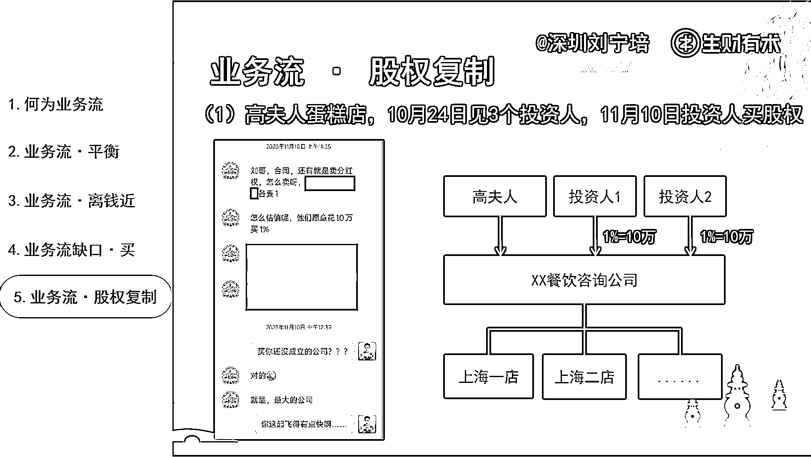

再次小结：
1. CEO 要懂财务、会算账、会分钱；
2. 别事事亲力亲为，否则做不大，也复制不了；
3. 商业模式的尽头，就是复制和批发。

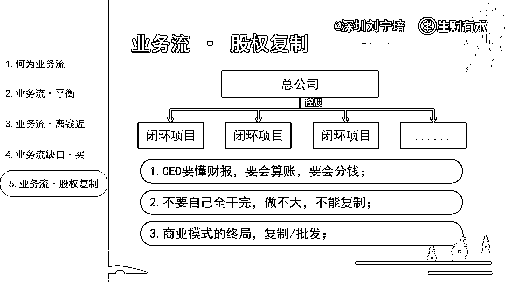

---

最后，收个尾。一起龙哥盟，2024 年赚大钱。

1. 获客、成交、交付，是公司最关键的三个业务端口；
2. 三个端口必须尽量平衡，不然就会白白烧掉闲置的人力成本；
3. 哪个端口最快能放大，就优先放大，别等完美；
4. 哪个端口缺人，要么用股权拉合伙人一起干，要么用经营思维花钱解决；
5. 记住一句话：股权复制 MVPplus、股权复制 MVPplus、股权复制 MVPplus。

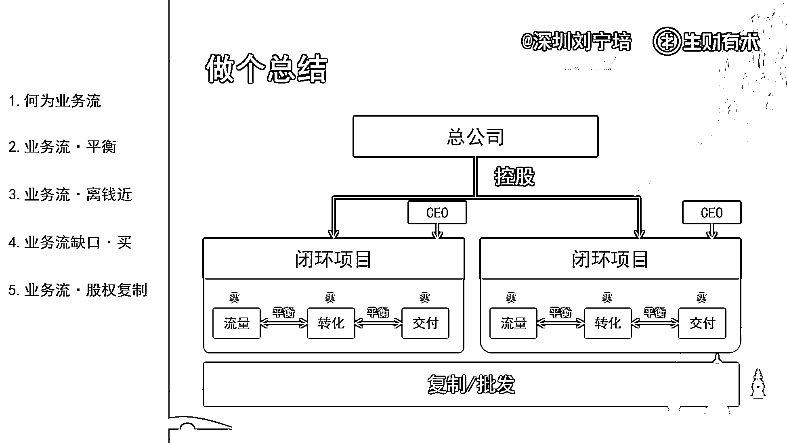

评论区：

暂无评论

