# 别小看这招“老套路”：小红书软文引流淘宝，3个月跑出400万成交，投产比超过20

很多人一听到“小红书软文种草”，第一反应都是“这招早过时了”。但同一个赛道，有人花20万预算只能听个响，有人却能把投产比做到20倍以上。赚钱圈友戴ss就是后者。去年冬天，她靠着“发笔记、评论引导去淘宝下单”这条朴素链路，用不到20万元投放，让一家新开的女装店铺在3个月里做到400万成交额，还帮一个传统服装品牌额外带来200万站外增长。今天她把完整的操作逻辑拆开，值得做服装或其他品类达人投放的朋友仔细看。

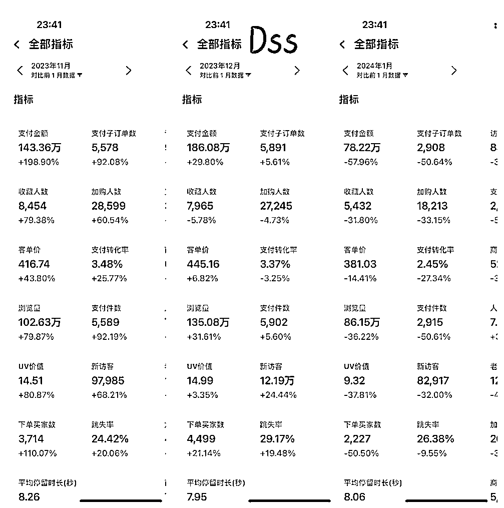

## 起手式：刷榜单，但要会刷

这套打法的起点，是一个坚持了一年多的习惯——刷榜单。不过她刷榜单的方式跟大多数人不一样：上来先按“收藏”排序。

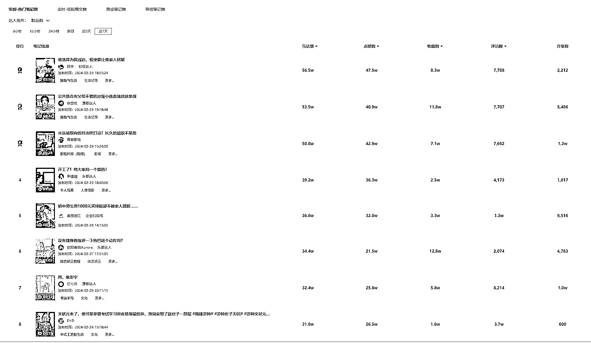

原因很简单，按推荐看，满屏都是社会新闻和娱乐八卦，价值密度太低。可一旦改成收藏排序，留下来的都是用户觉得“有用、想存下来”的内容。比如榜1的明星动作，可以快速联系到腿型矫正、足弓训练类目；第8位的美甲款式，美甲店照着做同款，大概率能火。

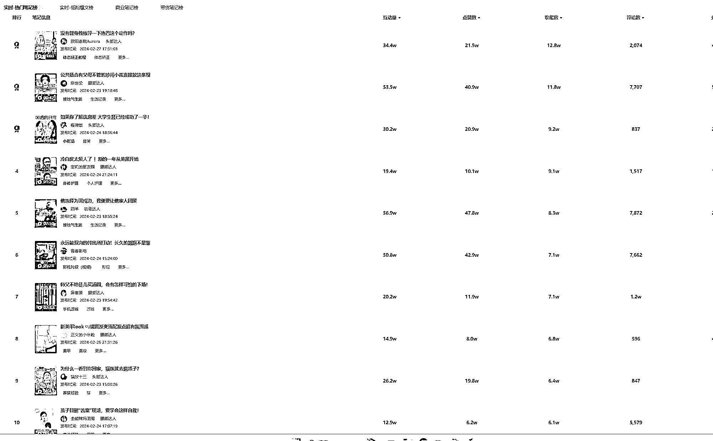

再叠加一个肉眼筛选条件：收藏点赞比小于3。一篇笔记如果点赞很高但收藏很少，说明内容只是“看着爽”，没有沉淀价值。两轮筛下来，剩下的内容含金量高很多。结合自己的行业再细看，很多选题甚至项目都能从这里挖出来。

## 正式复盘：服装选品定生死

接下来进入正题。与其说是复盘，不如模拟一遍：如果现在从零启动这个项目，每一步该怎么走。女装能不能赚钱，选品占七成。她把这套流程拆成三轮筛品。

### 第一轮：让历史数据当裁判

假设现在是2月底，春装已经来不及，只能提前布局夏装。夏天最热门的单品是连衣裙。于是去小红书搜“夏季连衣裙”，筛选标准有三条：

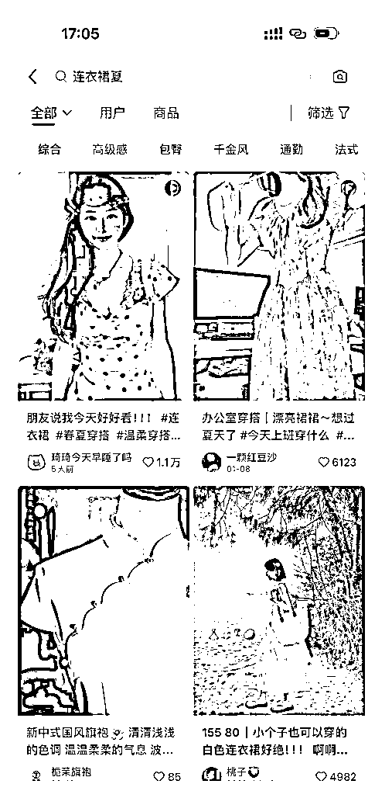

1. 点赞量超过2000，说明这款已经被市场验证过。但如果一个平时只有几十赞的小号，突然冒出一篇千赞笔记，这种更要重点关注。
2. 收藏量高出同类内容不少，规避纯养眼或娱乐向的笔记。
3. 笔记流量大幅超过这个账号平时水平，排除达人自带流量的干扰。

比如当时看到一篇1.2万赞的笔记，达人颜值和身材都很突出。但她的收藏点赞比大于3，说明用户只是来看人的，不是来买衣服的。这叫“人爆”，不是“款爆”。

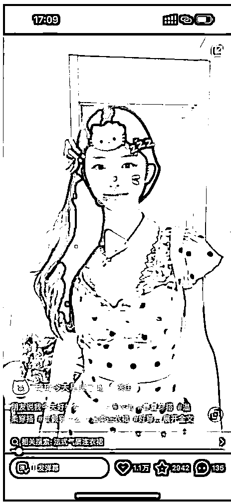

再看另一位达人：戴着口罩、不露身材，只展示衣服。结果6000多赞，收藏近4000，评论区全是“求链接”。点进主页一看，平时只有百来个赞。这种数据里的反常信号，就是潜在的爆款线索。

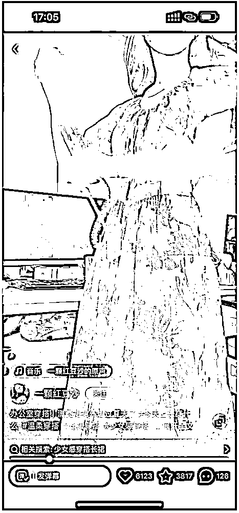

按这套方法，可以初筛出不少候选款。但要记住：这些款是别人家爆的，不代表在你家也能爆。所以还得继续往下走。

### 建一个“达人池”：筛选比数量重要

她花了两个月，整理出一个约1000人的达人资源池。这个过程很枯燥，前期录入快，后期新达人越来越难找，所以她把挖掘新人的工作交给兼职PR，按条数付费。但建池容易，筛人见功夫。很多品牌在女装投放上频频翻车，问题恰恰出在“是个人就发”。

找人的方法不复杂：搜关键词、看系统推荐、批量加联系方式。真正难的是筛选。

筛选标准包括：

1. 优先排除“大学生分享”“拼多多平替”“1688平替”类账号。这类账号带货逻辑不一样，也带不动中高客单价。

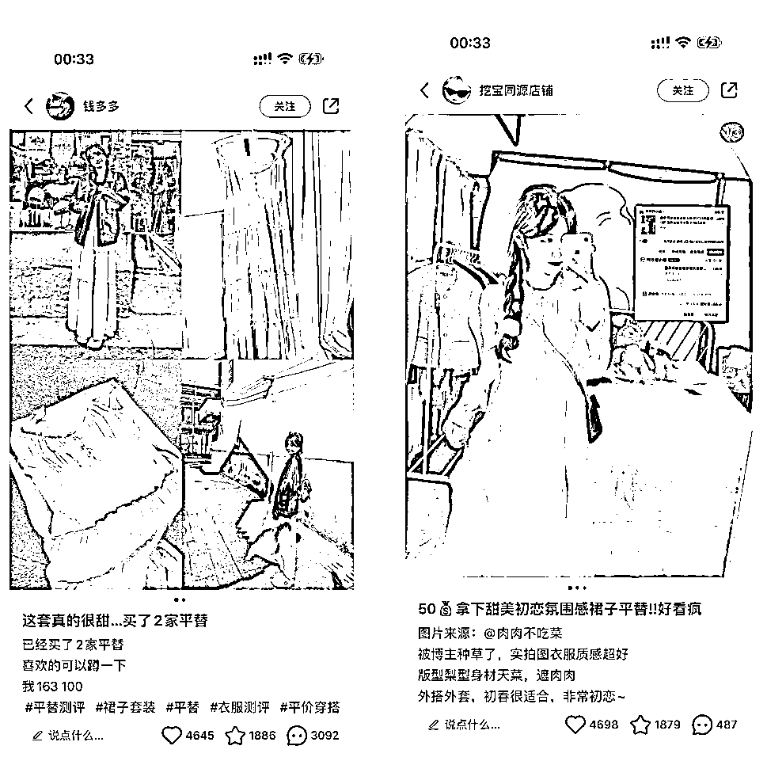

2. 作品收藏比例要高，收藏代表真实价值。
3. 内容以衣服为主，那些靠露身材、搞氛围感博眼球的号直接忽略。

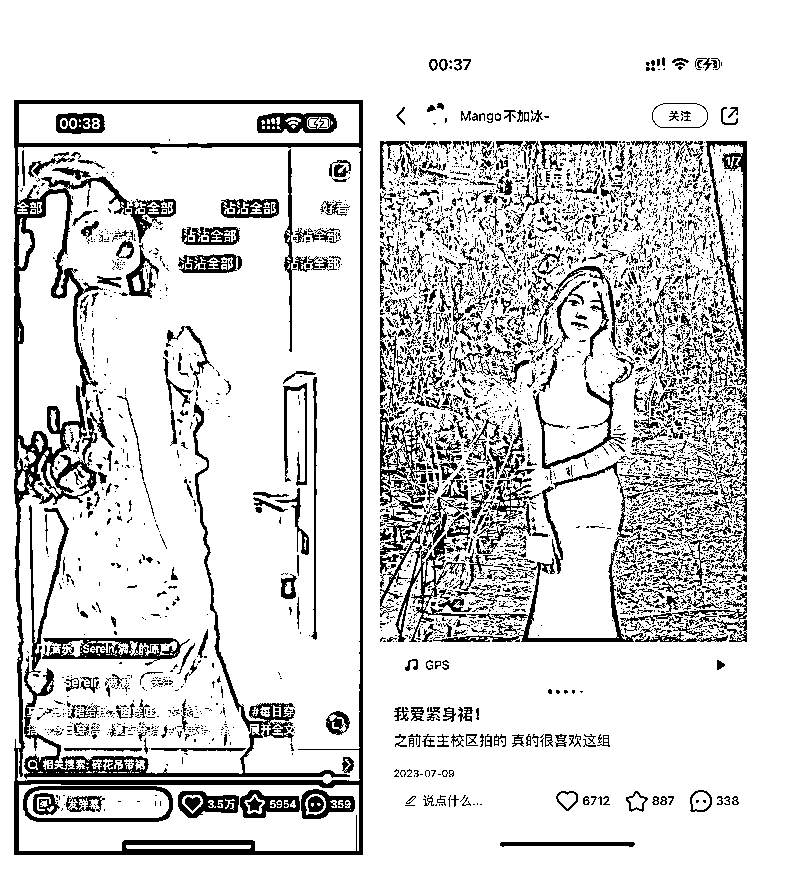

4. 合作价格合理。她这边的平均合作价在800元上下，流量周期会造成价格波动，合理范围内都能接受。
5. 验证真实带货能力。这是最关键的一步。去爆款笔记评论区找店铺名，再到淘宝找到对应商品，然后用后台数据工具追踪这篇内容发出后的加购曲线。有的达人收藏涨得飞快，但加购纹丝不动，说明只适合涨粉。真正会带货的达人，大概每100个收藏，能带来40个人把商品加进购物车。

筛完之后，按能力分成四档：第一档是流量好、价格合理且能带转化的；第二档是带货尚可，但价格或流量略有偏差的；第三档是内容一般、偶尔小爆、收费低但后面有大用途的；第四档是素人号，只在超级爆款加量时才能用。

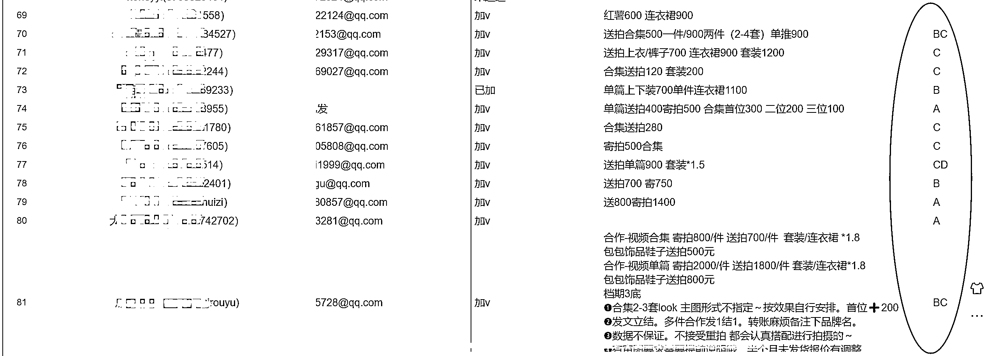

### 第二轮：让有经验的达人投票

第一轮筛下来，能准备出10-20套候选款。这些款都符合数据标准，但还停留在“理论上能爆”。于是她把候选款整理成表格，发给第一档的达人，请她们从中选1-5款。这些达人长期做穿搭，对款式的判断比数据更灵敏。画“正”字统计，得票最高的前10款进入下一轮，同时预定这些达人的夏季发文档期。

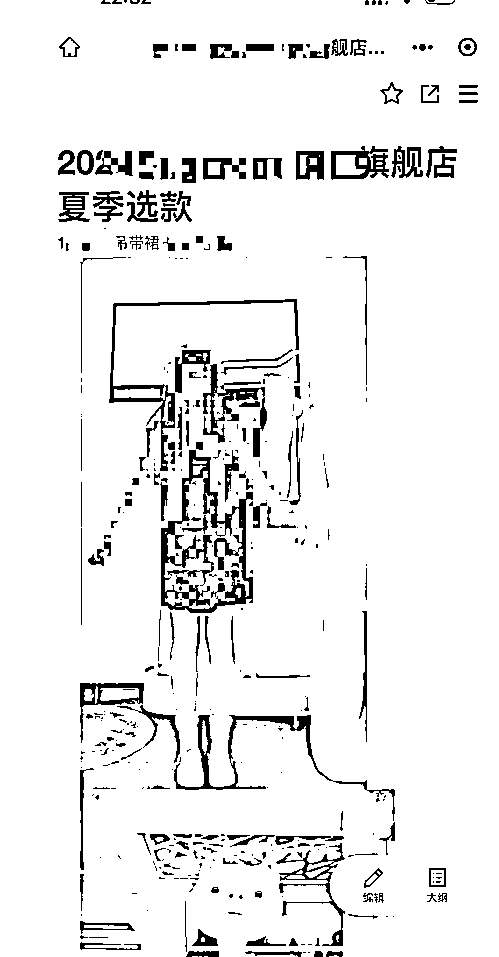

接着，再拿着前5-10款去约第二档达人，定好4月初的档期。

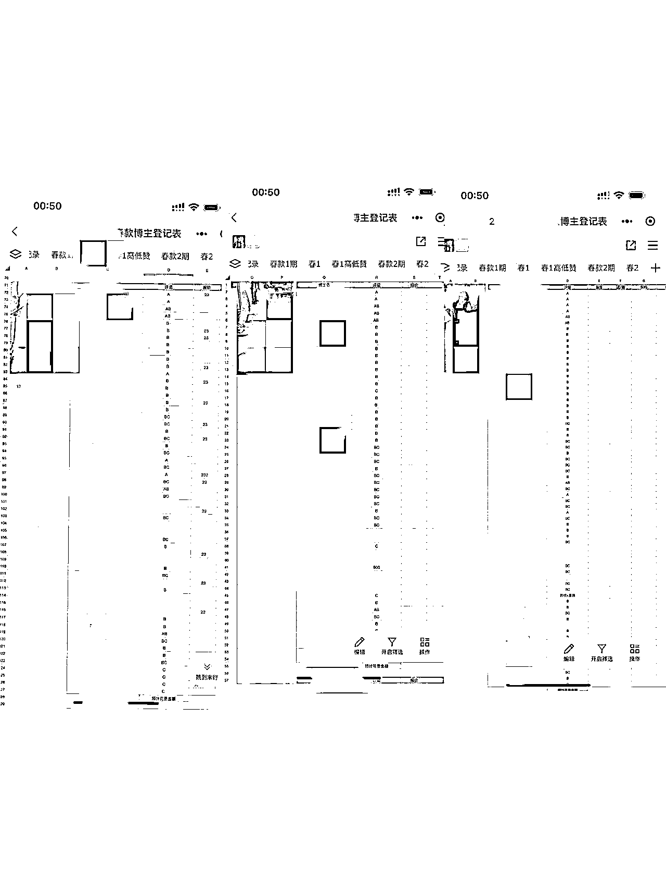

### 第三轮：让真实投放数据定生死

假设最终选定五款，每款安排30个一二档达人，4月1日起陆续发文。发到一半，数据就会明显分化：有的款普遍表现不错，甚至跑出小爆款；有的款就是不温不火。

这时候别急着庆祝，要从财务角度算账。她的判断标准是：每获得一个加购行为，按5元价值来估算。假设每款发了15篇，单篇合作价800元，那么每款广告成本是1.2万元。然后对比五款带来的加购数据，排名最靠前的1-2款，就是真正的种子选手。

为什么其他款会被淘汰？原因有三：一是这些款可能几年前就火过，爆款有周期，已经被市场推烂了；二是测试样本有限，达人流量本身有随机性；三是财务账算下来，只有种子选手的投产比最高。其他款也许能赚，但赚得不够，甚至有一款只能保本，那就果断砍掉。

### 锁定爆款后：大胆加量

一旦种子选手确定，就要把它当成“谁发谁爆”的素材。已经验证能赚钱的款继续正常发，但不加码。同时，拿这个爆款去撬动一二档达人的临时档期，比如主动加价几百元。达人看到爆款笔记的数据，通常都愿意插队。

这时，第三档达人和素人号的作用就体现出来了：她们不太会选品，但照搬模板的能力很强。直接把模范爆款笔记的链接甩过去，让她们照着拍、照着发，就能蹭到一波流量。发文量可以从每款30篇直接加到100篇甚至150篇。曾有顾客说刷到过她家四五篇笔记。200个账号同时推一个款，关注这类女装的人基本都能刷到。

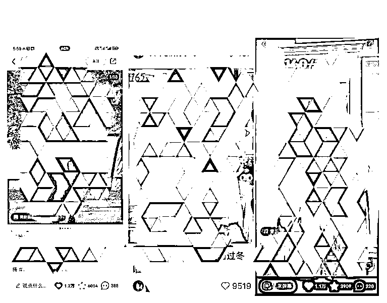

## 总结：爆在自己店里，才算真爆

整个过程，本质上就是三轮筛品：历史数据筛一次，达人眼光筛一次，真实投放数据再筛一次。只有最终在自己店铺里跑出爆款，才算真正成功。这也是她能做到投产比20倍以上的原因。很多人觉得这招过时，其实差距不在招式，而在每一步是否够细。

财务层面，她家的定价是成本乘以2.5，但女装最怕库存，所以采用先预售、后生产的模式。前期只备达人样衣，爆单后再小批量返单，7-10天出货。库存压力不大，但退款和货品生产环节也让人头疼。去年冬天因为工厂排期出错，一堆待发货订单难产，损失不小。最后扣除各项成本，净利润约35万。其中11月投放7万，营业额140万+；12月投放9.2万，营业额180万+。

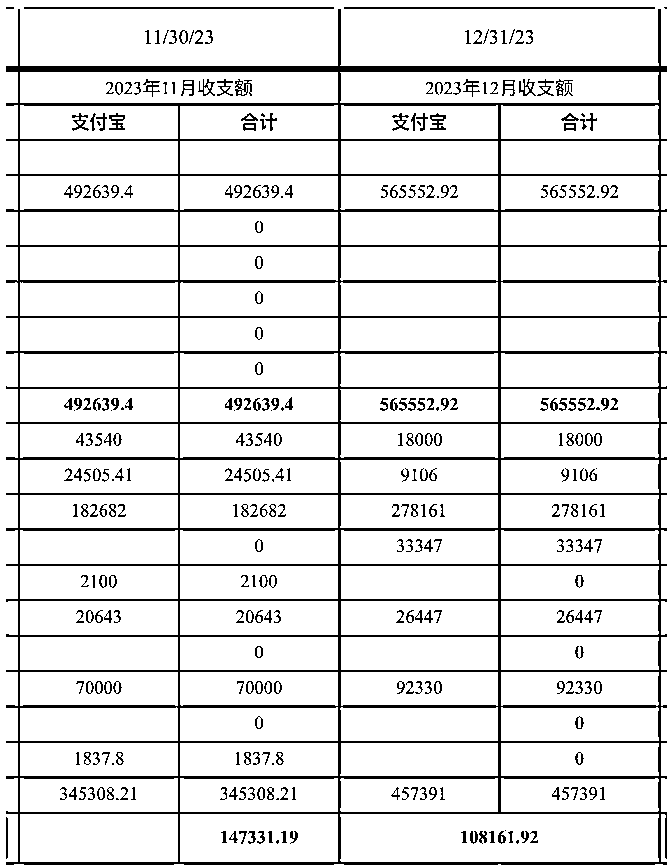

## 几个大家可能关心的问题

**为什么没尝试小红书自己的电商闭环？**
她做过对比实验：同一个大爆款，不挂购物链接、靠评论引导去淘宝成交，远高于挂链接的转化。原因在于，平台内很多没有IP属性的达人带不起高客单价，连衣裙超过100元就很难卖。而那些卖300元以上的平台内爆款，背后都是强人设买手，属于另一套玩法。

**为什么从女鞋转到了女装？**
最早看中的其实是女鞋，供应链都谈好了。但测试发现，女鞋出了爆款笔记后，加购数据增长不明显，需要多轮曝光才能成交。正好有服装工厂的朋友，就转向了女装。其实光腿袜、功能型内衣等品类也值得挖掘。

**低客单价和高客单价怎么选？**
低客单价领域已经有大量平替号，很多是拼多多、1688商家在运营，利润和生产成本都不够性感。更高阶的玩法是：把达人合作单价提到2000元左右，配合淘宝上质感高级的欧美模特实拍图，能带动300-700元的夏装、700-1000元的冬装，回报也相当不错。

**自营达人怎么玩？**
自己养穿搭账号，把验证过的爆款交给她们发布，起号很快，流量成本也低。除了带自家货，还能接外部品牌的种草合作，反向辅助选品。

**货品从哪里来？**
核心就是先预售，爆单后再下单生产。生产环节很痛苦，这里就不展开了。如果有优质服装工厂资源，欢迎联系合作。

最后说点题外话。作为赚钱的老圈友，这次第一次走进赚钱办公室，熟悉又陌生。平时总是默默刷风向标和精华帖，很少输出，这次索性把经验写出来，希望能帮到大家。行文有些粗糙，见谅。

