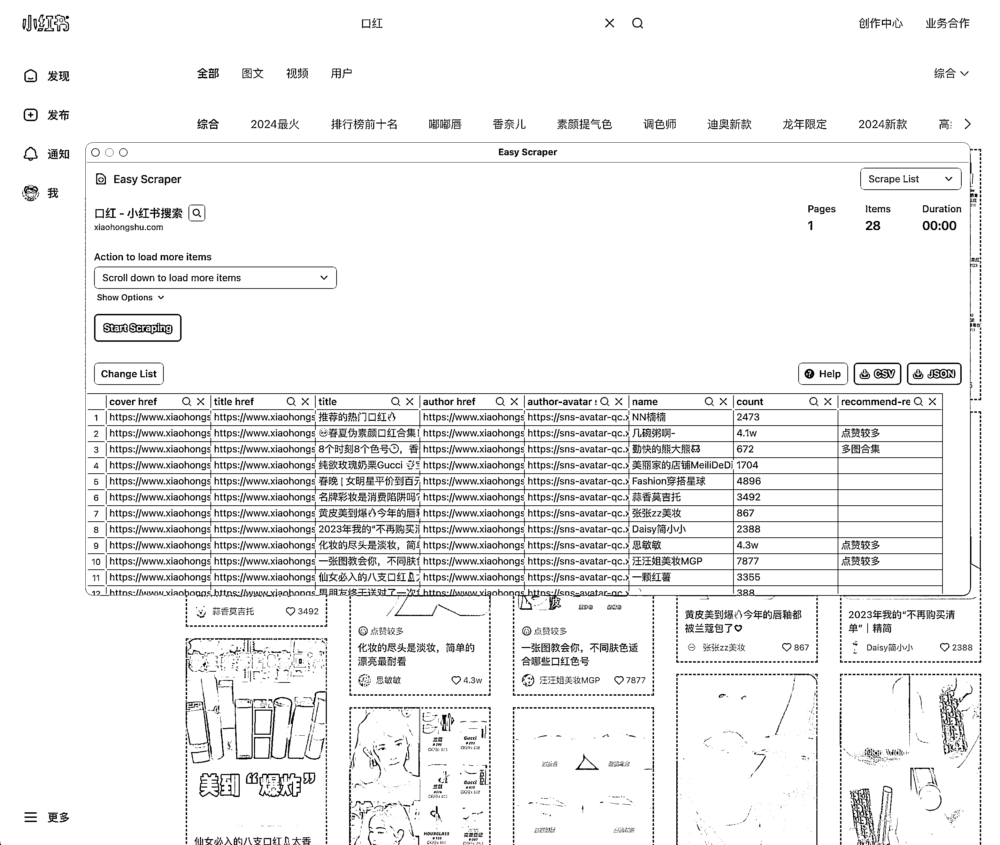
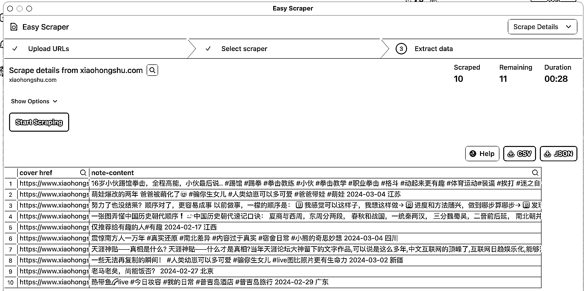
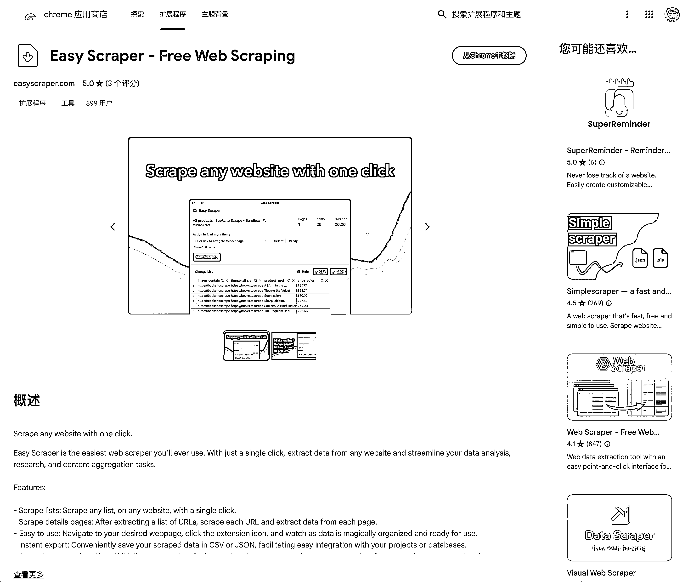
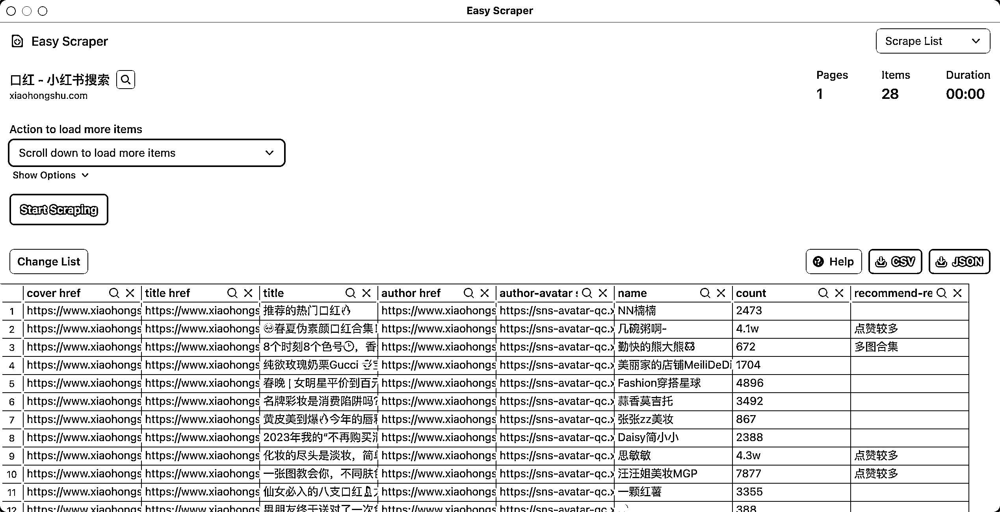
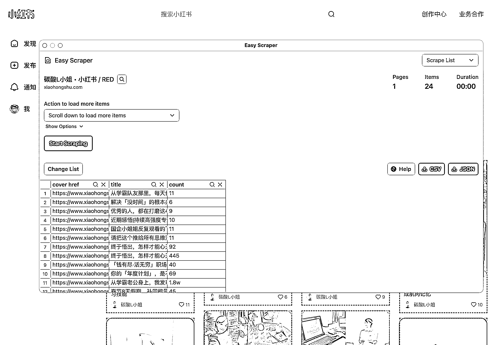
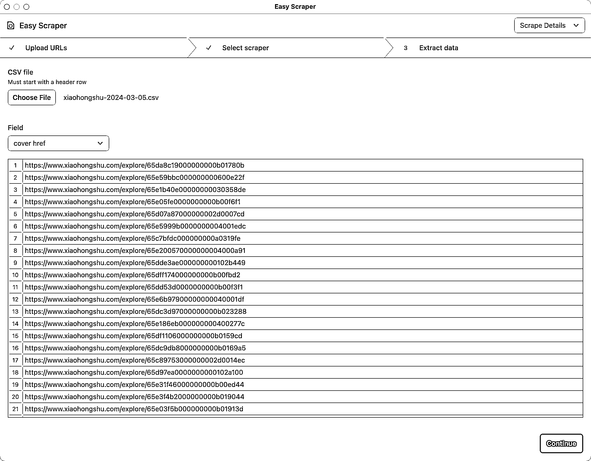
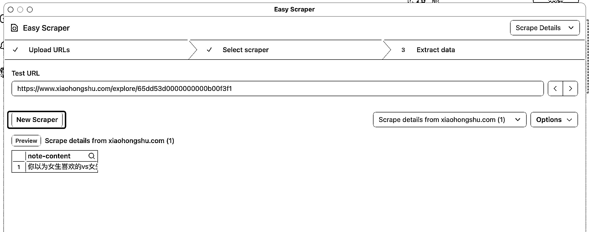
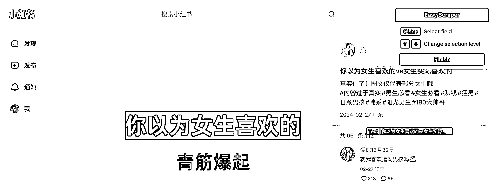
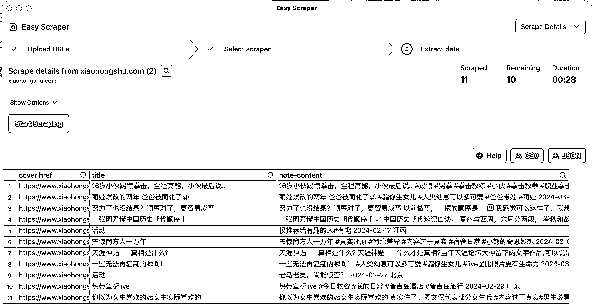
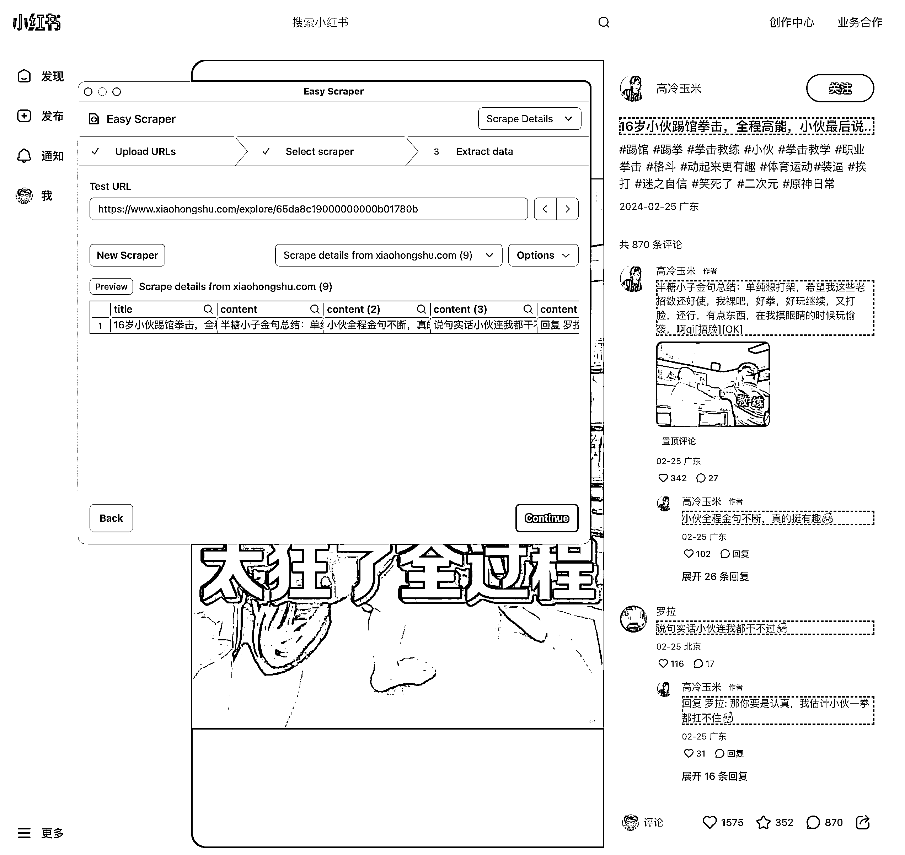

# 一键搞定：零代码秒级获取小红书笔记标题与正文

## 50 赞 零代码 1 秒导出小红书帖子标题和详情

作者：姬小光
日期：2024-03-05

哈喽各位，我是姬小光。今天要分享一个几乎零门槛的数据抓取神器 Easy Scraper，用它可以在 1 秒内把小红书的笔记标题和详情扒下来，而且完全不需要写代码。这款 Chrome 插件只要点一下，就能把任意网站的内容收进囊中。即使你从未接触过爬虫，也能瞬间拿到小红书的数据。先瞅瞅实际效果：

Easy Scraper 的核心能力围绕着列表抓取、详情抓取、操作简便、即时导出、对动态页面友好以及隐私优先展开。打开目标页面后点一下扩展图标，数据就会被自动整理好供你使用。它能很好地处理由 JavaScript 渲染出来的内容，即使是结构复杂的站点也能稳稳捕获。所有操作都在浏览器本地完成，数据不会上传到网络，私密性和安全性都有保障。

导出格式支持 CSV 和 JSON，拿到的文件可以直接喂给 ChatGPT 做初步分析，或作为 GPTs 的知识库素材。目前插件完全免费开放，原因是开发者在三月份全程参加静默冥想闭关，暂时没空去做付费功能的设计。

下面进入实操环节。

## 先把帖子列表的基础信息导出来

怎么上手？第一步去 [Chrome Web Store](https://chromewebstore.google.com/detail/easy-scraper-free-web-scr/ibdncfidcgeammedkdhoopophkkhcbme) 或 [官网](https://easyscraper.com/) 安装扩展，一键搞定。

安装好后打开你想采集的小红书页面，点击浏览器右上角的插件图标激活，就能在一秒内把帖子的基础信息导出：

如果想更精细地控制，还可以自定义抓取规则，比如调整列表滚动方式、抓取速度、滚动等待时长等。最后挑一个格式导出就算大功告成。

再举个例子，抓取某个博主的笔记标题：

结果里会包含笔记标题、链接以及点赞数等字段。抓到的标题可以直接交给 GPT 模仿生成同款标题，也能做简单的数据分析。

## 再把单篇笔记的详情数据抓出来

第一步我们已经拿到了列表的 CSV。接下来在插件右上角点选 Scrape Details，把刚才导出的列表文件重新导入进来：

工具会自动识别出最可能的详情链接字段，确认无误就点「Continue」，如果不对可以手动在下拉菜单里换一个字段。

然后进入详情页的元素配置，点击「New Scraper」后会弹出选择器，鼠标悬停并点击你想要采集的区域即可：

选好后点「Finish」完成配置：

继续点「Continue」进入抓取环节，点击「Start Scraping」开始拉取详情内容：

可以看到标题和正文都已成功采集，再次导出 CSV 就能使用。

想要同时抓取多个字段怎么办？在选择器界面按住 Ctrl 点击，Mac 用户按住 Cmd 多选即可，效果如下：

如果你直接框选了一个大的容器，插件会自动拆解子元素生成多列，不过不如手动多选那么精准。

## 小结

上面这两种做法本质上是通用的网页采集思路，只要更换选择器或微调列表配置，就能应用到任何肉眼可见的网页。最大的亮点就是极简：无需学习爬虫、无需写一行代码、也不用安装额外软件，点几下就能拿到数据，还有比这更省心的吗？

喜欢在飞书阅读的小伙伴可以戳这里：https://vfu5gh579k.feishu.cn/docx/G10CdKxKxoPrtAx7m3vcvzSanTd

* * *

评论区：

离心之巅 : 请问导出来都是乱码怎么回事呢

姬小光 : 大概率是打开方式的问题。如果你用 Excel 打开 CSV，可以在「数据」菜单里选择「从文本」导入，并在导入向导中指定正确的编码格式。

， : 二次爬取 多元素是怎样弄的呢 我二次爬取只能爬一个元素

离心之巅 : 好的，谢谢

姬小光 : 你好已经更新到文章里了。

樾樾 : 采集详情页点击 Finnish 之后出现了这个

姬小光 : 多试试不同的选择范围，可能跟页面结构有关，或者按操作发给作者看看

， : 太棒了 谢谢

* * *