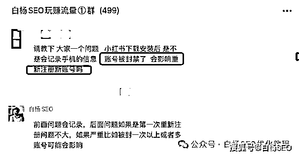
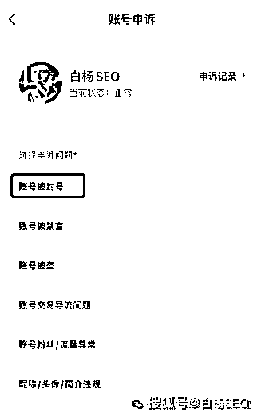
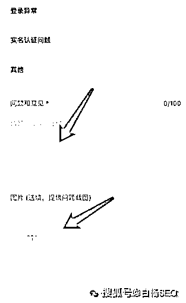
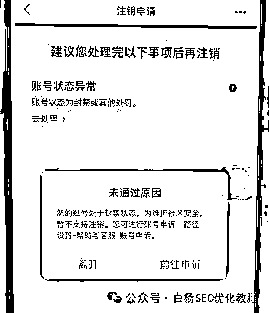
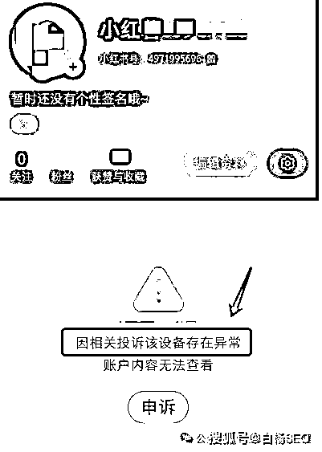
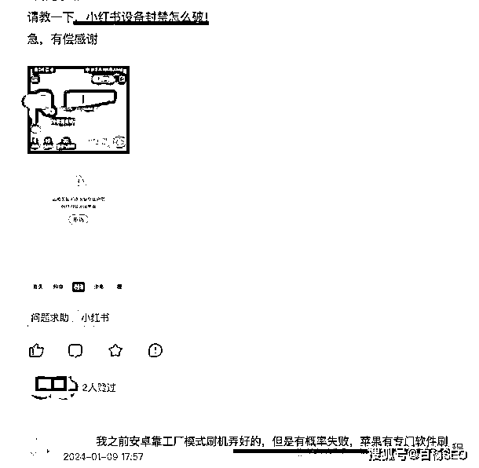
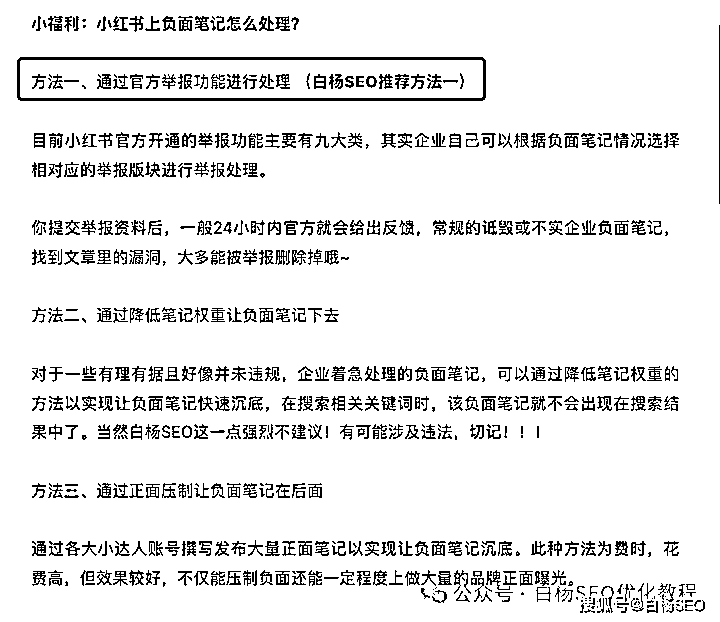

# 📕被封号或封设备怎么办？📕负面处理参考

被📕“制裁”了？账号封禁、设备拉黑、负面笔记到底怎么破？这篇实操指南建议收藏

最近后台收到好多朋友留言，都在问📕账号被封了该怎么办、设备被限制登录怎么处理，以及平台上出现了对品牌不利的笔记要怎么应对。其实这些问题在圈子里也经常被讨论，今天就把我了解到的处理思路整理一下，希望能给在📕上做推广的朋友一点启发。

先列一下这次要聊的重点：

1. 📕账号被封，有哪些可行的解决办法？
2. 账号没被封但设备被限制了，如何处理？
3. 账号或设备出了问题，重新注册会不会有影响？
4. 📕出现负面笔记，怎么处理才算稳妥？

**一、账号被封，首选方案是什么？**

如果账号被封了，最直接、效率最高的做法就是放弃这个号，重新开一个新号继续做。或者把你原来这个手机号从📕解绑出来，再绑定到新注册的账号上。

当然，有些小伙伴会觉得这个号养了挺久，数据也不错，放弃怪可惜，想再努力抢救一下。那就走账号申诉的路子，不过成功率没办法保证。具体操作是这样的：

第一步，打开📕，进入你的创作中心。

第二步，看你的账号情况分两种操作：
- 如果已经开通了专业号，那就拉到页面最底下，点击“前往帮助中心”。
- 如果还没开通专业号，就先点“更多服务”→“开通专业号”，然后在开通专业号页面的顶部能找到“联系客服”入口。

第三步，不管走了上面哪条路，最后都能进到一个页面，上面有“笔记申诉”和“账号申诉”的选项，直接点“账号申诉”。

第四步，申诉问题类型选“账号被封”，然后填写申诉理由，再上传相关的截图证据，点“提交”就完事了。

这里得说句实在话，这种申诉成功率确实很低，除非你是真的被冤枉了。想提高一点点希望的话，可以多申诉几次，或者打官方电话反馈，运气好的话一个月左右可能解封。

另外顺便提醒一下，像“笔记申诉”“账号交易导流问题”也是在这个页面里处理，方法差不多。如果账号实在解封不了，记得不要直接注销，而是把手机号解绑出来，绑到新号上去用。

那如果号注销不掉怎么办？可以先把账号上除手机号之外的其他绑定信息都解掉，留一个手机号就行。然后换另一部手机去注册新号，注册的时候别用手机号，用其他方式注册。注册好之后，在新手机上发一条笔记，再把原来被封号的手机号拿去绑定这个新号就可以了。

特别提醒：如果你的📕账号已经做过实名认证，那就没办法解绑了。所以你会发现，很多做推广的人故意不做实名认证，因为这样不影响笔记流量，还能方便操作上面的流程。

**二、设备被封了，怎么破？**

先解释一下，这里的“设备”指的是你登录过📕账号的手机、平板或者电脑，通常手机和平板是重点对象。

如果你问最快解决办法是什么？那只能是换一台手机。不过别慌，账号第一次被封并不等于手机设备也跟着被拉黑。只有当你同一个账号第二次被封禁，那这个设备才比较危险了，因为封设备属于📕最重的处罚之一。

当然也有一些不一定百分百奏效的偏方，可以参考：苹果手机的话可以尝试重新刷机，大概率能清除限制；安卓手机也可以刷机或者修改设备信息来试试，只是成功率通常比苹果低一些。

**三、重新注册会不会受影响？**

如果只是账号被封，只要你没做过实名认证，手机号就可以解绑，解绑之后再重新注册一个新号绑定原来那个手机号，基本没什么影响。

如果你现在用的这个手机设备并没有被封，那直接在这个设备上登录新账号，也是没问题的。

但万一设备本身已经被封了，那你不管注册新号还是用别的老号登录，都会受到牵连。所以这种情况，你就得按上面说的刷机之类的办法先把设备“洗白”，恢复才能继续正常用。

**四、碰到负面笔记，怎么处理更聪明？**

早在三年前我写📕SEO相关文章时就提到过三种应对路径，这里再展开说说。

我最推荐的是第一种：如果是被“恶意”用户发了负面笔记，而且你确认不是自己的产品或服务本身有问题，那就可以向📕平台发起投诉和维权，请官方介入处理，不过前提是你本身站得住脚，否则很难通过。

第二种是通过正面内容去覆盖：找大量的素人、博主或者达人，集中发布更多高质量的正面笔记。想做到覆盖效果的话，正面笔记的发布量要够多，并且其中一部分权重还得压过那些负面笔记才行。这个方法成本不低，但属于比较靠谱的常规打法。

至于第三种，也是很多人来咨询过的“降低笔记权重”——有人专门做这类业务。说实话，我不太推荐这种手段，一方面它本质上属于灰色操作，比如通过大量投诉举报或者shua量去压权重，另一方面这也毕竟是人家的饭碗，咱就不多展开了。

希望今天的分享能对你有点帮助。觉得有用的话可以持续关注，我已经在做原创内容这条路上坚持周更六年了，专注深耕SEO和流量这个垂直领域，算是比较实战派的自媒体人。

我是白杨SEO，十年专注于SEO这件事，研究全网精准流量，全网同名个人品牌都是白杨SEO。

大家在评论区的讨论也挺有意思，有朋友说被封了很难解开，我一般给的建议就是：别死磕旧号了，重新起号吧。

* * *