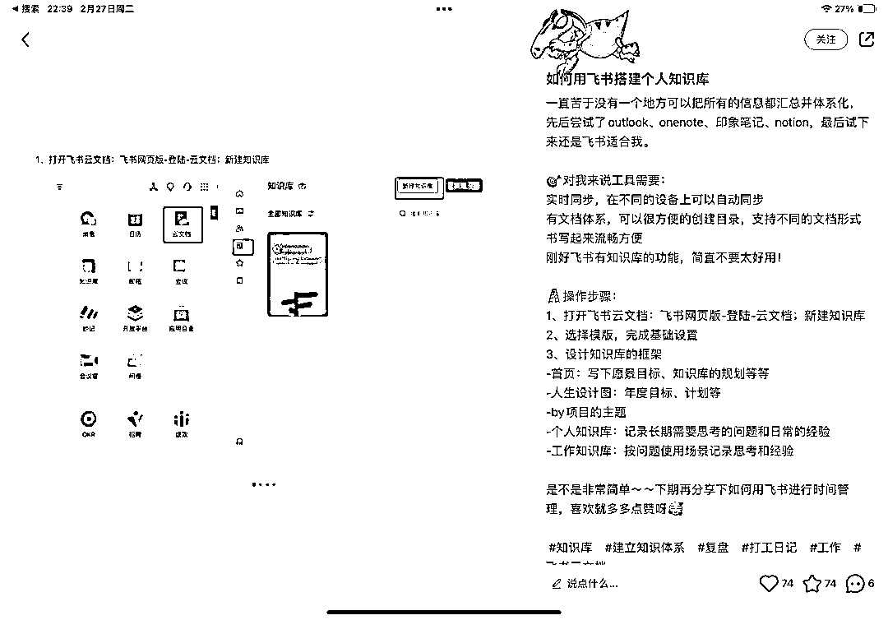
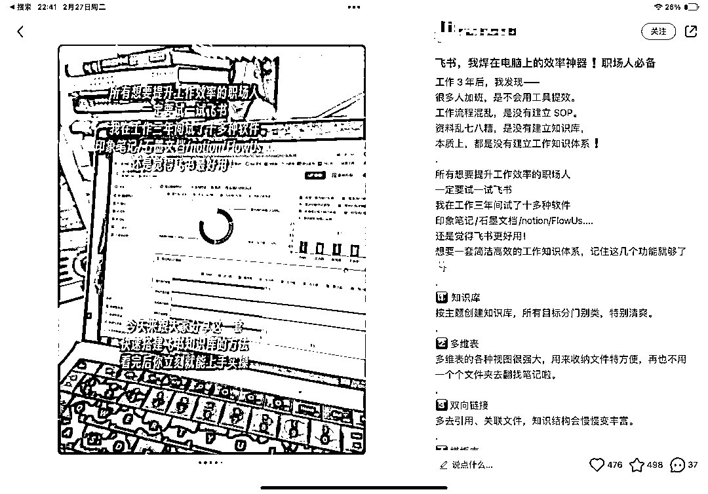
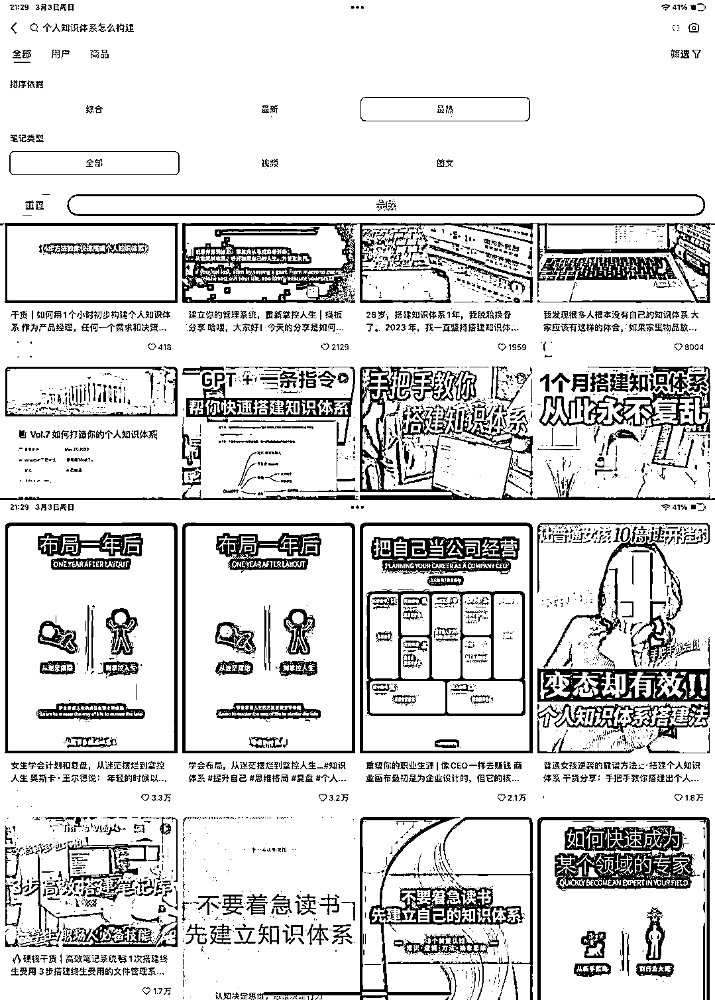
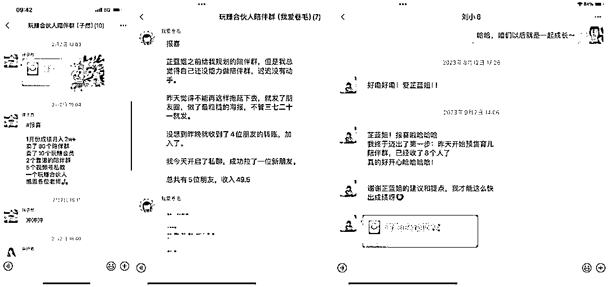

# 把知识管理变成个人IP的变现引擎

## 如何把知识管理技能转化为个人IP的商业价值

作者：芷蓝

日期：2024-03-08

我是芷蓝，很久没见了。今天这篇想和你聊聊一个具体打法：用知识管理这项能力来搭建个人IP并实现变现。

整篇文章会围绕IP定位、获取流量、设计产品这三大环节展开，对职场人以及想做自媒体创业的人来说都很实用。它能帮你把每天都在做的素材归档、信息检索、内容产出等日常操作，包装成可售卖的产品，一份投入多处收益。内容篇幅不小，不建议存着吃灰，直接看完就上手实践效果最好。

## 一、知识管理IP的定位要怎么定？

在说定位方法前，先问个问题。你在各个平台上一定刷到过那种纯资料号，专门发某个领域的学习资料、模板合集。这类账号互动数据往往不错，点赞收藏很高。但它真的能变现吗？

能变现，但除非做矩阵，否则很难赚到大钱，也不容易接广告，更容易被平台限流。

原因就在于个人IP定位里缺了一个关键要素：身份感。

换个角度想，如果你是品牌方，会愿意花钱让一个没有人设的资料号来带货吗？推荐这件事本质上需要一个人站出来。你内容里连作者是谁都看不出，怎么完成信任传递和产品植入？

同时，你也没有为品牌留下展示空间。举个例子，讲飞书做素材库提升工作效率，这篇内容怎么呈现效果更好？是只放飞书软件截图，还是放出现场的画面？

显然是后者。加入书桌、iPad等生活化场景后，内容瞬间有了故事感。别小看多加了一个场景，这意味着可以自然植入品牌，也暗示了内容背后有人在操作。

对于知识管理服务来说，用户看到书桌上放着书、电脑屏幕亮着，就会直觉这是一个真实的工作环境，对面一定坐着一个真实的人。真实带来信任，信任提升转化。

归纳一下，人+场景的组合能大幅增强内容的可信度。那么人设如何在定位里体现？最直接的方式是加上身份标签。

这里可以复习一下我常用的IP定位公式，适用于任何赛道：

**你的身份 + 你擅长的技能/成绩 + 你的目标人群 + 你要解决的问题/创造的新需求。**

举个例子，我合伙人Andrew老师就是走知识管理IP变现这条路，现在通过知识付费月收入已稳定过5万。基于他过往经历和擅长点，我帮他梳理的定位是：

**大厂设计师，知识管理教练，帮助自媒体创业者搭建知识体系，推动IP变现。**

设计师、知识管理教练就是身份，身份里自然带出能力。用户画像是自媒体创业者，这类人群对知识体系的需求更强烈，我自己也深有体会。

这里还有个核心逻辑：知识管理一定要落到实际问题上，不能只谈方法。方法研究的意义在于解决问题，比如用知识管理搭建营销素材库，实现更高效的内容输出，从而带来引流和变现；再比如用知识管理优化职场工作流，效率提升后提前完成任务，进而获得升职加薪。

知识管理这个方向非常契合设计师、项目管理、文案运营、产品经理等岗位，本身的工作成果就能作为案例输出，完全可以开干。

## 二、知识管理IP的流量从哪来？

**流量 = 高质量内容 + 引流路径**

引流路径这块不展开了，评论区引导、社群钩子、小号分流、简介置顶这些操作之前分享过很多。核心在于你能不能稳定产出让人愿意看的内容。

怎样算优质？它要同时给用户情绪价值、时间价值和认知价值。知识管理最擅长的就是认知价值。**管理的本质是看见底层关联，当你看清事物之间的联系，就能把它们串起来，让知识更有序、更易调用。**

我拆解过大量知识管理博主的爆款，会发现他们的选题基本集中在三类层面，每一类都可以结合用户的真实使用场景来创作。比如下拉搜索框输入“知识体系搭建”，就能看到当前用户的真实搜索意图。

**选题怎么找？** 只要锁定自己擅长的领域，输入一个相关词进搜索框，重置筛选条件，就能看到当前热度内容。比如我对个人知识体系搭建有实操经验，就用“个人知识体系怎么搭建”去搜热帖，得到以下结果。

从结果里我提炼出三个高频标题模型：

### 1、从 xxx 到 xxx，我靠知识体系实现了 xxx

### 2、别急着 xxx，先把自己的知识体系搭起来

### 3、xxx 推荐的知识体系搭建法，3步帮你 xxx

这就是“知识体系搭建”这个关键词下的爆款选题模板。按这个套路走，被系统识别进推荐池的概率会高很多。

“工具使用”和“素材沉淀”这两个词下的爆款我也整理过30天的数据，可以对照着找模板。

回到内容生产，总结一个通用的爆款批量打法，任何赛道都适用：

### 第一步：锁定赛道的核心关键词

做自媒体最大的信息差就是关键词。很多信息不是没有，是你不知道用什么词去搜。所以想做就先找词。别人做不出爆款，往往是因为不知道这个领域用户每天在搜什么。

除了5118、灰豚这类工具，最简单的方法就是用平台搜索框的下拉词。我能找到知识管理的三个选题方向，就是先搜“知识管理”，再看下拉词得到用户搜索词，再大量翻爆款。效率要求高就用工具，最后沉淀成自己的关键词库，词库越厚，创作越准。

### 第二步：用关键词锁定爆款选题

找到用户高频搜索词，就等于摸到流量的门。平台就是靠关键词做推荐的。接下来大量观察带关键词的爆款，分析它们的选题模型。比如我前面提到的三个标题公式。爆款是有规律的，多翻几页就能发现标题话术、封面风格都高度一致。

### 第三步：把爆款变成自己的选题

模仿是必须的，但不是抄袭。直接复制他人内容被举报，账号权重会下降，后续推荐会受限。

有效的模仿方式有三点：

1、模仿风格：背景、配乐、图文模板都可以借鉴，抖音上大蓝式喊话、张同学式第一人称、程前式朋友圈配乐都是这样被复制的。只要把主体换成自己就好。

2、模仿标题：标题公式是可以直接用的。比如把两个爆款标题，各取一半，结合自己的关键词重组。

3、模仿框架：看低粉爆款的视频结构，开头3秒用金句、设问或悬念抓人，中间用罗列、对比、故事留人，结尾放钩子引导评论互动。把一个博主的视频刷完，内容骨架就清晰了，再把自己的产品信息嵌进去。

## 三、知识管理IP的产品怎么设计？

做账号前先想清楚产品，不然引流到私域没有转化，很快就流失。而且没有产品锚点，内容方向会发散。

**知识付费常见形态有四种：标准网课、训练营、付费社群、私教。**选哪个看你所处阶段和擅长点。

**新手期：**不建议一上来就做标准网课。很多学员卡在写大纲、录课、上架平台这几个环节，最后烂尾。没有制作经验时，更适合从付费社群起步。你只需要一张权益海报和清晰的运营动作就能跑起来。

比如我的很多合伙人起初都是做的365天陪伴群模式。

陪伴群的权益可以用三件事覆盖：领域资料、答疑服务、月度打卡。以“知识管理365陪伴群”为例，海报上可以列出资料包、群内答疑、打卡激励等权益。

前端引流时就可以晒群员打卡截图、展示他们通过打卡获得的成果，增强信任。

**成长期：**可以加入标准网课作为社群的增值权益，买社群赠课程，或买课程送社群，学习+答疑+交流闭环打通。但网课不要做成大而全的体系，要聚焦场景痛点。

比如做一套《用知识管理搭建写作素材库》的课，围绕建立素材库、无痛输出、高频高质量产出展开。5-7节课的体量最合适，制作成本低、学员完课率高、也更容易传播。

不同人群+不同场景+多个痛点 = 一套课程。多套课程组成课程体系。用户买完一套进入社群后，通过打卡发现新痛点，再推荐下一套产品。

课程制作流程和要素我之前在个人IP系列里写过，有需要可以回看。

https://t.zsxq.com/18GISzANp

**进阶期：**这时可以做高客单的训练营或私教。注意训练营每期都要招生、交付，精力消耗很大。如果没有稳定的公域流量，或产品不适合复购，建议先做私教。

我的私教交付逻辑大概是这样：

### 第一步：信息收集

让用户填基础信息表，包括年收入、行业背景、做过什么产品、当前卡点。

### 第二步：定位确认

基于信息和卡点，帮用户诊断当前定位，并明确未来一年的方向。

### 第三步：给到行动方案

根据定位导出30天内的爆款话题清单，给出对标建议。提供IP故事名片的写作指导，修改后推送冷启动方案。如果卡点是课程制作，就协助选题、大纲修改、上架小鹅通并推广销售。

### 第四步：持续陪伴

每天固定回访私教学员，跟进进度、提醒朋友圈质量、督促持续输出，并结合平台规则和当下风口给出建议。

到这里，个人IP的定位、流量、产品三大模块的打法就讲完了。如果你也想通过打造行业IP实现持续变现和复利积累，欢迎来聊聊。

* * *

评论区：

AI 小陈 : mark

* * *