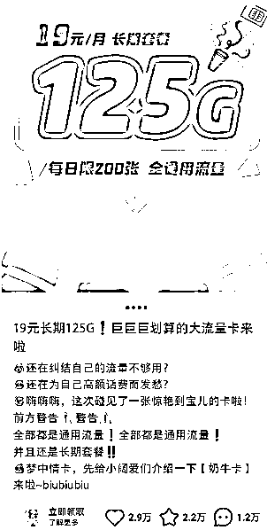
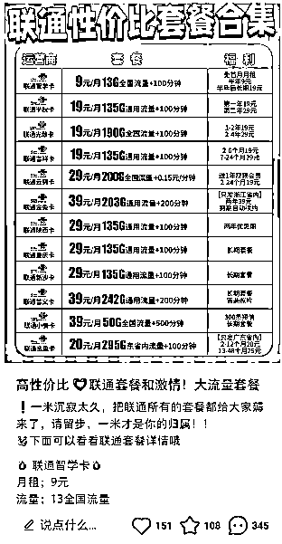
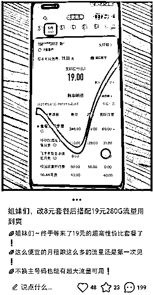
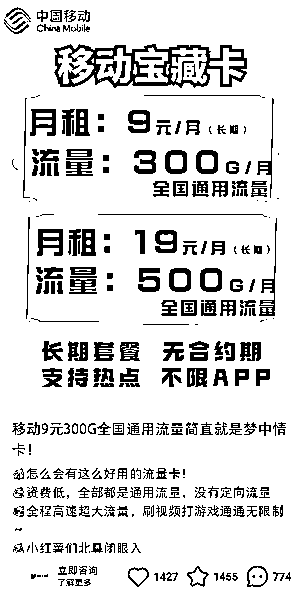
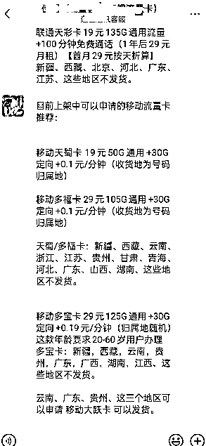

# 3 个人卖手机卡，40 个矩阵账号每月利润 5w
作者：龙哥

**3个人、40个账号，靠📕卖流量卡，一个月净赚5万+，这个项目我拆给你看**

先介绍一下，我是龙哥，做电商这行有七年了。今天想聊聊我们团队正在跑的一个小项目——靠流量卡拿返佣。说白了，就是在📕上找有办卡需求的人，推荐高流量套餐，成交一单能拿80到200块的返佣。我们一共三个人，手里养了40个📕账号，平均每天能出20张卡，哪怕行情再普通，一个月的利润也至少有5万。

这个项目不需要什么高深技巧，关键是把每个环节跑通。下面我就把从账号准备、内容发布、引流加🛰️，到最终成交和货源对接的全过程，一五一十分享出来。

**一、这个生意到底怎么赚钱**

一句话总结：📕负责引流，🛰️负责成交，我们赚的是通信运营商给的办卡佣金。单张卡的利润在80到200元之间，靠量把收益堆起来。

**二、怎么把流量引到🛰️**

第一步是注册📕蓝V账号。普通个人号发这类内容很容易被限流或判违规，所以一定要用营业执照认证，经营范围里带有“通讯”或者“通信”字样就可以。代办一个蓝V号的市场价大概600元。

账号注册完别急着发内容，先正常活跃几天，让账号看起来像个真人号。然后就可以开始发了，前期不用自己绞尽脑汁创作，直接去找同行的爆款笔记，参考他们的文案和图片，模仿着发就行。

笔记发出去后，要留意评论区，及时回复那些有办理意向的用户。先让他们关注你，随后在私聊中把二维码发过去，把人慢慢引流到🛰️上，后续成交都在🛰️完成。

**三、🛰️上怎么聊出订单**

加了🛰️之后，客户有两种常见情况：一种会主动说自己的需求，另一种是拿着8元月租的基础套餐来问。这时候我们可以顺势给他们推荐流量更多的套餐，尽量引导到佣金比较高的卡种。套餐详情直接发给客户看，他们想了解的问题，详细资料里基本都有答案。

稍微提醒一下，想通过改套餐来低价拿大流量的用户，最终办卡的比例并不高。所以后续要在朋友圈持续更新各种套餐，做好私域营销，经常会有已经办过卡的朋友帮你转介绍。

整个成交过程并不复杂，带一遍流程，基本就能独立上手。

关于话术，不用自己苦想。多加几个同行，把他们跟客户的聊天话术保存下来，稍作修改就能直接套用。

**四、靠谱货源去哪里找**

起步阶段，可以先去172、号易这类支持日结的平台试试水。如果能碰上长期稳定合作的上家，再签正式合同，这样更有保障。我们现在跑的敢探号，就是跟上游签了协议的。偶尔会遇到订单被吞量、佣金不结算的情况，但基本都能申诉回来。

这些平台的操作渠道，百度一搜就能找到，圈子里应该也有不少人已经在做了。

**五、关于这个项目，大家最关心的7个问题**

1. 项目做不起来，一般卡在哪个环节？
   要么是笔记始终没爆，要么是好不容易爆了，结果碰上同行举报、恶意引流举报，甚至账号被封。

2. 遇到这种问题，你们怎么解决？
   目前我们也没有特别的妙招。笔记违规就申诉，申诉不回来就放弃；账号被封也一样，实在不行就重新注册一个，继续再来。

3. 单条笔记大概能带来多少流量？
   多数在300到500的浏览量，好一点的能到1000到2000，再往上也要看运气。如果发了几天数据起不来，及时换内容就好。

4. 从意向到成交，你们会做哪些运营动作？
   其实没有太多运营动作，就是加🛰️然后按需推卡。专门冲着改套餐来的客户，成交率会偏低。但朋友圈要持续更新，很多客户加了🛰️当下不办，过了十天半个月再回来办的也有不少。

5. 注册蓝V账号有什么特别注意的地方？
   个体营业执照的经营范围含“通信”或“通讯”任一就可以。时间充裕就自己注册，嫌麻烦像我一样找服务商代办。

6. 怎么才能让笔记出爆款？
   我的做法很简单：坚持发。同时盯住那些已经爆掉的笔记，第一时间模仿和跟进，发得足够多，总会有爆款冒出来。

7. 除了发笔记，还有什么引流卖卡的方法？
   可以去别人的爆款笔记下面，重点关注那些留言咨询的用户，在私信里做好钩子引导。按照我们的转化数据，平均关注100个留言用户，能成交2张卡。

最后说点真实感受。这个赛道目前确实有人说“水很深”，也有朋友觉得现在进场有点晚了，竞争已经卷起来。但从我们小团队的实操看，只要流程跑通，每天稳定执行，一个月5万左右的利润还是能做到的。希望这篇拆解能给想入局的朋友一点点参考。
