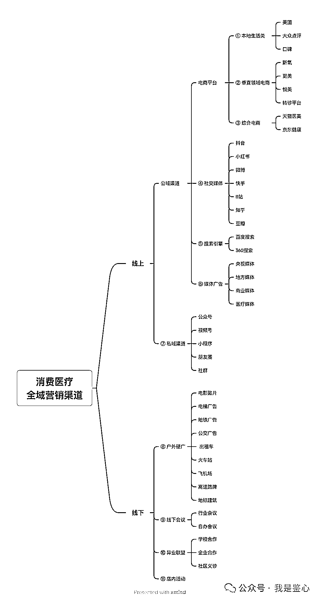
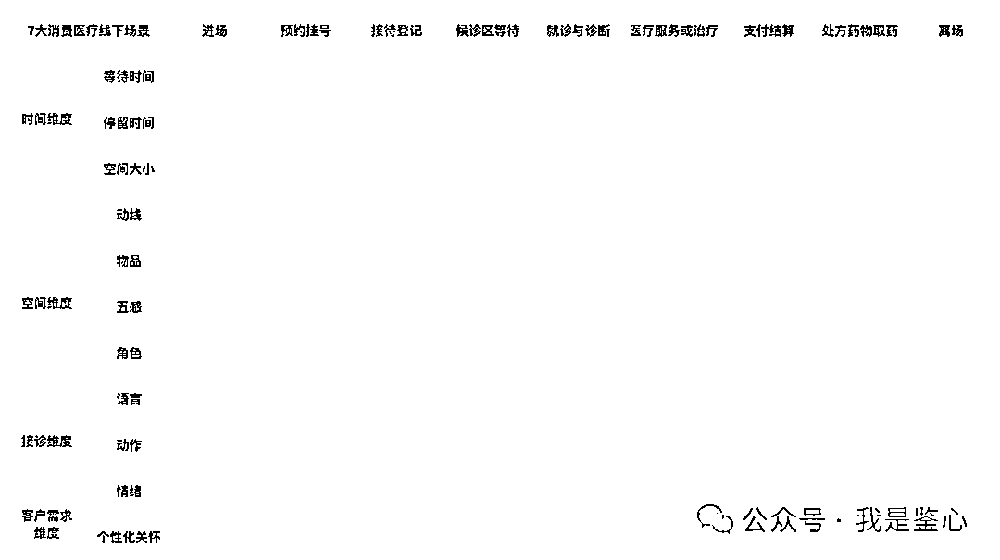
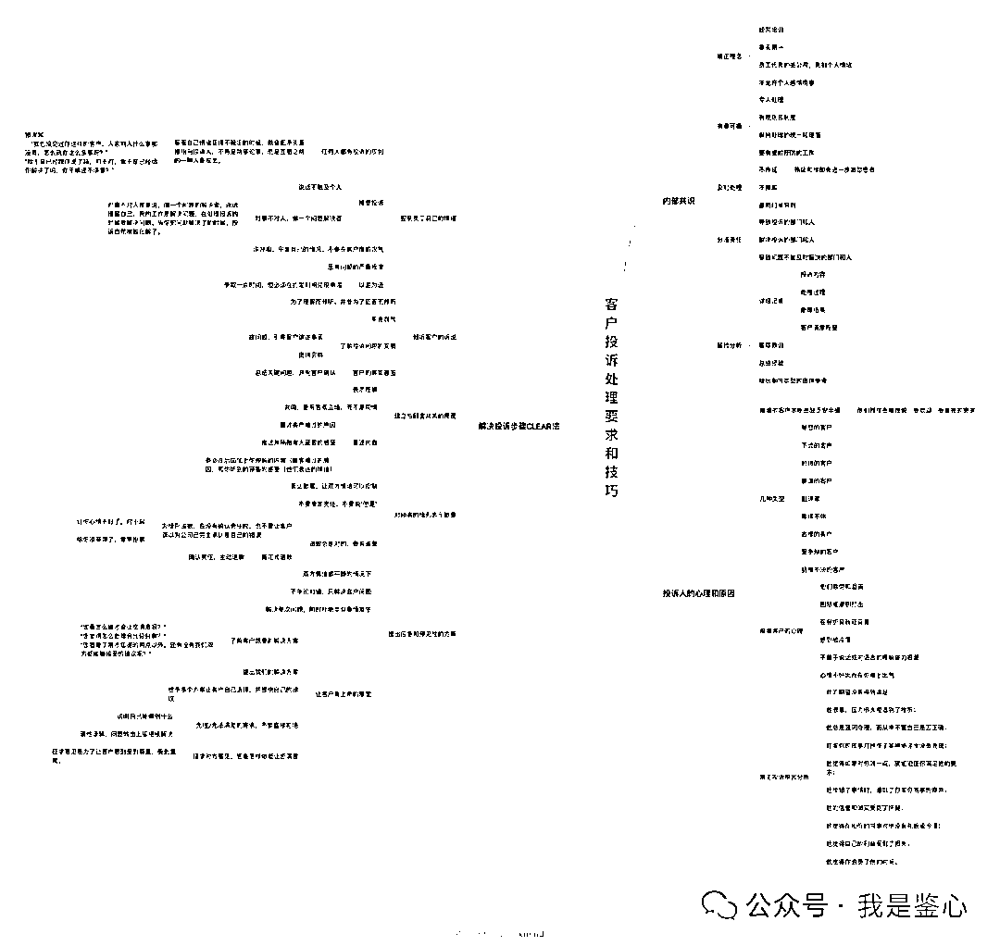

# 十年实战浓缩，医疗机构营销100条干货笔记

## 10年沉淀，100条医疗机构营销实操经验

作者： 蔡蔡

日期：2024-03-06

大家好，我是鉴心。十年前误入一家医美APP做推广，之后一直在1线跟着朋友拿钱开店，也给头部品牌做过增长。因为赚钱@芷蓝老师的启发，我把这些年花出去的钱、踩过的坑整理成100个要点，去掉了废话，提升了信息密度，希望能给医疗人带去一点启发。

-------

**1、一个面包等于两根金条，定价要看价值**

成本定价法：算上原材料、人工、运营和利润，一个面包卖10块能有15%利润。

价值定价法：假如世界大饥荒，富人手里只有金条，店里只剩两个面包，这时面包还值10块吗？

价格能卖高的项目，都是把价值讲明白了。产品好在哪、稀缺在哪、为什么选你、为什么这个价，让客户心甘情愿排队等、抢着要。

**2、案例比话术更有力量**

销售说再多也不如把成片的术后案例摆出来。病例量大说服力更强。若能从中挑出和到店客户相近的体型、诉求，那成交就更近一步。所以案例库要常备常更新，用起来要灵活。

**3、能租300平就别租600平**

身边开店的朋友没有不后悔租大租贵的。重来都会把租金成本再砍一半。机构空荡荡反而吓人，顾客会觉得没生意。吃饭也是，人少的店谁敢进。所以同区域内能小就小，300平够用就别开600平。

**4、预收款项目里藏着负债陷阱怎么防**

常规公式是利润=收入-成本。预收款下要改成：利润=收入-成本-负债。

预收款确认收入时要同步冲减负债。涉及多次复诊的项目，得算清每次的收入与成本，按服务交付完成的时间点来确认收入，这样反映的才是真实利润和经营状况。

**5、爆款主打项目设计有4个抓手**

客户体验是设计出来的，四个抓手是耗材+医生+服务+环境。不同科室配比不同，要找到重点突破口。

比如一家轻医美，耗材品质、正品保证、环境舒适度、地理位置、服务细致度和价格区间，可能比请手术大咖更重要。

**6、爆款底层逻辑相通，变的是表达方式**

大家都在短视频、🧣、👸号找素材，火过的东西能复火。咪蒙的图文玩法搬到短视频也能赚钱。爆款逻辑本质一样，只是在三个维度做微调：受众是谁；用户打开APP想干嘛；用户的观看习惯如何。平台调法不同，内核一样。

**7、消费医疗是典型的抢人头生意**

这就是零和。一颗牙齿矫正只做一次，做在你家就不会再去别家。需求只产生一次，抢到人头就算赢了。所以拼的是在单位时间内谁能抢来更多客户。

**8、商家最怕被打假人盯上的雷区**

各大电商医美平台店铺是重灾区。旗舰店在大众点评、美团、新氧上基本都被盯着。

高危用词诸如：新生、再生、一口价、性价比、重塑、正品、超值热卖、效果自然、功效、金奖专家、销量TOP、恢复快、名医、名院、除皱瘦脸、不惧揉捏、愈合快、祛疤、去红血丝、3天拆线、高存货、效果稳定、创伤小、人气款、爆款等。文案图片要避免功能暗示、对比图、模特图、医生图。能过法务先过法务。

**9、被举报违规被罚怎么处理**

走到定性和处罚阶段，一定要准备好广告投放费用凭证、完整合同、发票、证据链。罚款一般按广告费用3-5倍认定。若无法提供或费用明显偏低，罚款起步20万，上限100万。很多广告制作费不高，3倍也到不了20万，所以证据链一定要备齐。

**10、我整理好的消费医疗全渠道营销清单，大家自取**

**11、不同体量机构该怎么选渠道**

中小机构：大众点评&美团必须做。有内容能力就做📕，从图文起步。抖音短视频和直播上手难，适合内容团队。其他渠道量力而行。

头部机构：线上全覆盖，至少能被搜到。线下硬广常年投，如私立口腔在公立口腔医院门口长期投放广告；也根据节奏投，如地铁广告。

**12、不同体量机构该发什么内容**

中小机构品牌认知度低，抓一个定位一个卖点，打透了做。任何内容都要围绕这个点。

机构做大做品牌时，要在提供优质医疗服务的基础上，建立信任关怀形象。让用户觉得你是国民眼科、国民齿科、国民皮肤中心，看到业务就想无脑下单。

**13、能一次收完就别分期**

条件允许就让客户提前付钱，能提升服务时的幸福感。一次付清比分期更好，因为先享受服务再付款，支付的痛苦被后置，不会拉低峰终体验的“终”。

**14、调研对象要看钱包**

调研必须找真正掏过钱的消费者。说要买、以后会买的人没有意义，数据会失真。

**15、成年人和家长的决策路径完全不同**

给自己消费的成年人，会在公域平台反复搜索对比。一个项目在这里做，下一个项目仍会回到公域找答案。

家长更受熟人圈影响，同学群转介绍、身边人推荐为主，没空东看西看。

**16、哪类差评不会吓跑新客**

比如：门诊某个环节服务意识差、态度一般；沟通或操作小失误无大碍；团购价格争议、优惠过期等。回复要点：共情+重视，真诚道歉+改进方案，感谢建议。

**17、可挽救的严重差评有哪些**

如：对医疗结果有争议可自证；操作中轻微不适如牙龈出血后可愈合；隐形消费、加收费用、医生报价不一、消毒用品沟通误解等。这类公开回复得当不影响心智。回复要点：共情，事实还原，给具体解决方案，感谢建议。

**18、什么差评最致命必须规避**

如：效果差被公立医院否定；接待无法解答只能外出求助；操作中途换人；无证经营、医生无证上岗；过度夸大病情被识破等。出现这种只能私下沟通解决并恳求删评，公开回复很难扳回。

**19、没做过低价引流、没被薅过羊毛就不算完整**

刚开业BD就劝做几十块洗牙、几百块注射，甚至免费试戴隐形牙套。最后升单几个？羊毛党薅完就走，一分钱不加。有人算平常花两三千能来一个客户，活动来四五个，多转一个就赚。但结果往往是孩子没了狼也没套住。因为低价客群和正常客群不是同一拨人。

**20、低价引流的连锁负面**

转化低只是其一。医生咨询无业绩，稳定性差。老板开始怀疑平台，觉得抖音📕来的都是穷人，错过赢者通吃的机会。

**21、能玩转低价引流的都是狠角色**

大机构客户心里清楚自己是来薅羊毛的，也接受这里不便宜。人多才有安全感。头部机构客量大，销售多转化强。低价引流既能用极致性价比抢客户，也能逼死同行。

**22、突破认知的价格会让人恐惧**

用户觉得双眼皮正常价是几千到一两万。打85折7折都正常。但你若放500元特价，用户不会觉得捡漏，只会怀疑技术差拿人练手，或后面有大坑。

**23、2024年私域要从改名客服号开始**

公域做盘子，私域做稳定。很多人把私域当客服加群发优惠。错了。要把客户当人研究，🛰️上愿意和谁聊、怎么聊、聊什么。然后把这些路径复用。有团队卖高端女装五六个人一年过亿，主要工作就是聊天，家长里短。所以私域先从改掉客服账号、写上真名开始。

**24、大众点评&美团仍是获客最稳的渠道**

线上新客占比可超50%。操作简单，装修突出重点。做好三件事：评价要多且安全；广告要投，预算少就多投CPC；团购销量从众效应强。

**25、点评美团广告投放小技巧**

CPC精准，转化好，点击贵。CPM展示广，曝光强，价格低。大部分商家CPC占80%。我喜欢把CPM物料做成硬广，再按点击付费。物料够硬、够直接，才能筛到有需求的人并降低成本。

**26、100个洗牙客户能转1个矫正种植已不错**

即便医生认为必须做，客户也很难接受。洗牙可以随便找家附近门诊做，矫正种植是五位数大单，必须多方比较。所以想卖什么，就去找真正对这个项目有需求的人，而不是在洗牙客里硬转。

**27、专家人设容易被放大审视**

消费者对专家容错率为零。说错一点信任就崩。越专业越难讲，怕说错话。两头为难。

**28、用表格记录线下体验短板**

去店里当神秘客，用消费者视角感受体验。记录方式可参考表格模板，填表即可。

**29、单点方法论解决不了系统问题**

医疗营销是系统工程。从用户生命周期看，有术前术中术后不同运营策略。从内部看，市场、咨询、医护、客服要分工协作。拧成一股绳才行，否则互相甩锅。

**30、评价要能刺激购买欲**

评价要让人看了想咨询、下单、到店。思路：已完成客户谈效果满意；疗程中客户谈体验信任和期待；新客户谈选择原因。可长可短更真实，差评要少，爱惜羽毛。

**31、店铺装修别频繁改版**

点评美团抖音新氧，定好风格就别月月换色、活动一来面目全非。破坏品牌一致性。耐克不会今天换勾明天换叉。动品牌层面的改动是一个定心动作，不是一堆动作。时间精力不如去做内容直播。

**32、抖音医美直播被整顿后的思路**

焦点访谈后医美直播团购下架，口腔团购还在。想写直播干货也没必要。原则是平台开闸就抢第一，封了就停。规则平等。短视频直播门槛高，会做的赢家通吃。现在很多人转到金融直播间、创业直播间私域捞客。规则是死的，人是活的。

**33、峰终体验做好转介绍自然来**

宠物医院案例，猫生病住院，护士关灯让猫睡好，出院送相册每天照片手写寄语，打疫苗时护士记得名字。每个细节让主人感动并主动安利。这种峰终设计才有复购和转介绍。

**34、好内容不只限于短视频**

一条写出细节和卖点的评价，也是好内容。🛰️朋友圈对咨询未下单客户怎么说，对成交未复购客户怎么说，这都是内容。老板团队有内容意识，生意就不愁。

**35、新品牌能快速起来的共性**

老板和操盘手都很会做内容。起得快成本低。内容分层，写🧣的不一定会做👸号。

医美、口腔这行的老板们，每隔一阵就会被几个问题卡住：内容没人看、客户不成交、忙活一年一算账倒亏。不是大家不努力，是这行水太深，很多坑要提前看穿。

内容做不好，多半不是员工不行，是老板不会判断

不少门诊掌柜一谈到做内容，第一反应就是招个人来干。可真招起来就傻眼了：自己压根分不出什么是好内容，也认不准谁是真把式。给几千块工资，有本事的人自己接接广告、带带货都比这强；真要价上万的，比养一个有经验的医生还贵，老板心里又开始算划不划算。好不容易狠下心招了一个，内容铺了几个月，还没等到质变，老板先疑神疑鬼，焦虑上头，项目就黄了。

做内容的第一步还真不是找写手，是老板自己先建立判断力。许多经营者天天泡在行里，觉得这个常识那个也常见，可消费者不知道啊。你以为稀松平常的细节，在营销上可能就是一颗遗珠。周鸿祎讲过一段经历：他和小米都做摄像头，看了小米的广告文案——“4片玻璃镜头”，觉得档次不低，便问工程师自家用的什么镜头。工程师说也是4片玻璃，周问为什么不写出来，工程师回答：这不是大家都有嘛。看吧，这就是“知识的诅咒”。你自己觉得不值一提，别人却听着新鲜；而且就算大家都有，谁第一个喊出来，这个卖点就归谁。

找到卖点后，还要会表达。互联网是个人性放大器：没人爱听大道理，大家都爱凑热闹、听八卦、看故事。遇到正襟危坐讲知识的，手指比脑子快——直接划走。想让人记住，就把要讲的东西裹进一个有趣的故事里。人设也别端得太高，当“知心老友”，别当“权威专家”。专家的位置太高，观众拿放大镜等着找你毛病；反倒是“我踩过坑，分享给你，你少走弯路”这种姿态，既让人舒服，容错率也高。如果营销总没效果，找不到卖点、卖点不勾人、没有差异化——三根病根，总有一根扎在你身上。怎么治？穷举！列个表，从原料产地到服务流程，从预约方式到独有步骤，事无巨细都写下来，再请几个人翻翻，思路自然就打开了。

获客的钱，既要敢花，更要算清

认识不少老板，一到投广告就纠结。我自己的体会是：信息流广告越来越不值得砸。用户刷手机刷到一半，冷不防插进来一条广告，他根本不认识你；医广能说的话本来就不多，为了几十秒内套到线索，只能拼命往低价上靠，招来一堆贪便宜的人。信任感这东西，信息流给不了，IP、内容和店铺的慢慢经营才给得了。当然，一年预算几个亿、活动铺天盖地、线下转化又极强的大玩家另算。

该花的钱不能省。营销投入太少，抢不下市场，对手分分钟把份额卷走，很多医美口腔项目都是零和游戏，你做了他就没得做。舍得下本的人，早年在抖音直播还是风口时，花十几万认真学了一轮，2023年同行怨声载道，他回来赢家通吃。窗口期说没就没，观望的等来的只会是一锅端。

但花钱也得有章法。别只盯着账面收入，要看两个指标：获客成本（CAC）和客户终身价值（LTV）。两者一比，通常大于3就算健康；到5倍、10倍别高兴太早，那是提醒你钱花少了，大胆再去圈地；如果小于3，说明获客太贵，营销策略得重新捋。还能看获客成本的回收周期，客户从付钱起，多久能把你的获客成本赚回来，回得越快现金越健康，一般6到12个月是相对合理区间。

至于平台的破价大促，账算不过来就别凑热闹。低价引来的人升单难比登天，跟你想服务的高质量客群压根不是一类。就算销售把人按在店里磨了一小时，勉强成交，后面交付只要有一个环节不满，对方就能掀房顶。生意能不能良性循环，从你拿什么饵引什么鱼就定下了。破价太多，本质上是平台薅机构的羊毛，最后买单的是机构的口碑和客户的期待。

客户不成交的锅，怎么分

先讲个规律：业绩好的时候，团队都在忙着干活，根本顾不上闹别扭；业绩一拉胯，什么员工问题都冒出来了，互相甩锅、人心涣散。所以很多看似是人的问题，本质是业绩问题。业绩上去了，团队问题好解决一大半。

客户来了不成交，也别急着吵。成交之前接触过客户的每个环节都有责任。市场要是只会打折、讲不清产品和医生价值，市场背主责；客户到店前已经清楚你的定位和价格，进门还不掏钱，门诊的接诊和交付要背大责；再往源头挖，定价和定位跑偏了，老板责无旁贷——定价定生死，这件事必须一把手拍板。老板要是连自己要服务哪类人都想不清楚，就别指望员工能替你分忧。

说到底，所有答案都长在客户身上。与其被各路导师忽悠，不如回到消费者中间去：他们是谁、在哪出没、爱看什么内容、过去是怎么被转化的，那是个例还是通识，对拉新有没有启发——认真盘几轮，心里自然透亮。盘客户的前提是记录，把客户的每次到访和交易都写成台账：来没来、何时来、改没改约、带没带要求、做了什么项目、谁经手的、做了多久、有没有投诉、付了多少钱……客观发生的事实，一条都不要丢。再深一层是用户画像：客户穿什么、聊什么，无意间透露家住得远不远、有什么爱好，职业和身份是什么。你把画像描得越清楚，找相似的人就越有方向。

成交还差临门一脚时，最怕客户说“我回去商量一下”“回头🛰️联系”“过两天再买”。基本上，这一走就再也没影儿了。原因很简单——你没给他一个“今天非买不可”的理由。没有紧迫感，人永远不会着急。还要时不时去各平台搜搜自家品牌和医生的名字，加上“避雷”“翻车”“做坏了”这些词。坏事永远比好事跑得快，不主动搜，客户怎么蒸发的都不知道。发现差评、负面，第一时间处理，别等它滚成雪球。信任赚起来千难万难，崩掉只需要一个晚上。

有件事千万不能做：别拿“患者见证”当内容。不论对方是普通人还是网红大V，只要以亲历者口吻讲感受、向机构引流，理论上都站在灰色地带；把这种东西发在自己的官方号上，简直是给监管部门递业绩。同样，过于小众的“自我审美”好评也不要放公域，你觉得那是5星好评，大众看了可能皱眉摇头，反倒把新客吓跑。做免费试的初心也要摆正——它的价值从来不是转化，而是用真实体验换一批高质量评价；做这种活动，能选淡季就不选旺季，能约工作日就别排周末。至于投诉处理，别每次遇到才手忙脚乱，把一套完整的话术和流程沉淀下来，照着走，胜过临时救火。

算不清预付费的账，忙一年也是白忙

太多老板一到年底就纳闷：流水明明很大，怎么利润薄得可怜？十有八九，是掉进了预付费的坑。正畸、种植、充值卡、年卡，都是先收钱、后交服务——收钱时多痛快，往后就有多被动。这钱不是收入，是负债。利润公式得改成：收入减成本，再减负债。每一次老客上门来消耗服务，都是在你的成本上划一道；每多收一个这样的客户，将来就多背一笔。药方只有一个：按单次到店核算成本，尽快把客户的服务消耗完。不然拖着拖着，一两年后你才发现赚了一堆寂寞。

渠道大盘：公域决定你做多大，私域决定你多稳

听到很多人张口闭口做私域、搞转介绍，可你想过没有，没有公域往池子里放水，私域和转介绍就是空中楼阁。哪怕转介绍率拉到50%，100个成交带50个，50个再带25个，一层层削下去，没有公域补进来，生意只会越缩越紧。公域决定蛋糕能做多大，私域决定你能不能守住，两只手都要硬。

线上引流渠道里，大众点评和美团目前还是最稳的。评价量和销量一旦攒起来，来量基本不愁。📕和抖音呢，流量固然可观，但规则常跟天气一样，说变就变，你刚做起来一点，同行还可能举报你，号说没就没。平台能不能靠消费医疗这行挣钱，一定程度上要看他们法务遮不遮得住风雨。不过📕是个例外，我始终认为那是医疗商家的必争之地——用户画像太对口了：绝大多数是女性，一二线城市，收入不错，愿意为美付费，讨论度还高。医美、齿科、植发、眼科、中医、减重、产后塑形，没有卖不动的品类。早几年平台还没放开时，用户自发产出的医疗笔记就一直在涨，后台看得分明，禁令根本压不住讨论欲。再说了，📕做图文的门槛比短视频、直播低得多，这便宜不占白不占。

头部机构的终极打法，是让品牌变成品类代名词。提起隐形矫正，多少人脑子里直接蹦出隐适美？提起植发、牙齿，最先想到的也就是那几家。有实力有预算的机构，要做的是把消费心智占住，让人一有需求就想到你。至于成都，外行才总惦记着去分一杯羹——那边医美市场成熟得可怕，供给多、价格低、好医生扎堆，我在川大旁边喝杯咖啡的功夫，能撞见两桌同行在聊系统、算成本。连锁想扩张，真没必要去那儿送人头。

最后说说经营本身。名医出来开诊所，先别急着凭手艺闯江湖，经营和看病根本是两码事，有没有合适的运营负责人，比选址更该先想明白。爱尔眼科的合伙人计划就是个范本：新医院开张，医疗骨干、管理骨干、产业基金三路人马一起投。筹建期间，政府关系也别忘了走动，别等到被投诉、被打假才第一次见卫健委的老师。做得好的机构，装修过程中就请人现场看一圈，不合规的当场改，验收一次通过，省下的大把时间和资金，都是利润。

外界环境起起落落，业绩不行先别怨天怨地。经济好，外行带钱进场乱烧；经济坏，客户捂紧钱袋不动。哪一年都不容易，往内求才有答案。AI也是当下不容忽视的变量，用好ChatGPT做内容和营销，一个懂行的人就是一支军队。但工具再好，你得会提问：先把背景讲清楚——在什么平台做、给谁看、要达成什么；再给AI设定一个对口专家的角色，配上经验和技能；接着交代任务和预期，最后把语言风格、结构、模仿对象、创作流程这些要求一条条列明白。不会提问的人，给什么神器都白搭。

医疗这行的钱，从来不是快钱，是靠耐心守出来的细水长流。内容、客户、账本、渠道、团队，每一处都藏着坑，也都藏着转机。但愿这些大白话，能帮你在哪个坑前刹一脚，少亏几十万，就已经值了。

**71、为何各渠道投放费用逐年水涨船高？**
说到底还是内容不行。
光会拿钱买量不算本事，更糟的是很多广告还是外包团队拿现成模板改一改，后台操盘模式高度雷同。手里同时操盘多个品牌，彼此竞价互相推高，观众早就产生审美疲劳，成本自然一路攀升。
把那些花里胡哨的概念先搁在一边，营销里最省钱也最可持续的能力，我认为是内容力，尤其是有爆款潜力的内容能力。
所有社交平台本质都是内容分发场，平台自己并不生产内容，它需要创作者持续输出优质内容把用户留住。内容过硬，就不需要把预算浪费在无效投放上。

**72、判断文案档次，动词的密度是第一信号**
这也是我长期在补的短板。写得好的文案通常遵循：
少用形容词，多用动词和名词。形容词偏虚，读起来空泛，撑不起句子主干，也难以成为焦点。
大量动词和名词的组合才能构建画面感，而画面感才能占据读者的脑内投射。看几个经典案例就明白：
脑白金：今年过节不收礼，收礼只收脑白金。
旺仔牛奶：再看我，再看我，就把你吃掉！
联想：人类失去联想，世界将会怎样？

**73、另一个判断标准：会不会写特写镜头**
好文案本质上就是一个特写镜头。
特写就是把概括性的表述落到具体细节。比如强调服务好：
原来：我们公司提供高质量的客户服务。
特写：400万通电话被顺利接通，每一次响起的都是温暖亲切的声音；100%的客户问题得到处理，99%的解决方案赢得满意评价。
原来：女白领安全回家
特写：放心吧！加班的小女生百分百安全到家了

**74、没人愿意学知识，但人人都爱听故事**
同样谈定价，说教的版本是：做产品定价要价值定价，不要成本定价。
讲故事的版本是：一家面包店按成本算出每个面包卖10块有15%利润。有一天世界爆发饥荒，富人家里只剩金条，店里仅剩两个面包，这时一个面包还值10块钱吗？
显然后者更能让人沉下去。人性天然偏爱故事、八卦、热点，顺着人性沟通，做生意才顺畅。

**75、没问题意识的客户，你很难把产品卖给他**
比如儿童龋齿，年纪很小就开始发病，医学上父母应尽早带孩子去做涂氟、窝沟封闭做预防治疗。
但许多家长并不认为换牙前的牙齿损坏是问题，觉得反正要换牙，现在坏了也无所谓，不影响。
认知如此，他们不会主动去搜索解决方案，更不会去门诊购买涂氟项目。
你以机构身份去告知他该做什么，他只会觉得你是为了赚钱。有问题意识，才是购买行为的起点。

**76、我觉得现在做宣传是历史上最好的窗口期**
会写字，就做👸号、📕图文。擅长镜头表达，就做短视频、直播。
不会？有培训课程可学，有第三方机构可托付。
过去投放要去竞标电视台为数不多的广告位，没有几个亿根本拿不下。
现在人人可入场，平台规则相对公平，流量获取成本处于历史低位。
别固步自封、别畏难、别低估他人价值。动手去试。

**77、在医疗营销里，我吃过的抢先红利**
1、2020年初大家宅家数月，我带着团队在新氧做直播，停业的几个月里拿到几十个定金和全款，线索几百条。等到四五月机构复工，别人刚起步，我们已在接待消化存量客户。
2、同年📕刚开放医疗机构信息流广告，我第一时间接入投放搜索结果，用硬海报收表单，单表单成本几十块，且成交率远高于大众点评。我去拜访📕时，负责医疗的同事屈指可数，拿去给同行看的投放样例还是我的页面。
后来同行涌入，竞价一路走高。但我们已经先吃到了一波收益。
天下武功，唯快不破。出现新玩法，先试再说，少内耗直接上。

**78、线上营销的数据分析框架一般看哪些维度**
通常用漏斗来衡量：曝光、点击、咨询、留资、预约、到诊、付费。
算出每层的转化比值：点击率、咨询率、到诊率、付费率等。
再把成本算清：单次曝光成本、单次点击成本、单次咨询成本。
算明白后，不同渠道的效率对比就很清晰。

**79、线下医疗服务也要用心设计峰终体验**
峰是高潮，终是收尾。
人回忆坐过山车，记住的是登顶的紧张、俯冲的刺激、旋转的眩晕，以及结束时的余韵，排队多久早忘了。这就是典型的峰终定律，像宜家的1元冰淇淋。
诊前以期待迎接。
诊中设置一两个超出预期的高光瞬间。
离店后再做点让人回味的收尾动作。
这样客户自然会自发帮你宣传。

**80、想入行的新玩家，我的建议是先想清楚**
一不小心就踩坑。表面看美业、医美、口腔是高利润行业，实则身在其中才知辛苦。
没有实力，很容易把之前积累的资金亏空。
如果连机构规模该做到多大都心里没数，我建议你别当新韭菜，否则会在某个环节直接阵亡。

**81、消费者调研能帮你更系统地认识客户**
咨询公司常做这类工作，手头紧张时也可以自己积累认知。我们过去主要从两方面入手：
1、客户画像：年龄、性别、收入、生活方式、对美和健康的关注度；对不同类型诊所项目的认知差异，如公立私立、医疗消费。
2、获客情况：营销是否有效？通过何种渠道和内容触达？何种机构能形成品牌口碑？客户看重什么才成交？品牌印象如何？转介绍情况怎样？

**82、小规模机构的生存之道是做细分市场的专家**
小机构缺钱缺资源缺名气，就要找细分赛道深耕。
成都有一家不大不显眼的植发机构，专门瞄准需要植发的女性客群。植发男性为主，他们却主打帮女性提升发际线、缩小发缝，通过📕引流，生意做得红火，疫情期间还逆势增长。

**83、业绩下滑不等于市场部的问题**
很多老板一遇到增长乏力就怪营销不到位，天天让市场团队找对策、降价投放。但客户从初次认知到成为品牌拥护者的完整路径，需要企业深挖需求、优化产品和服务、提升满意度、关注转介绍，借助口碑、营销、社交媒体实现品牌螺旋式增长。
不同阶段对应不同部门。想提升业绩，先把问题定位准。

**84、医患沟通的高分关键是先读懂消费者的多重需求**
客户走进门诊时，内心渴望的需求往往是复合的，既要又要还要。
有的医生只强调健康，给出最健康的方案，却忽略了客户对美观的诉求。要兼顾消费者的多维度需求，满足其复合期望。

**85、医疗营销人才，各家都难招**
消费品行业营销人才相对充足，医疗行业却常出现懂营销不懂医疗，懂医疗不懂营销。略懂一点的，还要与医广、打假人员周旋，想说的说不全，做的内容频频被封、常被投诉。招人难、宣传难，是行业共性痛点。

**86、医疗项目定价的上限和次上限有两个客观参照**
第一，参考本专业学术领军者的市场定价。领军者的价位像锚点，徒子徒孙定价空间受限。
第二，参考本地或区域内顶尖公立医院的定价。如西南看华西，东区看上海九院，北京口腔看北大口腔，眼科看同仁。
领军者价决定天花板，一流公立价提供次高参考。若医资、效果、服务价值不相当，很难超过顶尖公立的单价。

**87、医疗领域存在高效、便宜、服务好的不可能三角**
国家医疗体系也有这个三角：便宜、高效、服务好，三者无法兼得。
美国选高效加服务好，成本极高，打个狂犬疫苗叫辆救护车就能破产。
英联邦和欧洲选便宜加服务好，结果看医生难，排队排到天荒地老。
中国人口多费用紧张，选便宜加高效。代价是医生超负荷、床位高周转、门诊两分钟一人，为的是让所有人都能看上病。
创业做医疗项目也一样，只能在三角中做取舍。

**88、医美营销的第一性原理是建立信任**
无论抖音、📕、视频号，无论图文、短视频、直播，无论齿科、医美、中医，无论机构品牌还是医生个人，营销的终极目标都是提升消费者心中的信任度。
这不仅是医美营销的第一性原理，更是做生意的根本。别被花哨迷惑，别做损耗信任的事。有了信任，客户会信你，无脑下单。

**89、营销调研第一步，搞清谁是付款人**
客户是青少年，付款人通常是父母。青少年牙齿矫正、成年后近视矫正手术，决策和付费都是父母完成。
我们调研时，对象是为孩子做消费决策的父母，研究他们为何买、如何选、如何考虑孩子、为何付费。
别把孩子当成消费者。

**90、高认知高学历的医生老板，越容易有表达羞耻感**
经验越丰富、地位越高，越接受不了自己的表达不够深刻、不够高级。
但越高级越专业的表达，吸引的往往是同行。别怕讲得太简单，在同行面前显得不够高深。对消费者来说，新鲜才是价值。当你的内容能被十倍百倍的人听到，深度和高度由你定义。

**91、大众点评美团更信机构，社交媒体更信个人**
在点评美团后台咨询，客户上来就问“什么时候能预约”。📕来的客户会问“能找XXX医生面诊吗”。
团购本地生活平台体现的是机构的靠谱、规模、口碑，所以KOL在上面很难出彩。
社交媒体以人为单位传递信任，所以机构品牌号在社交平台很难做。

**92、正畸的薄利多销是个伪命题**
前几年一万多的隐形矫正项目冒出来又消失，留下大量需要二次矫正无人负责的客户。
正畸周期长，轻度也要近一年。方案问题、收尾问题要到后期才暴露。
长周期、低利润、高竞争、前期高投入后期不确定能否收尾的项目，想靠互联网规模赚钱行不通。

**93、中小机构的打法是差异化做精品做高价值**
消费医疗里，客户肚子都填不饱，谁还管美不美、牙齐不齐？中小机构受场地和医生数量限制，提升营收要学奢侈品涨价逻辑，而不是打折逻辑。
把价值做高，把活做精。医疗产品的价值在于能为客户带来多大的改变，以及改变的确定性。

**94、为什么咨询有时比医生赚得多？**
销售链路中，谁离获客和成交越近，谁赚越多。
客户冲医生名气来，指名做项目，医生赚最多。
客户冲医院名气来，无所谓谁操作，老板赚最多。
医院没有获客能力，靠渠道公司和咨询销售牵引，那么渠道和咨询赚最多。医美领域有些渠道甚至抽走50%以上。

**95、自媒体是年轻医生成长的最佳杠杆**
年轻医生没有名气、没有职称、没有客户沉淀，必须做自媒体放大影响力。手艺好效果好，市场会认可。
做自媒体别搞专家人设。谷爱凌没说“我是世界冠军谷爱凌”，她说“你的朋友谷爱凌”。人设应该是消费者亲切的医生朋友。

**96、做生意如做人，赢得信任的医疗机构结局都不差**
医疗客户跟消费品不一样，不会见异思迁。今天喝奶茶明天咖啡。谁做脸谁做牙，他们比选饮料认真多了。
信任来得慢去得也慢，来了就只认你。所以每次营销活动、线下运营都要自问：是在加分信任还是减分信任？承诺兑现了吗？客户情绪处理到位了吗？

**97、聪明人把知识付费的镰刀变成自己的鱼塘**
最近一年我成了知识付费的重度消费者。遇到问题先看有没有高手把知识点拆解成课程。
买着买着就会发现高手。很多人买私董会并非只为学习，也是为了推广产品、打开圈子。
私董会的费用比投放广告低，且参与者都是用价格筛选过的优质人群。做高端产品的老板值得考虑这个渠道。

**98、我去年也做了一门知识付费课程，是几年里最值的弯路**
受其他课程启发，我去年花大半年整理多年经验做了一门消费医疗企业增长课，本文很多观点也源自那里。
但卖课和卖项目本质不同，第一步花大半年做课就走错了。也在买课做课中让知识框架更完整，失败后才明白逻辑。今年不再卖课，有时间会把底稿一篇篇公开，当作积累福报。

**99、想做课销售，别踩这些坑**
1、别等课程完美再卖，提纲出来就能开始预售。
2、像美剧一样边拍边写，根据学员反馈边上课边迭代，甚至发现新需求再开新课。
3、别做假大空，先明确针对谁、解决什么问题。是企业的哪个部门、哪个痛点。实操课适合经验型讲师，认知课适合有背景的人讲。
4、不是为了卖课而卖课，而是在解决结果的过程中顺带用课程筛选客户。

**100、一听就会的道理能带来获得感**
一听就会的道理让人有获得感。但很多干货需要长篇铺陈。比如消费者调研，什么阶段做定性定量？如何选对象？问什么问题？谁来问？在哪问？如何高效采集对工作有用的信息？不同阶段公司该问什么？
公域内容挑一听就会的道理会让人有获得感，但我也想分享更深刻、更能解决难题的东西。欢迎同行交流。

* * *

评论区：

坤霖 rex : 写的太好了 句句都是行内从业人员的心得

蔡蔡 : 谢谢！

* * *