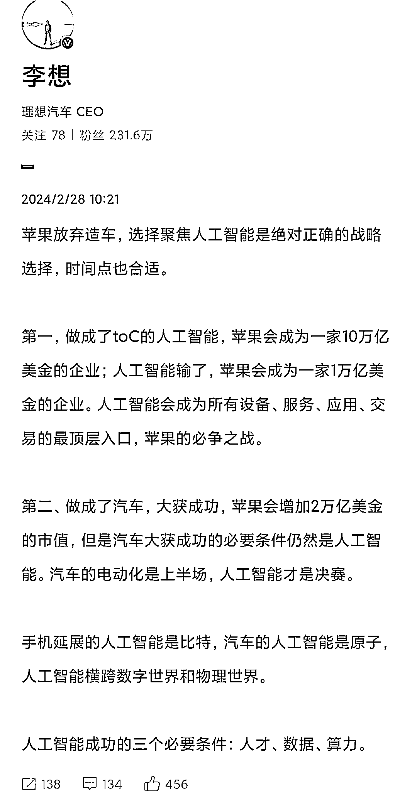

# 想让人工智能真正跑起来？缺一不可的三大底座
作者：龙哥

要评判一家公司、一个团队在 AI 赛道上能走多远，往往看的不是概念多炫，而是能不能把下面这三件事同时拿下：

**顶尖人才、优质数据、充足算力。**

这三者构成了人工智能落地的铁三角，少了任何一个，模型都很难从实验室走向真实应用。

首先是人才。算法和架构再先进，也需要懂得如何用的人。能提出问题、清洗数据、调参优化、评估效果的复合型人才，是把技术转化为产品的关键。

其次是数据。模型本质上是在数据上学习的经验机器。数据量够不够、质量够不够、是否具备代表性和多样性，直接决定了模型上限。没有高质量数据，再好的想法也无从训练。

最后是算力。训练大模型对算力消耗极大，从实验迭代到大规模部署都需要持续的算力支持。没有算力支撑，再多的人才和数据也无法高效运转。

所以，人工智能成功的三个必要条件：人才、数据、算力。

* * *

* * *