# 如何打造你的百万黄金人脉
作者：龙哥

你有没有想过，真正值钱的人脉，不是认识多少人，而是能把关键关系“管理”起来？

过去几年，我就是靠一套自创的“黄金人脉管理法”，帮一位万元客户促成过一笔50万的转介绍订单，也让一家顾问客户在6个月内实现了200万业绩。
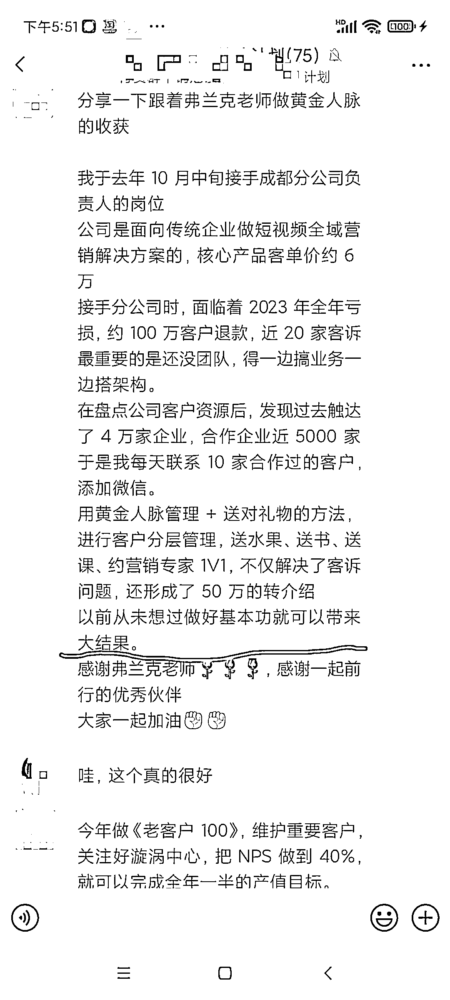

甚至有位武汉老板，因为这套方法加入了赚钱项目合作；还有一次，客户主动转了10万过来。为了这套方法，我还专门申请了知识产权保护。只要你用对，2024年多赚10万到100万，完全有可能。
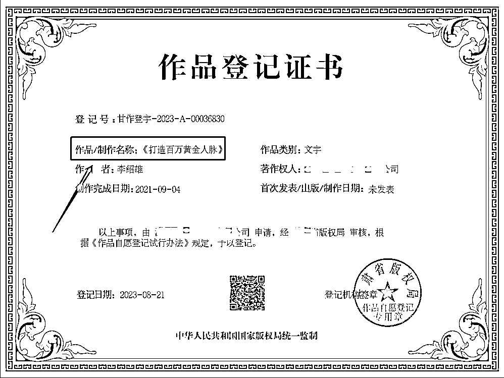

如果觉得这套方法对你有用，想拿去给团队做内部分享，欢迎私信我。或许我们还能有更多交集。

对了，
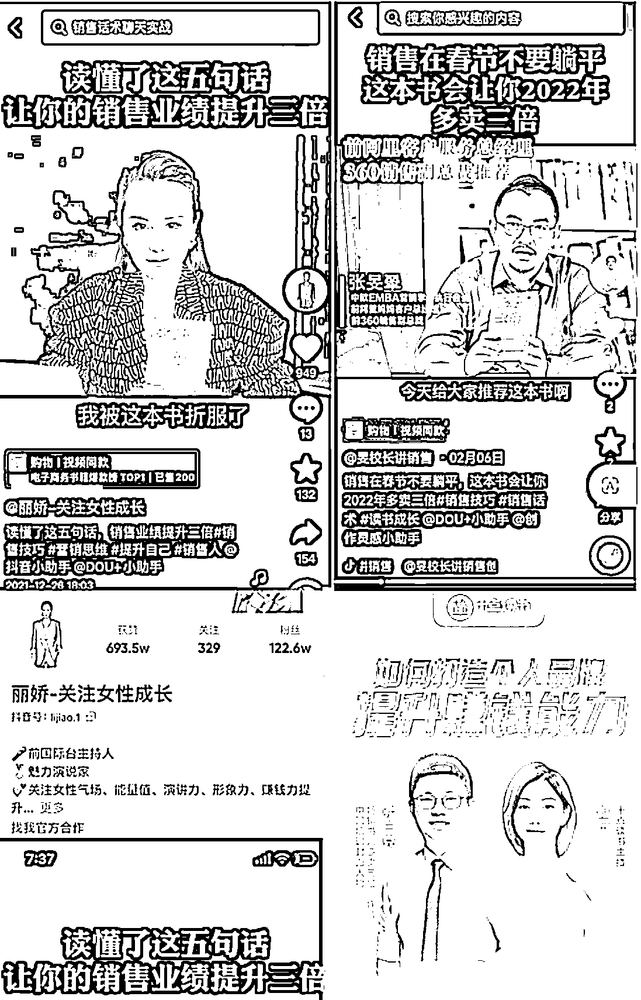

先别急，真正的干货从下面开始。

社交中的三个老毛病，你多半也经历过：群消息刷屏、人脉没有重点、潜在客户被忽略。针对这些高频痛点，我提炼了一套高效打法，既能解放身心，又能业绩翻番、多卖三倍。
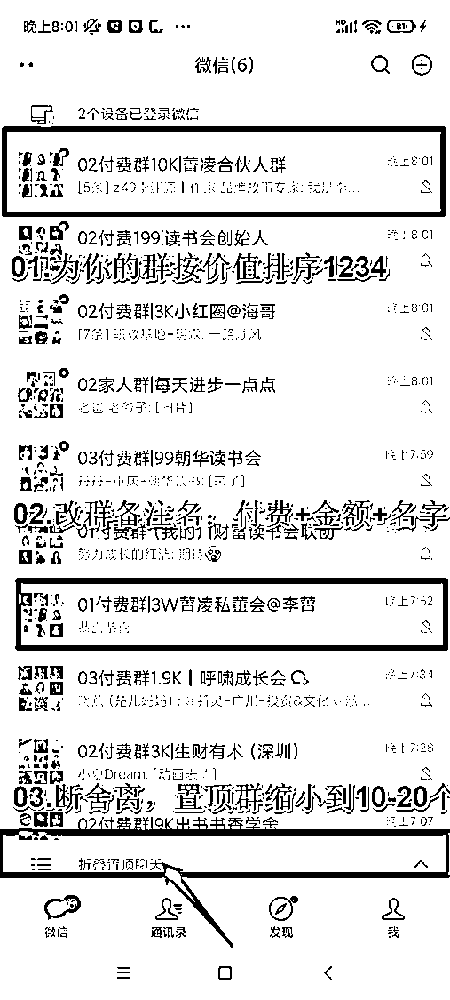

先看第一步——管理你的🛰️群。

有一个公式我很推崇：幸福=健康 X 财富 X 关系。你可以用它给所有群排个优先级：哪些群承载着重要的人，哪些群藏着财富机会，哪些群只是消耗时间。排序之后，你会看见：当群聊跳到顶部，看到编号04，就知道可以忽略；看到01、02，才值得点进去看看发生了什么。

这样做的目的只有一个：把注意力从泛滥的信息里抢回来。

不要在免费群和9.9元的群里耗费太多时间。机会从来不是等来的，而是管理出来的。与此同时，把个人聊天里的置顶全部解除。重要的话说三遍：不再置顶私聊，别让私聊占据你的视线，别让碎片消息绑架你的注意力。完成这一步，你会从信息海洋里上岸，告别999+的未读焦虑，整个人际关系都会轻松很多。
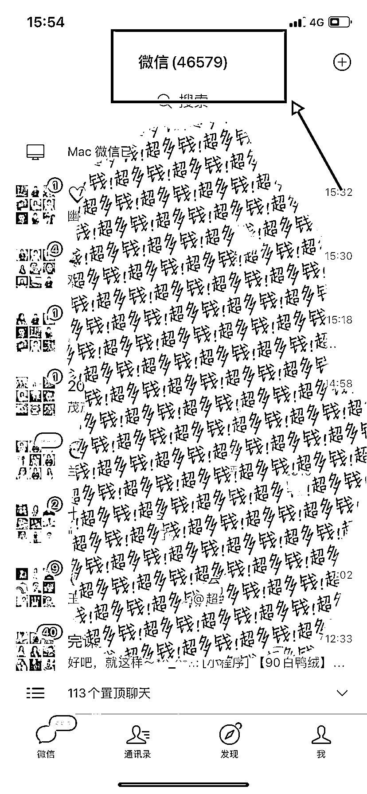

通常，这个整理过程只需要一天。但请记住，这只是1.0版本，是基本功。真正要理解的，是“黄金人脉”的核心——当你开始有意识地管理信息、人脉和注意力，你就能进入百万黄金人脉管理的2.0阶段。
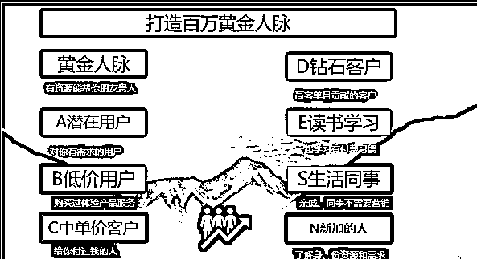

2.0版本，从左到右、从上到下，有三件关键事。

第一，锁定10个黄金人脉，每周去关注他们的动态和需求，逐步建立深度关系。为什么是少数人？因为真正无条件支持你的，往往就那么几个。回想那些帮过你的人，你会发现一个规律：帮过你的人，还会愿意继续帮你。所以，要学会借力、借势、用杠杆，而不是一个人闷头当老黄牛。陌生人社交场上认识的泛泛之交，需要很长时间才能建立信任，真正能撬动资源的，是少数深度关系。这套方法，就是帮你把精力聚焦到那20%的关键人身上。

那么，谁才是你的黄金人脉？
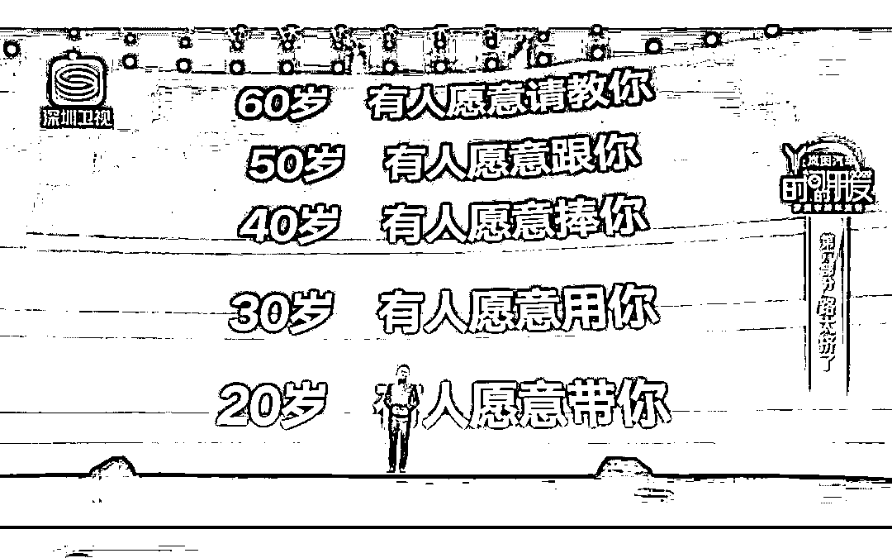
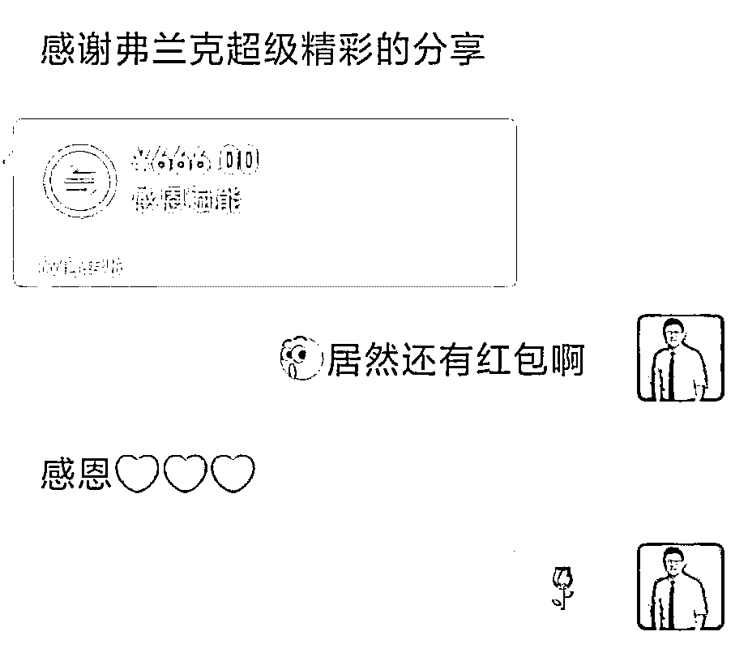

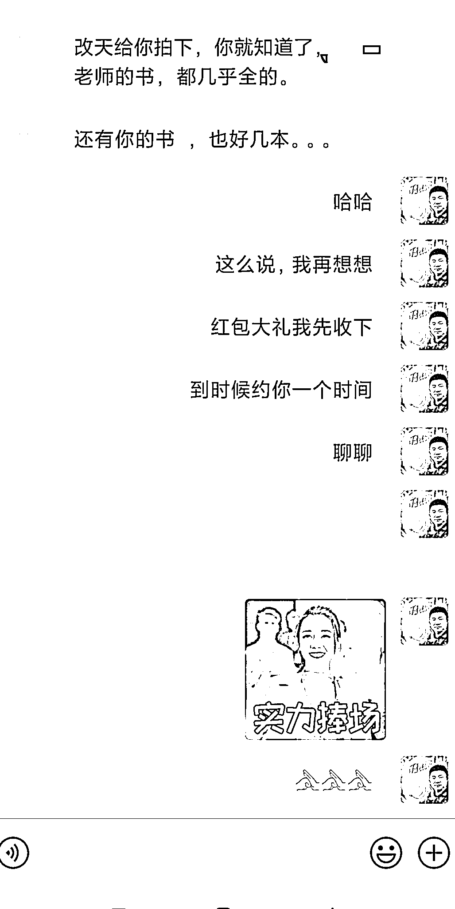

经历得越多越清醒：我最该关注的，是黄金人脉，是孩子，是家庭。所以从2023年2月开始，我发起了一个“#每天帮助一个人”的计划，目标就是我的黄金人脉，以及未来可能成为黄金人脉的人。
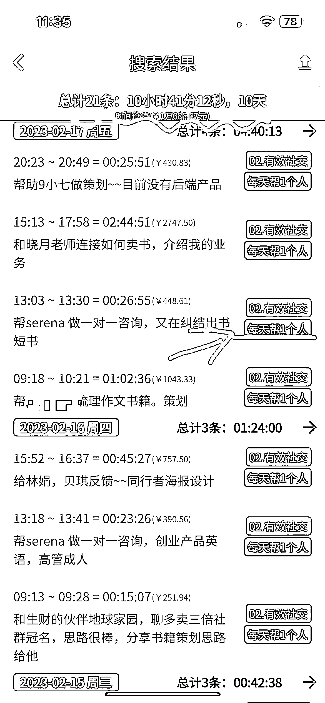

我还在办公室挂了一条横幅，用来时刻提醒自己：不要贪，每天实实在在帮一个人就好。
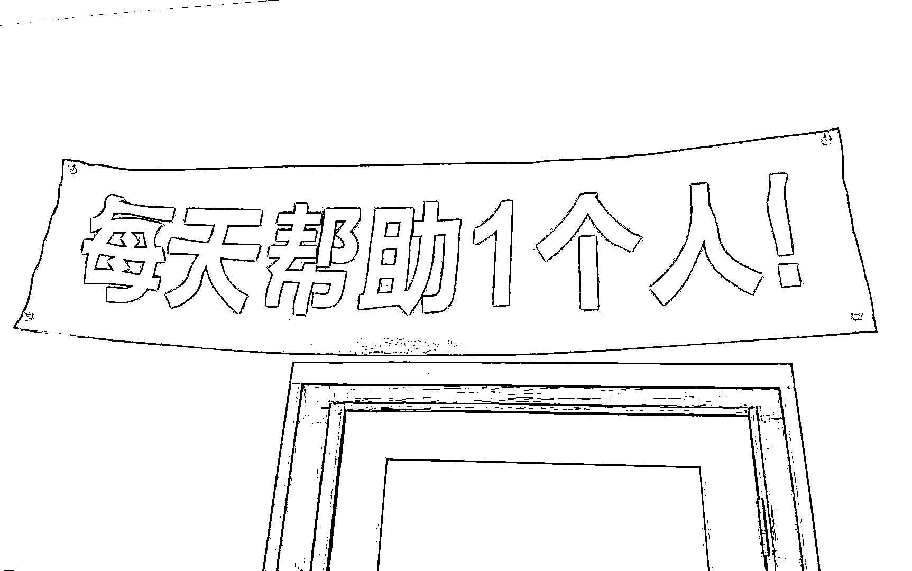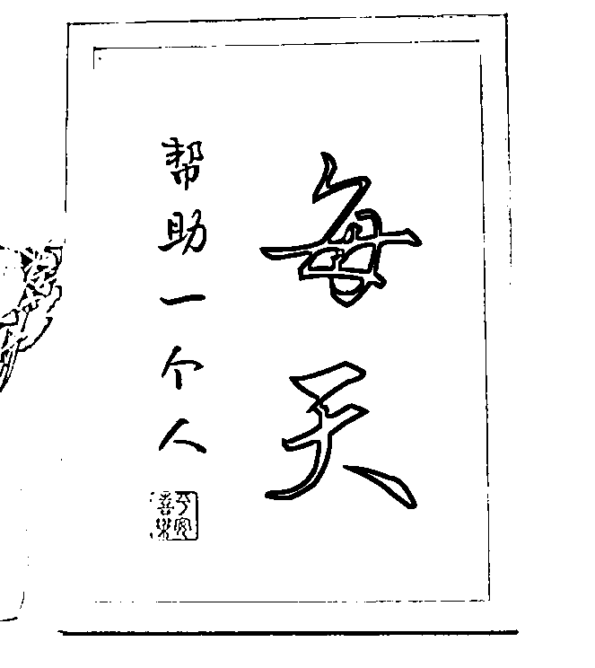

第二，把潜在客户梳理出来。那些咨询过、感兴趣、有需求但还没下单，或者有钱但还没下定决心的人，统统备注好，统一用字母A标记。很多老板忽视了潜在客户，而那个主动打10万的客户，就是这么“管理”出来的——通过自我介绍了解需求，持续分享有用信息，过年送问候，最后水到渠成。现在就去回顾：哪些人曾被忽略？哪些人其实有购买力，只是当初没做决定？把他们都找出来。

第三，给付过费的人做好标记。买过你的书、参加过9.9元活动的人，名字前面加B；
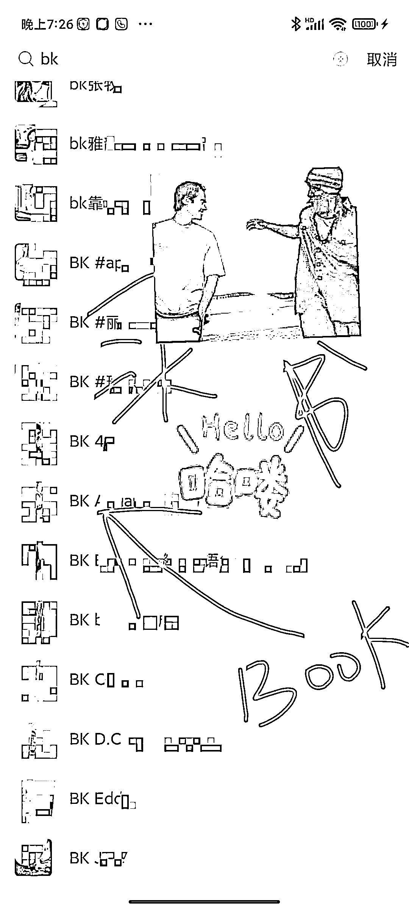

花过几百、几千的，标注C；万元级别的客户，标注D。ABCD是最朴素的管理方式，你当然可以建自己的体系，但逻辑是一样的：用最简单的方式，分清关系的层级。
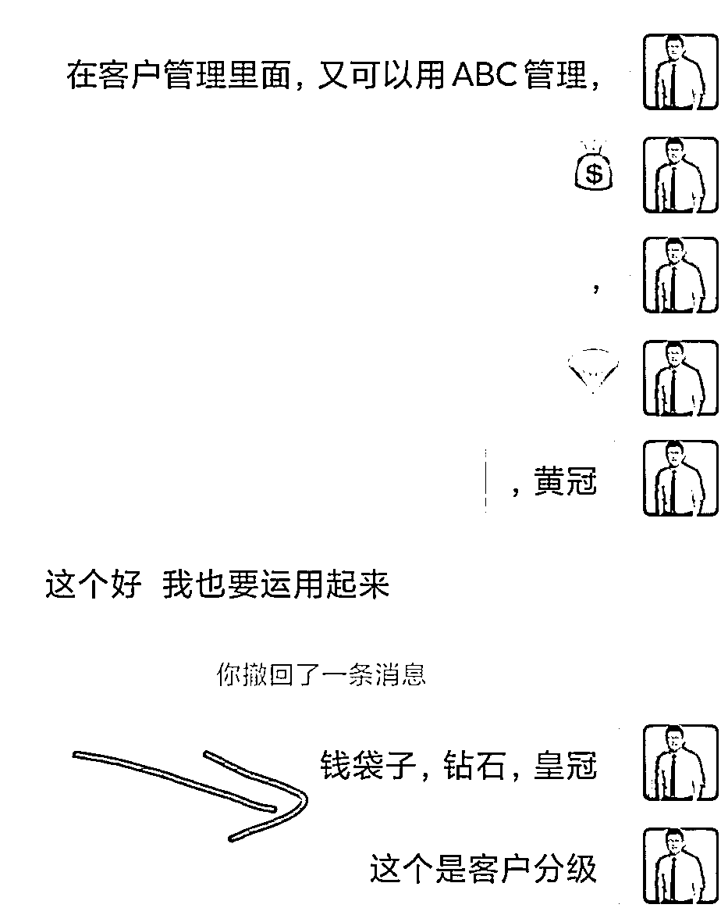

客户管理，永远是公司和团队的核心。以前我也听过很多大团队的管理分享，但要么太复杂，要么水土不服。最后我选择回归本质——盯住两成的关键人和事，用ABCD来管理。至于共同的兴趣爱好、付费学习的圈子，还有新加的好友，建议你在一开始就定好命名规则，然后长期执行，不要频繁改动。

看到这里，有些老板可能心动了。但我要提醒一句：如果你已有自己成熟的体系，别轻易推翻；如果还没有，可以基于我的框架去迭代。比如，有的客户会把生活和生意分成两个🛰️号；有的客户会把所有高付费用户都加到创始人🛰️里亲自维护，其余的交给销售或服务团队。仔细品味一下，百万黄金人脉的底层逻辑，其实就是聚焦——盯住20%的人和事，找到20%的机会，持续做好一件小事。

最后，真心希望你用起来。如果你有更好的方法或方案，欢迎评论区留言，一起交流，一起精进。

评论区已经有不少朋友反馈：“学到了”“受教了”“🛰️一操作，不再焦虑了”……你看，方法的价值在于行动。
